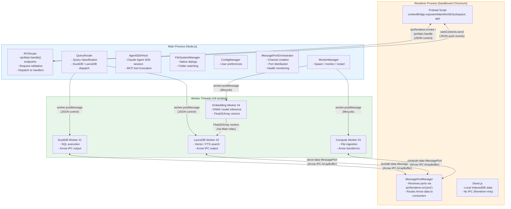

# duckspace: IPC and API Specification

**Document:** ipc-api-spec.md
**Version:** 1.0
**Date:** 2026-02-05
**Status:** Accepted
**Depends on:** [02-Electron Process Model](../design/02-electron-process-model.md), [03-Arrow Data Plane](../design/03-arrow-data-plane.md), [04-Database Integration](../design/04-database-integration.md), [08-Visualization Engine](../design/08-visualization-engine.md), [Data Model Spec](../data-model/data-model-spec.md), [Constitution](../../decomposition/constitution.yaml)
**Feeds into:** Integration Architecture Overview, Integration Cross-Reference Validation

---

## 1. IPC Architecture Overview

duckspace uses a **dual-plane IPC architecture** that separates control messages from data transfer. The control plane carries JSON-serializable commands and responses via Electron's `ipcMain.handle()` / `ipcRenderer.invoke()`. The data plane carries Apache Arrow IPC buffers via direct `MessagePort` channels between Worker Threads and the Renderer Process. This separation enforces Constitution Principle 9 (Arrow-first data flow) while keeping control messages lightweight.

### 1.1 IPC Channel Map



### 1.2 Channel Summary

| Channel | Protocol | Direction | Format | Purpose |
|---------|----------|-----------|--------|---------|
| **Control plane** | `ipcMain.handle()` / `ipcRenderer.invoke()` | Bidirectional (request-response) | JSON | Query submission, catalog operations, configuration, lifecycle |
| **Push events** | `webContents.send()` / `ipcRenderer.on()` | Main -> Renderer (push) | JSON | AI streaming, progress updates, state changes, health alerts |
| **duckdb-data** | `MessagePort` (`MessageChannelMain`) | DuckDB Worker <-> Renderer | Arrow IPC `ArrayBuffer` + JSON envelope | Query results, table metadata |
| **lance-data** | `MessagePort` (`MessageChannelMain`) | LanceDB Worker <-> Renderer | Arrow IPC `ArrayBuffer` + JSON envelope | Vector search results, FTS results |
| **compute-data** | `MessagePort` (`MessageChannelMain`) | Compute Worker <-> Renderer | Arrow IPC `ArrayBuffer` + JSON envelope | Ingestion preview data, export output |
| **Worker control** | `parentPort` / `worker.postMessage()` | Main <-> Workers | JSON | Query dispatch, lifecycle, heartbeat, configuration |
| **Inter-worker relay** | Main Process relay via `parentPort` | Embedding Worker -> LanceDB Worker | `Float32Array` (transferred) | Embedding vectors for storage |

### 1.3 Message Flow Patterns

| Pattern | Mechanism | Use Case | Example |
|---------|-----------|----------|---------|
| **Request-Response** | `ipcRenderer.invoke()` -> `ipcMain.handle()` | Control-plane commands | `duckspace.query.execute(sql)` -> `{ queryId }` |
| **Event Push** | `webContents.send()` -> `ipcRenderer.on()` | Streaming / notifications | AI response chunks, ingestion progress |
| **Data Streaming** | MessagePort with Arrow IPC batches | Query results, search results | Arrow `RecordBatch` chunks with backpressure ACKs |
| **Fire-and-Forget** | `worker.postMessage()` | Heartbeat, non-critical updates | Worker health pings |

---

## 2. Preload Bridge API

The preload script exposes a typed API via `contextBridge.exposeInMainWorld('duckspace', api)`. This is the **sole interface** between the sandboxed Renderer and the privileged Main Process. All methods use `ipcRenderer.invoke()` internally and return Promises. Push events are subscribed via callback registration that wraps `ipcRenderer.on()`.

### 2.1 Complete API Surface

```typescript
/**
 * The complete contextBridge-exposed API.
 * Accessible in the Renderer as `window.duckspace`.
 *
 * All methods return Promises (via ipcRenderer.invoke).
 * Event subscriptions return unsubscribe functions.
 */
interface DuckspaceAPI {
  /** Database query operations */
  query: QueryNamespace;
  /** Vector and full-text search */
  search: SearchNamespace;
  /** Data source catalog management */
  catalog: CatalogNamespace;
  /** AI / Claude Agent operations */
  ai: AINamespace;
  /** Data ingestion operations */
  ingest: IngestNamespace;
  /** Data export and publishing */
  publish: PublishNamespace;
  /** Application configuration */
  config: ConfigNamespace;
  /** Application lifecycle */
  lifecycle: LifecycleNamespace;
  /** Push event subscriptions */
  on: EventNamespace;
}
```

### 2.2 Database Namespace

```typescript
interface QueryNamespace {
  /**
   * Execute a SQL query against DuckDB.
   * Results arrive asynchronously via the duckdb-data MessagePort
   * as Arrow IPC stream chunks.
   *
   * @param sql - SQL string with $1, $2, ... parameter placeholders
   * @param params - Parameter values for binding
   * @returns Promise resolving to the assigned queryId
   *
   * IPC channel: 'query:execute'
   */
  execute(sql: string, params?: unknown[]): Promise<{ queryId: string }>;

  /**
   * Execute a structured query descriptor (UI-driven queries).
   * The QueryRouter compiles the descriptor to parameterized SQL.
   *
   * @param descriptor - Structured query with filters, aggregations, etc.
   * @returns Promise resolving to the assigned queryId
   *
   * IPC channel: 'query:executeStructured'
   */
  executeStructured(descriptor: StructuredQueryDescriptor): Promise<{ queryId: string }>;

  /**
   * Stream query results as an AsyncIterable of Arrow chunks.
   * Wraps the MessagePort-based streaming in an async generator.
   *
   * @param sql - SQL string
   * @param params - Parameter values
   * @returns AsyncIterable yielding ArrowBuffer chunks
   *
   * IPC channel: 'query:execute' + duckdb-data MessagePort
   */
  queryStream(sql: string, params?: unknown[]): AsyncIterable<ArrowChunk>;

  /**
   * Cancel a running query.
   *
   * @param queryId - The queryId returned by execute()
   *
   * IPC channel: 'query:cancel'
   */
  cancel(queryId: string): Promise<void>;

  /**
   * Get schema information for a DuckDB table.
   *
   * @param tableName - DuckDB table name
   * @returns Table schema with column definitions and Arrow type mappings
   *
   * IPC channel: 'query:describeTable'
   */
  getSchema(tableName: string): Promise<TableSchema>;

  /**
   * List all registered tables and views in DuckDB.
   *
   * @returns Array of table info objects
   *
   * IPC channel: 'query:listTables'
   */
  listTables(): Promise<TableInfo[]>;
}
```

### 2.3 Search Namespace

```typescript
interface SearchNamespace {
  /**
   * Execute vector similarity search against LanceDB.
   * Results arrive via the lance-data MessagePort as Arrow IPC.
   *
   * @param query - Natural language query (will be embedded by Embedding Worker)
   * @param topK - Number of results to return
   * @param options - Additional search options (table, filter, etc.)
   * @returns Promise resolving to the assigned searchId
   *
   * IPC channel: 'search:vector'
   */
  vectorSearch(query: string, topK: number, options?: VectorSearchOptions): Promise<SearchResult[]>;

  /**
   * Execute full-text search against LanceDB Tantivy index.
   *
   * @param query - Search query string
   * @param options - FTS options (table, limit, filter)
   * @returns Array of search results as Arrow IPC
   *
   * IPC channel: 'search:fts'
   */
  fullTextSearch(query: string, options: FTSOptions): Promise<SearchResult[]>;

  /**
   * Execute hybrid search combining vector similarity and FTS.
   * Uses Reciprocal Rank Fusion (RRF) to combine scores.
   *
   * @param query - Natural language query (used for both vector and FTS)
   * @param options - Hybrid search options with weighting
   * @returns Combined search results
   *
   * IPC channel: 'search:hybrid'
   */
  hybridSearch(query: string, options: HybridSearchOptions): Promise<SearchResult[]>;
}
```

### 2.4 Data Source Catalog Namespace

```typescript
interface CatalogNamespace {
  /**
   * Register a local file as a data source.
   * Triggers the ingestion pipeline (Compute Worker -> DuckDB Worker).
   *
   * @param path - Absolute file path
   * @param options - Registration options (format override, table name, etc.)
   * @returns Data source ID
   *
   * IPC channel: 'catalog:addLocalSource'
   */
  addLocalSource(path: string, options?: RegisterOptions): Promise<DataSourceId>;

  /**
   * Register a remote data source via a configured connector.
   *
   * @param config - Connector configuration
   * @returns Data source ID
   *
   * IPC channel: 'catalog:addRemoteSource'
   */
  addRemoteSource(config: ConnectorConfig): Promise<DataSourceId>;

  /**
   * Remove a registered data source.
   * Cascades: drops DuckDB table, deletes LanceDB embeddings,
   * removes Dexie.js metadata.
   *
   * @param id - Data source ID
   *
   * IPC channel: 'catalog:removeSource'
   */
  removeSource(id: DataSourceId): Promise<void>;

  /**
   * List all registered data sources.
   *
   * @returns Array of data source metadata
   *
   * IPC channel: 'catalog:listSources'
   */
  listSources(): Promise<DataSource[]>;

  /**
   * Get detailed metadata for a specific data source.
   *
   * @param id - Data source ID
   * @returns Full data source metadata including schema
   *
   * IPC channel: 'catalog:getSource'
   */
  getSource(id: DataSourceId): Promise<DataSource>;

  /**
   * Refresh a data source (re-ingest from original location).
   *
   * @param id - Data source ID
   *
   * IPC channel: 'catalog:refreshSource'
   */
  refreshSource(id: DataSourceId): Promise<void>;
}
```

### 2.5 AI Namespace

```typescript
interface AINamespace {
  /**
   * Send a message to the Claude Agent.
   * Responses stream via the 'ai:stream' push event channel.
   *
   * @param conversationId - Conversation session ID
   * @param message - User message text
   * @returns AsyncIterable of streaming chat chunks
   *
   * IPC channel: 'ai:sendMessage'
   * Push events: 'ai:stream', 'ai:tool-use', 'ai:completed', 'ai:error'
   */
  sendMessage(conversationId: string, message: string): AsyncIterable<ChatChunk>;

  /**
   * Create a new conversation session with the Claude Agent.
   *
   * @returns New conversation metadata
   *
   * IPC channel: 'ai:createConversation'
   */
  createConversation(): Promise<{ conversationId: string }>;

  /**
   * Cancel an in-flight AI response.
   *
   * @param conversationId - Conversation to cancel
   *
   * IPC channel: 'ai:cancelResponse'
   */
  cancelResponse(conversationId: string): Promise<void>;

  /**
   * List all conversation sessions.
   *
   * @returns Array of conversation summaries
   *
   * IPC channel: 'ai:listConversations'
   */
  listConversations(): Promise<Conversation[]>;

  /**
   * Get a specific conversation with message history.
   *
   * @param id - Conversation ID
   * @returns Full conversation with messages
   *
   * IPC channel: 'ai:getConversation'
   */
  getConversation(id: string): Promise<Conversation>;
}
```

### 2.6 Ingestion Namespace

```typescript
interface IngestNamespace {
  /**
   * Start file ingestion via the Compute Worker.
   * Progress updates arrive via 'ingest:progress' push events.
   * Preview data arrives via the compute-data MessagePort.
   *
   * @param filePath - Absolute path to the file
   * @param options - Ingestion options (format, table name, etc.)
   * @returns Job ID for tracking
   *
   * IPC channel: 'ingest:startFile'
   */
  startFile(filePath: string, options?: IngestOptions): Promise<{ jobId: string }>;

  /**
   * Cancel an in-progress ingestion job.
   *
   * @param jobId - Job ID from startFile()
   *
   * IPC channel: 'ingest:cancel'
   */
  cancel(jobId: string): Promise<void>;

  /**
   * Open native file picker dialog.
   * Uses Main Process FileSystemManager (Renderer is sandboxed).
   *
   * @param filters - File type filters for the dialog
   * @returns Array of selected file paths
   *
   * IPC channel: 'ingest:pickFiles'
   */
  pickFiles(filters?: FileFilter[]): Promise<string[]>;

  /**
   * Open native folder picker dialog.
   *
   * @returns Selected folder path, or null if cancelled
   *
   * IPC channel: 'ingest:pickFolder'
   */
  pickFolder(): Promise<string | null>;
}
```

### 2.7 Publishing Namespace

```typescript
interface PublishNamespace {
  /**
   * Export a dashboard to a static format.
   *
   * @param dashboardId - Dashboard to export
   * @param options - Export options (format, quality, etc.)
   * @returns Export result with file path
   *
   * IPC channel: 'publish:exportDashboard'
   */
  exportDashboard(dashboardId: string, options: ExportOptions): Promise<ExportResult>;

  /**
   * Export query results to a file.
   *
   * @param queryId - Query whose results to export
   * @param format - Target format (csv, parquet, json, arrow)
   * @param filePath - Destination file path
   *
   * IPC channel: 'publish:exportData'
   */
  exportData(queryId: string, format: ExportFormat, filePath: string): Promise<void>;

  /**
   * Get available export templates.
   *
   * @returns Array of template definitions
   *
   * IPC channel: 'publish:getTemplates'
   */
  getTemplates(): Promise<Template[]>;

  /**
   * Open native save dialog.
   *
   * @param defaultName - Default file name
   * @param filters - File type filters
   * @returns Selected save path, or null if cancelled
   *
   * IPC channel: 'publish:pickSaveLocation'
   */
  pickSaveLocation(defaultName: string, filters?: FileFilter[]): Promise<string | null>;
}
```

### 2.8 Configuration Namespace

```typescript
interface ConfigNamespace {
  /**
   * Get a configuration value.
   *
   * @param key - Dot-notation config key (e.g., 'memory.duckdbLimit')
   * @returns Configuration value
   *
   * IPC channel: 'config:get'
   */
  get<T = unknown>(key: string): Promise<T>;

  /**
   * Set a configuration value.
   *
   * @param key - Dot-notation config key
   * @param value - New value
   *
   * IPC channel: 'config:set'
   */
  set(key: string, value: unknown): Promise<void>;

  /**
   * Get all configuration values.
   *
   * @returns Full configuration object
   *
   * IPC channel: 'config:getAll'
   */
  getAll(): Promise<Record<string, unknown>>;
}
```

### 2.9 Lifecycle Namespace

```typescript
interface LifecycleNamespace {
  /**
   * Signal that the Renderer is fully initialized and ready.
   * Called after React hydration, Dexie.js open, and MessagePort setup.
   *
   * IPC channel: 'lifecycle:ready'
   */
  ready(): Promise<void>;

  /**
   * Get application version and system information.
   *
   * @returns App info including version, platform, memory stats
   *
   * IPC channel: 'lifecycle:getAppInfo'
   */
  getAppInfo(): Promise<AppInfo>;

  /**
   * Acknowledge shutdown preparation.
   * Called after Dexie.js flush and UI state save.
   *
   * IPC channel: 'lifecycle:shutdownAck'
   */
  shutdownAck(): Promise<void>;
}
```

### 2.10 Event Subscription Namespace

```typescript
interface EventNamespace {
  /**
   * Subscribe to AI streaming response chunks.
   * Events pushed via webContents.send('ai:stream', data).
   *
   * @returns Unsubscribe function
   */
  aiStream(callback: (event: AIStreamEvent) => void): () => void;

  /**
   * Subscribe to AI tool usage events.
   *
   * @returns Unsubscribe function
   */
  aiToolUse(callback: (event: AIToolUseEvent) => void): () => void;

  /**
   * Subscribe to ingestion progress updates.
   *
   * @returns Unsubscribe function
   */
  ingestProgress(callback: (event: IngestProgressEvent) => void): () => void;

  /**
   * Subscribe to query progress updates.
   *
   * @returns Unsubscribe function
   */
  queryProgress(callback: (event: QueryProgressEvent) => void): () => void;

  /**
   * Subscribe to export progress updates.
   *
   * @returns Unsubscribe function
   */
  exportProgress(callback: (event: ExportProgressEvent) => void): () => void;

  /**
   * Subscribe to catalog state changes (source added/updated/removed).
   * Triggered when CatalogSyncBridge pushes metadata updates.
   *
   * @returns Unsubscribe function
   */
  catalogChange(callback: (event: CatalogChangeEvent) => void): () => void;

  /**
   * Subscribe to worker health status changes.
   *
   * @returns Unsubscribe function
   */
  workerStatus(callback: (event: WorkerStatusEvent) => void): () => void;

  /**
   * Subscribe to shutdown preparation signal.
   * Renderer must flush Dexie.js and save UI state, then call lifecycle.shutdownAck().
   *
   * @returns Unsubscribe function
   */
  shutdownPrepare(callback: () => void): () => void;
}
```

### 2.11 Preload Implementation Pattern

```typescript
// preload.ts
import { contextBridge, ipcRenderer, IpcRendererEvent } from 'electron';

contextBridge.exposeInMainWorld('duckspace', {
  // === Query Namespace ===
  query: {
    execute: (sql: string, params?: unknown[]) =>
      ipcRenderer.invoke('query:execute', { sql, params }),
    executeStructured: (descriptor: StructuredQueryDescriptor) =>
      ipcRenderer.invoke('query:executeStructured', descriptor),
    queryStream: (sql: string, params?: unknown[]) => {
      // Returns an AsyncIterable that yields ArrowChunk objects
      // Implementation bridges MessagePort data to async generator
      return createQueryStream(sql, params);
    },
    cancel: (queryId: string) =>
      ipcRenderer.invoke('query:cancel', { queryId }),
    getSchema: (tableName: string) =>
      ipcRenderer.invoke('query:describeTable', { tableName }),
    listTables: () =>
      ipcRenderer.invoke('query:listTables'),
  },

  // === Search Namespace ===
  search: {
    vectorSearch: (query: string, topK: number, options?: VectorSearchOptions) =>
      ipcRenderer.invoke('search:vector', { query, topK, ...options }),
    fullTextSearch: (query: string, options: FTSOptions) =>
      ipcRenderer.invoke('search:fts', { query, ...options }),
    hybridSearch: (query: string, options: HybridSearchOptions) =>
      ipcRenderer.invoke('search:hybrid', { query, ...options }),
  },

  // === Catalog Namespace ===
  catalog: {
    addLocalSource: (path: string, options?: RegisterOptions) =>
      ipcRenderer.invoke('catalog:addLocalSource', { path, ...options }),
    addRemoteSource: (config: ConnectorConfig) =>
      ipcRenderer.invoke('catalog:addRemoteSource', config),
    removeSource: (id: string) =>
      ipcRenderer.invoke('catalog:removeSource', { id }),
    listSources: () =>
      ipcRenderer.invoke('catalog:listSources'),
    getSource: (id: string) =>
      ipcRenderer.invoke('catalog:getSource', { id }),
    refreshSource: (id: string) =>
      ipcRenderer.invoke('catalog:refreshSource', { id }),
  },

  // === AI Namespace ===
  ai: {
    sendMessage: (conversationId: string, message: string) =>
      createAIStream(conversationId, message),
    createConversation: () =>
      ipcRenderer.invoke('ai:createConversation'),
    cancelResponse: (conversationId: string) =>
      ipcRenderer.invoke('ai:cancelResponse', { conversationId }),
    listConversations: () =>
      ipcRenderer.invoke('ai:listConversations'),
    getConversation: (id: string) =>
      ipcRenderer.invoke('ai:getConversation', { id }),
  },

  // === Ingest Namespace ===
  ingest: {
    startFile: (filePath: string, options?: IngestOptions) =>
      ipcRenderer.invoke('ingest:startFile', { filePath, ...options }),
    cancel: (jobId: string) =>
      ipcRenderer.invoke('ingest:cancel', { jobId }),
    pickFiles: (filters?: FileFilter[]) =>
      ipcRenderer.invoke('ingest:pickFiles', { filters }),
    pickFolder: () =>
      ipcRenderer.invoke('ingest:pickFolder'),
  },

  // === Publish Namespace ===
  publish: {
    exportDashboard: (dashboardId: string, options: ExportOptions) =>
      ipcRenderer.invoke('publish:exportDashboard', { dashboardId, ...options }),
    exportData: (queryId: string, format: string, filePath: string) =>
      ipcRenderer.invoke('publish:exportData', { queryId, format, filePath }),
    getTemplates: () =>
      ipcRenderer.invoke('publish:getTemplates'),
    pickSaveLocation: (defaultName: string, filters?: FileFilter[]) =>
      ipcRenderer.invoke('publish:pickSaveLocation', { defaultName, filters }),
  },

  // === Config Namespace ===
  config: {
    get: <T = unknown>(key: string) =>
      ipcRenderer.invoke('config:get', { key }) as Promise<T>,
    set: (key: string, value: unknown) =>
      ipcRenderer.invoke('config:set', { key, value }),
    getAll: () =>
      ipcRenderer.invoke('config:getAll'),
  },

  // === Lifecycle Namespace ===
  lifecycle: {
    ready: () => ipcRenderer.invoke('lifecycle:ready'),
    getAppInfo: () => ipcRenderer.invoke('lifecycle:getAppInfo'),
    shutdownAck: () => ipcRenderer.invoke('lifecycle:shutdownAck'),
  },

  // === Event Subscriptions ===
  on: {
    aiStream: (cb: (e: AIStreamEvent) => void) => {
      const handler = (_: IpcRendererEvent, data: AIStreamEvent) => cb(data);
      ipcRenderer.on('ai:stream', handler);
      return () => ipcRenderer.removeListener('ai:stream', handler);
    },
    aiToolUse: (cb: (e: AIToolUseEvent) => void) => {
      const handler = (_: IpcRendererEvent, data: AIToolUseEvent) => cb(data);
      ipcRenderer.on('ai:tool-use', handler);
      return () => ipcRenderer.removeListener('ai:tool-use', handler);
    },
    ingestProgress: (cb: (e: IngestProgressEvent) => void) => {
      const handler = (_: IpcRendererEvent, data: IngestProgressEvent) => cb(data);
      ipcRenderer.on('ingest:progress', handler);
      return () => ipcRenderer.removeListener('ingest:progress', handler);
    },
    queryProgress: (cb: (e: QueryProgressEvent) => void) => {
      const handler = (_: IpcRendererEvent, data: QueryProgressEvent) => cb(data);
      ipcRenderer.on('query:progress', handler);
      return () => ipcRenderer.removeListener('query:progress', handler);
    },
    exportProgress: (cb: (e: ExportProgressEvent) => void) => {
      const handler = (_: IpcRendererEvent, data: ExportProgressEvent) => cb(data);
      ipcRenderer.on('export:progress', handler);
      return () => ipcRenderer.removeListener('export:progress', handler);
    },
    catalogChange: (cb: (e: CatalogChangeEvent) => void) => {
      const handler = (_: IpcRendererEvent, data: CatalogChangeEvent) => cb(data);
      ipcRenderer.on('catalog:change', handler);
      return () => ipcRenderer.removeListener('catalog:change', handler);
    },
    workerStatus: (cb: (e: WorkerStatusEvent) => void) => {
      const handler = (_: IpcRendererEvent, data: WorkerStatusEvent) => cb(data);
      ipcRenderer.on('worker:status', handler);
      return () => ipcRenderer.removeListener('worker:status', handler);
    },
    shutdownPrepare: (cb: () => void) => {
      const handler = () => cb();
      ipcRenderer.on('shutdown-prepare', handler);
      return () => ipcRenderer.removeListener('shutdown-prepare', handler);
    },
  },
} as DuckspaceAPI);
```

---

## 3. Arrow IPC Message Types

All data-plane messages use Arrow IPC Stream Format (per doc 03, Section 2.1). The JSON envelope travels alongside the Arrow `ArrayBuffer` in the same `postMessage` call, with the buffer in the transfer list for zero-copy ownership transfer.

### 3.1 Query Request (Control Plane)

Sent from Main Process (QueryRouter) to DuckDB Worker or LanceDB Worker via `worker.postMessage()`.

```typescript
/**
 * Request to execute an analytical SQL query.
 * Sent: Main Process -> DuckDB Worker (via parentPort)
 */
interface QueryRequest {
  type: 'execute_query';
  /** UUID assigned by QueryRouter */
  queryId: string;
  /** Parameterized SQL with $1, $2, ... placeholders */
  sql: string;
  /** Parameter values for binding */
  params?: unknown[];
  /** Query execution options */
  options?: {
    /** Query timeout in milliseconds (default: 30000) */
    timeout?: number;
    /** Override default batch size (rows per Arrow RecordBatch) */
    batchSize?: number;
    /** Whether this is a read-only query (default: true for user queries) */
    readOnly?: boolean;
    /** Query priority hint */
    priority?: 'high' | 'normal' | 'low';
  };
}
```

### 3.2 Query Response (Data Plane)

Arrow IPC data sent from Worker to Renderer via MessagePort.

```typescript
/**
 * A single Arrow RecordBatch chunk of query results.
 * Sent: Worker -> Renderer (via MessagePort)
 * Transfer list: [arrowBuffer] (zero-copy ownership move)
 */
interface QueryResponse {
  type: 'arrow-batch';
  /** Correlates with the original QueryRequest.queryId */
  queryId: string;
  /** 0-based batch sequence number */
  index: number;
  /** Total batch count (if known from query planner; null for streaming) */
  totalBatches?: number;
  /** Number of rows in this batch */
  rowCount: number;
  /** Size of the Arrow IPC buffer in bytes */
  byteSize: number;
  /** The Arrow IPC schema is embedded in the first batch's stream header */
}
// Transfer: [arrowBuffer] -- ArrayBuffer containing Arrow IPC stream data
```

### 3.3 Stream Chunk

For streaming queries, each chunk follows the same `QueryResponse` format. The consumer processes chunks incrementally:

```typescript
/**
 * Stream completion marker.
 * Sent: Worker -> Renderer (via MessagePort) after all batches
 */
interface StreamEnd {
  type: 'arrow-end';
  /** Correlates with the original QueryRequest.queryId */
  queryId: string;
  /** Final count of batches sent */
  totalBatches: number;
  /** Total rows across all batches */
  totalRows: number;
  /** Total bytes transferred */
  totalBytes: number;
  /** Query + transfer duration in milliseconds */
  durationMs: number;
}
```

### 3.4 Query Error

```typescript
/**
 * Query execution failure.
 * Sent: Worker -> Renderer (via MessagePort) OR via parentPort -> IPC
 */
interface QueryError {
  type: 'arrow-error';
  /** Correlates with the original QueryRequest.queryId */
  queryId: string;
  /** Error category code (see Section 6 for taxonomy) */
  code: string;
  /** Human-readable error description */
  message: string;
  /** Number of batches already sent before the error */
  batchesSent: number;
}
```

### 3.5 Query Cancel

```typescript
/**
 * Request to cancel a running query.
 * Sent: Renderer -> Worker (via MessagePort, data plane)
 * AND/OR: Main Process -> Worker (via parentPort, control plane)
 */
interface QueryCancel {
  type: 'cancel';
  /** The queryId to cancel */
  queryId: string;
  /** Cancellation reason (optional, for logging) */
  reason?: 'user_cancelled' | 'component_unmounted' | 'timeout' | 'superseded';
}
```

### 3.6 Flow Control (ACK)

```typescript
/**
 * Consumer acknowledges receipt and processing of a batch.
 * Sent: Renderer -> Worker (via MessagePort)
 * Used by: BackpressureController (doc 03, Section 4.2)
 */
interface BatchAck {
  type: 'ack';
  /** Correlates with the QueryResponse.queryId */
  queryId: string;
  /** Batch index being acknowledged */
  index: number;
}
```

### 3.7 Vector Search Request (Control Plane)

```typescript
/**
 * Request for vector similarity search.
 * Sent: Main Process -> LanceDB Worker (via parentPort)
 */
interface VectorSearchRequest {
  type: 'vector_search';
  /** UUID assigned by QueryRouter */
  searchId: string;
  /** LanceDB table to search */
  table: string;
  /** Query vector (384-dim Float32Array for all-MiniLM-L6-v2) */
  vector: Float32Array;
  /** Number of results to return */
  limit: number;
  /** Optional SQL-like filter predicate */
  filter?: string;
}
// Transfer: [vector.buffer] for zero-copy

/**
 * Request for hybrid search (vector + FTS).
 * Sent: Main Process -> LanceDB Worker (via parentPort)
 */
interface HybridSearchRequest {
  type: 'hybrid_search';
  /** UUID */
  searchId: string;
  /** LanceDB table to search */
  table: string;
  /** Natural language query for FTS */
  query: string;
  /** Query vector for similarity search */
  vector: Float32Array;
  /** Number of results to return */
  limit: number;
  /** RRF weighting */
  weights: { vector: number; fts: number };
}
```

---

## 4. Worker Thread Protocols

Each Worker Thread communicates with the Main Process via `parentPort` (control plane) and with the Renderer via a dedicated `MessagePort` (data plane). All workers share a common lifecycle protocol and implement worker-specific operational messages.

### 4.1 Common Worker Lifecycle Protocol

All four Worker Threads implement these messages:

```typescript
// === Lifecycle Messages (all workers) ===

/** Worker -> Main: Worker has completed initialization */
interface WorkerReady {
  type: 'ready';
  worker: 'duckdb' | 'lancedb' | 'compute' | 'embedding';
  /** Optional initialization metadata */
  metadata?: Record<string, unknown>;
}

/** Main -> Worker: Request graceful shutdown */
interface ShutdownRequest {
  type: 'shutdown';
}

/** Worker -> Main: Shutdown complete, safe to terminate */
interface ShutdownComplete {
  type: 'shutdown-complete';
  worker: 'duckdb' | 'lancedb' | 'compute' | 'embedding';
}

/** Main -> Worker: Health check ping */
interface Heartbeat {
  type: 'heartbeat';
  /** Monotonic timestamp for latency measurement */
  sentAt: number;
}

/** Worker -> Main: Health check response */
interface HeartbeatAck {
  type: 'heartbeat_ack';
  /** Echo back the sentAt timestamp */
  sentAt: number;
  /** Worker's view of its health */
  status: 'healthy' | 'degraded' | 'busy';
  /** Optional health details */
  details?: {
    activeQueries?: number;
    memoryUsageMB?: number;
    uptime?: number;
  };
}

/** Main -> Worker: Request memory usage report */
interface MemoryReportRequest {
  type: 'memory_report';
}

/** Worker -> Main: Memory usage response */
interface MemoryReportResponse {
  type: 'memory_report_result';
  worker: string;
  rss: number;
  heapUsed: number;
  heapTotal: number;
  external: number;
  /** Native memory (DuckDB, LanceDB, ONNX) -- worker-specific */
  nativeMemory?: number;
}

/** Main -> Worker: Distribute a MessagePort for data-plane communication */
interface PortAssignment {
  type: 'port';
  /** Channel identifier */
  channel: 'duckdb-data' | 'lance-data' | 'compute-data';
}
// Transfer: [port] -- the MessagePort handle

/** Worker -> Main: Confirm port is set up and listening */
interface PortReady {
  type: 'port-ready';
  channel: string;
}
```

### 4.2 DuckDB Worker (Query Worker) Messages

```typescript
// === DuckDB Worker Operational Messages ===

/** Main -> DuckDB Worker: Execute SQL query */
// See QueryRequest in Section 3.1

/** Main -> DuckDB Worker: Cancel a running query */
interface CancelQueryRequest {
  type: 'cancel_query';
  queryId: string;
}

/** Main -> DuckDB Worker: Register a table from Arrow IPC data */
interface RegisterTableRequest {
  type: 'register_table';
  /** Table name in DuckDB */
  tableName: string;
  /** duckspace source ID */
  sourceId: string;
  /** Registration method */
  method: 'arrow_scan' | 'parquet_view' | 'csv_view';
  /** File path (for view-based registration) */
  filePath?: string;
}
// Transfer: [arrowBuffer] for arrow_scan method

/** Main -> DuckDB Worker: Get table information */
interface GetTableInfoRequest {
  type: 'get_table_info';
  tableName: string;
}

/** DuckDB Worker -> Main: Table info response */
interface GetTableInfoResponse {
  type: 'table_info';
  tableName: string;
  columns: DuckDBColumnInfo[];
  rowCount: number;
  sizeBytes: number;
}

/** DuckDB Worker -> Main: Catalog update after table registration */
interface CatalogUpdateMessage {
  type: 'catalog_update';
  table: string;
  columns: DuckDBColumnInfo[];
  rowCount: number;
  sizeBytes: number;
  sourceId: string;
  registrationType: 'table' | 'view';
}

/** Main -> DuckDB Worker: Drop a registered table */
interface DropTableRequest {
  type: 'drop_table';
  tableName: string;
}

/** Main -> DuckDB Worker: Health check */
interface DuckDBHealthCheck {
  type: 'health_check';
}

/** DuckDB Worker -> Main: Health check response */
interface DuckDBHealthResponse {
  type: 'health_check_result';
  status: 'healthy' | 'degraded' | 'failed';
  tables: number;
  memoryUsedMB: number;
  activeQueries: number;
}

/** Main -> DuckDB Worker: Update configuration */
interface DuckDBConfigUpdate {
  type: 'configure';
  settings: {
    memory_limit?: string;
    threads?: number;
    temp_directory?: string;
  };
}
```

### 4.3 LanceDB Worker Messages

```typescript
// === LanceDB Worker Operational Messages ===

/** Main -> LanceDB Worker: Vector similarity search */
// See VectorSearchRequest in Section 3.7

/** Main -> LanceDB Worker: Full-text search */
interface FTSSearchRequest {
  type: 'fts_search';
  searchId: string;
  table: string;
  query: string;
  limit: number;
  filter?: string;
}

/** Main -> LanceDB Worker: Hybrid search */
// See HybridSearchRequest in Section 3.7

/** LanceDB Worker -> Renderer: Search results */
interface SearchResultMessage {
  type: 'search_result';
  searchId: string;
}
// Transfer: [arrowBuffer] -- Arrow IPC with search results + scores

/** Main -> LanceDB Worker: Add vectors to a table */
interface AddVectorsRequest {
  type: 'add_vectors';
  table: string;
  /** Records to insert (each contains text, vector, metadata) */
  records: {
    id: string;
    sourceId: string;
    contentType: string;
    chunkIndex: number;
    text: string;
    metadata: string;
  }[];
  /** Embedding vectors (parallel array with records) */
  vectors: Float32Array[];
}
// Transfer: vectors[].buffer for zero-copy

/** LanceDB Worker -> Main: Vectors added confirmation */
interface VectorsAddedResponse {
  type: 'vectors_added';
  table: string;
  count: number;
}

/** Main -> LanceDB Worker: Create a new table */
interface CreateTableRequest {
  type: 'create_table';
  name: string;
  schema: LanceDBSchemaDefinition;
}

/** Main -> LanceDB Worker: Create or rebuild vector index */
interface CreateIndexRequest {
  type: 'create_index';
  table: string;
  column: string;
  indexType: 'ivf_flat' | 'ivf_pq' | 'ivf_hnsw_sq';
  params?: Record<string, unknown>;
}

/** Main -> LanceDB Worker: Trigger compaction */
interface OptimizeRequest {
  type: 'optimize';
  table: string;
}

/** Main -> LanceDB Worker: Delete records by filter */
interface DeleteRecordsRequest {
  type: 'delete_records';
  table: string;
  /** SQL-like WHERE predicate */
  filter: string;
}

/** Main -> LanceDB Worker: Get table statistics */
interface GetTableStatsRequest {
  type: 'get_table_stats';
  table: string;
}

/** LanceDB Worker -> Main: Table statistics response */
interface GetTableStatsResponse {
  type: 'table_stats';
  table: string;
  rowCount: number;
  fragmentCount: number;
  indexedRowCount: number;
  indexType: string | null;
}

/** Main -> LanceDB Worker: Health check */
interface LanceDBHealthCheck {
  type: 'health_check';
}

/** LanceDB Worker -> Main: Health check response */
interface LanceDBHealthResponse {
  type: 'health_check_result';
  status: 'healthy' | 'degraded' | 'failed';
  tables: string[];
  totalVectors: number;
}
```

### 4.4 Compute Worker (Ingestion Worker) Messages

```typescript
// === Compute Worker Operational Messages ===

/** Main -> Compute Worker: Ingest a file */
interface IngestFileRequest {
  type: 'ingest_file';
  jobId: string;
  filePath: string;
  /** Override detected format */
  format?: 'csv' | 'parquet' | 'json' | 'ndjson' | 'xlsx' | 'arrow';
  options?: {
    /** CSV delimiter override */
    delimiter?: string;
    /** Whether first row is header */
    header?: boolean;
    /** Maximum rows to ingest (null = all) */
    maxRows?: number;
    /** Target DuckDB table name */
    tableName?: string;
  };
}

/** Compute Worker -> Main: Ingestion progress update */
interface IngestProgressMessage {
  type: 'ingest_progress';
  jobId: string;
  phase: 'detecting' | 'parsing' | 'converting' | 'registering' | 'indexing';
  rowsProcessed: number;
  totalRows?: number;
  bytesProcessed: number;
  totalBytes?: number;
  elapsedMs: number;
}

/** Compute Worker -> Renderer: Ingestion complete with preview */
interface IngestCompleteMessage {
  type: 'ingest_complete';
  jobId: string;
  schema: SchemaInfo;
  rowCount: number;
  sizeBytes: number;
  tableName: string;
}
// Transfer: [previewArrowBuffer] -- first N rows for UI preview

/** Compute Worker -> Main: Ingestion failed */
interface IngestErrorMessage {
  type: 'ingest_error';
  jobId: string;
  error: string;
  code: string;
  phase: string;
  rowsProcessed: number;
}

/** Main -> Compute Worker: Cancel ingestion */
interface CancelIngestRequest {
  type: 'cancel_ingest';
  jobId: string;
}

/** Main -> Compute Worker: Export data to file */
interface ExportDataRequest {
  type: 'export';
  jobId: string;
  format: 'csv' | 'parquet' | 'json' | 'arrow';
  filePath: string;
}
// Transfer: [arrowBuffer] -- data to export

/** Compute Worker -> Main: Export progress */
interface ExportProgressMessage {
  type: 'export_progress';
  jobId: string;
  rowsWritten: number;
  totalRows: number;
  bytesWritten: number;
}

/** Compute Worker -> Main: Export complete */
interface ExportCompleteMessage {
  type: 'export_complete';
  jobId: string;
  filePath: string;
  rowCount: number;
  sizeBytes: number;
}

/** Main -> Compute Worker: Transform Arrow data */
interface TransformRequest {
  type: 'transform';
  jobId: string;
  operations: TransformOperation[];
}
// Transfer: [inputArrowBuffer]
```

### 4.5 Embedding Worker Messages

```typescript
// === Embedding Worker Operational Messages ===

/** Main -> Embedding Worker: Generate embeddings for a batch of texts */
interface EmbedBatchRequest {
  type: 'embed_batch';
  batchId: string;
  texts: string[];
  /** Override default batch size for ONNX inference */
  batchSize?: number;
}

/** Embedding Worker -> Main: Batch embedding results */
interface EmbedBatchResponse {
  type: 'embed_result';
  batchId: string;
  /** Array of 384-dim Float32Array vectors, parallel with input texts */
  vectors: Float32Array[];
}
// Transfer: vectors[].buffer for zero-copy at each hop

/** Main -> Embedding Worker: Generate single embedding */
interface EmbedSingleRequest {
  type: 'embed_single';
  requestId: string;
  text: string;
}

/** Embedding Worker -> Main: Single embedding result */
interface EmbedSingleResponse {
  type: 'embed_single_result';
  requestId: string;
  vector: Float32Array;
}
// Transfer: [vector.buffer]

/** Main -> Embedding Worker: Warm up inference pipeline */
interface WarmupRequest {
  type: 'warmup';
}

/** Embedding Worker -> Main: Warmup complete */
interface WarmupComplete {
  type: 'warmup_complete';
  modelName: string;
  dimensions: number;
  warmupMs: number;
}

/** Embedding Worker -> Main: Embedding progress (for large batches) */
interface EmbedProgressMessage {
  type: 'embed_progress';
  batchId: string;
  processed: number;
  total: number;
  elapsedMs: number;
}
```

---

## 5. Event Bus Messages

Events are pushed from the Main Process to the Renderer via `webContents.send()`. The Renderer subscribes via the `duckspace.on.*` event namespace. Events are fire-and-forget (no acknowledgment required from the Renderer).

### 5.1 Data Source Events

```typescript
/** Emitted when a new data source is registered */
interface SourceAddedEvent {
  event: 'source:added';
  source: {
    id: string;
    name: string;
    type: 'local_file' | 'remote_cache' | 'network_share';
    format: string;
    duckdbName: string;
    rowCount: number;
    status: 'active';
  };
}

/** Emitted when a data source metadata is updated */
interface SourceUpdatedEvent {
  event: 'source:updated';
  sourceId: string;
  changes: Partial<DataSource>;
}

/** Emitted when a data source is removed */
interface SourceRemovedEvent {
  event: 'source:removed';
  sourceId: string;
  reason: 'user_deleted' | 'file_deleted' | 'connector_removed';
}

/** Emitted when a data source encounters an error */
interface SourceErrorEvent {
  event: 'source:error';
  sourceId: string;
  error: string;
  code: string;
}
```

### 5.2 Query Events

```typescript
/** Emitted when a query begins execution */
interface QueryStartedEvent {
  event: 'query:started';
  queryId: string;
  sql: string;
  timestamp: string;
}

/** Emitted periodically during long-running queries */
interface QueryProgressEvent {
  event: 'query:progress';
  queryId: string;
  phase: 'scanning' | 'filtering' | 'aggregating' | 'sorting' | 'streaming';
  rowsScanned?: number;
  rowsFiltered?: number;
  batchesStreamed: number;
  estimatedTotalBatches?: number;
  elapsedMs: number;
}

/** Emitted when a query completes successfully */
interface QueryCompletedEvent {
  event: 'query:completed';
  queryId: string;
  totalRows: number;
  totalBatches: number;
  durationMs: number;
}

/** Emitted when a query fails */
interface QueryErrorEvent {
  event: 'query:error';
  queryId: string;
  code: string;
  message: string;
}
```

### 5.3 Ingestion Events

```typescript
/** Emitted when file ingestion begins */
interface IngestionStartedEvent {
  event: 'ingestion:started';
  jobId: string;
  filePath: string;
  format: string;
  timestamp: string;
}

/** Emitted periodically during ingestion */
interface IngestionProgressEvent {
  event: 'ingestion:progress';
  jobId: string;
  phase: 'detecting' | 'parsing' | 'converting' | 'registering' | 'indexing';
  rowsProcessed: number;
  totalRows?: number;
  percentComplete?: number;
  elapsedMs: number;
}

/** Emitted when ingestion completes */
interface IngestionCompletedEvent {
  event: 'ingestion:completed';
  jobId: string;
  sourceId: string;
  tableName: string;
  rowCount: number;
  durationMs: number;
}

/** Emitted when ingestion fails */
interface IngestionErrorEvent {
  event: 'ingestion:error';
  jobId: string;
  error: string;
  code: string;
  phase: string;
}
```

### 5.4 AI Events

```typescript
/** Emitted for each streaming chunk of an AI response */
interface AIStreamingEvent {
  event: 'ai:streaming';
  conversationId: string;
  messageId: string;
  /** Incremental text content (append to previous chunks) */
  delta: string;
  /** Whether this is the final chunk */
  done: boolean;
}

/** Emitted when the AI invokes an MCP tool */
interface AIToolUseEvent {
  event: 'ai:tool-use';
  conversationId: string;
  messageId: string;
  toolName: string;
  toolInput: Record<string, unknown>;
}

/** Emitted when an MCP tool execution completes */
interface AIToolResultEvent {
  event: 'ai:tool-result';
  conversationId: string;
  messageId: string;
  toolName: string;
  result: unknown;
  isError: boolean;
}

/** Emitted when the complete AI response is finished */
interface AICompletedEvent {
  event: 'ai:completed';
  conversationId: string;
  messageId: string;
  totalTokens?: number;
}

/** Emitted on AI response failure */
interface AIErrorEvent {
  event: 'ai:error';
  conversationId: string;
  error: string;
  code: string;
  retryable: boolean;
}
```

### 5.5 Worker Health Events

```typescript
/** Emitted when a worker's health status changes */
interface WorkerStatusEvent {
  event: 'worker:status';
  worker: 'duckdb' | 'lancedb' | 'compute' | 'embedding';
  status: 'ready' | 'busy' | 'degraded' | 'restarting' | 'failed';
  restartCount?: number;
  /** Details about the status change */
  message?: string;
}
```

### 5.6 Catalog Sync Events

```typescript
/**
 * Emitted by CatalogSyncBridge when metadata should be written to Dexie.js.
 * The Renderer processes these to keep Dexie.js in sync with DuckDB/LanceDB state.
 */
interface CatalogChangeEvent {
  event: 'catalog:change';
  /** Dexie.js collection name to update */
  collection: string;
  /** CRUD action */
  action: 'put' | 'add' | 'delete' | 'bulkPut' | 'bulkDelete';
  /** Data payload (for put/add/bulkPut) */
  data?: Record<string, unknown> | Record<string, unknown>[];
  /** Key(s) for delete operations */
  key?: string;
  keys?: string[];
}
```

---

## 6. Error Codes and Handling

### 6.1 Error Code Taxonomy

All errors returned via IPC (both control plane and data plane) use a structured error code format: `E{category}{sequence}`.

| Code Range | Category | Description |
|-----------|----------|-------------|
| `E1xxx` | Database (DuckDB) | SQL errors, query failures, connection issues |
| `E2xxx` | Connector / Remote | Network errors, authentication failures, rate limits |
| `E3xxx` | AI / Agent | Claude Agent SDK errors, MCP tool failures |
| `E4xxx` | Ingestion | File parsing errors, format detection failures |
| `E5xxx` | Search (LanceDB) | Vector search errors, index failures, FTS errors |
| `E6xxx` | System | Worker crashes, memory exhaustion, IPC failures |
| `E7xxx` | Export / Publishing | File write errors, format conversion failures |
| `E8xxx` | Configuration | Invalid settings, permission errors |
| `E9xxx` | Validation | Invalid input, schema mismatch, constraint violation |

### 6.2 Detailed Error Codes

#### E1xxx: Database Errors

| Code | Name | Description | Retryable |
|------|------|-------------|-----------|
| `E1001` | `QUERY_SYNTAX_ERROR` | SQL syntax error | No |
| `E1002` | `QUERY_TIMEOUT` | Query exceeded timeout limit | Yes |
| `E1003` | `QUERY_CANCELLED` | Query cancelled by user or system | No |
| `E1004` | `TABLE_NOT_FOUND` | Referenced table does not exist | No |
| `E1005` | `COLUMN_NOT_FOUND` | Referenced column does not exist | No |
| `E1006` | `TYPE_MISMATCH` | Parameter type does not match column type | No |
| `E1007` | `OUT_OF_MEMORY` | DuckDB memory limit exceeded (spill failed) | Yes (with reduced scope) |
| `E1008` | `DISK_FULL` | Temp directory or database file disk full | No |
| `E1009` | `CONCURRENT_WRITE` | Write conflict (single-writer lock held) | Yes (after delay) |
| `E1010` | `DATABASE_CORRUPT` | DuckDB integrity check failed | No |
| `E1011` | `EXTENSION_ERROR` | DuckDB extension load or execution failure | No |
| `E1012` | `MUTATION_REJECTED` | DDL/DML rejected for user query (readOnly enforcement) | No |

#### E2xxx: Connector Errors

| Code | Name | Description | Retryable |
|------|------|-------------|-----------|
| `E2001` | `NETWORK_ERROR` | Network request failed (DNS, connection refused) | Yes |
| `E2002` | `AUTH_FAILED` | Authentication credentials invalid or expired | No |
| `E2003` | `RATE_LIMITED` | API rate limit exceeded | Yes (with backoff) |
| `E2004` | `TIMEOUT` | Remote request timed out | Yes |
| `E2005` | `NOT_FOUND` | Remote resource not found (404) | No |
| `E2006` | `PERMISSION_DENIED` | Insufficient permissions for requested resource | No |
| `E2007` | `SCHEMA_MISMATCH` | Remote schema changed since last fetch | Yes (re-detect) |
| `E2008` | `CONNECTOR_NOT_CONFIGURED` | No connector config for requested type | No |

#### E3xxx: AI Errors

| Code | Name | Description | Retryable |
|------|------|-------------|-----------|
| `E3001` | `AGENT_SESSION_ERROR` | Claude Agent SDK session initialization failed | Yes |
| `E3002` | `AGENT_RESPONSE_ERROR` | AI response generation failed | Yes |
| `E3003` | `TOOL_EXECUTION_ERROR` | MCP tool invocation failed | No (tool-specific) |
| `E3004` | `CONTEXT_OVERFLOW` | Conversation context exceeded window limit | No (auto-managed) |
| `E3005` | `AGENT_CANCELLED` | AI response cancelled by user | No |
| `E3006` | `EMBEDDING_ERROR` | Embedding generation failed | Yes |
| `E3007` | `MODEL_NOT_LOADED` | Embedding model not yet initialized | Yes (queue) |

#### E4xxx: Ingestion Errors

| Code | Name | Description | Retryable |
|------|------|-------------|-----------|
| `E4001` | `FORMAT_DETECTION_FAILED` | Cannot detect file format | No |
| `E4002` | `PARSE_ERROR` | File parsing failed (malformed CSV, invalid JSON) | No |
| `E4003` | `SCHEMA_EXTRACTION_FAILED` | Cannot extract column schema from file | No |
| `E4004` | `FILE_NOT_FOUND` | Source file does not exist | No |
| `E4005` | `FILE_TOO_LARGE` | File exceeds maximum ingestion size | No |
| `E4006` | `UNSUPPORTED_FORMAT` | File format not supported for ingestion | No |
| `E4007` | `INGESTION_CANCELLED` | Ingestion cancelled by user | No |
| `E4008` | `REGISTRATION_FAILED` | DuckDB table registration failed after parsing | Yes |

#### E5xxx: Search Errors

| Code | Name | Description | Retryable |
|------|------|-------------|-----------|
| `E5001` | `TABLE_NOT_FOUND` | LanceDB table does not exist | No |
| `E5002` | `INDEX_NOT_BUILT` | Vector index not yet built for this table | Yes (build index first) |
| `E5003` | `VECTOR_DIMENSION_MISMATCH` | Query vector dimension does not match index | No |
| `E5004` | `FTS_INDEX_ERROR` | Full-text search index failure | Yes |
| `E5005` | `SEARCH_TIMEOUT` | Search exceeded timeout limit | Yes |
| `E5006` | `COMPACTION_ERROR` | Table compaction/optimization failed | Yes |

#### E6xxx: System Errors

| Code | Name | Description | Retryable |
|------|------|-------------|-----------|
| `E6001` | `WORKER_CRASHED` | Worker thread terminated unexpectedly | Yes (auto-restart) |
| `E6002` | `WORKER_UNRESPONSIVE` | Worker failed heartbeat check | Yes (restart) |
| `E6003` | `IPC_TIMEOUT` | IPC request timed out (30s default) | Yes |
| `E6004` | `PORT_DISCONNECTED` | MessagePort channel disconnected | Yes (recreate) |
| `E6005` | `MEMORY_PRESSURE` | System memory pressure detected | Yes (after eviction) |
| `E6006` | `SHUTTING_DOWN` | Operation rejected because app is shutting down | No |

### 6.3 Error Response Format

All IPC error responses use a consistent format:

```typescript
/**
 * Standard error response for all IPC channels.
 * Returned by ipcMain.handle() rejection or via MessagePort error messages.
 */
interface IPCError {
  /** Structured error code (E1xxx - E9xxx) */
  code: string;
  /** Human-readable error message */
  message: string;
  /** Whether the client should retry this operation */
  retryable: boolean;
  /** Suggested retry delay in milliseconds (present if retryable) */
  retryAfterMs?: number;
  /** Additional context for debugging */
  details?: Record<string, unknown>;
  /** Stack trace (development mode only) */
  stack?: string;
}
```

### 6.4 Error Handling Patterns

```typescript
// Main Process: ipcMain.handle error wrapping
ipcMain.handle('query:execute', async (event, { sql, params }) => {
  try {
    const queryId = crypto.randomUUID();
    await queryRouter.dispatch('duckdb', {
      type: 'execute_query', queryId, sql, params
    });
    return { queryId };
  } catch (error) {
    throw {
      code: classifyError(error),
      message: error.message,
      retryable: isRetryable(error),
      retryAfterMs: getRetryDelay(error),
    } as IPCError;
  }
});

// Renderer: Error handling in preload bridge consumer
try {
  const { queryId } = await window.duckspace.query.execute(sql, params);
} catch (error) {
  const ipcError = error as IPCError;
  if (ipcError.retryable && ipcError.retryAfterMs) {
    // Schedule retry with backoff
    setTimeout(() => retryQuery(sql, params), ipcError.retryAfterMs);
  } else {
    // Display error to user
    showErrorNotification(ipcError.code, ipcError.message);
  }
}
```

---

## 7. Type Definitions

All types used across IPC boundaries are defined here. These types are shared between the Main Process, Worker Threads, and the Renderer (via the Preload Bridge).

### 7.1 Core Identifiers

```typescript
/** UUID string for data source identification */
type DataSourceId = string;

/** UUID string for query tracking */
type QueryId = string;

/** UUID string for search tracking */
type SearchId = string;

/** UUID string for conversation identification */
type ConversationId = string;

/** UUID string for ingestion job tracking */
type JobId = string;
```

### 7.2 Arrow-Related Types

```typescript
/**
 * Arrow IPC buffer.
 * Contains serialized Arrow IPC Stream data (schema + record batches).
 */
type ArrowBuffer = ArrayBuffer;

/**
 * A single chunk of an Arrow IPC stream.
 * Used by the queryStream() AsyncIterable API.
 */
interface ArrowChunk {
  /** Arrow IPC ArrayBuffer containing one or more RecordBatches */
  buffer: ArrowBuffer;
  /** Batch index in the stream */
  index: number;
  /** Number of rows in this chunk */
  rowCount: number;
  /** Whether this is the last chunk */
  isLast: boolean;
}

/**
 * Table schema information with Arrow type mappings.
 * Returned by query.getSchema().
 */
interface TableSchema {
  /** DuckDB table name */
  tableName: string;
  /** DuckDB schema (always 'main') */
  schemaName: string;
  /** Column definitions */
  columns: ColumnDefinition[];
  /** Estimated row count */
  rowCount: number;
  /** Estimated storage size */
  sizeBytes: number;
}

/**
 * Column definition with DuckDB and Arrow type information.
 */
interface ColumnDefinition {
  /** Column name */
  name: string;
  /** DuckDB type (VARCHAR, INTEGER, DECIMAL(10,2), TIMESTAMP, etc.) */
  duckdbType: string;
  /** Arrow type (Utf8, Int32, Float64, Timestamp(us, UTC), etc.) */
  arrowType: string;
  /** Whether column allows NULL values */
  nullable: boolean;
  /** Position in table (0-based) */
  ordinalPosition: number;
}

/**
 * Table info summary.
 * Returned by query.listTables().
 */
interface TableInfo {
  /** Table or view name */
  name: string;
  /** 'table' for persistent tables, 'view' for SQL views */
  type: 'table' | 'view';
  /** Number of columns */
  columnCount: number;
  /** Estimated row count */
  rowCount: number;
  /** Estimated storage size */
  sizeBytes: number;
  /** duckspace source ID (if registered) */
  sourceId?: string;
}
```

### 7.3 Query Descriptor Types

```typescript
/**
 * Structured query descriptor for UI-driven queries.
 * Compiled to parameterized SQL by the QueryRouter.
 * (Defined in doc 03, Section 3.2)
 */
interface StructuredQueryDescriptor {
  type: 'structured';
  source: {
    table: string;
    schema?: string;
  };
  columns?: string[];
  filters?: FilterExpression[];
  aggregations?: AggregationSpec[];
  groupBy?: string[];
  orderBy?: OrderBySpec[];
  limit?: number;
  offset?: number;
  options?: QueryOptions;
}

interface FilterExpression {
  column: string;
  operator: 'eq' | 'neq' | 'gt' | 'gte' | 'lt' | 'lte' |
            'in' | 'not_in' | 'like' | 'ilike' |
            'between' | 'is_null' | 'is_not_null';
  value?: unknown;
  values?: unknown[];
}

interface AggregationSpec {
  function: 'count' | 'sum' | 'avg' | 'min' | 'max' |
            'median' | 'stddev' | 'variance' |
            'percentile_cont' | 'percentile_disc' |
            'count_distinct' | 'list_agg';
  column: string;
  alias?: string;
  params?: unknown[];
}

interface OrderBySpec {
  column: string;
  direction: 'asc' | 'desc';
  nulls?: 'first' | 'last';
}

interface QueryOptions {
  timeout?: number;
  batchSize?: number;
  priority?: 'high' | 'normal' | 'low';
}
```

### 7.4 Search Types

```typescript
interface VectorSearchOptions {
  /** LanceDB table to search (default: 'document_embeddings') */
  table?: string;
  /** SQL-like filter predicate */
  filter?: string;
  /** Content type filter */
  contentType?: 'schema' | 'column' | 'query' | 'analysis' | 'sample';
}

interface FTSOptions {
  /** LanceDB table to search */
  table?: string;
  /** Maximum results to return */
  limit?: number;
  /** SQL-like filter predicate */
  filter?: string;
}

interface HybridSearchOptions {
  /** LanceDB table to search */
  table?: string;
  /** Maximum results to return */
  limit?: number;
  /** Weighting between vector and FTS scores */
  weights?: { vector: number; fts: number };
  /** SQL-like filter predicate */
  filter?: string;
}

interface SearchResult {
  /** Record ID */
  id: string;
  /** Source data source ID */
  sourceId: string;
  /** Original text content */
  text: string;
  /** Content type */
  contentType: string;
  /** Similarity/relevance score (0-1, lower is more similar for L2) */
  score: number;
  /** Additional metadata */
  metadata?: Record<string, unknown>;
}
```

### 7.5 Data Source Types

```typescript
interface DataSource {
  id: string;
  name: string;
  type: 'local_file' | 'remote_cache' | 'network_share';
  format: string;
  pathOrUrl: string;
  duckdbName: string;
  registrationType: 'table' | 'view';
  status: 'active' | 'stale' | 'error' | 'removed' | 'ingesting';
  rowCount: number;
  sizeBytes: number;
  createdAt: string;
  updatedAt: string;
  tags: string[];
  errorMessage?: string;
}

interface RegisterOptions {
  /** Override table name (default: derived from filename) */
  tableName?: string;
  /** Override format detection */
  format?: string;
  /** CSV-specific options */
  delimiter?: string;
  header?: boolean;
}

interface ConnectorConfig {
  id: string;
  type: string;
  name: string;
  settings: Record<string, unknown>;
  credentialId: string;
  category: 'cloud_storage' | 'database' | 'saas_analytics';
}
```

### 7.6 AI Types

```typescript
interface Conversation {
  id: string;
  sessionId: string;
  label: string;
  createdAt: string;
  updatedAt: string;
  status: 'active' | 'archived';
  turnCount: number;
  summary?: string;
}

interface ChatChunk {
  /** Incremental text delta (append to previous) */
  delta: string;
  /** Whether this is the final chunk */
  done: boolean;
  /** Message ID for this response */
  messageId: string;
  /** Set if this chunk represents tool usage */
  toolUse?: {
    toolName: string;
    toolInput: Record<string, unknown>;
  };
  /** Set if this chunk represents a tool result */
  toolResult?: {
    toolName: string;
    result: unknown;
    isError: boolean;
  };
}
```

### 7.7 Ingestion Types

```typescript
interface IngestOptions {
  /** Override detected format */
  format?: string;
  /** Override table name */
  tableName?: string;
  /** CSV-specific options */
  delimiter?: string;
  header?: boolean;
  /** Maximum rows to ingest */
  maxRows?: number;
}

interface FileFilter {
  name: string;
  extensions: string[];
}

interface SchemaInfo {
  columns: ColumnDefinition[];
  rowCount: number;
  detectedFormat: string;
}
```

### 7.8 Export Types

```typescript
type ExportFormat = 'csv' | 'parquet' | 'json' | 'arrow' | 'png' | 'svg' | 'html';

interface ExportOptions {
  format: ExportFormat;
  quality?: 'draft' | 'standard' | 'high';
  /** Include chart images (for dashboard export) */
  includeCharts?: boolean;
  /** Template ID to use */
  templateId?: string;
}

interface ExportResult {
  filePath: string;
  format: ExportFormat;
  sizeBytes: number;
}

interface Template {
  id: string;
  name: string;
  description: string;
  format: ExportFormat;
  thumbnail?: string;
}
```

### 7.9 Event Types

```typescript
interface IngestProgressEvent {
  jobId: string;
  phase: string;
  rowsProcessed: number;
  totalRows?: number;
  percentComplete?: number;
}

interface ExportProgressEvent {
  jobId: string;
  rowsWritten: number;
  totalRows: number;
  percentComplete: number;
}

interface WorkerStatusEvent {
  worker: 'duckdb' | 'lancedb' | 'compute' | 'embedding';
  status: 'ready' | 'busy' | 'degraded' | 'restarting' | 'failed';
  restartCount?: number;
  message?: string;
}

interface AIStreamEvent {
  conversationId: string;
  messageId: string;
  delta: string;
  done: boolean;
}

interface AIToolUseEvent {
  conversationId: string;
  messageId: string;
  toolName: string;
  toolInput: Record<string, unknown>;
}

interface CatalogChangeEvent {
  collection: string;
  action: 'put' | 'add' | 'delete' | 'bulkPut' | 'bulkDelete';
  data?: Record<string, unknown> | Record<string, unknown>[];
  key?: string;
  keys?: string[];
}

interface AppInfo {
  version: string;
  electronVersion: string;
  platform: string;
  arch: string;
  userDataPath: string;
  memory: {
    total: number;
    free: number;
    duckdbLimit: string;
  };
  workers: {
    duckdb: 'ready' | 'degraded' | 'failed';
    lancedb: 'ready' | 'degraded' | 'failed';
    compute: 'ready' | 'degraded' | 'failed';
    embedding: 'ready' | 'degraded' | 'failed';
  };
}
```

### 7.10 Arrow Schema Type Mappings

This table maps DuckDB types through Arrow to JavaScript, as used across all IPC boundaries (from doc 03, Section 5.2):

| DuckDB Type | Arrow Type | Arrow JS Class | JavaScript Type | IPC Serialization |
|------------|-----------|---------------|----------------|-------------------|
| `BOOLEAN` | `Bool` | `Bool` | `boolean` | Arrow IPC (1 bit/value) |
| `TINYINT` | `Int8` | `Int8` | `number` | Arrow IPC (Int8Array) |
| `SMALLINT` | `Int16` | `Int16` | `number` | Arrow IPC (Int16Array) |
| `INTEGER` | `Int32` | `Int32` | `number` | Arrow IPC (Int32Array) |
| `BIGINT` | `Int64` | `Int64` | `bigint` | Arrow IPC (BigInt64Array) |
| `FLOAT` | `Float32` | `Float32` | `number` | Arrow IPC (Float32Array) |
| `DOUBLE` | `Float64` | `Float64` | `number` | Arrow IPC (Float64Array) |
| `DECIMAL(p,s)` | `Decimal128` | `Decimal` | `string` | Arrow IPC (128-bit) |
| `VARCHAR` | `Utf8` | `Utf8` | `string` | Arrow IPC (offset + data) |
| `BLOB` | `Binary` | `Binary` | `Uint8Array` | Arrow IPC (offset + data) |
| `DATE` | `Date32` | `DateDay` | `number` (epoch days) | Arrow IPC (Int32) |
| `TIMESTAMP` | `Timestamp(us, UTC)` | `TimestampMicrosecond` | `number` (ms epoch) | Arrow IPC (Int64) |
| `UUID` | `FixedSizeBinary(16)` | `FixedSizeBinary` | `Uint8Array` | Arrow IPC (16 bytes) |
| `LIST(T)` | `List(T)` | `List` | `Array` | Arrow IPC (nested) |
| `STRUCT(...)` | `Struct(...)` | `Struct` | `object` | Arrow IPC (nested) |
| `JSON` | `Utf8` | `Utf8` | `string` | Arrow IPC (as UTF-8) |
| `ENUM(...)` | `Dictionary(Int32, Utf8)` | `Dictionary` | `string` | Arrow IPC (dictionary-encoded) |

---

## 8. IPC Channel Registry

Complete listing of all `ipcMain.handle()` channels registered by the Main Process:

| Channel | Handler | Request Payload | Response Payload |
|---------|---------|----------------|------------------|
| `query:execute` | QueryRouter | `{ sql, params? }` | `{ queryId }` |
| `query:executeStructured` | QueryRouter | `StructuredQueryDescriptor` | `{ queryId }` |
| `query:cancel` | QueryRouter | `{ queryId }` | `void` |
| `query:describeTable` | QueryRouter | `{ tableName }` | `TableSchema` |
| `query:listTables` | QueryRouter | (none) | `TableInfo[]` |
| `search:vector` | QueryRouter | `{ query, topK, ...options }` | `SearchResult[]` |
| `search:fts` | QueryRouter | `{ query, ...options }` | `SearchResult[]` |
| `search:hybrid` | QueryRouter | `{ query, ...options }` | `SearchResult[]` |
| `catalog:addLocalSource` | FileSystemManager + Ingestion | `{ path, ...options }` | `DataSourceId` |
| `catalog:addRemoteSource` | ConnectorManager | `ConnectorConfig` | `DataSourceId` |
| `catalog:removeSource` | DatabaseManager | `{ id }` | `void` |
| `catalog:listSources` | CatalogSyncBridge | (none) | `DataSource[]` |
| `catalog:getSource` | CatalogSyncBridge | `{ id }` | `DataSource` |
| `catalog:refreshSource` | Ingestion Pipeline | `{ id }` | `void` |
| `ai:sendMessage` | AgentSDKHost | `{ conversationId, message }` | `{ messageId }` |
| `ai:createConversation` | AgentSDKHost | (none) | `{ conversationId }` |
| `ai:cancelResponse` | AgentSDKHost | `{ conversationId }` | `void` |
| `ai:listConversations` | AgentSDKHost | (none) | `Conversation[]` |
| `ai:getConversation` | AgentSDKHost | `{ id }` | `Conversation` |
| `ingest:startFile` | ComputeWorker (via WorkerManager) | `{ filePath, ...options }` | `{ jobId }` |
| `ingest:cancel` | ComputeWorker (via WorkerManager) | `{ jobId }` | `void` |
| `ingest:pickFiles` | FileSystemManager | `{ filters? }` | `string[]` |
| `ingest:pickFolder` | FileSystemManager | (none) | `string \| null` |
| `publish:exportDashboard` | PublishingEngine | `{ dashboardId, ...options }` | `ExportResult` |
| `publish:exportData` | ComputeWorker | `{ queryId, format, filePath }` | `void` |
| `publish:getTemplates` | PublishingEngine | (none) | `Template[]` |
| `publish:pickSaveLocation` | FileSystemManager | `{ defaultName, filters? }` | `string \| null` |
| `config:get` | ConfigManager | `{ key }` | `T` |
| `config:set` | ConfigManager | `{ key, value }` | `void` |
| `config:getAll` | ConfigManager | (none) | `Record<string, unknown>` |
| `lifecycle:ready` | AppLifecycleManager | (none) | `void` |
| `lifecycle:getAppInfo` | AppLifecycleManager | (none) | `AppInfo` |
| `lifecycle:shutdownAck` | AppLifecycleManager | (none) | `void` |

---

## 9. Security Considerations

### 9.1 IPC Security Model

| Risk | Mitigation |
|------|-----------|
| **SQL injection via contextBridge** | All user-facing queries are parameterized ($1, $2, ...). QueryRouter validates SQL. DDL/DML rejected for user queries (`readOnly: true`). |
| **Path traversal in file operations** | FileSystemManager validates paths against allowed directories. Only native dialog-selected paths permitted for ingestion/export. |
| **Excessive IPC calls (DoS)** | Rate limiting: max 100 calls/second per channel, burst limit 20. Enforced by IPCRouter. |
| **Prototype pollution via contextBridge** | All exposed methods are plain functions. Electron's contextBridge prevents prototype leakage. |
| **MessagePort data integrity** | Arrow IPC buffers validated (magic bytes, schema) before deserialization. |
| **Renderer compromise** | Sandboxed Renderer (`sandbox: true`, `contextIsolation: true`, `nodeIntegration: false`). No filesystem, process, or native module access. |
| **Credential exposure** | Connector credentials stored in encrypted CredentialStore (Electron safeStorage + macOS Keychain), never in Dexie.js or IPC messages. |

### 9.2 IPC Timeout Policy

| Channel Type | Default Timeout | Maximum | Override |
|-------------|----------------|---------|---------|
| `ipcMain.handle()` control messages | 30 seconds | 120 seconds | Per-request via `options.timeout` |
| Worker `postMessage()` commands | 30 seconds | 60 seconds | Per-command |
| MessagePort data batches | 10 seconds per ACK | 60 seconds | Via `ackTimeout` backpressure config |
| Heartbeat response | 5 seconds | 5 seconds | Not configurable |
| Shutdown acknowledgment | 5 seconds per worker | 5 seconds | Not configurable |

---

## 10. Cross-Reference and Consistency

### 10.1 Constitution Alignment

| Principle | Requirement | How This Spec Satisfies It |
|-----------|------------|----------------------------|
| #9 Arrow-First Data Flow | All inter-component transfer uses Arrow | Data plane uses Arrow IPC exclusively. JSON is control-plane only. No small-payload JSON exception. |
| #10 Embedded-Only Databases | No external database servers | All IPC is in-process (Worker Threads + MessagePort). No network protocols (Arrow Flight rejected per ADR-002). |
| #11 Stream and Scan | No bulk loading into JS memory | Streaming Arrow batches with backpressure. Batch size targets 2 MB. |
| #12 Process Isolation | Main owns databases, Renderer owns visualization | Control-plane IPC validates all requests. Data-plane MessagePort bypasses Main for data transfer. |
| #13 macOS-First | Technologies work on macOS + Electron | All IPC mechanisms are Electron/Chromium built-in (ipcMain, MessagePort, worker_threads). |
| #14 Single-User, Local-First | No multi-user, sync, auth | No authentication in IPC layer. No network IPC protocols. |

### 10.2 Upstream Document Integration

| Document | Integration Points in This Spec |
|----------|-------------------------------|
| **02-Electron Process Model** | Section 1 (channel map), Section 2 (preload bridge API), Section 4 (worker protocols) |
| **03-Arrow Data Plane** | Section 3 (Arrow IPC message types), Section 4 (backpressure ACK), Section 7.10 (type mappings) |
| **04-Database Integration** | Section 2 (query/catalog namespaces), Section 4.2-4.3 (DuckDB/LanceDB worker messages), Section 5.6 (catalog sync) |
| **08-Visualization Engine** | Section 2 (query streaming for DuckDBHandler), Section 5 (event bus for dashboard updates) |
| **Data Model Spec** | Section 7 (all type definitions align with data model entities), Section 5 (catalog change events match cross-DB references) |
| **Constitution** | Section 10.1 (all 6 relevant principles verified) |

### 10.3 Downstream Consumers

| Consumer | What It Uses From This Spec |
|----------|----------------------------|
| **Integration Architecture Overview** | Full IPC channel map, message type catalog, error taxonomy |
| **Integration Cross-Reference Validation** | All type definitions, all IPC channels, all event types, error codes |
| **Implementation Tasks** | Complete API surface for each module, message protocol for each worker |

---

*IPC and API Specification for the duckspace Architecture Series*
*Generated: 2026-02-05 | Plan: duckspace-system-design-2026-02-04 | Task: spec-ipc-api*
