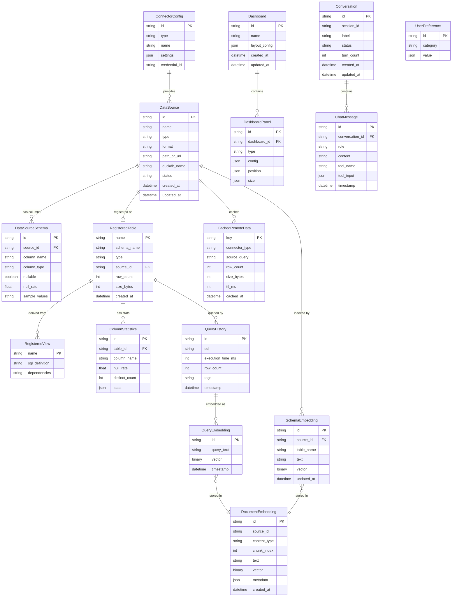
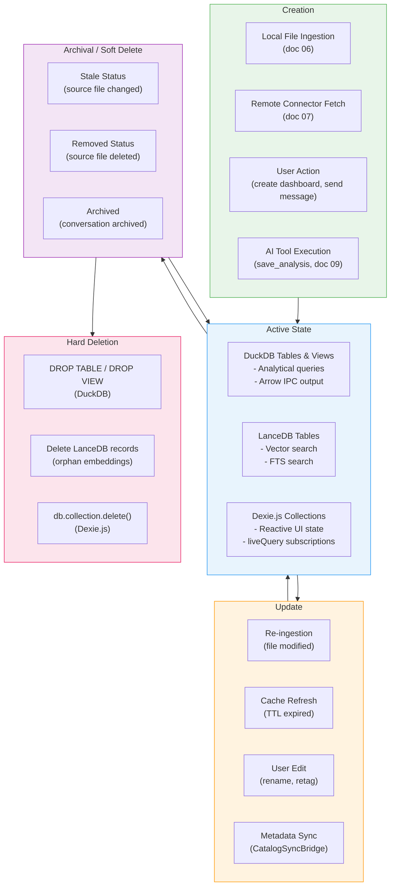
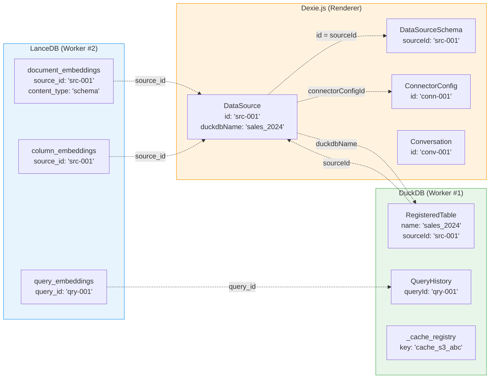
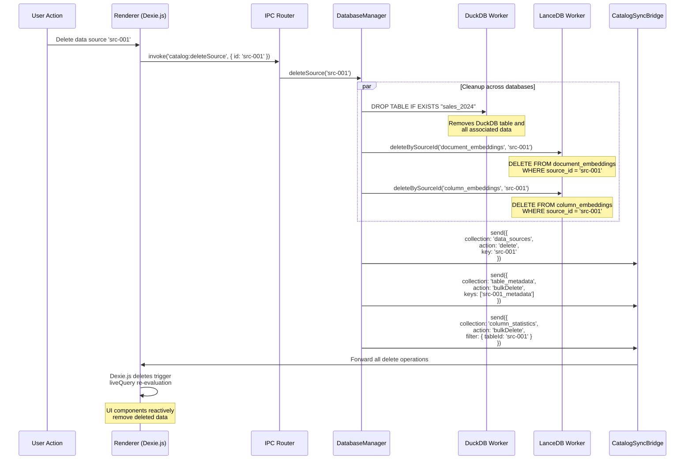

# datspace: Data Model Specification

**Document:** data-model-spec.md
**Version:** 1.0
**Date:** 2026-02-05
**Status:** Accepted
**Depends on:** [04-Database Integration](../design/04-database-integration.md), [05-Vector Search & FTS](../design/05-vector-search-fts.md), [06-Local Ingestion](../design/06-local-ingestion.md), [07-Remote Connectors](../design/07-remote-connectors.md), [09-AI Integration](../design/09-ai-integration.md), [Constitution](../../decomposition/constitution.yaml)
**Feeds into:** IPC/API Spec, UI Component Spec, Integration Architecture Overview

---

## 1. Data Model Overview

This specification defines every persistent data entity in datspace, its storage location, field-level schema, relationships to other entities, and lifecycle rules. datspace uses a **database trio** architecture (per ADR-001): DuckDB for OLAP analytics, LanceDB for vector and full-text search, and Dexie.js for reactive UI state via IndexedDB. Each database is optimized for its workload, and cross-database references are managed through shared identifier conventions.

### 1.1 Entity Relationship Diagram



### 1.2 Storage Location Map

Each entity is stored in one of the three databases. Cross-database references use string identifiers (UUIDs or table names) rather than foreign keys.

| Entity | Database | Process | Rationale |
|--------|----------|---------|-----------|
| **RegisteredTable** | DuckDB | Main (Worker #1) | Analytical table catalog within DuckDB engine |
| **RegisteredView** | DuckDB | Main (Worker #1) | SQL views over external files or derived data |
| **QueryHistory** (analytical) | DuckDB | Main (Worker #1) | Query execution metadata for performance tracking |
| **CachedRemoteData** | DuckDB | Main (Worker #1) | Remote data cached as DuckDB tables for offline/fast access |
| **_cache_registry** | DuckDB | Main (Worker #1) | Cache metadata table tracking all cached entries |
| **DocumentEmbedding** | LanceDB | Main (Worker #2) | Combined embedding store: schemas, columns, queries, analyses, samples |
| **ColumnEmbedding** (table) | LanceDB | Main (Worker #2) | Column-level embeddings for fine-grained schema search |
| **QueryEmbedding** (table) | LanceDB | Main (Worker #2) | SQL query embeddings for query recommendation |
| **FTS Index** | LanceDB (Tantivy) | Main (Worker #2) | Full-text inverted index on text columns of embedding tables |
| **DataSource** | Dexie.js | Renderer | Reactive metadata catalog for all data sources |
| **DataSourceSchema** (table_metadata) | Dexie.js | Renderer | Per-table column info with reactive queries |
| **ColumnStatistics** | Dexie.js | Renderer | Per-column stats for data quality indicators |
| **Dashboard** | Dexie.js | Renderer | Dashboard layouts and configurations |
| **DashboardPanel** | Dexie.js | Renderer | Individual panels within dashboards |
| **UserPreference** | Dexie.js | Renderer | App settings, theme, watch directories |
| **Conversation** (chat_conversations) | Dexie.js | Renderer | AI chat session metadata |
| **ChatMessage** (chat_messages) | Dexie.js | Renderer | Individual chat messages for UI display |
| **ConnectorConfig** | Dexie.js | Renderer | Remote connector configurations (credentials stored separately via CredentialStore) |
| **OpenTab** | Dexie.js | Renderer | Currently open UI tabs for session restore |

### 1.3 Data Lifecycle



**Lifecycle rules:**

| Phase | Trigger | Actions |
|-------|---------|---------|
| **Creation** | File ingestion, remote fetch, user action, AI tool | Create DuckDB table/view, push metadata to Dexie.js, generate embeddings in LanceDB |
| **Update** | File modification, cache TTL expiry, user edit | Re-ingest data, update DuckDB, sync metadata to Dexie.js, regenerate embeddings |
| **Archival** | Source file removed, conversation closed | Set status to `removed`/`archived` in Dexie.js; DuckDB data retained until confirmed deletion |
| **Deletion** | User confirms removal | DROP TABLE in DuckDB, delete LanceDB embeddings, delete Dexie.js entries |

---

## 2. DuckDB Entities

DuckDB stores all analytical data in the Main Process (Worker Thread #1). It owns the single database file at `app.getPath('userData')/analytics.duckdb`. Per doc 04, DuckDB uses MVCC with multiple concurrent readers and a single-writer lock.

### 2.1 Registered Table

A persistent table created from ingested data (local files or remote fetches). Data is physically stored in DuckDB's columnar storage.

```typescript
/**
 * Represents a DuckDB persistent table created via
 * CREATE TABLE ... AS SELECT * FROM arrow_scan(?)
 * or via DuckDB's native file readers.
 *
 * Stored in: DuckDB catalog (main schema)
 * Created by: Ingestion pipeline (doc 06), Remote connectors (doc 07)
 */
interface RegisteredTable {
  /** Table name in DuckDB (sanitized from source filename) */
  name: string;

  /** DuckDB schema (always 'main' for datspace) */
  schema: string;

  /** Whether this is a persistent table or a view */
  type: 'table' | 'view';

  /** datspace source ID (links to Dexie.js DataSource.id) */
  sourceId: string;

  /** Column definitions */
  columns: DuckDBColumnInfo[];

  /** Estimated row count */
  rowCount: number;

  /** Estimated storage size in bytes */
  sizeBytes: number;

  /** ISO timestamp of table creation */
  createdAt: string;

  /** ISO timestamp of last access */
  lastAccessedAt: string;
}

interface DuckDBColumnInfo {
  /** Column name */
  name: string;

  /** DuckDB type (VARCHAR, INTEGER, DECIMAL(10,2), TIMESTAMP, etc.) */
  type: string;

  /** Arrow type equivalent (Utf8, Int32, Float64, etc.) */
  arrowType: string;

  /** Whether column allows NULL values */
  nullable: boolean;
}
```

**DuckDB catalog query to enumerate tables:**

```sql
SELECT
  table_name AS name,
  table_schema AS schema,
  CASE WHEN table_type = 'VIEW' THEN 'view' ELSE 'table' END AS type,
  estimated_size AS size_bytes
FROM information_schema.tables
WHERE table_schema = 'main'
  AND table_name NOT LIKE '_cache_%'
  AND table_name != '_cache_registry';
```

### 2.2 Registered View

A virtual table defined by a SQL query. Views are lazy -- they do not store data but reference external files (Parquet, CSV) or other tables.

```typescript
/**
 * Represents a DuckDB view created via
 * CREATE VIEW ... AS SELECT * FROM read_parquet(?)
 *
 * Views reference external data without copying.
 * Stored in: DuckDB catalog (main schema)
 * Created by: Parquet/large CSV ingestion (doc 06, Section 4.3)
 */
interface RegisteredView {
  /** View name in DuckDB */
  name: string;

  /** The SQL SELECT statement defining this view */
  sqlDefinition: string;

  /**
   * Tables or files this view depends on.
   * For file-backed views: the absolute file path.
   * For derived views: list of referenced table/view names.
   */
  dependencies: string[];

  /** Columns exposed by this view */
  columns: DuckDBColumnInfo[];

  /** ISO timestamp of view creation */
  createdAt: string;
}
```

### 2.3 Query History

Tracks every SQL query executed through DuckDB, supporting query replay, performance analysis, and AI context (via query embeddings in LanceDB).

```typescript
/**
 * Records every SQL query execution.
 * Stored in: DuckDB table `_query_history`
 * Created by: DuckDB Worker on every query execution
 * Linked to: QueryEmbedding in LanceDB (via query_id)
 */
interface QueryHistoryEntry {
  /** UUID for this query execution */
  queryId: string;

  /** The SQL statement executed */
  sql: string;

  /** Natural language description (if generated by AI) */
  description?: string;

  /** Execution duration in milliseconds */
  executionTimeMs: number;

  /** Number of rows in the result set */
  rowCount: number;

  /** ISO timestamp of execution */
  timestamp: string;

  /** Source of the query: 'user' | 'ai' | 'system' */
  source: 'user' | 'ai' | 'system';

  /** User-assigned tags for categorization */
  tags: string[];

  /** Whether the query succeeded or failed */
  status: 'success' | 'error';

  /** Error message if status is 'error' */
  errorMessage?: string;
}
```

**DuckDB schema for query history table:**

```sql
CREATE TABLE IF NOT EXISTS _query_history (
  query_id     VARCHAR PRIMARY KEY,
  sql          VARCHAR NOT NULL,
  description  VARCHAR,
  execution_time_ms INTEGER NOT NULL,
  row_count    INTEGER NOT NULL DEFAULT 0,
  timestamp    TIMESTAMP NOT NULL DEFAULT current_timestamp,
  source       VARCHAR NOT NULL DEFAULT 'user',
  tags         VARCHAR[] DEFAULT '{}',
  status       VARCHAR NOT NULL DEFAULT 'success',
  error_message VARCHAR
);

-- Index for time-range queries
CREATE INDEX IF NOT EXISTS idx_query_history_timestamp
  ON _query_history (timestamp DESC);

-- Index for tag-based lookup
CREATE INDEX IF NOT EXISTS idx_query_history_tags
  ON _query_history USING LIST (tags);
```

### 2.4 Cached Remote Data

Remote data fetched by connectors (doc 07) is cached as DuckDB tables for fast access and offline mode.

```typescript
/**
 * Metadata for a cached remote data table.
 * Stored in: DuckDB table `_cache_registry`
 * Actual data stored in: DuckDB table `cache_{type}_{hash}`
 * Created by: CacheManager (doc 07, Section 6)
 */
interface CacheRegistryEntry {
  /** DuckDB table name (e.g., cache_s3_abc123) */
  key: string;

  /** Source connector type (s3, bigquery, mixpanel, etc.) */
  connectorType: string;

  /** The query/request that produced this cached data */
  sourceQuery: string;

  /** Number of rows in the cache table */
  rowCount: number;

  /** Estimated size in DuckDB storage (bytes) */
  sizeBytes: number;

  /** Unix timestamp when data was cached */
  cachedAt: number;

  /** Time-to-live in milliseconds */
  ttlMs: number;

  /** Unix timestamp of last query against this cache */
  lastAccessedAt: number;

  /** Cache freshness status */
  status: 'fresh' | 'stale' | 'refreshing';
}
```

**DuckDB schema for cache registry:**

```sql
CREATE TABLE IF NOT EXISTS _cache_registry (
  key              VARCHAR PRIMARY KEY,
  connector_type   VARCHAR NOT NULL,
  source_query     VARCHAR NOT NULL,
  row_count        INTEGER NOT NULL DEFAULT 0,
  size_bytes       BIGINT NOT NULL DEFAULT 0,
  cached_at        BIGINT NOT NULL,
  ttl_ms           BIGINT NOT NULL,
  last_accessed_at BIGINT NOT NULL,
  status           VARCHAR NOT NULL DEFAULT 'fresh'
);
```

---

## 3. LanceDB Entities

LanceDB stores all vector embeddings and provides full-text search capabilities. It runs in the Main Process (Worker Thread #2) and uses a directory-based storage model at `app.getPath('userData')/lance/`. Per doc 04 Section 3 and doc 05, LanceDB uses the Lance columnar format with copy-on-write versioning.

### 3.1 Document Embedding (document_embeddings table)

The primary embedding table storing schema descriptions, analysis summaries, data sample descriptions, and general document content.

```typescript
/**
 * A single embedding record in the document_embeddings LanceDB table.
 * Stored in: LanceDB table `document_embeddings`
 * Created by: Embedding pipeline (doc 05, Section 1)
 * Used by: RAG pipeline (doc 09, Section 4), search_datasets MCP tool
 */
interface DocumentEmbedding {
  /** UUID for this embedding record */
  id: string;

  /** Data source reference (links to DataSource.id in Dexie.js) */
  sourceId: string;

  /**
   * Content type classification.
   * Determines chunking strategy and re-ranking priority.
   */
  contentType: 'schema' | 'column' | 'query' | 'analysis' | 'sample';

  /** Position within the source document (for multi-chunk content) */
  chunkIndex: number;

  /** Original text that was embedded */
  text: string;

  /**
   * Embedding vector: 384-dimensional Float32Array.
   * Generated by all-MiniLM-L6-v2 via Embedding Worker #4.
   * L2-normalized for cosine similarity.
   */
  vector: Float32Array; // fixed_size_list(float32, 384)

  /**
   * JSON metadata blob.
   * Content varies by contentType:
   * - schema: { table_name, column_count, row_count }
   * - column: { table_name, column_name, column_type, nullable }
   * - query:  { query_id, executed_at, source }
   * - analysis: { analysis_id, title, tags }
   * - sample: { table_name, stat_summary }
   */
  metadata: string; // JSON string

  /** ISO timestamp of record creation */
  createdAt: string; // timestamp[us]

  /** ISO timestamp of last update */
  updatedAt: string; // timestamp[us]
}
```

**LanceDB schema definition:**

```typescript
const DOCUMENT_EMBEDDINGS_SCHEMA = {
  fields: [
    { name: 'id',           type: 'string' },
    { name: 'source_id',    type: 'string' },
    { name: 'content_type', type: 'string' },
    { name: 'chunk_index',  type: 'int32' },
    { name: 'text',         type: 'string' },
    { name: 'vector',       type: 'fixed_size_list(float32, 384)' },
    { name: 'metadata',     type: 'string' },
    { name: 'created_at',   type: 'timestamp[us]' },
    { name: 'updated_at',   type: 'timestamp[us]' },
  ],
};
```

**Indexes:**

| Index Type | Column | Configuration | Trigger |
|-----------|--------|---------------|---------|
| Vector (IVF_FLAT/IVF_PQ) | `vector` | Tier-based: none < 5K, IVF_FLAT 5K-50K, IVF_PQ > 50K | Bulk insert, 20% growth, idle maintenance |
| FTS (Tantivy) | `text` | BM25 scoring, default tokenizer, positions indexed | Table creation, incremental on writes |

### 3.2 Column Embedding (column_embeddings table)

Fine-grained per-column embeddings for semantic schema discovery.

```typescript
/**
 * Column-level embedding for fine-grained schema search.
 * Stored in: LanceDB table `column_embeddings`
 * Created by: Schema embedding trigger (doc 06, Section 4.5)
 */
interface ColumnEmbedding {
  /** UUID */
  id: string;

  /** Data source reference */
  sourceId: string;

  /** DuckDB table name */
  tableName: string;

  /** Column name */
  columnName: string;

  /** Column data type */
  columnType: string;

  /** Whether column is nullable */
  nullable: boolean;

  /**
   * Descriptive text that was embedded.
   * Format: "Table {tableName}. Column {columnName} ({columnType}): {description}"
   */
  text: string;

  /** 384-dim embedding vector */
  vector: Float32Array; // fixed_size_list(float32, 384)

  /** ISO timestamp */
  updatedAt: string; // timestamp[us]
}
```

**LanceDB schema:**

```typescript
const COLUMN_EMBEDDINGS_SCHEMA = {
  fields: [
    { name: 'id',          type: 'string' },
    { name: 'source_id',   type: 'string' },
    { name: 'table_name',  type: 'string' },
    { name: 'column_name', type: 'string' },
    { name: 'column_type', type: 'string' },
    { name: 'nullable',    type: 'bool' },
    { name: 'text',        type: 'string' },
    { name: 'vector',      type: 'fixed_size_list(float32, 384)' },
    { name: 'updated_at',  type: 'timestamp[us]' },
  ],
};
```

**Expected size:** 10K-100K vectors. Index: IVF_FLAT -> IVF_PQ at 50K.

### 3.3 Query Embedding (query_embeddings table)

Embeddings of executed SQL queries for query recommendation and deduplication.

```typescript
/**
 * SQL query embedding for semantic query search.
 * Stored in: LanceDB table `query_embeddings`
 * Created by: Post-query embedding pipeline
 * Linked to: QueryHistory in DuckDB (via query_id)
 */
interface QueryEmbeddingRecord {
  /** UUID */
  id: string;

  /** Reference to QueryHistory.queryId in DuckDB */
  queryId: string;

  /**
   * Combined text: NL description + SQL.
   * Format: "{description}. {sql}"
   */
  queryText: string;

  /** 384-dim embedding vector */
  vector: Float32Array; // fixed_size_list(float32, 384)

  /** ISO timestamp of query execution */
  timestamp: string; // timestamp[us]

  /** Tags from the QueryHistory entry */
  tags: string; // JSON array string
}
```

**LanceDB schema:**

```typescript
const QUERY_EMBEDDINGS_SCHEMA = {
  fields: [
    { name: 'id',         type: 'string' },
    { name: 'query_id',   type: 'string' },
    { name: 'query_text', type: 'string' },
    { name: 'vector',     type: 'fixed_size_list(float32, 384)' },
    { name: 'timestamp',  type: 'timestamp[us]' },
    { name: 'tags',       type: 'string' },
  ],
};
```

**Expected size:** 1K-10K vectors. Index: brute force -> IVF_FLAT at 5K.

### 3.4 Full-Text Index

The FTS index is not a separate table but a Tantivy inverted index built on the `text` column of each LanceDB table (doc 05, Section 3).

| LanceDB Table | FTS Column | Tokenizer | Features |
|--------------|-----------|-----------|----------|
| `document_embeddings` | `text` | Default (Unicode word segmentation) | BM25 scoring, phrase search, fuzzy matching |
| `column_embeddings` | `text` | Default | BM25 scoring, phrase search |
| `query_embeddings` | `query_text` | Default | BM25 scoring, phrase search |

FTS indices are created at table creation time and updated incrementally on every write. They are rebuilt during `table.optimize()` compaction.

---

## 4. Dexie.js Entities

Dexie.js manages all reactive UI state in the Renderer Process via IndexedDB. It uses `liveQuery()` for push-based reactive queries and `useLiveQuery` for React component integration. Per doc 04 Section 4, Dexie.js was chosen over RxDB for its free license and native reactive capabilities.

The Dexie.js database is named `Datspace` and stores data at:
```
~/Library/Application Support/Datspace/IndexedDB/
```

### 4.1 DataSource

The primary metadata catalog entity tracking all registered data sources (local files and remote connections).

```typescript
/**
 * Metadata for a registered data source.
 * Stored in: Dexie.js collection `data_sources`
 * Created by: Ingestion pipeline (doc 06), CacheManager (doc 07)
 * Updated by: CatalogSyncBridge (doc 04, Section 4.4)
 */
interface DataSource {
  /** UUID primary key */
  id: string;

  /** User-visible display name (derived from filename or user-assigned) */
  name: string;

  /**
   * Source type classification.
   * 'local_file': Ingested from local filesystem.
   * 'remote_cache': Fetched and cached from a remote connector.
   * 'network_share': From a mounted network share.
   */
  type: 'local_file' | 'remote_cache' | 'network_share';

  /** Source file format (csv, parquet, json, xlsx, arrow) */
  format: string;

  /** Absolute file path (local) or URL (remote) */
  pathOrUrl: string;

  /**
   * Corresponding DuckDB table or view name.
   * Links to RegisteredTable.name or RegisteredView.name in DuckDB.
   */
  duckdbName: string;

  /** Whether registered as DuckDB table or view */
  registrationType: 'table' | 'view';

  /**
   * Source lifecycle status.
   * 'active': Registered and up-to-date.
   * 'stale': Source file modified since last ingestion.
   * 'error': Ingestion or registration failed.
   * 'removed': Source file deleted from disk.
   * 'ingesting': Currently being ingested.
   */
  status: 'active' | 'stale' | 'error' | 'removed' | 'ingesting';

  /** Row count in the registered DuckDB table/view */
  rowCount: number;

  /** File size on disk in bytes */
  sizeBytes: number;

  /** ISO timestamp of initial registration */
  createdAt: string;

  /** ISO timestamp of last metadata update */
  updatedAt: string;

  /** ISO timestamp of last file system check */
  lastScannedAt: string;

  /** ID of the watch directory that discovered this file (optional) */
  watchDirectoryId?: string;

  /** Remote connector configuration ID (for remote sources) */
  connectorConfigId?: string;

  /** User-assigned tags for organization */
  tags: string[];

  /** Error details if status is 'error' */
  errorMessage?: string;
}
```

**Dexie.js index declaration:**

```typescript
data_sources: 'id, name, type, status, createdAt, *tags'
```

| Index | Type | Purpose |
|-------|------|---------|
| `id` | Primary key | Direct lookup by UUID |
| `name` | Simple | Sort and filter by name |
| `type` | Simple | Filter local vs remote sources |
| `status` | Simple | Filter by lifecycle status |
| `createdAt` | Simple | Sort by creation date |
| `*tags` | Multi-entry | Tag-based filtering (Dexie.js multi-entry index) |

### 4.2 DataSourceSchema (table_metadata)

Per-table schema information with column definitions, pushed from the Main Process after DuckDB table registration.

```typescript
/**
 * Schema metadata for a registered DuckDB table.
 * Stored in: Dexie.js collection `table_metadata`
 * Created by: SchemaExtractor -> CatalogSyncBridge (doc 06, Section 4.4)
 */
interface DataSourceSchema {
  /** Composite ID: `{sourceId}_metadata` */
  id: string;

  /** Reference to DataSource.id */
  sourceId: string;

  /** DuckDB table/view name */
  name: string;

  /** Column definitions */
  columns: ColumnInfo[];

  /** Total row count */
  rowCount: number;

  /** Estimated storage size in bytes */
  estimatedSizeBytes: number;

  /** Source file format */
  sourceFormat: string;
}

interface ColumnInfo {
  /** Column name */
  name: string;

  /** DuckDB type name (VARCHAR, INTEGER, DECIMAL(10,2), TIMESTAMP, etc.) */
  type: string;

  /** Arrow type (Utf8, Int32, Float64, etc.) */
  arrowType: string;

  /** Whether column allows NULL */
  nullable: boolean;

  /** Fraction of NULL values (0.0-1.0) */
  nullRate: number;

  /** Up to 5 sample non-null values */
  sampleValues: unknown[];
}
```

**Dexie.js index declaration:**

```typescript
table_metadata: 'id, sourceId, name, [sourceId+name]'
```

| Index | Type | Purpose |
|-------|------|---------|
| `id` | Primary key | Direct lookup |
| `sourceId` | Simple | All tables for a data source |
| `name` | Simple | Lookup by DuckDB table name |
| `[sourceId+name]` | Compound | Unique constraint: one metadata entry per source+table pair |

### 4.3 Dashboard

Dashboard layout configuration storing panel arrangement, grid settings, and display preferences.

```typescript
/**
 * Dashboard layout configuration.
 * Stored in: Dexie.js collection `dashboards`
 * Created by: User action via Dashboard Builder UI
 */
interface Dashboard {
  /** UUID primary key */
  id: string;

  /** Dashboard name (user-assigned) */
  name: string;

  /**
   * Layout configuration.
   * Defines grid dimensions, spacing, and responsive breakpoints.
   */
  layoutConfig: {
    /** Grid columns (default: 12) */
    columns: number;
    /** Row height in pixels (default: 60) */
    rowHeight: number;
    /** Gap between panels in pixels (default: 8) */
    gap: number;
    /** Whether panels can overlap (default: false) */
    compactType: 'vertical' | 'horizontal' | null;
  };

  /** ISO timestamp of creation */
  createdAt: string;

  /** ISO timestamp of last modification */
  updatedAt: string;

  /** Optional description */
  description?: string;

  /** Whether this dashboard is pinned to the sidebar */
  pinned: boolean;
}
```

**Dexie.js index declaration:**

```typescript
dashboards: 'id, name, createdAt, updatedAt'
```

### 4.4 DashboardPanel

Individual visualization or content panel within a dashboard.

```typescript
/**
 * A single panel within a dashboard.
 * Stored in: Dexie.js collection `dashboard_panels`
 * Created by: User action via Dashboard Builder UI
 */
interface DashboardPanel {
  /** UUID primary key */
  id: string;

  /** Parent dashboard ID (links to Dashboard.id) */
  dashboardId: string;

  /**
   * Panel content type.
   * 'chart': Visualization (Observable Plot, ECharts).
   * 'table': Data table (Perspective).
   * 'metric': Single value / KPI card.
   * 'text': Markdown text block.
   * 'sql': SQL editor with live results.
   */
  type: 'chart' | 'table' | 'metric' | 'text' | 'sql';

  /**
   * Type-specific configuration.
   * For 'chart': { chartType, sql, vegaLiteSpec or echartsSpec, xAxis, yAxis, colorBy }
   * For 'table': { sql, columns, sortBy, pageSize }
   * For 'metric': { sql, label, format, thresholds }
   * For 'text': { markdown }
   * For 'sql': { sql, autoRun }
   */
  config: Record<string, unknown>;

  /** Grid position: { x, y } in grid units */
  position: { x: number; y: number };

  /** Grid size: { w, h } in grid units */
  size: { w: number; h: number };

  /** Panel title (displayed in panel header) */
  title?: string;

  /** ISO timestamp of last modification */
  updatedAt: string;
}
```

**Dexie.js index declaration:**

```typescript
dashboard_panels: 'id, dashboardId, type'
```

| Index | Type | Purpose |
|-------|------|---------|
| `id` | Primary key | Direct lookup |
| `dashboardId` | Simple | All panels for a dashboard |
| `type` | Simple | Filter panels by type |

### 4.5 UserPreference

Application settings, theme preferences, watch directory configurations, and feature flags.

```typescript
/**
 * User preference or application setting.
 * Stored in: Dexie.js collection `user_preferences`
 * Created by: Settings UI, application defaults
 */
interface UserPreference {
  /**
   * Setting key. Uses dot notation for namespacing:
   * 'appearance.theme', 'appearance.fontSize',
   * 'memory.duckdbLimit', 'memory.cacheMaxSize',
   * 'watch.directories', 'editor.defaultLimit',
   * 'ai.maxTurns', 'ai.ragTokenBudget'
   */
  id: string;

  /** Setting value (type depends on the key) */
  value: unknown;

  /** Category for grouping in Settings UI */
  category: 'appearance' | 'memory' | 'watch' | 'editor' | 'ai' | 'advanced';

  /** ISO timestamp of last modification */
  updatedAt: string;
}
```

**Dexie.js index declaration:**

```typescript
user_preferences: 'id'
```

Only the primary key is indexed. Preferences are few (< 100 rows) and always loaded in full.

### 4.6 Conversation (chat_conversations)

AI chat session metadata. The actual conversation context (full message history, context window state) is managed internally by the Claude Agent SDK's session management (doc 09, Section 5.2).

```typescript
/**
 * AI chat conversation session metadata.
 * Stored in: Dexie.js collection `chat_conversations`
 * Created by: ConversationManager (doc 09, Section 5.3)
 * Updated by: ConversationManager via CatalogSyncBridge
 */
interface Conversation {
  /** UUID primary key (datspace internal ID) */
  id: string;

  /** Claude Agent SDK session ID (for resume/fork operations) */
  sessionId: string;

  /** Conversation title (user-assigned or auto-generated) */
  label: string;

  /** ISO timestamp of creation */
  createdAt: string;

  /** ISO timestamp of last message */
  updatedAt: string;

  /**
   * Conversation lifecycle status.
   * 'active': Currently active conversation.
   * 'archived': User closed the conversation.
   */
  status: 'active' | 'archived';

  /** Number of user-assistant message exchanges */
  turnCount: number;

  /** Parent conversation ID (for forked conversations) */
  parentConversationId?: string;

  /** Auto-generated summary of the conversation */
  summary?: string;
}
```

**Dexie.js index declaration:**

```typescript
chat_conversations: 'id, createdAt, updatedAt'
```

### 4.7 ChatMessage (chat_messages)

Individual messages within a conversation, displayed in the AI Chat UI.

```typescript
/**
 * A single chat message within a conversation.
 * Stored in: Dexie.js collection `chat_messages`
 * Created by: Renderer on user input; AgentSDKHost on AI response
 * Used by: ChatUI component via useLiveQuery
 */
interface ChatMessage {
  /** UUID primary key */
  id: string;

  /** Parent conversation ID (links to Conversation.id) */
  conversationId: string;

  /**
   * Message role/type.
   * 'user': User-sent message.
   * 'assistant': AI-generated response.
   * 'system': System notification.
   * 'tool_use': AI tool invocation (shows tool name + input).
   * 'tool_result': Tool execution result (shows formatted output).
   */
  role: 'user' | 'assistant' | 'system' | 'tool_use' | 'tool_result';

  /** Text content (markdown for assistant, plain for user, JSON for tool messages) */
  content: string;

  /** ISO timestamp of message creation */
  timestamp: string;

  /** MCP tool name (for role: 'tool_use' and 'tool_result') */
  toolName?: string;

  /** Tool input parameters (for role: 'tool_use') */
  toolInput?: Record<string, unknown>;

  /** Tool result status (for role: 'tool_result') */
  toolResultType?: 'success' | 'error';

  /**
   * Rendering metadata for the UI.
   * Populated during post-processing of AI responses.
   */
  metadata?: {
    /** Extracted SQL queries for syntax highlighting */
    sqlQueries?: { sql: string; language: string }[];
    /** Chart specification for inline rendering */
    chartSpec?: Record<string, unknown>;
    /** Whether this message is currently streaming (partial content) */
    isStreaming?: boolean;
    /** Estimated token count */
    tokenCount?: number;
  };
}
```

**Dexie.js index declaration:**

```typescript
chat_messages: 'id, conversationId, timestamp, [conversationId+timestamp]'
```

| Index | Type | Purpose |
|-------|------|---------|
| `id` | Primary key | Direct lookup |
| `conversationId` | Simple | All messages for a conversation |
| `timestamp` | Simple | Global message timeline |
| `[conversationId+timestamp]` | Compound | Ordered messages within a conversation (primary query pattern) |

### 4.8 ConnectorConfig

Configuration for remote data source connectors (doc 07). Credentials are stored separately in the CredentialStore (encrypted via Electron safeStorage), not in Dexie.js.

```typescript
/**
 * Remote connector configuration.
 * Stored in: Dexie.js collection `connector_configs`
 * Created by: Connection Settings UI (doc 07, Section 9)
 * Used by: ConnectorManager (doc 07, Section 1.2)
 */
interface ConnectorConfig {
  /** UUID primary key */
  id: string;

  /**
   * Connector type identifier.
   * Matches ConnectorTypeDescriptor.type in ConnectorRegistry.
   * e.g., 's3', 'bigquery', 'clickhouse', 'mixpanel', 'posthog',
   * 'google_sheets', 'airtable', 'postgresql', 'mysql', 'gcs'
   */
  type: string;

  /** User-assigned display name for this connection */
  name: string;

  /**
   * Connector-specific settings (validated against ConnectorTypeDescriptor.configSchema).
   * For S3: { bucket, region, endpoint?, pathPrefix?, forcePathStyle? }
   * For BigQuery: { projectId, defaultDataset?, location?, maximumBytesBilled? }
   * For Mixpanel: { projectId, region?, apiHost?, exportBatchDays? }
   * etc.
   */
  settings: Record<string, unknown>;

  /**
   * Reference to the credential in CredentialStore.
   * This is an opaque ID -- the actual credential data is encrypted
   * and stored outside Dexie.js (via Electron safeStorage + macOS Keychain).
   */
  credentialId: string;

  /**
   * Connector category for UI grouping.
   * 'cloud_storage': S3, GCS, network shares
   * 'database': BigQuery, ClickHouse, PostgreSQL, MySQL
   * 'saas_analytics': Mixpanel, PostHog, Google Sheets, Airtable
   */
  category: 'cloud_storage' | 'database' | 'saas_analytics';

  /** Connector capabilities from ConnectorTypeDescriptor */
  capabilities: string[];

  /** Current connection state */
  connectionState: 'disconnected' | 'connecting' | 'connected' | 'error' | 'rate_limited';

  /** ISO timestamp of creation */
  createdAt: string;

  /** ISO timestamp of last successful connection */
  lastConnectedAt?: string;

  /** Error message if connectionState is 'error' */
  errorMessage?: string;

  /** Whether this connector is enabled */
  enabled: boolean;
}
```

**Dexie.js index declaration:**

```typescript
connector_configs: 'id, type, name, category'
```

### 4.9 ColumnStatistics

Per-column statistical summaries computed by DuckDB after table registration.

```typescript
/**
 * Statistical summary for a single column.
 * Stored in: Dexie.js collection `column_statistics`
 * Created by: StatisticsCollector -> CatalogSyncBridge (doc 06, Section 4.2)
 */
interface ColumnStatistics {
  /** Composite ID: `{tableId}_{columnName}` */
  id: string;

  /** Reference to DataSourceSchema.id (which references DataSource.id) */
  tableId: string;

  /** Column name */
  columnName: string;

  /** Column data type */
  columnType: string;

  /** Total row count */
  rowCount: number;

  /** Number of NULL values */
  nullCount: number;

  /** Fraction of NULL values (0.0-1.0) */
  nullRate: number;

  /** Number of distinct values (exact for < 100K rows; estimated via HyperLogLog for larger) */
  distinctCount: number;

  /** Numeric column statistics (present for numeric types) */
  min?: number | string;
  max?: number | string;
  mean?: number;
  median?: number;
  stddev?: number;

  /** String column statistics (present for string types) */
  minLength?: number;
  maxLength?: number;
  avgLength?: number;

  /** Top-N most frequent values with counts */
  topValues?: { value: unknown; count: number }[];

  /** ISO timestamp of statistics computation */
  computedAt: string;
}
```

**Dexie.js index declaration:**

```typescript
column_statistics: 'id, tableId, [tableId+columnName]'
```

### 4.10 OpenTab

Currently open UI tabs for session state restoration.

```typescript
/**
 * Represents an open tab in the application UI.
 * Stored in: Dexie.js collection `open_tabs`
 * Created by: Tab management system in Renderer
 */
interface OpenTab {
  /** UUID primary key */
  id: string;

  /**
   * Tab content type.
   * 'query': SQL editor tab.
   * 'dashboard': Dashboard view tab.
   * 'source': Data source explorer tab.
   * 'chat': AI chat tab.
   * 'settings': Settings tab.
   */
  type: 'query' | 'dashboard' | 'source' | 'chat' | 'settings';

  /** Display order (0-based index) */
  order: number;

  /** Tab title */
  title: string;

  /**
   * Tab state for restoration.
   * For 'query': { sql, results?, executionState }
   * For 'dashboard': { dashboardId }
   * For 'source': { sourceId }
   * For 'chat': { conversationId }
   * For 'settings': { section }
   */
  state: Record<string, unknown>;

  /** Whether this tab is the currently active tab */
  active: boolean;

  /** ISO timestamp of last interaction */
  lastAccessedAt: string;
}
```

**Dexie.js index declaration:**

```typescript
open_tabs: 'id, type, order'
```

---

## 5. Entity Relationships

### 5.1 Intra-Database Relationships

**Dexie.js (Renderer Process):**

| Parent | Child | Cardinality | Join Key | Reactive |
|--------|-------|-------------|----------|----------|
| DataSource | DataSourceSchema (table_metadata) | 1:many | `sourceId` | Yes (liveQuery) |
| DataSource | ColumnStatistics | 1:many | `tableId` (derived from sourceId) | Yes |
| Dashboard | DashboardPanel | 1:many | `dashboardId` | Yes |
| Conversation | ChatMessage | 1:many | `conversationId` | Yes |
| ConnectorConfig | DataSource | 1:many | `connectorConfigId` | Yes |

**DuckDB (Worker Thread #1):**

| Parent | Child | Cardinality | Join Key |
|--------|-------|-------------|----------|
| RegisteredTable | RegisteredView | 1:many | View SQL references table name |
| RegisteredTable | QueryHistory | 1:many | Table name appears in SQL |
| CacheRegistryEntry | Cache table | 1:1 | `key` is the table name |

**LanceDB (Worker Thread #2):**

| Parent Table | Relationship | Description |
|-------------|-------------|-------------|
| document_embeddings | Contains schema, analysis, sample embeddings | Filtered by `content_type` |
| column_embeddings | Contains column-level embeddings | One record per table column |
| query_embeddings | Contains query embeddings | Linked to DuckDB query_history via `query_id` |

### 5.2 Cross-Database References

Since the three databases run in different processes/threads, cross-database "foreign keys" are implemented as string identifier conventions. There are no enforced referential integrity constraints across databases -- consistency is maintained by the application layer.



**Cross-database reference patterns:**

| Reference | From | To | Key | Direction |
|-----------|------|-----|-----|-----------|
| DataSource -> DuckDB table | Dexie.js | DuckDB | `DataSource.duckdbName` = `RegisteredTable.name` | Dexie.js references DuckDB |
| DuckDB table -> DataSource | DuckDB | Dexie.js | `RegisteredTable.sourceId` = `DataSource.id` | DuckDB references Dexie.js |
| Embedding -> DataSource | LanceDB | Dexie.js | `DocumentEmbedding.sourceId` = `DataSource.id` | LanceDB references Dexie.js |
| QueryEmbedding -> QueryHistory | LanceDB | DuckDB | `QueryEmbedding.queryId` = `QueryHistory.queryId` | LanceDB references DuckDB |
| DataSource -> ConnectorConfig | Dexie.js | Dexie.js | `DataSource.connectorConfigId` = `ConnectorConfig.id` | Intra-Dexie.js |
| Cache entry -> DataSource | DuckDB | Dexie.js | `CacheRegistry.key` = `DataSource.duckdbName` | DuckDB references Dexie.js |

**Consistency guarantees:**

Cross-database consistency is maintained through the **CatalogSyncBridge** (doc 04, Section 4.4), which pushes structured update messages from the Main Process to the Renderer whenever DuckDB or LanceDB state changes. The bridge ensures:

1. When a DuckDB table is created, a corresponding DataSource + DataSourceSchema entry is pushed to Dexie.js
2. When a DuckDB table is dropped, the corresponding Dexie.js entries are marked as `removed`
3. When embeddings are generated, no Dexie.js update is needed (LanceDB is independent)
4. When a DataSource is deleted from Dexie.js, a cleanup cascade drops the DuckDB table and LanceDB embeddings

---

## 6. Complete Schema Definitions

### 6.1 Dexie.js Database Schema (Version 1)

This is the complete Dexie.js schema declaration used in the Renderer Process:

```typescript
import Dexie from 'dexie';

class DatspaceDB extends Dexie {
  // Typed table declarations
  data_sources!: Dexie.Table<DataSource, string>;
  table_metadata!: Dexie.Table<DataSourceSchema, string>;
  column_statistics!: Dexie.Table<ColumnStatistics, string>;
  dashboards!: Dexie.Table<Dashboard, string>;
  dashboard_panels!: Dexie.Table<DashboardPanel, string>;
  user_preferences!: Dexie.Table<UserPreference, string>;
  chat_conversations!: Dexie.Table<Conversation, string>;
  chat_messages!: Dexie.Table<ChatMessage, string>;
  connector_configs!: Dexie.Table<ConnectorConfig, string>;
  open_tabs!: Dexie.Table<OpenTab, string>;
  query_history!: Dexie.Table<QueryHistoryUI, string>;

  constructor() {
    super('Datspace');

    this.version(1).stores({
      // Metadata catalog
      data_sources:      'id, name, type, status, createdAt, *tags',
      table_metadata:    'id, sourceId, name, [sourceId+name]',
      column_statistics: 'id, tableId, [tableId+columnName]',

      // Dashboards
      dashboards:        'id, name, createdAt, updatedAt',
      dashboard_panels:  'id, dashboardId, type',

      // User settings
      user_preferences:  'id',

      // AI chat
      chat_conversations: 'id, createdAt, updatedAt',
      chat_messages:      'id, conversationId, timestamp, [conversationId+timestamp]',

      // Remote connectors
      connector_configs:  'id, type, name, category',

      // UI state
      open_tabs:          'id, type, order',

      // Query history (UI-side mirror for reactive display)
      query_history:      'id, timestamp, *tags',
    });
  }
}

const db = new DatspaceDB();
export default db;
```

### 6.2 DuckDB System Tables

DuckDB creates these application-managed tables at startup:

```sql
-- Query history table
CREATE TABLE IF NOT EXISTS _query_history (
  query_id          VARCHAR PRIMARY KEY,
  sql               VARCHAR NOT NULL,
  description       VARCHAR,
  execution_time_ms INTEGER NOT NULL,
  row_count         INTEGER NOT NULL DEFAULT 0,
  timestamp         TIMESTAMP NOT NULL DEFAULT current_timestamp,
  source            VARCHAR NOT NULL DEFAULT 'user',
  tags              VARCHAR[] DEFAULT '{}',
  status            VARCHAR NOT NULL DEFAULT 'success',
  error_message     VARCHAR
);

CREATE INDEX IF NOT EXISTS idx_qh_timestamp
  ON _query_history (timestamp DESC);

-- Cache registry table
CREATE TABLE IF NOT EXISTS _cache_registry (
  key              VARCHAR PRIMARY KEY,
  connector_type   VARCHAR NOT NULL,
  source_query     VARCHAR NOT NULL,
  row_count        INTEGER NOT NULL DEFAULT 0,
  size_bytes       BIGINT NOT NULL DEFAULT 0,
  cached_at        BIGINT NOT NULL,
  ttl_ms           BIGINT NOT NULL,
  last_accessed_at BIGINT NOT NULL,
  status           VARCHAR NOT NULL DEFAULT 'fresh'
);

-- Saved analyses table (created by save_analysis MCP tool)
CREATE TABLE IF NOT EXISTS _saved_analyses (
  analysis_id   VARCHAR PRIMARY KEY,
  name          VARCHAR NOT NULL,
  description   VARCHAR NOT NULL,
  sql           VARCHAR NOT NULL,
  visualization VARCHAR,           -- JSON chart specification
  tags          VARCHAR[] DEFAULT '{}',
  created_at    TIMESTAMP NOT NULL DEFAULT current_timestamp,
  updated_at    TIMESTAMP NOT NULL DEFAULT current_timestamp
);

CREATE INDEX IF NOT EXISTS idx_sa_created
  ON _saved_analyses (created_at DESC);
```

### 6.3 LanceDB Table Schemas (Summary)

| Table | Fields | Vector Dimension | FTS Column | Expected Size |
|-------|--------|-----------------|-----------|---------------|
| `document_embeddings` | id, source_id, content_type, chunk_index, text, vector, metadata, created_at, updated_at | 384 | `text` | 5K-50K |
| `column_embeddings` | id, source_id, table_name, column_name, column_type, nullable, text, vector, updated_at | 384 | `text` | 10K-100K |
| `query_embeddings` | id, query_id, query_text, vector, timestamp, tags | 384 | `query_text` | 1K-10K |

### 6.4 Field Constraints Summary

| Entity | Field | Constraint | Default |
|--------|-------|-----------|---------|
| DataSource.id | UUID format | Required, unique | Generated |
| DataSource.name | Non-empty string | Required | Derived from filename |
| DataSource.type | Enum: local_file, remote_cache, network_share | Required | -- |
| DataSource.status | Enum: active, stale, error, removed, ingesting | Required | 'ingesting' |
| DataSource.tags | String array | Optional | `[]` |
| Dashboard.layoutConfig.columns | Integer > 0 | Required | 12 |
| Dashboard.layoutConfig.rowHeight | Integer > 0 | Required | 60 |
| DashboardPanel.position.x | Integer >= 0 | Required | -- |
| DashboardPanel.position.y | Integer >= 0 | Required | -- |
| DashboardPanel.size.w | Integer > 0 | Required | -- |
| DashboardPanel.size.h | Integer > 0 | Required | -- |
| Conversation.status | Enum: active, archived | Required | 'active' |
| ChatMessage.role | Enum: user, assistant, system, tool_use, tool_result | Required | -- |
| ChatMessage.timestamp | ISO 8601 string | Required | Generated |
| ConnectorConfig.enabled | Boolean | Required | true |
| QueryHistory.executionTimeMs | Integer >= 0 | Required | -- |
| QueryHistory.status | Enum: success, error | Required | 'success' |
| DocumentEmbedding.vector | Float32Array[384] | Required | -- |
| DocumentEmbedding.contentType | Enum: schema, column, query, analysis, sample | Required | -- |
| CacheRegistry.ttlMs | Integer > 0 | Required | 3600000 (1 hour) |
| CacheRegistry.status | Enum: fresh, stale, refreshing | Required | 'fresh' |

---

## 7. Migration Strategy

### 7.1 Version Numbering Scheme

All three databases use independent version numbers:

| Database | Version Format | Current Version | Tracking Location |
|----------|---------------|-----------------|-------------------|
| **Dexie.js** | Integer (1, 2, 3...) | 1 | `db.version(N).stores({...})` in DatspaceDB class |
| **DuckDB** | Semantic (1.0.0) | 1.0.0 | `_schema_version` user-defined table |
| **LanceDB** | Integer (1, 2, 3...) | 1 | `_meta` file in lance directory |

### 7.2 Dexie.js Schema Migration

Dexie.js uses version-based declarative migrations. Each version increment declares the new schema and an optional `upgrade()` function for data transformation.

```typescript
const db = new Dexie('Datspace');

// Version 1: Initial schema (current)
db.version(1).stores({
  data_sources:       'id, name, type, status, createdAt, *tags',
  table_metadata:     'id, sourceId, name, [sourceId+name]',
  column_statistics:  'id, tableId, [tableId+columnName]',
  dashboards:         'id, name, createdAt, updatedAt',
  dashboard_panels:   'id, dashboardId, type',
  user_preferences:   'id',
  chat_conversations: 'id, createdAt, updatedAt',
  chat_messages:      'id, conversationId, timestamp, [conversationId+timestamp]',
  connector_configs:  'id, type, name, category',
  open_tabs:          'id, type, order',
  query_history:      'id, timestamp, *tags',
});

// Version 2 (future example): Add scheduled queries
db.version(2).stores({
  // Add new collection
  scheduled_queries: 'id, name, cron, lastRun, enabled',
  // Add new index to existing collection
  data_sources: 'id, name, type, status, createdAt, updatedAt, *tags',
}).upgrade(tx => {
  // Data migration: add default preference for new feature
  return tx.table('user_preferences').put({
    id: 'scheduler.enabled',
    value: false,
    category: 'advanced',
    updatedAt: new Date().toISOString(),
  });
});

// Version 3 (future example): Add annotation support
db.version(3).stores({
  annotations: 'id, sourceId, columnName, createdAt',
}).upgrade(tx => {
  // No data migration needed -- just adding a new collection
  return Promise.resolve();
});
```

**Migration guarantees (Dexie.js):**
- Migrations run within IndexedDB transactions -- atomic and crash-safe
- Adding new collections or indexes is non-destructive (existing data preserved)
- Only indexed properties need declaration -- adding non-indexed properties requires no migration
- Dexie handles version skipping: if a user upgrades from v1 to v3, both v2 and v3 migrations run sequentially
- If a migration fails mid-transaction, IndexedDB rolls back to the previous version

### 7.3 DuckDB Schema Evolution

DuckDB schema changes are managed through an explicit version tracking table and migration scripts:

```sql
-- Version tracking table (created at first startup)
CREATE TABLE IF NOT EXISTS _schema_version (
  version    VARCHAR PRIMARY KEY,
  applied_at TIMESTAMP NOT NULL DEFAULT current_timestamp,
  description VARCHAR
);

-- Check current version at startup
SELECT version FROM _schema_version ORDER BY applied_at DESC LIMIT 1;
```

**Migration patterns:**

```sql
-- Migration 1.0.0 -> 1.1.0: Add description column to _saved_analyses
ALTER TABLE _saved_analyses ADD COLUMN IF NOT EXISTS methodology VARCHAR;

INSERT INTO _schema_version (version, description)
VALUES ('1.1.0', 'Add methodology column to saved analyses');

-- Migration 1.1.0 -> 1.2.0: Add execution plan column to query history
ALTER TABLE _query_history ADD COLUMN IF NOT EXISTS execution_plan VARCHAR;

INSERT INTO _schema_version (version, description)
VALUES ('1.2.0', 'Add execution plan to query history');
```

**DuckDB migration rules:**
- `ALTER TABLE ... ADD COLUMN` is the primary migration pattern (non-destructive)
- Column drops are avoided -- columns are deprecated via naming convention (`_deprecated_*`)
- Table renames use `ALTER TABLE ... RENAME TO`
- Data type changes require creating a new column, copying data, and dropping the old column
- Migrations run at DuckDB Worker startup, before the Worker reports ready

### 7.4 LanceDB Index Rebuild Triggers

LanceDB does not have traditional schema migrations since the Lance format is schemaless (columns are defined per-table at creation time). However, index management requires explicit triggers:

| Trigger | Action | When |
|---------|--------|------|
| **New table creation** | Create FTS index + initial vector index (if > 5K rows) | Table creation |
| **Collection crosses size threshold** | Upgrade vector index tier (brute force -> IVF_FLAT -> IVF_PQ) | After bulk insert |
| **Embedding model change** | Drop all tables, re-embed all content, rebuild all indices | User-initiated via Settings |
| **Schema field addition** | Create new table with updated schema, migrate data, drop old table | Application upgrade |
| **Fragment count > 50** | `table.optimize()` -- compact fragments and rebuild indices | Idle maintenance scheduler |
| **> 20% unindexed rows** | Rebuild vector index with current parameters | Idle maintenance scheduler |

**LanceDB migration process for schema changes:**

```typescript
async function migrateLanceDBTable(
  db: LanceDBConnection,
  tableName: string,
  newSchema: LanceDBSchema,
  transformFn?: (record: Record<string, unknown>) => Record<string, unknown>,
): Promise<void> {
  const tempName = `${tableName}_migration_temp`;

  // Step 1: Read all data from existing table
  const oldTable = await db.openTable(tableName);
  const data = await oldTable.search().limit(Infinity).toArrow();

  // Step 2: Transform data if needed
  const transformedData = transformFn
    ? data.toArray().map(transformFn)
    : data.toArray();

  // Step 3: Create new table with updated schema
  await db.createTable(tempName, transformedData, { schema: newSchema });

  // Step 4: Rebuild indices on new table
  await rebuildIndices(tempName);

  // Step 5: Drop old table, rename new table
  await db.dropTable(tableName);
  // Note: LanceDB does not support rename -- the new table is used directly
  // Application code must update table name references
}
```

---

## 8. Data Integrity Rules

### 8.1 Cross-Database Consistency Constraints

Since the three databases have no native cross-database foreign key support, consistency is enforced at the application layer through the CatalogSyncBridge and explicit cleanup operations.

| Constraint | Enforcement | Violation Detection |
|-----------|-------------|-------------------|
| Every DuckDB table has a corresponding Dexie.js DataSource | CatalogSyncBridge pushes metadata on table creation | Startup health check: compare DuckDB `information_schema.tables` with Dexie.js `data_sources` |
| Every Dexie.js DataSource with status 'active' has a valid DuckDB table | CatalogSyncBridge marks DataSource as 'removed' when DuckDB table is dropped | Periodic reconciliation in DatabaseManager health check |
| LanceDB embeddings reference valid DataSource IDs | Embedding pipeline only creates embeddings for registered sources | Orphan scan during idle maintenance |
| QueryEmbedding.queryId references valid QueryHistory.queryId | Embedding created in same transaction as query history write | Orphan scan during idle maintenance |
| ConnectorConfig.credentialId references valid CredentialStore entry | Credential created before connector config | CredentialStore.resolve() throws if missing |

### 8.2 Orphan Cleanup

When a DataSource is removed, cascade cleanup must occur across all three databases:



**Orphan cleanup rules:**

| When | What is orphaned | Cleanup action |
|------|-----------------|----------------|
| DataSource deleted | DuckDB table/view | `DROP TABLE IF EXISTS "{duckdbName}"` |
| DataSource deleted | LanceDB embeddings (document + column) | `DELETE FROM {table} WHERE source_id = ?` |
| DataSource deleted | Dexie.js table_metadata entries | `db.table_metadata.where('sourceId').equals(id).delete()` |
| DataSource deleted | Dexie.js column_statistics entries | `db.column_statistics.where('tableId').equals(id).delete()` |
| Conversation deleted | Dexie.js chat_messages | `db.chat_messages.where('conversationId').equals(id).delete()` |
| Dashboard deleted | Dexie.js dashboard_panels | `db.dashboard_panels.where('dashboardId').equals(id).delete()` |
| ConnectorConfig deleted | CredentialStore credential | `credentialStore.delete(credentialId)` |
| ConnectorConfig deleted | Dexie.js DataSources from this connector | Set `status: 'removed'` for all sources with `connectorConfigId` |
| Cache TTL expired | DuckDB cache table | `DROP TABLE IF EXISTS "{cacheKey}"` + delete from `_cache_registry` |

### 8.3 Startup Reconciliation

On application startup, a reconciliation pass detects and repairs cross-database inconsistencies:

```typescript
async function reconcileDatabases(): Promise<ReconciliationReport> {
  const report: ReconciliationReport = {
    orphanedDuckDBTables: [],
    missingDuckDBTables: [],
    orphanedEmbeddings: [],
    repaired: [],
  };

  // Step 1: Get all DuckDB user tables
  const duckdbTables = await duckdbAdapter.execute(
    `SELECT table_name FROM information_schema.tables
     WHERE table_schema = 'main'
     AND table_name NOT LIKE '\\_%' ESCAPE '\\'`
  );

  // Step 2: Get all active DataSource entries from Dexie.js
  const activeSources = await ipcInvoke('dexie:query', {
    collection: 'data_sources',
    filter: { status: ['active', 'stale'] },
  });

  // Step 3: Find DuckDB tables without a DataSource entry
  const duckdbNames = new Set(duckdbTables.map(t => t.table_name));
  const dexieNames = new Set(activeSources.map(s => s.duckdbName));

  for (const tableName of duckdbNames) {
    if (!dexieNames.has(tableName)) {
      report.orphanedDuckDBTables.push(tableName);
      // Option: create a DataSource entry, or drop the orphaned table
    }
  }

  // Step 4: Find DataSource entries without a DuckDB table
  for (const source of activeSources) {
    if (!duckdbNames.has(source.duckdbName)) {
      report.missingDuckDBTables.push(source.id);
      // Mark as 'removed' in Dexie.js
    }
  }

  // Step 5: Find LanceDB embeddings referencing nonexistent sources
  const allSourceIds = new Set(activeSources.map(s => s.id));
  const embeddingSourceIds = await lancedbAdapter.getDistinctValues(
    'document_embeddings', 'source_id'
  );

  for (const sourceId of embeddingSourceIds) {
    if (!allSourceIds.has(sourceId)) {
      report.orphanedEmbeddings.push(sourceId);
      // Delete orphaned embeddings
    }
  }

  return report;
}
```

### 8.4 Transaction Boundaries

Each database provides its own transaction guarantees:

| Database | Transaction Scope | Atomicity | Crash Safety |
|----------|------------------|-----------|-------------|
| **DuckDB** | Single SQL statement or explicit `BEGIN/COMMIT` | Full ACID within DuckDB | WAL-based recovery on restart |
| **LanceDB** | Single `table.add()` / `table.update()` call | Copy-on-write versioning; incomplete writes discarded | Version manifest ensures consistent reads |
| **Dexie.js** | `db.transaction()` block across multiple collections | Full ACID within IndexedDB (backed by LevelDB) | Chromium's IndexedDB journal ensures crash recovery |

**Cross-database "transaction" pattern:**

Since there are no distributed transactions across the three databases, cross-database operations use a **best-effort with compensation** pattern:

1. **DuckDB write first** (most critical -- contains analytical data)
2. **LanceDB write second** (embeddings can be regenerated if lost)
3. **Dexie.js write last** (metadata can be re-synced from DuckDB catalog)

If any step fails, the preceding steps are compensated:
- If LanceDB write fails: DuckDB table exists but without search capability (degraded but functional)
- If Dexie.js write fails: DuckDB + LanceDB have data, but UI won't show it until next reconciliation

This ordering ensures the most valuable data (analytical tables) is written first, and less critical data (UI metadata, search indices) is written later with automatic recovery.

---

*Data Model Specification for the datspace Architecture Series*
*Generated: 2026-02-05 | Plan: datspace-system-design-2026-02-04 | Task: spec-data-model*
