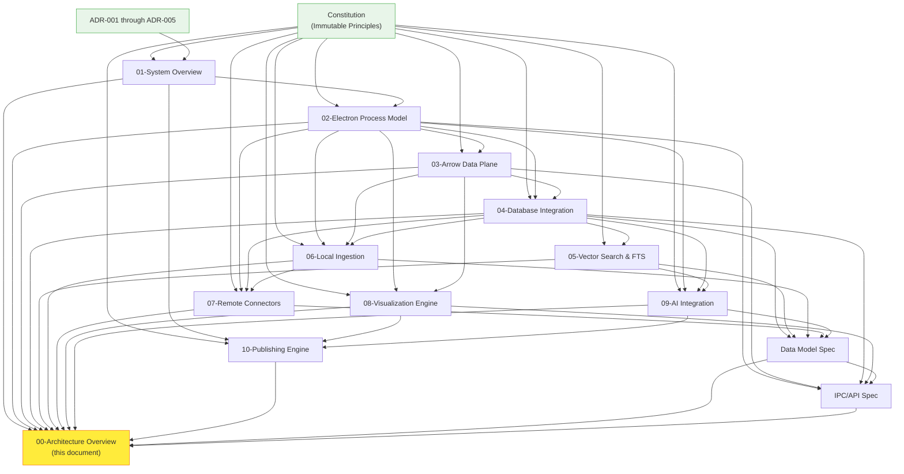
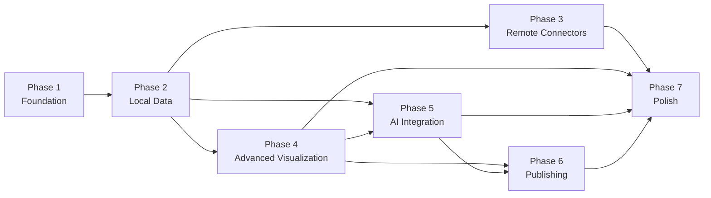
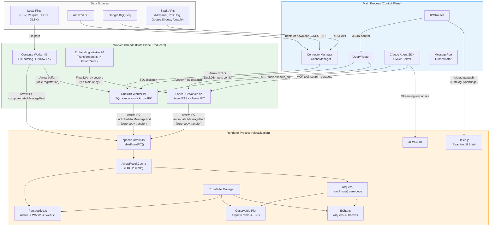
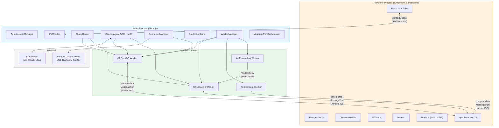

# duckspace: Master Architecture Overview

**Document:** 00-architecture-overview.md
**Version:** 1.0
**Date:** 2026-02-05
**Status:** Accepted
**References:** All 10 design documents, Data Model Spec, IPC/API Spec, Constitution

---

## 1. Executive Summary

duckspace is a **serverless data warehouse in a desktop application** -- a macOS-first Electron application that gives individual analysts the power of a modern data stack without deploying servers, managing infrastructure, or paying per-query cloud costs. It embeds three specialized database engines (DuckDB for OLAP analytics, LanceDB for vector/FTS search, Dexie.js for reactive UI state), transfers all data via Apache Arrow IPC, and integrates Claude AI for natural language analytics through the Claude Agent SDK.

### Key Design Principles

| # | Principle | Summary |
|---|-----------|---------|
| 9 | **Arrow-First Data Flow** | All inter-component data transfer uses Apache Arrow IPC. JSON is restricted to control-plane messages only. |
| 10 | **Embedded-Only Databases** | DuckDB, LanceDB, and Dexie.js all run in-process within Electron. No external database servers. |
| 11 | **Stream and Scan** | Never load full datasets into JavaScript memory. Use streaming, scanning, or predicate pushdown. |
| 12 | **Process Isolation** | Main Process owns lifecycle and routing. Workers own database engines. Renderer owns visualization. |
| 13 | **macOS-First** | All technology choices target macOS with Electron. Cross-platform deferred. |
| 14 | **Single-User, Local-First** | No multi-user sync or authentication. Offline-capable. Remote connectors degrade gracefully. |

### Technology Stack at a Glance

| Category | Technology | Role |
|----------|-----------|------|
| **Runtime** | Electron v28+ | Desktop shell (Chromium + Node.js) |
| **OLAP Database** | DuckDB (native N-API addon) | Analytical SQL, columnar scans, aggregations |
| **Vector Database** | LanceDB (native N-API addon) | Vector similarity search, Tantivy FTS, hybrid search (RRF) |
| **Reactive State** | Dexie.js (IndexedDB) | UI state, metadata catalog, chat history, preferences |
| **Data Interchange** | Apache Arrow IPC (Stream format) | Zero-copy inter-process data transfer |
| **IPC Transport** | MessagePort (ArrayBuffer transfer) | Direct Worker-to-Renderer data channels |
| **Data Grid** | Perspective.js (WASM + WebGL) | Interactive data grid, pivot tables, virtual scrolling |
| **Statistical Charts** | Observable Plot | Distributions, regressions, small multiples (SVG) |
| **Data Wrangling** | Arquero | Client-side Arrow table operations, zero-copy `fromArrow()` |
| **Dashboard Charts** | ECharts (+ echarts-gl) | Time series, gauges, maps, Sankey diagrams (Canvas) |
| **AI Conversation** | Claude Agent SDK | LLM interaction via autonomous agent loop |
| **Tool Protocol** | MCP (Model Context Protocol) | Tool registration, discovery, invocation (in-process) |
| **Embeddings** | Transformers.js (all-MiniLM-L6-v2) | Local 384-dim embedding generation for RAG |
| **UI Framework** | React + react-grid-layout | Component rendering, drag-and-drop dashboard composition |

### Bundle Size Budget

| Component | Size |
|-----------|------|
| Electron baseline | 150-200 MB |
| DuckDB + extensions | 53-73 MB |
| LanceDB N-API addon | 15-25 MB |
| Perspective.js (WASM + JS) | ~10 MB |
| ECharts (tree-shaken + gl) | ~500 KB |
| Observable Plot | ~150 KB |
| Arquero (incl. Flechette) | ~150 KB |
| Dexie.js + React hooks | ~83 KB |
| apache-arrow JS | ~500 KB |
| Transformers.js + ONNX model | ~31 MB |
| **Total estimate** | **~260-340 MB** |

---

## 2. Document Map

### 2.1 Architecture Document Inventory

| # | Document | Path | Scope |
|---|----------|------|-------|
| 00 | **Architecture Overview** (this document) | `design/00-architecture-overview.md` | Master entry point, document map, phase mapping, end-to-end data flow, cross-reference matrix |
| 01 | System Overview | `design/01-system-overview.md` | Component topology, technology stack, roadmap, cross-references |
| 02 | Electron Process Model | `design/02-electron-process-model.md` | Process types, Worker Thread allocation, MessagePort channels, startup/shutdown sequences, preload/contextBridge API |
| 03 | Arrow Data Plane | `design/03-arrow-data-plane.md` | Arrow IPC format, streaming protocol, backpressure, predicate pushdown, channel architecture |
| 04 | Database Integration | `design/04-database-integration.md` | DuckDB configuration, LanceDB configuration, Dexie.js schema, query routing, cross-database patterns |
| 05 | Vector Search and FTS | `design/05-vector-search-fts.md` | LanceDB vector indices, Tantivy FTS, hybrid search (RRF), embedding pipeline, RAG retrieval |
| 06 | Local Ingestion Pipeline | `design/06-local-ingestion.md` | File scanning, format detection, Arrow conversion, metadata extraction, auto-registration, folder watching |
| 07 | Remote Connectors | `design/07-remote-connectors.md` | Connector framework, S3/BigQuery/ClickHouse/SaaS adapters, credential management, caching |
| 08 | Visualization Engine | `design/08-visualization-engine.md` | Perspective.js DuckDBHandler, Observable Plot + Arquero integration, ECharts dashboards, cross-filter manager |
| 09 | AI Integration | `design/09-ai-integration.md` | Claude Agent SDK, MCP server (9 analytics tools), RAG pipeline, session management, safety enforcement |
| 10 | Publishing Engine | `design/10-publishing-engine.md` | Export pipeline, static HTML generation, embedded viewers, shareable snapshots |

### 2.2 Specification Documents

| Spec | Path | Scope |
|------|------|-------|
| Data Model Specification | `data-model/data-model-spec.md` | All persistent entities, relationships, storage locations across DuckDB, LanceDB, and Dexie.js |
| IPC/API Specification | `api-spec/ipc-api-spec.md` | All message types, contextBridge API surface, MessagePort protocols, Worker message contracts |

### 2.3 Architecture Decision Records

| ADR | Title | Key Decision |
|-----|-------|-------------|
| ADR-001 | Embedded Database Trio | DuckDB + LanceDB + Dexie.js (Dexie.js chosen over RxDB) |
| ADR-002 | Apache Arrow Data Plane | Arrow IPC Stream + MessagePort transfer (no JSON fallback) |
| ADR-003 | Visualization Stack | Perspective.js + Observable Plot + ECharts + Arquero |
| ADR-004 | AI Integration | Claude Agent SDK + MCP + local embeddings (Agent SDK chosen over Client SDK) |
| ADR-005 | Process Architecture | Single Renderer + Main + 4 Worker Threads |

### 2.4 Recommended Reading Order

For someone new to the duckspace architecture, the recommended reading order is:

1. **00-Architecture Overview** (this document) -- start here for orientation
2. **01-System Overview** -- component topology and technology stack
3. **02-Electron Process Model** -- understand how processes communicate
4. **03-Arrow Data Plane** -- the data transfer backbone
5. **04-Database Integration** -- the three embedded databases
6. **05-Vector Search and FTS** -- AI retrieval infrastructure
7. **06-Local Ingestion Pipeline** -- how data enters the system
8. **07-Remote Connectors** -- cloud and SaaS data sources
9. **08-Visualization Engine** -- how data is rendered
10. **09-AI Integration** -- conversational analytics
11. **10-Publishing Engine** -- sharing results
12. **Data Model Spec** -- all persistent entities
13. **IPC/API Spec** -- all message contracts

### 2.5 Document Dependency Graph



---

## 3. Roadmap Phase Architecture Mapping

duckspace is designed for incremental delivery across seven phases. Each phase produces a functional increment that builds on previous phases.

### Phase Dependency Graph



### Phase 1: Foundation

**Objective:** Establish the Electron application shell with DuckDB integration, Arrow IPC data channels, and the basic query execution pipeline.

**Relevant Design Documents:**
- **02-Electron Process Model** -- Process topology, Worker Thread architecture, startup/shutdown sequences, preload/contextBridge API
- **03-Arrow Data Plane** -- Arrow IPC format, MessagePort channel setup, backpressure protocol, streaming transfer
- **04-Database Integration** -- DuckDB initialization, Worker Thread hosting, query routing (DuckDB path only)
- **IPC/API Spec** -- Control plane message types, contextBridge `query.*` namespace

**Key Components Implemented:**
- Electron Main Process with AppLifecycleManager, ConfigManager, WorkerManager
- DuckDB Worker Thread with native addon, SQL execution, Arrow IPC output
- MessagePortOrchestrator with duckdb-data channel
- Preload script with contextBridge API (`query.execute`, `query.cancel`, `lifecycle.ready`)
- Basic React shell with tab framework

**Dependencies on Prior Phases:** None (first phase)

**Success Criteria:**
- Electron app launches in < 2 seconds on macOS
- DuckDB Worker reports ready and responds to health checks
- SQL queries execute via contextBridge and return Arrow IPC results via MessagePort
- Arrow IPC round-trip from DuckDB Worker to Renderer demonstrated
- Graceful shutdown with DuckDB WAL flush

---

### Phase 2: Local Data

**Objective:** Enable local file ingestion, metadata catalog, and basic data grid visualization.

**Relevant Design Documents:**
- **06-Local Ingestion Pipeline** -- File discovery, format detection, parsing, DuckDB registration, metadata catalog creation
- **04-Database Integration** -- Dexie.js reactive state setup, CatalogSyncBridge, metadata catalog collections
- **08-Visualization Engine** -- Perspective.js DuckDBHandler for data grid rendering

**Key Components Implemented:**
- Compute Worker (#3) for file parsing (CSV, Parquet, JSON, XLSX, Arrow IPC)
- Folder watcher (chokidar/FSEvents) for automatic file discovery
- Format detection and schema inference pipeline
- DuckDB table/view registration (`CREATE TABLE AS arrow_scan`, `CREATE VIEW` for Parquet)
- Dexie.js schema with `data_sources`, `table_metadata`, `column_statistics` collections
- CatalogSyncBridge for Main-to-Renderer metadata push
- Perspective.js data grid with DuckDBHandler (virtual scrolling, query pushdown)
- Basic query editor interface

**Dependencies on Prior Phases:** Phase 1 (Electron shell, DuckDB, Arrow IPC)

**Success Criteria:**
- CSV, Parquet, and JSON files import successfully
- Imported tables appear in Dexie.js-backed catalog with reactive queries
- Perspective.js renders data grid with sorting, filtering, and virtual scrolling
- Column statistics computed and displayed
- Folder watch detects new/modified/deleted files

---

### Phase 3: Remote Connectors

**Objective:** Connect to cloud storage, hosted databases, and SaaS analytics platforms.

**Relevant Design Documents:**
- **07-Remote Connectors** -- Connector framework, S3/BigQuery/ClickHouse/SaaS adapters, credential management, caching

**Key Components Implemented:**
- ConnectorRegistry and ConnectorManager framework
- CredentialStore with Electron safeStorage (macOS Keychain)
- Cloud storage connectors: S3, GCS (via DuckDB httpfs extension)
- Database connectors: BigQuery, ClickHouse
- SaaS connectors: Mixpanel, PostHog, Google Sheets, Airtable
- CacheManager with TTL-based invalidation and LRU eviction
- OAuthManager for Google Sheets OAuth 2.0 flow
- Connection management UI with test-connection and browse capabilities

**Dependencies on Prior Phases:** Phase 2 (ingestion pipeline, metadata catalog)

**Success Criteria:**
- At least one cloud storage connector (S3) reads Parquet files directly via DuckDB httpfs
- At least one SaaS connector (Mixpanel or Google Sheets) fetches and caches data
- Credentials stored securely in macOS Keychain via safeStorage
- Cache-first query pattern serves cached data when offline
- Remote sources appear in shared metadata catalog alongside local sources

---

### Phase 4: Advanced Visualization

**Objective:** Full visualization stack with statistical charts, dashboard composition, and cross-filter coordination.

**Relevant Design Documents:**
- **08-Visualization Engine** -- Observable Plot integration, ECharts dashboards, Arquero data wrangling, cross-filter manager, dashboard layout

**Key Components Implemented:**
- Observable Plot renderer with Arquero `fromArrow()` zero-copy pipeline
- ECharts renderer with Arquero data wrangling (`dt.objects()` and `dt.column().data` TypedArray)
- CrossFilterManager with SQL WHERE predicate propagation and debounce
- ChartTypeRouter mapping data shapes to optimal chart types
- Dashboard layout via react-grid-layout (drag-and-drop, responsive resize)
- Dashboard persistence in Dexie.js (`dashboards`, `dashboard_panels` collections)
- Renderer Web Workers for off-main-thread chart data preparation
- ThemeManager with dark mode and color palette support

**Dependencies on Prior Phases:** Phase 2 (Perspective.js data grid, DuckDB queries)

**Success Criteria:**
- Observable Plot renders statistical charts (histograms, scatter plots, regressions)
- ECharts renders dashboard widgets (time series, gauges, Sankey)
- Cross-filter interactions propagate between Perspective, Plot, and ECharts panels
- Dashboard layout saves and restores from Dexie.js
- Arquero zero-copy pipeline verified (no `toArray()` in Plot path)

---

### Phase 5: AI Integration

**Objective:** Claude AI-powered conversational data analytics with RAG grounding.

**Relevant Design Documents:**
- **09-AI Integration** -- Claude Agent SDK, MCP server, tool definitions, RAG pipeline, session management, safety enforcement
- **05-Vector Search and FTS** -- Embedding pipeline, LanceDB vector indices, hybrid search (RRF), RAG context assembly

**Key Components Implemented:**
- Claude Agent SDK (AgentSDKHost) with autonomous agent loop and streaming responses
- MCP Server (in-process, InMemoryTransport) with 9 analytics tools:
  - `execute_sql`, `explore_schema`, `sample_data`, `describe_statistics`
  - `search_datasets` (hybrid vector + FTS), `save_analysis`
  - `create_visualization`, `export_data`, `list_tables`
- Embedding Worker (#4) with Transformers.js / all-MiniLM-L6-v2 (384-dim, int8 ONNX)
- LanceDB tables: `document_embeddings`, `column_embeddings`, `query_embeddings`
- RAG Orchestrator with context assembly and token budget management
- Defense-in-depth SQL safety: allowedTools restriction, PreToolUse hook, regex validation, read-only DuckDB connection, query timeout + row limit
- ConversationManager with session lifecycle, resume, fork
- Chat UI with streaming display, code highlighting, tool result visualization
- Conversation state persisted in Dexie.js (`chat_conversations`, `chat_messages`)

**Dependencies on Prior Phases:** Phase 2 (data catalog), Phase 4 (visualization for AI-generated charts)

**Success Criteria:**
- Claude Agent SDK initializes with local Claude Code auth (no API key)
- Natural language query produces correct SQL via `execute_sql` tool
- Hybrid search retrieves relevant schema context from LanceDB
- Defense-in-depth prevents mutation queries (5-layer safety)
- Streaming AI responses display in chat UI in real-time
- Conversation sessions persist and resume across app restarts

---

### Phase 6: Publishing

**Objective:** Export dashboards and analyses as standalone, shareable artifacts.

**Relevant Design Documents:**
- **10-Publishing Engine** -- Export pipeline (selection, data snapshot, template, bundling, output), viewer types, privacy scrubbing

**Key Components Implemented:**
- ExportPipelineManager orchestrating 5-stage export flow
- DataPackager for data subsetting, aggregation pre-compute, and privacy scrubbing
- TemplateEngine (Handlebars) for viewer HTML generation
- AssetBundler (esbuild) for JS/CSS tree-shaking and bundling
- DeploymentManager for local file save and version tracking
- Export viewer types:
  - Single HTML file (data embedded, < 10 MB)
  - Multi-file package (index.html + assets/ + data/)
  - Chat UI export (embeddable chat component)
- Export metadata tracked in Dexie.js

**Dependencies on Prior Phases:** Phase 4 (dashboards), Phase 5 (AI chat sessions)

**Success Criteria:**
- Dashboard exports as self-contained HTML file that opens in any browser
- Exported artifacts contain no credentials, connection strings, or sensitive metadata
- Multi-file package includes working Perspective.js / Observable Plot / ECharts viewers
- Export pipeline completes within 30 seconds for typical dashboards

---

### Phase 7: Polish

**Objective:** Performance optimization, UX refinement, error handling, accessibility, and documentation.

**Relevant Design Documents:**
- Cross-cutting across all documents

**Key Components Implemented:**
- Memory tuning: DuckDB memory limits, Arrow cache sizing, Renderer memory audits
- Startup optimization: parallel Worker init, lazy Embedding Worker, < 2s target
- Keyboard navigation and accessibility (ARIA labels, focus management)
- Error recovery: dirty shutdown detection, DuckDB WAL replay, LanceDB version recovery
- User documentation and onboarding
- Performance profiling and bottleneck resolution

**Dependencies on Prior Phases:** All prior phases (3, 4, 5, 6)

**Success Criteria:**
- Application startup < 2 seconds
- Memory usage stays within budget (16 GB Mac reference)
- No data loss on crash (DuckDB WAL, LanceDB versioning, Dexie.js atomic transactions)
- Core keyboard shortcuts functional (Cmd+K search, Cmd+Enter execute)
- All error states display actionable user-facing messages

---

## 4. End-to-End Data Flow

The following diagram shows how data flows from source through every system component to visualization, with Arrow as the universal data format.



### Data Flow Key Invariants

1. **Arrow everywhere on the data plane.** Every byte of analytical data crossing a process boundary uses Arrow IPC Stream format. JSON is exclusively for the control plane (query requests, ACKs, lifecycle signals).

2. **Main Process is NOT in the data path.** After MessagePort channel setup, query results flow directly from Worker Threads to the Renderer via MessagePort. The Main Process only relays control messages.

3. **Single copy at the N-API boundary.** The only unavoidable data copy is DuckDB/LanceDB native -> V8 ArrayBuffer at the N-API addon boundary. All subsequent transfers use ArrayBuffer ownership move (zero-copy).

4. **Arquero eliminates toArray() copies.** Observable Plot consumes Arquero tables via native iteration (zero-copy). ECharts uses `dt.objects()` (1 copy) for complex charts or `dt.column().data` (zero-copy TypedArray) for numeric series.

5. **Backpressure prevents memory exhaustion.** Window-based flow control (window size 4, ~8 MB in-flight per channel) prevents fast DuckDB queries from overwhelming the Renderer.

6. **Reactive state is Renderer-local.** Dexie.js runs in the Renderer's IndexedDB with zero IPC latency. The Main Process pushes metadata updates via `webContents.send()`, but never reads from Dexie.js directly.

### Serialization Boundary Summary

| Boundary | Direction | Format | Copy? |
|----------|-----------|--------|-------|
| DuckDB C++ -> Worker V8 | Worker-internal | Arrow IPC | Yes (1 unavoidable N-API copy) |
| Worker -> Renderer | Cross-process | Arrow IPC ArrayBuffer | No (zero-copy transfer) |
| LanceDB Rust -> Worker V8 | Worker-internal | Arrow IPC | Yes (1 unavoidable N-API copy) |
| ArrowJS -> Perspective.js | In-process | Arrow Table reference | No (shared reference into WASM) |
| ArrowJS -> Arquero -> Observable Plot | In-process | Arquero ColumnTable | No (fromArrow zero-copy + Plot iterates table) |
| ArrowJS -> Arquero -> ECharts | In-process | Objects or TypedArray | Conditional (objects = 1 copy; TypedArray = 0 copy) |
| Embedding Worker -> LanceDB Worker | Inter-worker | Float32Array | No (transferred via Main relay) |
| Control messages (all boundaries) | Any | JSON | Yes (structured clone, negligible for small messages) |

---

## 5. Component Cross-Reference Matrix

The following matrix maps major system components (rows) to the documents that define them (columns). A filled cell indicates the document is the **primary definition** for that component.

| Component | 01 | 02 | 03 | 04 | 05 | 06 | 07 | 08 | 09 | 10 | DM | IPC |
|-----------|----|----|----|----|----|----|----|----|----|----|----|----|
| **Electron Shell / Lifecycle** | x | **P** | | | | | | | | | | |
| **Main Process Modules** | x | **P** | | | | | | | | | | x |
| **DuckDB Worker** | x | **P** | x | **P** | | x | x | | x | x | x | x |
| **LanceDB Worker** | x | **P** | x | **P** | **P** | | | | x | | x | x |
| **Compute Worker** | x | **P** | x | | | **P** | | | | x | | x |
| **Embedding Worker** | x | **P** | | | **P** | | | | x | | x | |
| **MessagePort Channels** | x | **P** | **P** | | | | | | | | | **P** |
| **Arrow IPC Protocol** | x | | **P** | | | | | | | | | x |
| **Backpressure** | | | **P** | | | | | | | | | x |
| **Predicate Pushdown** | | | **P** | | | | | | | | | x |
| **DuckDB Config & Catalog** | | | | **P** | | x | x | | | | **P** | |
| **LanceDB Tables & Indices** | | | | **P** | **P** | | | | x | | **P** | |
| **Dexie.js Schema & Queries** | | | | **P** | | x | x | x | x | x | **P** | |
| **Query Router** | x | | | **P** | | | | | | | | x |
| **Embedding Pipeline** | | | | | **P** | x | | | x | | | |
| **Vector Index Management** | | | | x | **P** | | | | | | | |
| **Full-Text Search (Tantivy)** | | | | | **P** | | | | x | | | |
| **Hybrid Search (RRF)** | | | | | **P** | | | | x | | | |
| **File Parsers** | | | | | | **P** | | | | | | |
| **Folder Watch System** | | | | | | **P** | | | | | | |
| **Auto-Registration Pipeline** | | | | x | | **P** | | | | | x | |
| **Connector Framework** | | | | | | | **P** | | | | | x |
| **Credential Store** | | | | | | | **P** | | | | | |
| **Cache Manager** | | | | | | | **P** | | | | | |
| **Perspective.js (DuckDBHandler)** | x | | | | | | | **P** | | x | | |
| **Observable Plot + Arquero** | x | x | | | | | | **P** | | x | | |
| **ECharts + Arquero** | x | x | | | | | | **P** | | x | | |
| **CrossFilterManager** | | | | | | | | **P** | | | | |
| **Dashboard Layout** | | | | | | | | **P** | | | x | |
| **Claude Agent SDK** | x | | | | | | | | **P** | | | x |
| **MCP Server & Tools** | x | | | | | | | | **P** | | | x |
| **RAG Pipeline** | | | | | x | | | | **P** | | | |
| **Conversation Manager** | | | | | | | | | **P** | | x | x |
| **Safety Enforcement** | x | | | | | | | | **P** | | | |
| **Export Pipeline** | | | | | | | | | | **P** | | |
| **Template Engine** | | | | | | | | | | **P** | | |
| **Asset Bundler** | | | | | | | | | | **P** | | |
| **Preload Bridge API** | | **P** | | | | | x | | x | | | **P** |

**Legend:** **P** = Primary definition, x = Referenced/extended

---

## 6. Key Design Patterns Summary

### Pattern 1: Arrow-First Data Transfer

All data-plane communication uses Apache Arrow IPC Stream format. No JSON fallback for small payloads. This eliminates decision logic and maintains a single code path.

```
DuckDB (C++) --[Arrow C API]--> N-API Binding --[1 copy]--> V8 ArrayBuffer
V8 ArrayBuffer --[postMessage transfer]--> Renderer V8 ArrayBuffer (zero-copy)
Renderer ArrayBuffer --[tableFromIPC]--> Arrow Table --[direct read]--> Perspective WASM
```

**Enforced by:** Constitution Principle 9, ADR-002, Doc 03

### Pattern 2: Stream-and-Scan Processing

Never load full datasets into JavaScript memory. DuckDB executes all filtering, sorting, aggregation, and grouping using its columnar scan engine. The Renderer receives only the rows it will display.

- Chunked Arrow RecordBatch streaming with adaptive batch sizes (target 2 MB per batch)
- Window-based backpressure (window size 4, max 8 MB in-flight per channel)
- Predicate pushdown via StructuredQueryDescriptor compilation to parameterized SQL
- Client-side filtering permitted only for small cross-filter interactions (< 5,000 rows)

**Enforced by:** Constitution Principle 11, ADR-002, Doc 03 Section 3-4

### Pattern 3: Process Isolation Model

```
Main Process (Node.js)
  Purpose: Lifecycle management, IPC dispatch, query routing, AI orchestration
  Does NOT: Hold database connections, relay data-plane buffers, perform computation

Worker Threads (V8 Isolates in Main OS Process)
  #1 DuckDB:   Native addon, OLAP queries, Arrow IPC output
  #2 LanceDB:  Native addon, vector/FTS search, Arrow IPC output
  #3 Compute:  File parsing, Arrow transforms, data export
  #4 Embedding: Transformers.js/ONNX, local embedding generation

Renderer Process (Chromium, Sandboxed)
  Purpose: Visualization (Perspective, Observable Plot, ECharts), UI, Dexie.js state
  Does NOT: Access filesystem, load native modules, make network requests
```

**Dexie.js exception:** Dexie.js runs in the Renderer (not Main) because reactive UI state belongs close to the UI. IndexedDB is Chromium-native and `liveQuery()` operates without IPC. This is a documented Principle 12 deviation (see ADR-001).

**Enforced by:** Constitution Principle 12, ADR-005, Doc 02

### Pattern 4: Reactive State Management (Dexie.js)

Dexie.js provides push-based reactive queries via `liveQuery()` that automatically re-evaluate when underlying data changes. The `useLiveQuery` React hook integrates this into the component rendering cycle.

- **9 collections:** `user_preferences`, `dashboards`, `data_sources`, `table_metadata`, `chat_conversations`, `chat_messages`, `query_history`, `column_statistics`, `open_tabs`
- **Main Process updates:** CatalogSyncBridge sends structured update messages via `webContents.send()` which the Renderer writes to Dexie.js
- **Zero IPC for reads:** Dexie.js queries execute entirely in the Renderer against local IndexedDB
- **Atomic transactions:** IndexedDB provides transaction atomicity (no partial writes on crash)

**Enforced by:** ADR-001, Doc 04 Section 4

### Pattern 5: Tool-Using AI Agents (MCP)

The Claude Agent SDK operates an autonomous agent loop that can invoke MCP tools to interact with data. The MCP server runs in-process using `InMemoryTransport` (no network, no subprocess).

- **9 analytics tools** registered via MCP: `execute_sql`, `explore_schema`, `sample_data`, `describe_statistics`, `search_datasets`, `save_analysis`, `create_visualization`, `export_data`, `list_tables`
- **Defense-in-depth SQL safety** (5 layers): `allowedTools` restriction, `PreToolUse` hook, regex validation, read-only DuckDB connection, query timeout + row limit
- **Progressive context loading:** Minimal schema overview injected at session start (~3K tokens); agent uses tools to discover details on demand
- **Local embeddings:** No external API calls for RAG retrieval -- Transformers.js runs in Embedding Worker #4
- **Zero-config auth:** Claude Agent SDK uses local Claude Code installation + Claude Max subscription (no API keys, no cost tracking)

**Enforced by:** ADR-004 (Revision 3), Doc 09

### Pattern 6: Cache-First Remote Data Access

Remote connectors follow a cache-first pattern: check DuckDB cache table validity (TTL), serve from cache on hit, fetch from remote on miss, and store in DuckDB for future queries.

- **TTL-based invalidation** per connector type (15 min for Sheets/Airtable, 1-6 hours for others)
- **LRU eviction** when total cache exceeds 2 GB budget
- **Offline mode:** Serves stale cached data with a warning when network is unavailable
- **DuckDB httpfs:** S3/GCS Parquet files read directly by DuckDB without download

**Enforced by:** Constitution Principle 14, Doc 07 Section 6

---

## 7. Process Topology Summary



---

## 8. Storage Architecture Summary

| Database | Process | Storage Location | Purpose | Access Pattern |
|----------|---------|-----------------|---------|---------------|
| **DuckDB** | Worker #1 | `~/Library/Application Support/Duckspace/analytics.duckdb` | OLAP analytics, registered tables, cache tables | SQL via Worker postMessage, Arrow IPC results |
| **LanceDB** | Worker #2 | `~/Library/Application Support/Duckspace/lance/` | Vector embeddings, FTS indices, semantic search | Vector/FTS via Worker postMessage, Arrow IPC results |
| **Dexie.js** | Renderer | `~/Library/Application Support/Duckspace/IndexedDB/` | UI state, metadata catalog, chat history, preferences | Direct IndexedDB access, liveQuery reactive |
| **Credentials** | Main | `~/Library/Application Support/Duckspace/credentials.enc` | Encrypted connector credentials | safeStorage encrypt/decrypt, macOS Keychain |
| **Config** | Main | `~/Library/Application Support/Duckspace/config.json` | Application configuration | JSON file read/write |
| **DuckDB Temp** | Worker #1 | `~/Library/Application Support/Duckspace/tmp/` | Spill-to-disk for large queries | Managed by DuckDB, cleaned on shutdown |
| **ONNX Models** | Worker #4 | `~/Library/Application Support/Duckspace/models/` | Embedding model cache | Transformers.js model cache |

---

## 9. Architectural Consistency Notes

### Constitution Principle Enforcement

| Principle | Verification |
|-----------|-------------|
| **#9 Arrow-First** | All 3 data MessagePort channels (duckdb-data, lance-data, compute-data) carry Arrow IPC. JSON restricted to ipcMain.handle and webContents.send control messages. No JSON fallback for small data. |
| **#10 Embedded-Only** | DuckDB in Worker #1 (native addon). LanceDB in Worker #2 (N-API addon). Dexie.js in Renderer (IndexedDB). No external processes. Arrow Flight explicitly rejected (ADR-002). |
| **#11 Stream and Scan** | Chunked Arrow streaming with backpressure (window=4). Perspective DuckDBHandler with virtual scrolling. Pre-aggregation for chart libraries. Arquero operates on Arrow buffers without toArray(). |
| **#12 Process Isolation** | Main Process: lifecycle + routing only. Workers: database engines. Renderer: visualization + Dexie.js (documented exception). |
| **#13 macOS-First** | All native addons target macOS arm64/x64. WebGL maps to Metal. safeStorage uses macOS Keychain. FSEvents for folder watching. |
| **#14 Single-User, Local-First** | No auth, no sync. Local embeddings via Transformers.js. Remote features degrade gracefully. Claude Agent SDK uses local Claude Code auth. |

### Technology Correction Notes

The following technology choices reflect decisions made during the design process and supersede any earlier references:

- **Reactive State:** Dexie.js (not RxDB). Dexie.js provides `liveQuery()` reactive queries, MIT license, and zero-IPC operation in the Renderer. See ADR-001.
- **AI SDK:** Claude Agent SDK (not Anthropic Client SDK). Agent SDK provides zero-config auth via Claude Max, native MCP integration, and `allowedTools` restriction. See ADR-004 Revision 3.
- **Data Wrangling:** Arquero for Renderer-side Arrow table operations. `fromArrow()` provides zero-copy wrapping. Observable Plot iterates Arquero tables directly. See ADR-003 Revision 4.
- **Visualization:** Observable Plot + ECharts for charting (Perspective.js for data grid only, not for dashboards). Cross-filter coordination managed by custom CrossFilterManager.

---

*Document 00 of the duckspace Architecture Series*
*Generated: 2026-02-05 | Plan: duckspace-system-design-2026-02-04 | Task: integration-architecture-overview*
