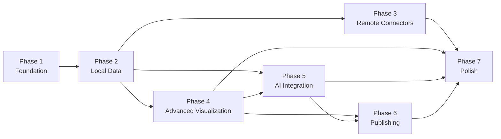

# duckspace: System Overview and Component Topology

**Document:** 01-system-overview.md
**Version:** 1.1
**Date:** 2026-02-04
**Status:** Accepted
**Relates to:** ADR-001 through ADR-005, all subsequent design documents

---

## 1. System Purpose and Scope

### What duckspace Is

duckspace is a **serverless data warehouse in a desktop application**. It is a macOS-first Electron application that gives individual analysts the power of a modern data stack -- analytical SQL, vector search, GPU-accelerated visualization, and AI-powered exploration -- without deploying any servers, managing any infrastructure, or paying per-query cloud costs.

duckspace embeds three specialized database engines directly inside the Electron process:

- **DuckDB** for analytical SQL (OLAP queries, columnar scans, aggregations, joins)
- **LanceDB** for vector similarity search and full-text search (RAG pipeline, semantic search)
- **Dexie.js** for reactive UI state (dashboard layouts, metadata catalog, chat history, preferences)

All inter-component data transfer uses **Apache Arrow IPC** -- a zero-copy columnar binary format that eliminates JSON serialization overhead and preserves type fidelity from database engine through to visualization layer.

### Target User

duckspace targets the **solo analyst or small-team data practitioner** who:

- Works primarily on macOS
- Needs to explore datasets ranging from thousands to millions of rows
- Wants SQL-level analytical power without database administration
- Values offline-capable, privacy-preserving local-first operation
- Benefits from AI assistance for query generation, data exploration, and insight summarization

### Key Design Principles

| # | Principle | Description |
|---|-----------|-------------|
| 9 | **Arrow-First Data Flow** | All inter-component data transfer uses Apache Arrow. JSON serialization in hot paths is a design violation. |
| 10 | **Embedded-Only Databases** | No external database servers. DuckDB, LanceDB, and Dexie.js all run in-process within Electron. |
| 11 | **Stream and Scan** | Never load full datasets into JavaScript memory. All data access uses streaming, scanning, or predicate pushdown. |
| 12 | **Process Isolation** | Main Process owns database engines. Renderer Process owns visualization. Worker Threads isolate heavy computation. |
| 13 | **macOS-First** | All technology choices must work on macOS with Electron. Cross-platform is deferred. |
| 14 | **Single-User, Local-First** | No multi-user sync or authentication. The app works offline for local data; remote connectors degrade gracefully. |

These principles are codified in the [Project Constitution](../../decomposition/constitution.yaml) and are immutable for all design decisions.

---

## 2. High-Level Component Diagram

```mermaid
graph TB
    subgraph RendererProcess["Renderer Process (Chromium)"]
        UI["React UI Layer"]
        PerspectiveJS["Perspective.js<br/>(Data Grid / Pivot)"]
        ObservablePlot["Observable Plot<br/>(Statistical Charts)"]
        ECharts["ECharts<br/>(Dashboard Widgets)"]
        DexieJS["Dexie.js<br/>(Reactive State via IndexedDB)"]
        ArrowJS["apache-arrow JS<br/>(IPC Deserialization)"]
        FilterMgr["Cross-Filter Manager"]
        ContextBridge["contextBridge API"]
    end

    subgraph MainProcess["Main Process (Node.js)"]
        Lifecycle["App Lifecycle Manager"]
        IPCHub["IPC Hub<br/>(ipcMain.handle)"]
        MPOrch["MessagePort Orchestrator"]
        QueryRouter["Query Router"]
        AgentSDK["Claude Agent SDK<br/>(Conversation Engine)"]
        MCPServer["MCP Server<br/>(In-Process, InMemoryTransport)"]
        SessionMgr["Session Manager"]
    end

    subgraph Workers["Worker Threads"]
        DuckDBWorker["Worker #1: DuckDB<br/>(N-API Native Addon)<br/>OLAP Queries, Arrow IPC Output"]
        LanceDBWorker["Worker #2: LanceDB<br/>(N-API Native Addon)<br/>Vector Search, FTS, Hybrid Search"]
        ComputeWorker["Worker #3: Compute Pipeline<br/>(Ingestion, Export, Transforms)"]
        EmbeddingWorker["Worker #4: Embedding<br/>(Transformers.js / ONNX)"]
    end

    subgraph ExternalSources["External Data Sources"]
        LocalFiles["Local Files<br/>(CSV, Parquet, JSON)"]
        S3["Amazon S3"]
        BigQuery["Google BigQuery"]
        ClickHouse["ClickHouse"]
        SaaS["SaaS APIs<br/>(Mixpanel, PostHog,<br/>Google Sheets, Airtable)"]
    end

    subgraph AIServices["AI Services (Network)"]
        ClaudeAPI["Claude API<br/>(via Claude Max)"]
    end

    %% Renderer internal connections
    UI --> PerspectiveJS
    UI --> ObservablePlot
    UI --> ECharts
    UI --> DexieJS
    FilterMgr --> PerspectiveJS
    FilterMgr --> ObservablePlot
    FilterMgr --> ECharts

    %% Renderer to Main (control plane)
    ContextBridge -->|"Control Messages<br/>(JSON via IPC)"| IPCHub

    %% MessagePort data channels (zero-copy Arrow IPC)
    DuckDBWorker -->|"Arrow IPC ArrayBuffer<br/>(MessagePort, zero-copy)"| ArrowJS
    LanceDBWorker -->|"Arrow IPC ArrayBuffer<br/>(MessagePort, zero-copy)"| ArrowJS
    ComputeWorker -->|"Arrow IPC ArrayBuffer<br/>(MessagePort, zero-copy)"| ArrowJS

    %% ArrowJS feeds visualization
    ArrowJS --> PerspectiveJS
    ArrowJS --> ObservablePlot
    ArrowJS --> ECharts

    %% Main Process orchestration
    IPCHub --> QueryRouter
    QueryRouter --> DuckDBWorker
    QueryRouter --> LanceDBWorker
    MPOrch --> DuckDBWorker
    MPOrch --> LanceDBWorker
    MPOrch --> ComputeWorker

    %% AI integration
    AgentSDK --> MCPServer
    MCPServer -->|"execute_sql"| DuckDBWorker
    MCPServer -->|"search_datasets"| LanceDBWorker
    AgentSDK -->|"Streaming Responses<br/>(IPC)"| UI
    AgentSDK <-->|"Claude API"| ClaudeAPI

    %% Embedding pipeline
    EmbeddingWorker -->|"Float32Array vectors"| LanceDBWorker

    %% Data ingestion
    LocalFiles --> ComputeWorker
    S3 --> ComputeWorker
    BigQuery --> ComputeWorker
    ClickHouse --> ComputeWorker
    SaaS --> ComputeWorker
    ComputeWorker -->|"Register tables"| DuckDBWorker
```



### Process Boundary Summary

| Process | Owns | Does NOT Own |
|---------|------|-------------|
| **Renderer** (Chromium) | Visualization (Perspective.js, Observable Plot, ECharts), Dexie.js reactive state, UI interaction | Database engines, native modules, heavy computation |
| **Main** (Node.js) | App lifecycle, IPC dispatch, MessagePort orchestration, Claude Agent SDK, MCP Server, query routing | Visualization, direct data plane relay |
| **DuckDB Worker** | DuckDB native addon, SQL execution, Arrow IPC result production | Visualization, application lifecycle |
| **LanceDB Worker** | LanceDB native addon, vector indices, FTS indices, hybrid search | SQL analytics, visualization |
| **Compute Worker** | Data ingestion, Arrow transforms, export pipeline | Database engines, visualization |
| **Embedding Worker** | ONNX runtime, Transformers.js, embedding computation | Database storage, visualization |

**Dexie.js exception:** Dexie.js runs in the Renderer Process (not Main), which is a documented deviation from Principle 12. Rationale: reactive UI state belongs close to the UI; IndexedDB is Chromium-native; `liveQuery()`/`useLiveQuery()` operates without IPC. See [ADR-001](../decisions/adr-001-database-trio.md) for full justification.

---

## 3. Technology Stack Summary

| Category | Technology | Role | Process | License | ADR |
|----------|-----------|------|---------|---------|-----|
| **Runtime** | Electron (v28+) | Desktop application shell | All | MIT | -- |
| **OLAP Database** | DuckDB (native N-API addon) | Analytical SQL, columnar scans, aggregations | Worker Thread #1 | MIT | [ADR-001](../decisions/adr-001-database-trio.md) |
| **Vector Database** | LanceDB (native N-API addon) | Vector similarity search, FTS, hybrid search | Worker Thread #2 | Apache 2.0 | [ADR-001](../decisions/adr-001-database-trio.md) |
| **Reactive State** | Dexie.js (IndexedDB) | UI state, metadata catalog, chat history | Renderer | MIT | [ADR-001](../decisions/adr-001-database-trio.md) |
| **Data Interchange** | Apache Arrow IPC (Stream format) | Zero-copy inter-process data transfer | All (data plane) | Apache 2.0 | [ADR-002](../decisions/adr-002-arrow-data-plane.md) |
| **IPC Transport** | MessagePort (ArrayBuffer transfer) | Direct Worker-to-Renderer data channels | Main (setup), Worker+Renderer (runtime) | -- | [ADR-002](../decisions/adr-002-arrow-data-plane.md) |
| **Data Grid** | Perspective.js (WASM + WebGL) | Interactive data exploration, pivot tables | Renderer (Web Worker) | Apache 2.0 | [ADR-003](../decisions/adr-003-visualization-stack.md) |
| **Statistical Charts** | Observable Plot | Distributions, regressions, small multiples | Renderer | ISC | [ADR-003](../decisions/adr-003-visualization-stack.md) |
| **Data Wrangling** | Arquero | Client-side Arrow table operations, filtering, derived columns | Renderer | BSD-3-Clause | [ADR-003](../decisions/adr-003-visualization-stack.md) |
| **Dashboard Charts** | ECharts (+ echarts-gl) | Time series, gauges, maps, Sankey diagrams | Renderer | Apache 2.0 | [ADR-003](../decisions/adr-003-visualization-stack.md) |
| **AI Conversation** | Claude Agent SDK | LLM interaction, autonomous agent loop | Main | Anthropic | [ADR-004](../decisions/adr-004-ai-integration.md) |
| **Tool Protocol** | MCP (Model Context Protocol) | Tool registration, discovery, invocation | Main (in-process) | Open Standard | [ADR-004](../decisions/adr-004-ai-integration.md) |
| **Embeddings** | Transformers.js (all-MiniLM-L6-v2) | Local embedding generation for RAG | Worker Thread #4 | Apache 2.0 | [ADR-004](../decisions/adr-004-ai-integration.md) |
| **UI Framework** | React | Component rendering, state management | Renderer | MIT | -- |
| **Dashboard Layout** | react-grid-layout | Drag-and-drop dashboard composition | Renderer | MIT | [ADR-003](../decisions/adr-003-visualization-stack.md) |

### Bundle Size Budget

| Component | Size | Notes |
|-----------|------|-------|
| Electron baseline | 150-200 MB | Chromium + Node.js |
| DuckDB core + extensions | 53-73 MB | Native addon + parquet, json, httpfs, icu |
| LanceDB N-API addon | 15-25 MB | Rust-compiled |
| Perspective.js (WASM + JS) | ~10 MB | C++ engine compiled to WASM |
| ECharts (tree-shaken + gl) | ~500 KB | Only imported chart types |
| Observable Plot | ~150 KB | ES module |
| Arquero (incl. Flechette) | ~150 KB | ES module, zero-copy Arrow loading |
| Dexie.js + React hooks | ~83 KB | No native compilation |
| apache-arrow JS | ~500 KB | Arrow deserialization |
| Transformers.js + ONNX model | ~31 MB | Embedding model (all-MiniLM-L6-v2) |
| **Total estimate** | **~260-340 MB** | Comparable to other Electron analytics apps |

---

## 4. Roadmap Phase Overview

duckspace is designed for incremental delivery across seven phases. Each phase produces a functional increment that builds on previous phases.

| Phase | Name | Key Systems | Dependencies | Key Deliverables |
|-------|------|------------|--------------|------------------|
| **Phase 1** | **Foundation** | Electron shell, DuckDB Worker Thread, Arrow IPC, basic query execution | None | Electron app with DuckDB integration, MessagePort data channels, Arrow IPC streaming, contextBridge API |
| **Phase 2** | **Local Data** | Local file ingestion, metadata catalog (Dexie.js), basic data grid (Perspective.js) | Phase 1 | CSV/Parquet/JSON import, auto-registration, folder scanning, Perspective data grid with DuckDBHandler, basic query interface |
| **Phase 3** | **Remote Connectors** | S3, BigQuery, ClickHouse connectors, SaaS integrations (Mixpanel, PostHog, Google Sheets, Airtable) | Phase 2 | Connector framework, credential management, remote table registration in DuckDB, incremental sync, cache management |
| **Phase 4** | **Advanced Visualization** | Observable Plot statistical charts, ECharts dashboards, cross-filter coordination, dashboard composition | Phase 2 | Full visualization stack, dashboard builder with drag-and-drop, cross-filter manager, chart type selection, export to image |
| **Phase 5** | **AI Integration** | Claude Agent SDK, MCP server, RAG pipeline (LanceDB + embeddings), text-to-SQL, insight generation | Phase 2, Phase 4 | Chat interface, natural language queries, data exploration assistant, schema-aware context, session management |
| **Phase 6** | **Publishing** | Export pipeline, embedded viewers, static HTML generation, hosted chat UI export | Phase 4, Phase 5 | Export dashboards as standalone HTML, embedded Perspective viewers, shareable analysis snapshots |
| **Phase 7** | **Polish** | Performance optimization, UX refinement, error handling, accessibility, documentation | All prior phases | Memory tuning, startup optimization, keyboard navigation, error recovery, user documentation |

### Phase Dependency Graph



### Phase-to-Architecture Document Mapping

| Phase | Primary Design Documents |
|-------|------------------------|
| Phase 1 | 02-Electron Process Model, 03-Arrow Data Plane, 04-Database Integration |
| Phase 2 | 06-Local Ingestion Pipeline, 04-Database Integration (metadata catalog) |
| Phase 3 | 07-Remote Connectors |
| Phase 4 | 08-Visualization Engine |
| Phase 5 | 09-AI Integration, 05-Vector Search and FTS |
| Phase 6 | 10-Publishing Engine |
| Phase 7 | Cross-cutting across all documents |

---

## 5. Data Flow Architecture

### End-to-End Arrow Data Flow

The following diagram shows how data flows from ingestion through to visualization, with Arrow as the universal format.

```
[Data Source]                    [Compute Worker #3]              [DuckDB Worker #1]
 CSV/Parquet/JSON  ---------->  Arrow conversion  ------------>  Table registration
 S3/BigQuery/etc.               Schema extraction                Columnar storage
                                Metadata extraction              Query execution
                                                                 Arrow IPC output
                                                                      |
                                                                      v
                                                            [MessagePort Channel]
                                                            ArrayBuffer transfer
                                                            (zero-copy, Transferable)
                                                                      |
                                                                      v
                                                            [Renderer Process]
                                                            apache-arrow JS
                                                            tableFromIPC()
                                                                      |
                                   +----------------------------------+------------------+
                                   |                                  |                  |
                                   v                                  v                  v
                           [Perspective.js]                  [Observable Plot]      [ECharts]
                           Arrow IPC -> WASM                 Small Arrow ->         Small Arrow ->
                           WebGL datagrid                    Arquero -> SVG         Arquero -> Canvas
                           Virtual scroll                    Pre-aggregated         Pre-aggregated
                           Query pushdown                    subsets only           subsets only
```

**Key invariants:**
- Raw data never materializes as JavaScript objects in the Renderer
- Only pre-aggregated summaries (<10K rows) are loaded into Arquero via fromArrow() for Observable Plot (zero-copy iteration) and ECharts (dt.objects() or TypedArray passthrough)
- Perspective handles raw data natively via Arrow + WASM + WebGL
- The Main Process is NOT in the data path after MessagePort channel setup
- Backpressure (window-based, window size 4) prevents memory exhaustion

### Control Plane vs Data Plane Separation

| Plane | Format | Transport | Examples |
|-------|--------|-----------|----------|
| **Control** | JSON | ipcRenderer.invoke / ipcMain.handle | Query requests, catalog operations, config changes, error reports |
| **Data** | Arrow IPC (binary) | MessagePort with ArrayBuffer transfer | Query results, search results, ingestion output |
| **Reactive State** | JavaScript objects | Dexie.js liveQuery (Renderer-local) | Dashboard layouts, chat history, user preferences |

---

## 6. Cross-Reference Index

This section maps all architecture documents to each other, showing how they relate and what each covers.

### Architecture Document Inventory

| # | Document | Path | Scope |
|---|----------|------|-------|
| 01 | System Overview (this document) | `artifacts/design/01-system-overview.md` | Component topology, technology stack, roadmap, cross-references |
| 02 | Electron Process Model | `artifacts/design/02-electron-process-model.md` | Process types, Worker Thread allocation, MessagePort channels, startup sequence, preload/contextBridge API |
| 03 | Arrow Data Plane | `artifacts/design/03-arrow-data-plane.md` | Arrow IPC format, streaming protocol, backpressure, predicate pushdown, channel architecture |
| 04 | Database Integration | `artifacts/design/04-database-integration.md` | DuckDB configuration, LanceDB configuration, Dexie.js schema, query routing, cross-database patterns |
| 05 | Vector Search and FTS | `artifacts/design/05-vector-search-fts.md` | LanceDB vector indices, Tantivy FTS, hybrid search (RRF), embedding pipeline, RAG retrieval |
| 06 | Local Ingestion Pipeline | `artifacts/design/06-local-ingestion.md` | File scanning, format detection, Arrow conversion, metadata extraction, auto-registration, folder watching |
| 07 | Remote Connectors | `artifacts/design/07-remote-connectors.md` | Connector framework, S3/BigQuery/ClickHouse/SaaS adapters, credential management, incremental sync, caching |
| 08 | Visualization Engine | `artifacts/design/08-visualization-engine.md` | Perspective.js DuckDBHandler, Observable Plot integration, ECharts dashboards, cross-filter manager, layout |
| 09 | AI Integration | `artifacts/design/09-ai-integration.md` | Claude Agent SDK, MCP server, tool definitions, RAG pipeline, session management, safety enforcement |
| 10 | Publishing Engine | `artifacts/design/10-publishing-engine.md` | Export pipeline, static HTML generation, embedded viewers, shareable snapshots |

### Architecture Decision Records

| ADR | Title | Key Decision | Referenced By |
|-----|-------|-------------|---------------|
| [ADR-001](../decisions/adr-001-database-trio.md) | Embedded Database Trio | DuckDB + LanceDB + Dexie.js | Docs 01, 02, 04, 05 |
| [ADR-002](../decisions/adr-002-arrow-data-plane.md) | Apache Arrow Data Plane | Arrow IPC Stream + MessagePort transfer | Docs 01, 02, 03, 04, 06, 07, 08 |
| [ADR-003](../decisions/adr-003-visualization-stack.md) | Visualization Stack | Perspective.js + Observable Plot + ECharts | Docs 01, 08, 10 |
| [ADR-004](../decisions/adr-004-ai-integration.md) | AI Integration | Claude Agent SDK + MCP + local embeddings | Docs 01, 05, 09 |
| [ADR-005](../decisions/adr-005-process-architecture.md) | Process Architecture | Single Renderer + Main + 3 Worker Threads | Docs 01, 02, 03, 04 |

### Specification Documents

| Spec | Path | Scope | Feeds Into |
|------|------|-------|------------|
| Data Model | `artifacts/specs/data-model-spec.md` | All persistent entities, relationships, storage locations | Docs 04, 05, 06, 07, 09, IPC API spec |
| IPC/API | `artifacts/specs/ipc-api-spec.md` | All message types, contextBridge API, MessagePort protocols | Docs 02, 03, 04, 08 |

### Integration Documents

| Document | Path | Purpose |
|----------|------|---------|
| Architecture Overview | `artifacts/integration/00-architecture-overview.md` | Unified narrative across all design docs |
| Cross-Reference Validation | `artifacts/integration/cross-reference-validation.md` | Consistency checks across all documents |

### Document Dependency Matrix

The following matrix shows which documents each design document depends on (reads from) and feeds into (is read by).

| Document | Depends On (inputs) | Feeds Into (consumers) |
|----------|-------------------|----------------------|
| 01-System Overview | All 5 ADRs, Constitution | 02, 10, Integration docs |
| 02-Process Model | 01, ADR-001, ADR-005 | 03, 04, 06, 07, 08, 09, IPC spec |
| 03-Arrow Data Plane | 02, ADR-002 | 04, 06, 08, IPC spec |
| 04-Database Integration | 02, 03, ADR-001 | 05, 06, 07, 09, Data Model spec, IPC spec |
| 05-Vector Search/FTS | 04, ADR-001, ADR-004 | 09, Data Model spec |
| 06-Local Ingestion | 02, 03, 04 | 07, Data Model spec |
| 07-Remote Connectors | 02, 04, 06 | Data Model spec |
| 08-Visualization Engine | 02, 03, ADR-003 | 10, IPC spec |
| 09-AI Integration | 02, 04, 05, ADR-004 | 10, Data Model spec |
| 10-Publishing Engine | 01, 08, 09 | Integration docs |

---

## 7. Architectural Principles Summary

The following table maps each constitutional principle to how it is satisfied across the architecture.

| Principle | Enforcement Mechanism | Primary Documents |
|-----------|----------------------|-------------------|
| **Arrow-First (9)** | Arrow IPC Stream format on all MessagePort data channels; JSON restricted to control plane only | ADR-002, Doc 03 |
| **Embedded-Only (10)** | DuckDB native addon in Worker Thread; LanceDB N-API addon in Worker Thread; Dexie.js in Renderer IndexedDB; no external processes | ADR-001, ADR-005, Doc 02, Doc 04 |
| **Stream and Scan (11)** | Chunked Arrow streaming with backpressure (window=4); Perspective DuckDBHandler with virtual scrolling and query pushdown; pre-aggregation for chart libraries | ADR-002, ADR-003, Doc 03, Doc 08 |
| **Process Isolation (12)** | Main Process: lifecycle + query routing; Worker Threads: database engines; Renderer: visualization + Dexie.js (documented exception) | ADR-005, Doc 02 |
| **macOS-First (13)** | All native addons target macOS arm64/x64; WebGL maps to Metal; no Linux/Windows-specific APIs | All ADRs |
| **Single-User, Local-First (14)** | No auth, no sync; local embeddings via Transformers.js; remote features degrade gracefully; Claude Agent SDK uses local Claude Code auth | ADR-004, Doc 07, Doc 09 |

---

## 8. Key Architectural Patterns

### Pattern: Query Routing

All database queries flow through a central Query Router in the Main Process that dispatches to the correct engine.

| Query Type | Target Engine | Worker | Format |
|-----------|--------------|--------|--------|
| Analytical SQL | DuckDB | Worker #1 | Arrow IPC result |
| Vector similarity | LanceDB | Worker #2 | Arrow IPC result |
| Full-text search | LanceDB FTS | Worker #2 | Arrow IPC result |
| Hybrid search | LanceDB (vector + FTS + RRF) | Worker #2 | Arrow IPC result |
| Cross-database analytics | DuckDB + Arrow scan of LanceDB results | Workers #1 + #2 | Arrow IPC result |
| UI state read/write | Dexie.js liveQuery | Renderer (direct) | JavaScript objects |

### Pattern: Zero-Copy Transfer Pipeline

```
DuckDB (C++) --[Arrow C API]--> N-API Binding --[one copy]--> V8 ArrayBuffer
V8 ArrayBuffer --[postMessage transfer]--> Renderer V8 ArrayBuffer (zero-copy)
Renderer ArrayBuffer --[tableFromIPC]--> Arrow Table --[direct read]--> Perspective WASM
```

### Pattern: Defense-in-Depth SQL Safety

1. **Layer 1 -- Agent SDK allowedTools:** Restricts agent to `mcp__duckspace__*` tools only
2. **Layer 2 -- PreToolUse hook:** Intercepts `execute_sql`, validates read-only
3. **Layer 3 -- MCP tool handler:** Regex rejects mutation keywords
4. **Layer 4 -- DuckDB connection:** Configured in read-only mode
5. **Layer 5 -- Worker Thread:** 30-second query timeout, 1000-row limit for AI context

### Pattern: Progressive Context Loading (RAG)

Rather than pre-loading all schema context into the LLM prompt:
1. Inject minimal schema overview into system prompt (~3K tokens)
2. Agent uses `explore_schema` MCP tool to discover specific tables
3. Agent uses `describe_statistics` for columns of interest
4. Agent uses `sample_data` to understand data shape
5. LanceDB hybrid search retrieves relevant past queries and analyses

This keeps context usage proportional to query complexity.

---

*Document 01 of the duckspace Architecture Series*
*Generated: 2026-02-04 | Plan: duckspace-system-design-2026-02-04 | Task: design-system-overview*

---
**R4 Revision (2026-02-05):** Added Arquero to technology table and bundle budget. Updated pipeline diagram to show Arquero replacing toArray() for Observable Plot and ECharts paths.
