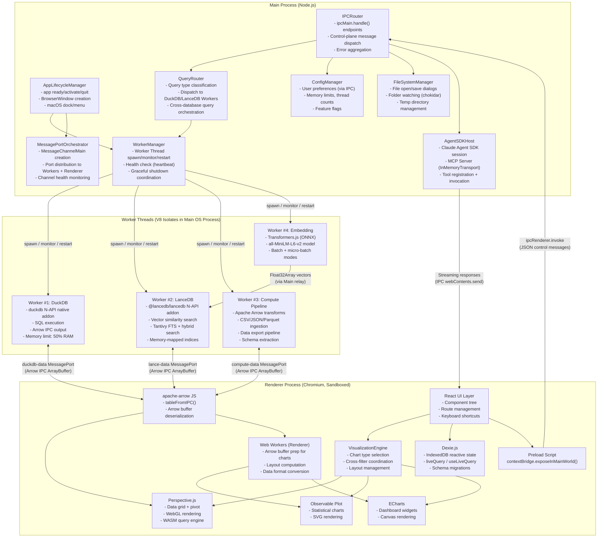
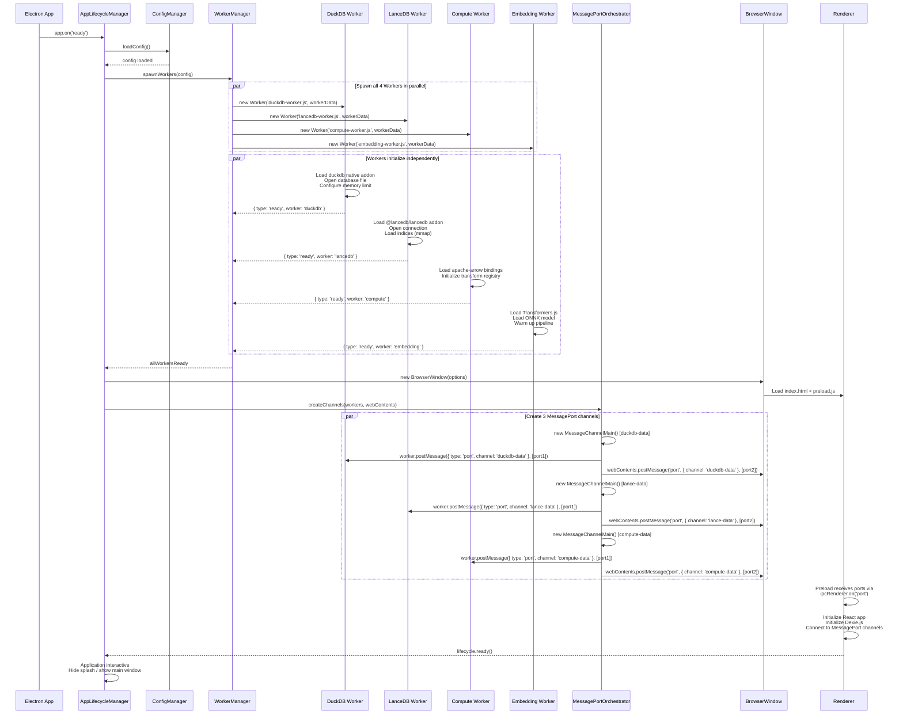
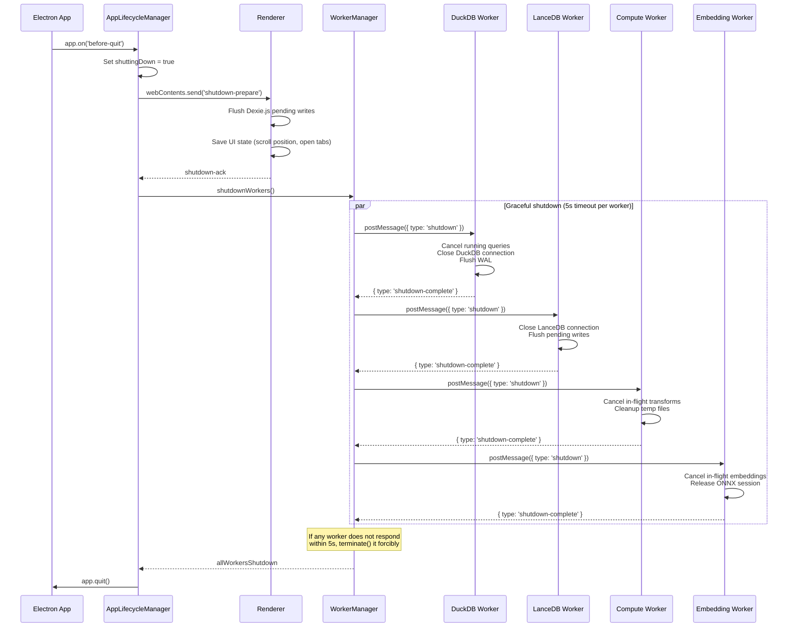
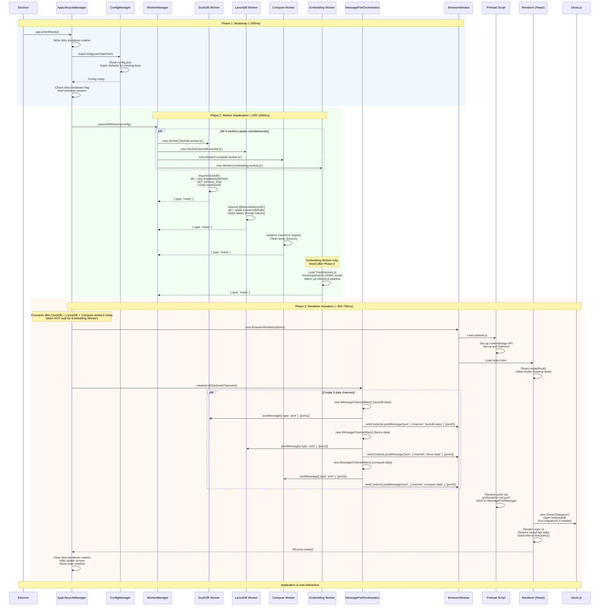
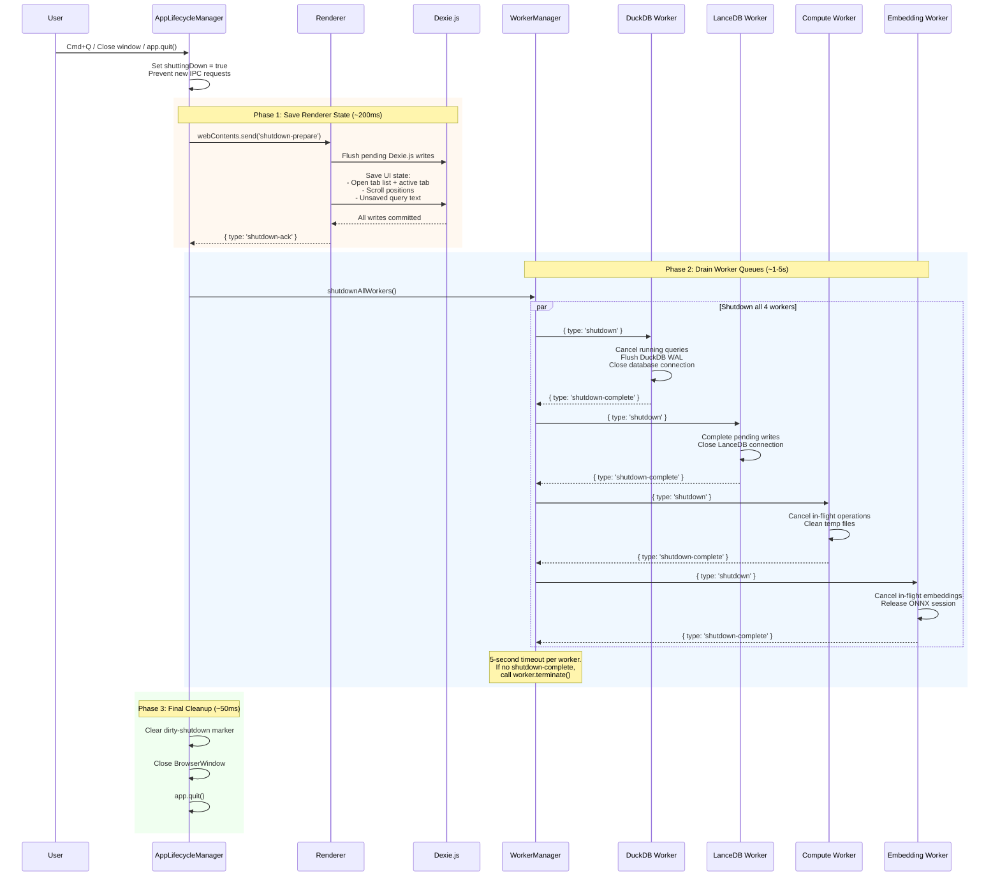

# datspace: Electron Process Model

**Document:** 02-electron-process-model.md
**Version:** 1.0
**Date:** 2026-02-05
**Status:** Accepted
**Depends on:** [ADR-005](../decisions/adr-005-process-architecture.md), [ADR-001](../decisions/adr-001-database-trio.md), [01-System Overview](01-system-overview.md), [Constitution](../../decomposition/constitution.yaml)
**Feeds into:** 03-Arrow Data Plane, 04-Database Integration, 06-Local Ingestion, 07-Remote Connectors, 08-Visualization Engine, 09-AI Integration, IPC/API Spec

---

## 1. Process Topology Diagram

The following diagram shows the complete process topology of datspace, including all modules, their process assignments, and communication channels.



### Process Boundary Summary

| Process | Type | OS Process | Crash Impact |
|---------|------|-----------|--------------|
| **Main Process** | Node.js event loop | Electron main | Fatal -- all windows close |
| **Renderer Process** | Chromium content process | Separate OS process | Recoverable -- can recreate BrowserWindow |
| **DuckDB Worker** | V8 isolate (worker_threads) | Same as Main | Fatal if native segfault; V8 exception is contained |
| **LanceDB Worker** | V8 isolate (worker_threads) | Same as Main | Fatal if native segfault; V8 exception is contained |
| **Compute Worker** | V8 isolate (worker_threads) | Same as Main | Fatal if native segfault; V8 exception is contained |
| **Embedding Worker** | V8 isolate (worker_threads) | Same as Main | Fatal if native segfault; V8 exception is contained |

---

## 2. Main Process Architecture

The Main Process is the **control plane** and **lifecycle manager** for datspace. It runs no data-plane operations after initial MessagePort channel setup. Per ADR-005, the Main Process must remain responsive at all times -- it must never perform synchronous computation that blocks the Node.js event loop for more than 10ms.

### 2.1 Module Listing

| Module | Responsibility | Startup Order |
|--------|---------------|---------------|
| **AppLifecycleManager** | Electron app events (`ready`, `activate`, `before-quit`, `window-all-closed`), BrowserWindow creation, macOS dock/menu integration | 1 |
| **ConfigManager** | Load/save user configuration from `app.getPath('userData')/config.json`, provide defaults, expose via IPC | 2 |
| **WorkerManager** | Spawn, monitor (heartbeat), and restart the 4 Worker Threads. Maintains worker registry with status and restart counts. | 3 |
| **MessagePortOrchestrator** | Create `MessageChannelMain` pairs, distribute ports to Workers and Renderer, monitor channel health | 4 |
| **IPCRouter** | Register `ipcMain.handle()` endpoints, validate incoming messages, dispatch to appropriate handler module | 5 |
| **QueryRouter** | Classify query type (SQL, vector, FTS, hybrid, cross-DB), dispatch to correct Worker via `worker.postMessage()` | 5 |
| **FileSystemManager** | Native file/folder dialogs, folder watching (chokidar), temp directory lifecycle | 5 |
| **AgentSDKHost** | Initialize Claude Agent SDK session, create MCP server with `InMemoryTransport`, register MCP tools, manage conversation sessions | 6 (after Workers ready) |

### 2.2 Initialization Sequence



**Timing budget (target: <2 seconds total startup):**

| Phase | Target | Notes |
|-------|--------|-------|
| Electron app.ready | ~200ms | Platform overhead |
| Config load | ~10ms | JSON file read |
| Worker spawn (all 4 parallel) | ~50ms | worker_threads creation is fast |
| DuckDB init | ~300-500ms | Native addon load + database open |
| LanceDB init | ~200-400ms | Native addon load + mmap indices |
| Compute Worker init | ~50ms | JS-only, fast |
| Embedding Worker init | ~500-1000ms | ONNX model loading (31MB) |
| BrowserWindow creation | ~200ms | Chromium renderer spawn |
| MessagePort setup | ~20ms | Channel creation + port distribution |
| Renderer initialization | ~300-500ms | React hydration + Dexie.js open |
| **Total** | **~1.3-2.5s** | Embedding Worker may complete after app is interactive |

**Note:** The Embedding Worker's ONNX model load is the slowest step. The application becomes interactive before embedding is ready. Embedding requests during this window are queued and processed once the worker reports ready.

### 2.3 Graceful Shutdown Sequence



**Shutdown guarantees:**
- DuckDB WAL is flushed before connection close (data durability)
- LanceDB pending fragment writes are completed or rolled back (versioned storage protects against corruption)
- Dexie.js/IndexedDB transactions are atomic -- partial writes do not occur
- 5-second timeout per worker prevents indefinite hang on shutdown

### 2.4 Error Handling and Crash Recovery

| Error Type | Detection | Response | Recovery |
|-----------|-----------|----------|----------|
| **Worker V8 exception** | `worker.on('error')` | Log error, mark worker as failed | Restart worker via `WorkerManager.restartWorker()` |
| **Worker exit (non-zero)** | `worker.on('exit', code)` | Log exit code, increment restart counter | Auto-restart if restarts < 3 within 60s; else mark degraded |
| **Native module segfault** | Process crash (unrecoverable) | N/A -- entire app crashes | On next launch: detect dirty shutdown flag, offer recovery |
| **Renderer crash** | `webContents.on('render-process-gone')` | Log crash reason | Recreate BrowserWindow, re-establish MessagePort channels |
| **IPC timeout** | Promise timeout (30s default) | Reject promise, log timeout | Retry once; if persistent, mark target worker as unhealthy |
| **MessagePort disconnect** | `port.on('close')` | Log disconnection | Recreate MessageChannelMain, redistribute ports |
| **Main Process unhandled rejection** | `process.on('unhandledRejection')` | Log error with stack trace | Continue (non-fatal); if frequent, log degradation warning |

**Dirty shutdown detection:** On startup, `AppLifecycleManager` writes a `running` marker to `app.getPath('userData')/app-state.json`. On clean shutdown, this marker is cleared. If the marker is still present on next launch, the previous session did not shut down cleanly. The app then:
1. Logs the dirty shutdown event
2. Runs DuckDB integrity check (`PRAGMA database_list; PRAGMA integrity_check`)
3. Verifies LanceDB can open its tables (Lance format is append-only with versioning, so corruption is unlikely)
4. Offers the user a recovery option if any database fails verification

### 2.5 Native Module Hosting

| Native Module | Process | Addon Type | Rebuild Required | Memory Model |
|--------------|---------|-----------|-----------------|-------------|
| `duckdb` | DuckDB Worker Thread | N-API | Yes (`@electron/rebuild`) | Native heap (outside V8), configurable limit |
| `@lancedb/lancedb` | LanceDB Worker Thread | N-API (Rust/neon) | No (N-API ABI stable) | Memory-mapped files + native heap |
| `onnxruntime-node` | Embedding Worker Thread | N-API | Yes (`@electron/rebuild`) | Native heap for model weights + inference |

All native modules are loaded in Worker Threads, not the Main Process. This ensures that native module initialization (which can block for 100-500ms) does not freeze the Main Process event loop.

---

## 3. Renderer Process Architecture

The Renderer Process is a **pure visualization and interaction layer**. Per ADR-005 and Constitution Principle 12, it owns no database engines and performs no heavy computation on its main thread.

### 3.1 Module Listing

| Module | Responsibility |
|--------|---------------|
| **PreloadBridge** | `contextBridge.exposeInMainWorld('datspace', api)` -- typed API surface for Renderer-to-Main control messages |
| **React UI Layer** | Component tree, routing (React Router), keyboard shortcut handling, theme management |
| **VisualizationEngine** | Chart type selection, cross-filter coordination (CrossFilterManager), dashboard layout (react-grid-layout) |
| **Perspective.js** | Data grid, pivot tables, WebGL rendering, WASM query engine, virtual scrolling |
| **Observable Plot** | Statistical charts (distributions, regressions, small multiples), SVG rendering |
| **ECharts** | Dashboard widgets (time series, gauges, maps, Sankey), Canvas rendering |
| **Dexie.js StateManager** | Reactive state via IndexedDB: dashboard layouts, chat history, user preferences, metadata catalog, query history |
| **ArrowDeserializer** | `apache-arrow` JS library for `tableFromIPC()` -- deserializes Arrow IPC buffers received via MessagePort |
| **MessagePortManager** | Receives and manages MessagePort handles from Main Process, routes incoming data to appropriate consumers |
| **Web Workers (Renderer)** | Arrow buffer preparation for chart libraries, layout computation, data format conversion (offloaded from Renderer main thread) |

### 3.2 Context Isolation and Security Model

datspace uses Electron's default security configuration for v28+:

```javascript
const mainWindow = new BrowserWindow({
  webPreferences: {
    contextIsolation: true,    // Preload runs in isolated world
    sandbox: true,             // Full Chromium sandbox
    nodeIntegration: false,    // No Node.js in Renderer
    preload: path.join(__dirname, 'preload.js'),
    webSecurity: true,         // Enforce same-origin policy
  },
});
```

| Security Property | Setting | Effect |
|------------------|---------|--------|
| **contextIsolation** | `true` (default v28+) | Preload script runs in an isolated V8 context. The Renderer's `window` object cannot access preload's `require` or Node.js APIs. Only `contextBridge`-exposed methods are visible. |
| **sandbox** | `true` (default v28+) | Full Chromium sandboxing. The Renderer cannot access the filesystem, spawn processes, or load native modules. All OS access must go through the Main Process via IPC. |
| **nodeIntegration** | `false` (default v28+) | No `require()`, `process`, `Buffer`, or other Node.js globals in the Renderer. |
| **webSecurity** | `true` | Same-origin policy enforced. Prevents Renderer from making arbitrary network requests (remote data access goes through Main Process connectors). |

**Threat model:** The Renderer is treated as untrusted. Even if a vulnerability in a visualization library (Perspective.js, ECharts) allows code execution in the Renderer, the attacker cannot access the filesystem, databases, or network directly. All privileged operations require the Main Process to validate and execute via IPC handlers that enforce authorization checks.

### 3.3 Window Management

datspace uses a **single BrowserWindow with a tab model**:

- **One BrowserWindow** for the entire application
- **Tabs** are implemented in the Renderer via React Router (not Electron's `BrowserView` or multiple windows)
- Tab types: Query Editor, Dashboard View, Data Catalog, Chat/AI, Settings
- Tab state is persisted in Dexie.js (`open_tabs` collection) and restored on launch

This aligns with ADR-005's decision to reject multi-window architecture (Alternative 2) in favor of single-Renderer simplicity.

**macOS integration:**
- Native title bar with traffic lights (close/minimize/maximize)
- `titleBarStyle: 'hiddenInset'` for custom tab bar area
- `vibrancy: 'sidebar'` for macOS-native sidebar appearance
- `app.dock.setMenu()` for dock context menu (recent files, new query)

---

## 4. Worker Thread Architecture

### 4.1 Worker Thread Pool Configuration

datspace uses **4 dedicated Worker Threads** (not a generic thread pool). Each worker has a specific role, its own V8 isolate, and independent lifecycle.

```javascript
// WorkerManager configuration
const WORKER_CONFIG = {
  duckdb: {
    script: 'workers/duckdb-worker.js',
    workerData: {
      dbPath: path.join(userDataPath, 'analytics.duckdb'),
      memoryLimit: `${Math.floor(os.totalmem() * 0.5 / (1024 ** 3))}GB`,
      threads: Math.max(1, os.cpus().length - 2),
      extensions: ['parquet', 'json', 'httpfs', 'icu'],
    },
    resourceLimits: {
      maxOldGenerationSizeMb: 512,  // V8 heap limit for JS (not native)
    },
  },
  lancedb: {
    script: 'workers/lancedb-worker.js',
    workerData: {
      dbPath: path.join(userDataPath, 'lance'),
      compactionThreshold: 50,
    },
    resourceLimits: {
      maxOldGenerationSizeMb: 256,
    },
  },
  compute: {
    script: 'workers/compute-worker.js',
    workerData: {
      tempDir: path.join(userDataPath, 'tmp'),
    },
    resourceLimits: {
      maxOldGenerationSizeMb: 512,
    },
  },
  embedding: {
    script: 'workers/embedding-worker.js',
    workerData: {
      modelName: 'Xenova/all-MiniLM-L6-v2',
      modelCacheDir: path.join(userDataPath, 'models'),
    },
    resourceLimits: {
      maxOldGenerationSizeMb: 512,  // ONNX model loaded into V8 heap
    },
  },
};
```

### 4.2 Worker Types and Responsibilities

#### Worker #1: DuckDB Worker (Query Worker)

**Role:** Execute all analytical SQL queries against local and registered data sources.

| Aspect | Detail |
|--------|--------|
| **Native addon** | `duckdb` (N-API, requires `@electron/rebuild`) |
| **Message types accepted** | `execute_query`, `cancel_query`, `register_table`, `get_table_info`, `configure` |
| **Output format** | Arrow IPC Stream (`ArrayBuffer`) via MessagePort transfer |
| **Streaming** | Chunked Arrow record batches (1024-2048 rows per chunk) with backpressure acknowledgment |
| **Memory limit** | 50% of system RAM (configurable), spill-to-disk enabled |
| **Thread pool** | DuckDB internal thread pool: `os.cpus().length - 2` threads |
| **Cancellation** | `duckdb_interrupt` via `AbortSignal` forwarded from Main Process |
| **Concurrency** | Multiple concurrent read queries (MVCC); writes serialized via internal queue |

**Message protocol:**
```typescript
// Request (Main -> DuckDB Worker via parentPort)
{ type: 'execute_query', queryId: string, sql: string, params?: unknown[] }

// Response (DuckDB Worker -> Renderer via MessagePort, Arrow IPC buffer)
{ type: 'query_result', queryId: string, chunk: number, final: boolean }
// Transfer: [arrowBuffer]  -- zero-copy ownership move

// Error
{ type: 'query_error', queryId: string, error: string, code?: string }
```

#### Worker #2: LanceDB Worker

**Role:** Vector similarity search, full-text search, hybrid search, and vector storage management.

| Aspect | Detail |
|--------|--------|
| **Native addon** | `@lancedb/lancedb` (N-API, Rust-compiled, ABI-stable) |
| **Message types accepted** | `vector_search`, `fts_search`, `hybrid_search`, `add_vectors`, `create_table`, `create_index`, `optimize`, `get_table_info` |
| **Output format** | Arrow IPC Stream (`ArrayBuffer`) via MessagePort transfer |
| **Index types** | No index (<5K), IVF_FLAT (5K-50K), IVF_PQ / IVF_HNSW_SQ (>50K) |
| **FTS engine** | Tantivy-based, BM25 scoring |
| **Hybrid search** | Reciprocal Rank Fusion (RRF) combining vector + FTS |
| **Storage** | Lance columnar format (Arrow-native, versioned, fragment-based) |
| **Compaction** | Triggered on app idle or fragment count > 50, via `table.optimize()` |

**Message protocol:**
```typescript
// Vector search request
{ type: 'vector_search', searchId: string, table: string, vector: Float32Array, limit: number, filter?: string }

// Hybrid search request
{ type: 'hybrid_search', searchId: string, table: string, query: string, vector: Float32Array, limit: number, weights: { vector: number, fts: number } }

// Results (LanceDB Worker -> Renderer via MessagePort)
{ type: 'search_result', searchId: string }
// Transfer: [arrowBuffer]

// Vector insertion (Embedding Worker -> Main -> LanceDB Worker)
{ type: 'add_vectors', table: string, vectors: Float32Array[], metadata: Record<string, unknown>[] }
```

#### Worker #3: Compute Worker (Ingestion Worker)

**Role:** Data ingestion (file parsing, Arrow conversion), Arrow-to-Arrow transformations, and data export.

| Aspect | Detail |
|--------|--------|
| **Libraries** | `apache-arrow` (JS bindings), file format parsers (csv-parse, Parquet via DuckDB delegation) |
| **Message types accepted** | `ingest_file`, `transform`, `export`, `cancel` |
| **Output format** | Arrow IPC Stream (`ArrayBuffer`) for ingested/transformed data |
| **Ingestion pipeline** | Detect format -> Parse -> Convert to Arrow -> Extract schema metadata -> Send to DuckDB for registration |
| **Export pipeline** | Receive Arrow data -> Convert to target format (CSV, Parquet, JSON) -> Write to filesystem |
| **Temp file management** | Uses `tempDir` under `app.getPath('userData')/tmp`, cleaned on startup and shutdown |

**Message protocol:**
```typescript
// Ingestion request
{ type: 'ingest_file', jobId: string, filePath: string, format?: string, options?: IngestOptions }

// Progress updates (Compute Worker -> Main via parentPort)
{ type: 'ingest_progress', jobId: string, rowsProcessed: number, totalRows?: number }

// Completion (Compute Worker -> Renderer via MessagePort for preview data)
{ type: 'ingest_complete', jobId: string, schema: SchemaInfo, rowCount: number }
// Transfer: [previewArrowBuffer]  -- first N rows for UI preview
```

#### Worker #4: Embedding Worker

**Role:** Generate vector embeddings for documents and queries using local ONNX models.

| Aspect | Detail |
|--------|--------|
| **Runtime** | Transformers.js with ONNX Runtime (onnxruntime-node) |
| **Model** | all-MiniLM-L6-v2 (384 dimensions, ~31 MB) |
| **Batch modes** | Bulk ingestion: 256-1024 texts/batch; real-time RAG: 16-64 texts/batch |
| **Message types accepted** | `embed_batch`, `embed_single`, `warmup` |
| **Output** | `Float32Array` vectors sent to Main Process for relay to LanceDB Worker |
| **Initialization** | Slowest worker (~500-1000ms for ONNX model load); queues requests until ready |

**Message protocol:**
```typescript
// Batch embedding request
{ type: 'embed_batch', batchId: string, texts: string[], batchSize?: number }

// Results (Embedding Worker -> Main via parentPort, for relay to LanceDB Worker)
{ type: 'embed_result', batchId: string, vectors: Float32Array[] }
// Transfer: vectors are transferred via transferList for zero-copy
```

### 4.3 Worker Lifecycle Management

**Spawn:**
```typescript
class WorkerManager {
  private workers = new Map<string, { worker: Worker, status: WorkerStatus, restarts: number }>();

  async spawnWorker(name: string): Promise<void> {
    const config = WORKER_CONFIG[name];
    const worker = new Worker(config.script, {
      workerData: config.workerData,
      resourceLimits: config.resourceLimits,
    });

    // Wait for ready signal with timeout
    await new Promise((resolve, reject) => {
      const timeout = setTimeout(() => reject(new Error(`${name} worker startup timeout`)), 10_000);
      worker.once('message', (msg) => {
        if (msg.type === 'ready') {
          clearTimeout(timeout);
          resolve(undefined);
        }
      });
      worker.once('error', (err) => { clearTimeout(timeout); reject(err); });
    });

    this.workers.set(name, { worker, status: 'ready', restarts: 0 });
  }
}
```

**Health monitoring (heartbeat):**
- Every 30 seconds, `WorkerManager` sends `{ type: 'heartbeat' }` to each worker
- Worker must respond with `{ type: 'heartbeat_ack' }` within 5 seconds
- Two consecutive missed heartbeats trigger worker restart
- Heartbeat checks are staggered (not all workers checked simultaneously) to avoid bursty Main Process load

**Restart policy:**
- Maximum 3 restarts within 60 seconds per worker
- After 3 restarts, worker is marked as `degraded` and the user is notified
- When a worker restarts:
  1. `WorkerManager` calls `worker.terminate()`
  2. Spawns new worker with same configuration
  3. `MessagePortOrchestrator` creates new `MessageChannelMain` pair
  4. New ports distributed to restarted worker and Renderer
  5. Renderer's `MessagePortManager` detects port replacement and reconnects

**Terminate:**
```typescript
async terminateWorker(name: string): Promise<void> {
  const entry = this.workers.get(name);
  if (!entry) return;

  entry.worker.postMessage({ type: 'shutdown' });

  // Wait for graceful shutdown with timeout
  const exitCode = await Promise.race([
    new Promise<number>((resolve) => entry.worker.once('exit', resolve)),
    new Promise<number>((resolve) => setTimeout(() => resolve(-1), 5_000)),
  ]);

  if (exitCode === -1) {
    // Forcible termination after timeout
    await entry.worker.terminate();
  }

  this.workers.delete(name);
}
```

### 4.4 Communication Patterns

datspace uses two distinct communication patterns, separating control from data:

**Control plane (parentPort -- Worker <-> Main Process):**
- Used for: query requests, lifecycle messages, heartbeat, error reports, configuration updates
- Format: JSON-serializable objects via `parentPort.postMessage()` / `worker.postMessage()`
- Direction: Bidirectional (Main sends commands, Worker sends status/errors)
- Overhead: Structured clone serialization -- negligible for small control messages

**Data plane (MessagePort -- Worker <-> Renderer, direct):**
- Used for: Arrow IPC buffers (query results, search results, ingestion output)
- Format: `ArrayBuffer` in transfer list (zero-copy ownership move)
- Direction: Primarily Worker -> Renderer (results); Renderer -> Worker for some operations
- Overhead: Near-zero for data transfer (Transferable moves ownership, no copy)
- Setup: `MessageChannelMain` created by Main Process, ports distributed at startup

**Inter-worker communication (via Main Process relay):**
- Used for: Embedding Worker -> LanceDB Worker vector insertion
- Route: Embedding Worker -> `parentPort` -> Main Process -> `worker.postMessage()` -> LanceDB Worker
- Rationale: Worker Threads cannot directly communicate; Main Process acts as relay
- Optimization: `Float32Array` vectors are transferred (not copied) through each hop via `transferList`

```
Control Plane:                     Data Plane:
Worker <--parentPort--> Main       Worker <--MessagePort--> Renderer
(JSON, bidirectional)              (Arrow IPC ArrayBuffer, zero-copy)

Inter-Worker:
EmbeddingWorker --parentPort--> Main --worker.postMessage--> LanceDBWorker
(Float32Array, transferred at each hop)
```

---

## 5. Preload Bridge API Design

The preload script exposes a typed API via `contextBridge.exposeInMainWorld('datspace', api)`. This is the **only** interface between the sandboxed Renderer and the privileged Main Process.

### 5.1 Complete Method Listing

```typescript
// Type definitions for the contextBridge-exposed API
interface DatspaceAPI {
  // === Query Operations ===
  query: {
    /** Initiate a SQL query. Results arrive via duckdb-data MessagePort. */
    execute(sql: string, params?: unknown[]): Promise<{ queryId: string }>;
    /** Cancel a running query. */
    cancel(queryId: string): Promise<void>;
    /** Get table schema information. */
    describeTable(tableName: string): Promise<TableSchema>;
    /** List all registered tables. */
    listTables(): Promise<TableInfo[]>;
  };

  // === Vector / Search Operations ===
  search: {
    /** Initiate vector similarity search. Results via lance-data MessagePort. */
    vectorSearch(query: VectorSearchQuery): Promise<{ searchId: string }>;
    /** Initiate full-text search. Results via lance-data MessagePort. */
    textSearch(query: TextSearchQuery): Promise<{ searchId: string }>;
    /** Initiate hybrid search (vector + FTS). Results via lance-data MessagePort. */
    hybridSearch(query: HybridSearchQuery): Promise<{ searchId: string }>;
  };

  // === Catalog Operations ===
  catalog: {
    /** Register a local file as a data source. */
    registerFile(filePath: string, options?: RegisterOptions): Promise<string>;
    /** Register a remote data source. */
    registerRemote(config: RemoteSourceConfig): Promise<string>;
    /** Remove a registered data source. */
    unregister(sourceId: string): Promise<void>;
    /** Get metadata for a data source. */
    getSource(sourceId: string): Promise<DataSourceInfo>;
    /** List all registered data sources. */
    listSources(): Promise<DataSourceInfo[]>;
  };

  // === Configuration ===
  config: {
    /** Get a configuration value. */
    get<T = unknown>(key: string): Promise<T>;
    /** Set a configuration value. */
    set(key: string, value: unknown): Promise<void>;
    /** Get all configuration values. */
    getAll(): Promise<Record<string, unknown>>;
  };

  // === AI / Agent Operations ===
  ai: {
    /** Send a message to the Claude Agent. Streaming responses via IPC events. */
    sendMessage(conversationId: string, message: string): Promise<{ messageId: string }>;
    /** Create a new conversation session. */
    createConversation(): Promise<{ conversationId: string }>;
    /** Cancel an in-flight AI response. */
    cancelResponse(conversationId: string): Promise<void>;
    /** List conversation history. */
    listConversations(): Promise<ConversationSummary[]>;
  };

  // === Data Ingestion ===
  ingest: {
    /** Start file ingestion. Progress via IPC events, preview via compute-data MessagePort. */
    startFile(filePath: string, options?: IngestOptions): Promise<{ jobId: string }>;
    /** Cancel an in-progress ingestion. */
    cancel(jobId: string): Promise<void>;
    /** Open native file picker dialog. */
    pickFiles(filters?: FileFilter[]): Promise<string[]>;
    /** Open native folder picker dialog. */
    pickFolder(): Promise<string | null>;
  };

  // === Export Operations ===
  export: {
    /** Start data export. Progress via IPC events. */
    start(config: ExportConfig): Promise<{ jobId: string }>;
    /** Cancel an in-progress export. */
    cancel(jobId: string): Promise<void>;
    /** Open native save dialog. */
    pickSaveLocation(defaultName: string, filters?: FileFilter[]): Promise<string | null>;
  };

  // === Lifecycle ===
  lifecycle: {
    /** Signal that Renderer is fully initialized and ready. */
    ready(): Promise<void>;
    /** Get application version and system info. */
    getAppInfo(): Promise<AppInfo>;
  };

  // === Event Subscriptions ===
  on: {
    /** Subscribe to RxDB-style state change events from Main Process. */
    stateChange(callback: (event: StateChangeEvent) => void): () => void;
    /** Subscribe to AI streaming response chunks. */
    aiStream(callback: (event: AIStreamEvent) => void): () => void;
    /** Subscribe to ingestion progress updates. */
    ingestProgress(callback: (event: IngestProgressEvent) => void): () => void;
    /** Subscribe to export progress updates. */
    exportProgress(callback: (event: ExportProgressEvent) => void): () => void;
    /** Subscribe to worker health status changes. */
    workerStatus(callback: (event: WorkerStatusEvent) => void): () => void;
    /** Subscribe to shutdown preparation signal. */
    shutdownPrepare(callback: () => void): () => void;
  };

  // === MessagePort Handles ===
  // Note: MessagePort handles are received via ipcRenderer.on('port')
  // and stored by MessagePortManager in the Renderer. They are NOT
  // exposed via contextBridge (ports are received before contextBridge
  // is fully set up). The preload script sets up port listeners
  // internally and routes data to registered handlers.
}
```

### 5.2 Async Patterns

All contextBridge methods use `ipcRenderer.invoke()` / `ipcMain.handle()` (request-response pattern). This ensures:
- Every call returns a Promise that resolves with the result or rejects with an error
- The Main Process can validate and authorize each request
- Timeout handling is straightforward (Promise.race with timeout)

**Invoke/handle (request-response, for control messages):**
```typescript
// Preload script (simplified)
contextBridge.exposeInMainWorld('datspace', {
  query: {
    execute: (sql: string, params?: unknown[]) =>
      ipcRenderer.invoke('query:execute', { sql, params }),
    cancel: (queryId: string) =>
      ipcRenderer.invoke('query:cancel', { queryId }),
  },
  // ... etc
});

// Main Process
ipcMain.handle('query:execute', async (event, { sql, params }) => {
  const queryId = crypto.randomUUID();
  queryRouter.dispatch('duckdb', { type: 'execute_query', queryId, sql, params });
  return { queryId };
});
```

**Send/on (push events, for streaming and notifications):**
```typescript
// Main Process -> Renderer (push)
mainWindow.webContents.send('ai:stream', { conversationId, chunk, done: false });

// Preload script
contextBridge.exposeInMainWorld('datspace', {
  on: {
    aiStream: (callback: (event: AIStreamEvent) => void) => {
      const handler = (_event: IpcRendererEvent, data: AIStreamEvent) => callback(data);
      ipcRenderer.on('ai:stream', handler);
      return () => ipcRenderer.removeListener('ai:stream', handler);
    },
  },
});
```

### 5.3 Security Considerations

| Risk | Mitigation |
|------|-----------|
| **SQL injection via contextBridge** | Main Process `QueryRouter` validates SQL: rejects mutations (INSERT, UPDATE, DELETE, DROP, ALTER) for user-facing queries; AI queries go through defense-in-depth layers (see System Overview doc 01, Section 8) |
| **Path traversal in file operations** | `FileSystemManager` resolves paths and validates they are within allowed directories (user data, user-selected paths via native dialogs only) |
| **Excessive IPC calls (DoS)** | Rate limiting on IPC handlers: max 100 calls/second per channel, burst limit 20 |
| **Prototype pollution via contextBridge** | All exposed methods are plain functions (no object prototypes leak across the bridge); Electron's contextBridge enforces this automatically |
| **MessagePort data integrity** | Arrow IPC buffers are validated (magic bytes check, schema verification) before deserialization in the Renderer |
| **Renderer compromise** | Sandboxed Renderer cannot access filesystem, spawn processes, or load native modules. All privileged operations require IPC to Main Process. |

---

## 6. Startup and Shutdown Sequences

### 6.1 Detailed Startup Sequence

The startup sequence is divided into three phases: **Bootstrap**, **Worker Initialization**, and **Renderer Activation**.



**Startup dependency ordering:**
1. Config must load before Workers spawn (Workers need configuration values)
2. Workers must report ready before MessagePort channels are created (channel endpoints must exist)
3. BrowserWindow must be created before ports can be sent to Renderer
4. Renderer signals `lifecycle.ready()` only after receiving all ports and initializing Dexie.js
5. Embedding Worker is NOT a blocking dependency -- the app is interactive without it

### 6.2 Detailed Shutdown Sequence



**Shutdown guarantees:**
- Dexie.js/IndexedDB transactions are atomic -- no partial writes
- DuckDB WAL flush ensures query results written to disk
- LanceDB's Lance format uses copy-on-write versioning -- incomplete writes are automatically discarded on next open
- 5-second per-worker timeout prevents indefinite shutdown hangs
- Dirty-shutdown marker cleared only on successful shutdown; presence on next startup triggers recovery check

---

## 7. Memory Monitoring and Resource Management

### 7.1 Per-Process Memory Budget (16 GB Mac)

| Component | Budget | Monitoring | Enforcement |
|-----------|--------|-----------|-------------|
| DuckDB native heap | ~8 GB (configurable) | `SET memory_limit` in DuckDB | DuckDB spills to disk when limit reached |
| DuckDB V8 isolate | 512 MB | `resourceLimits.maxOldGenerationSizeMb` | V8 OOM terminates worker (auto-restart) |
| LanceDB native heap | ~200-500 MB | Memory-mapped files managed by OS | OS page cache handles eviction |
| LanceDB V8 isolate | 256 MB | `resourceLimits.maxOldGenerationSizeMb` | V8 OOM terminates worker (auto-restart) |
| Compute Worker V8 | 512 MB | `resourceLimits.maxOldGenerationSizeMb` | V8 OOM terminates worker (auto-restart) |
| Embedding Worker V8 | 512 MB | `resourceLimits.maxOldGenerationSizeMb` | V8 OOM terminates worker (auto-restart) |
| Renderer (Chromium) | ~500 MB - 1 GB | Chromium's own memory management | Renderer crash triggers recreation |
| Main Process | ~100-200 MB | `process.memoryUsage()` every 60s | Alert if RSS exceeds 300 MB |

### 7.2 Monitoring Implementation

```typescript
// Main Process: periodic memory monitoring (every 60 seconds)
setInterval(() => {
  const mainMem = process.memoryUsage();
  const report = {
    main: {
      rss: mainMem.rss,
      heapUsed: mainMem.heapUsed,
      external: mainMem.external,  // Native addons in Main Process (should be minimal)
    },
    workers: {},
  };

  // Request memory reports from each Worker
  for (const [name, entry] of workerManager.workers) {
    entry.worker.postMessage({ type: 'memory_report' });
    // Workers respond with their own process.memoryUsage()
  }

  // Log if any component exceeds its budget
  if (mainMem.rss > 300 * 1024 * 1024) {
    log.warn('Main Process RSS exceeds 300MB', { rss: mainMem.rss });
  }
}, 60_000);
```

---

## 8. Process Topology Decisions Cross-Reference

This section maps each design decision in this document back to [ADR-005](../decisions/adr-005-process-architecture.md) and the [Constitution](../../decomposition/constitution.yaml).

| Decision | ADR-005 Section | Constitution Principle |
|----------|----------------|----------------------|
| Single Renderer + Main + 4 Workers | "Process Topology" | #12 (Process Isolation) |
| DuckDB in Worker Thread (not UtilityProcess) | "Alternative 1: UtilityProcess" rejected | #9 (Arrow-First), #12 (Process Isolation) |
| Single BrowserWindow (not multi-window) | "Alternative 2: Multiple Renderer Windows" rejected | #14 (Single-User, Local-First) |
| DuckDB as native addon (not WASM) | "Alternative 3: Database in Renderer via WASM" rejected | #12 (Process Isolation) |
| MessagePort for direct Worker-Renderer data | "MessagePort Channels" section | #9 (Arrow-First Data Flow) |
| Main Process as control plane only | "Main Process Responsibilities" | #12 (Process Isolation) |
| Dexie.js in Renderer (exception to Principle 12) | ADR-001 "Consequences" | #12 deviation documented |
| contextBridge as sole Renderer-Main interface | "Preload Script and contextBridge API Surface" | Electron security best practices |
| 4 workers (expanded from ADR-005's 3) | System Overview doc showed need for dedicated Embedding Worker | #12 (Process Isolation) |

**Note on 4 vs 3 Workers:** ADR-005 describes "3 Dedicated Worker Threads" (DuckDB, LanceDB, Computation). The System Overview (doc 01) added a 4th Embedding Worker based on ADR-004's requirement for local embedding generation via Transformers.js/ONNX. This expansion follows the same architectural pattern (dedicated worker per workload type) and does not conflict with ADR-005's design rationale.

---

*Document 02 of the datspace Architecture Series*
*Generated: 2026-02-05 | Plan: datspace-system-design-2026-02-04 | Task: design-electron-process-model*
