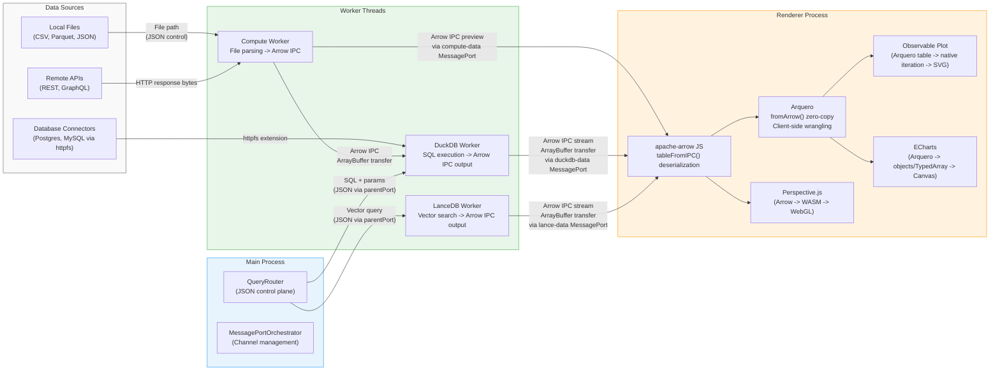
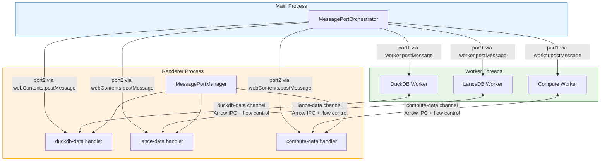
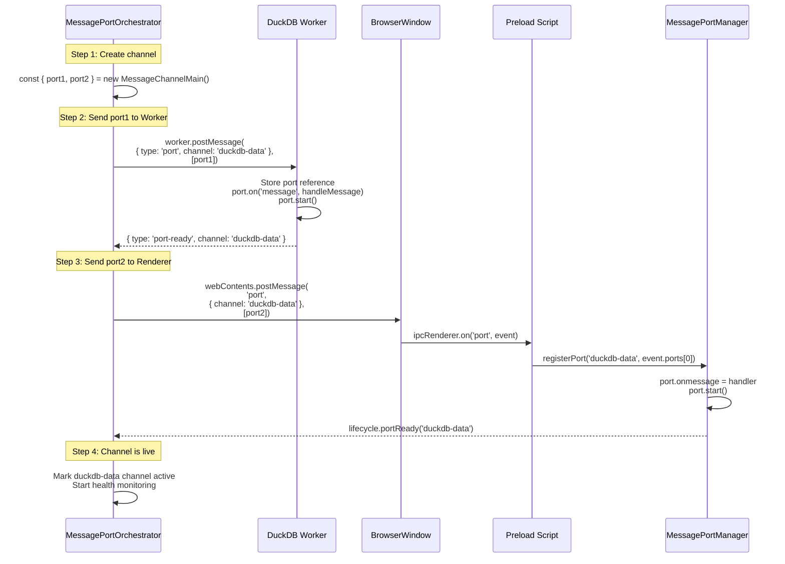
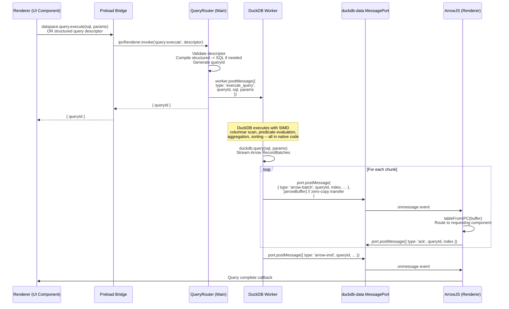
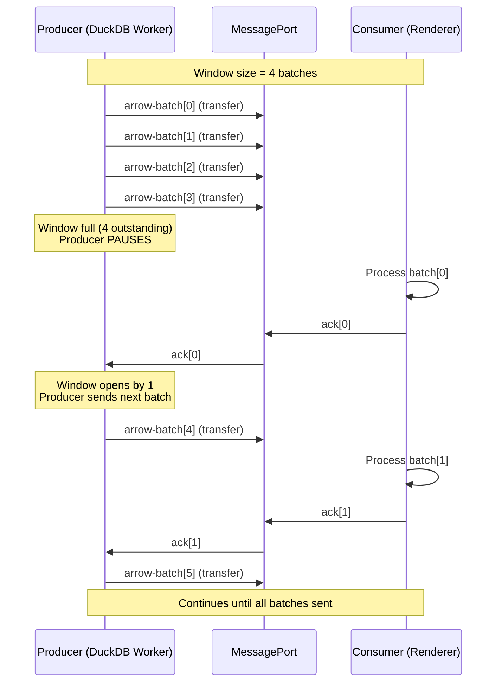
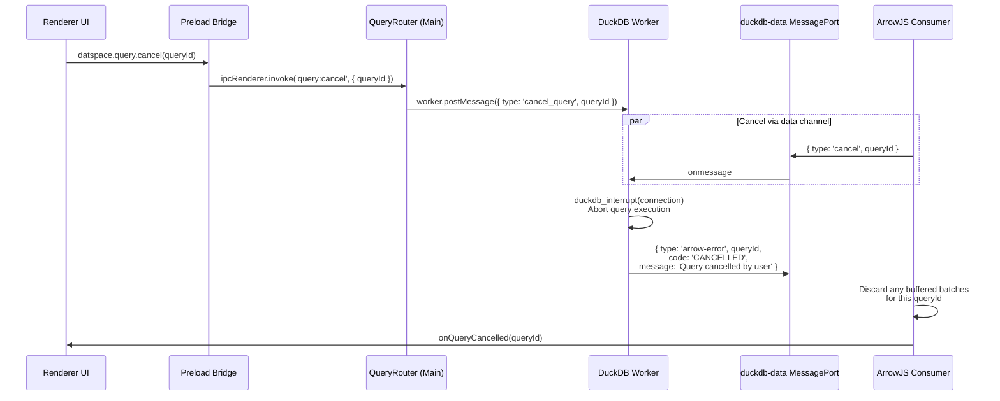

# datspace: Apache Arrow Data Plane

**Document:** 03-arrow-data-plane.md
**Version:** 1.1
**Date:** 2026-02-05
**Status:** Accepted
**Depends on:** [ADR-002](../decisions/adr-002-arrow-data-plane.md), [02-Electron Process Model](02-electron-process-model.md), [Constitution](../../decomposition/constitution.yaml)
**Feeds into:** 04-Database Integration, 06-Local Ingestion, 07-Remote Connectors, 08-Visualization Engine, IPC/API Spec

---

## 1. End-to-End Arrow Data Flow

The Arrow data plane is the backbone of datspace's data transfer architecture. Every byte of analytical data flowing between processes uses Apache Arrow IPC stream format. JSON is reserved exclusively for control-plane messages (query descriptors, ACK signals, lifecycle events). This separation enforces Constitution Principle 9 (Arrow-first data flow) without exception.

### 1.1 Data Flow Overview



### 1.2 Serialization Boundary Map

The following table documents every process boundary where data crosses and the exact format used at each crossing. Arrow format is maintained at every data-plane boundary. The only serialization/deserialization that occurs is the unavoidable DuckDB native-to-V8 copy at the N-API boundary.

| Boundary | Direction | Format | Copy? | Mechanism |
|----------|-----------|--------|-------|-----------|
| DuckDB C++ -> DuckDB Worker V8 | Worker-internal | Arrow IPC buffer | **Yes** (1 unavoidable copy) | N-API `napi_create_external_arraybuffer` wrapping native Arrow output |
| DuckDB Worker -> Renderer | Cross-process | Arrow IPC stream `ArrayBuffer` | **No** (zero-copy transfer) | `MessagePort.postMessage(msg, [buffer])` with transfer list |
| LanceDB Rust -> LanceDB Worker V8 | Worker-internal | Arrow IPC buffer | **Yes** (1 unavoidable copy) | N-API binding returns `ArrayBuffer` from Rust Arrow output |
| LanceDB Worker -> Renderer | Cross-process | Arrow IPC stream `ArrayBuffer` | **No** (zero-copy transfer) | `MessagePort.postMessage(msg, [buffer])` with transfer list |
| Compute Worker -> Renderer | Cross-process | Arrow IPC stream `ArrayBuffer` | **No** (zero-copy transfer) | `MessagePort.postMessage(msg, [buffer])` via compute-data channel |
| Compute Worker -> DuckDB Worker | Inter-worker | Arrow IPC `ArrayBuffer` | **No** (zero-copy transfer) | Via Main Process relay with transfer list at each hop |
| Embedding Worker -> LanceDB Worker | Inter-worker | `Float32Array` | **No** (zero-copy transfer) | Via Main Process relay with transfer list |
| Renderer ArrowJS -> Perspective.js | In-process | Arrow `Table` / `RecordBatch` | **No** (shared reference) | `table.update(arrowBuffer)` -- Arrow maps into WASM memory |
| Renderer ArrowJS -> Observable Plot | In-process | Arquero Table (zero-copy fromArrow wrapping) | **No** (zero-copy fromArrow + Plot iterates Arquero table directly) | `aq.fromArrow(table)` wraps Arrow buffers; Plot consumes via iterator protocol |
| Renderer ArrowJS -> ECharts | In-process | Arquero Table -> objects or TypedArray | **Conditional** (dt.objects() copies; dt.column().data is zero-copy TypedArray) | `aq.fromArrow(table)` then `.objects()` for dataset config or `.column().data` for large numeric series |

**Key insight:** With Arquero, the Observable Plot path becomes zero-copy end-to-end (no `toArray()` step). The data path copies become: (1) DuckDB/LanceDB native -> V8 at the N-API boundary (unavoidable), and (2) ECharts `dt.objects()` for non-TypedArray scenarios (avoidable via TypedArray passthrough for numeric series). Observable Plot's previous `toArray()` copy is eliminated by Arquero's `fromArrow()` zero-copy wrapping and Plot's native Arquero table iteration. Every other transfer is zero-copy via ArrayBuffer ownership transfer.

---

## 2. Arrow IPC Protocol Design

### 2.1 IPC Format Selection

datspace uses **Arrow IPC Stream Format** (not File Format) for all inter-process data transfer. The distinction matters:

| Property | Stream Format | File Format |
|----------|--------------|-------------|
| Structure | Schema message + N RecordBatch messages + EOS marker | Magic bytes + Schema + N RecordBatches + Footer + Magic bytes |
| Random access | No (sequential only) | Yes (footer contains offsets) |
| Incremental emission | Yes (emit batches as produced) | No (must write footer after all batches) |
| Memory mapping | No | Yes (designed for mmap) |
| Overhead | Lower (no footer, no magic bytes) | Higher (8-byte magic + footer block) |
| Use case | IPC between processes | Persistent storage on disk |

Stream format aligns with the chunked streaming transfer design: DuckDB produces RecordBatch messages incrementally, each transferred over MessagePort as it becomes available. The consumer does not need to wait for the complete result before beginning deserialization and rendering.

File format is reserved for a single scenario: writing Arrow IPC files to disk for memory-mapped access by multiple processes (e.g., caching frequently-accessed datasets for SharedArrayBuffer read patterns). This is a secondary optimization path, not part of the primary data plane.

### 2.2 Message Envelope Protocol

Every Arrow IPC transfer is wrapped in a message envelope that provides query context, ordering, and flow control metadata. The envelope is a JSON object; the Arrow data is a separate `ArrayBuffer` in the transfer list.

```typescript
// === Data Plane Messages (Arrow IPC payloads) ===

/** Sent by producer (Worker) for each chunk of query results */
interface ArrowBatchMessage {
  type: 'arrow-batch';
  queryId: string;          // Correlates with original query request
  index: number;            // 0-based batch sequence number
  totalBatches?: number;    // Known if query planner can estimate; null for streaming
  rowCount: number;         // Number of rows in this batch
  byteSize: number;         // Size of the Arrow IPC buffer in bytes
  // The Arrow IPC ArrayBuffer is in the transfer list, NOT in this object
}

/** Sent by producer when all batches have been emitted */
interface ArrowEndMessage {
  type: 'arrow-end';
  queryId: string;
  totalBatches: number;     // Final count of batches sent
  totalRows: number;        // Total rows across all batches
  totalBytes: number;       // Total bytes transferred
  durationMs: number;       // Query + transfer duration
}

/** Sent by producer on query failure */
interface ArrowErrorMessage {
  type: 'arrow-error';
  queryId: string;
  code: string;             // Error category: 'SYNTAX' | 'TIMEOUT' | 'OOM' | 'CANCELLED' | 'INTERNAL'
  message: string;          // Human-readable error description
  batchesSent: number;      // Number of batches already transferred before error
}

// === Flow Control Messages (consumer -> producer) ===

/** Consumer acknowledges receipt and processing of a batch */
interface AckMessage {
  type: 'ack';
  queryId: string;
  index: number;            // Batch index being acknowledged
}

/** Consumer requests query cancellation */
interface CancelMessage {
  type: 'cancel';
  queryId: string;
  reason?: string;          // Optional: 'user_cancelled' | 'component_unmounted' | 'timeout'
}
```

### 2.3 MessagePort Channel Architecture

Per the Electron Process Model (doc 02, Section 4.4), datspace establishes three dedicated `MessageChannelMain` data channels. Each channel carries Arrow IPC payloads for a specific Worker:



**Channel separation rationale:**
- Prevents large DuckDB query results from blocking vector search results
- Enables independent backpressure per channel (DuckDB may stream millions of rows while LanceDB returns 10 results)
- Allows monitoring per-channel throughput and latency independently
- Supports channel-specific configuration (e.g., different batch sizes for DuckDB vs LanceDB)

### 2.4 Channel Setup Sequence

MessagePort channels are established during application initialization (doc 02, Section 2.2). The setup follows a strict protocol to ensure both endpoints are ready before data flows:



**Health monitoring:** After setup, `MessagePortOrchestrator` sends periodic ping messages (`{ type: 'ping' }`) on each channel every 30 seconds. The Worker responds with `{ type: 'pong' }`. Two consecutive missed pongs trigger channel recreation (new `MessageChannelMain`, redistribute ports).

---

## 3. Predicate Pushdown Protocol

### 3.1 Design Philosophy

The predicate pushdown protocol enforces a fundamental architectural principle: **compute where the data lives, transfer only results**. DuckDB executes all filtering, sorting, aggregation, and grouping using its columnar scan engine with SIMD acceleration. The Renderer receives only the rows it will display.

This inverts the traditional web application pattern where a client fetches raw data and filters locally. In datspace, the Renderer sends a declarative description of what it needs, and the database returns exactly that.

### 3.2 Query Descriptor Formats

Two query descriptor formats serve different use cases:

#### Structured Query Descriptor (UI-driven queries)

Used by UI components (Perspective, dashboard panels, catalog browser) to request data without constructing SQL:

```typescript
interface StructuredQueryDescriptor {
  type: 'structured';
  queryId: string;
  source: {
    table: string;                     // DuckDB table name
    schema?: string;                   // DuckDB schema (default: 'main')
  };
  columns?: string[];                  // SELECT columns (null = all)
  filters?: FilterExpression[];        // WHERE clause predicates
  aggregations?: AggregationSpec[];    // GROUP BY + aggregate functions
  groupBy?: string[];                  // GROUP BY columns
  orderBy?: OrderBySpec[];             // ORDER BY clauses
  limit?: number;                      // LIMIT
  offset?: number;                     // OFFSET (for pagination)
  options?: {
    timeout?: number;                  // Query timeout in ms (default: 30000)
    batchSize?: number;                // Override default batch size
    priority?: 'high' | 'normal' | 'low';  // Query priority hint
  };
}

interface FilterExpression {
  column: string;
  operator: 'eq' | 'neq' | 'gt' | 'gte' | 'lt' | 'lte' |
            'in' | 'not_in' | 'like' | 'ilike' |
            'between' | 'is_null' | 'is_not_null';
  value: unknown;                      // Type matches column type
  values?: unknown[];                  // For 'in', 'not_in', 'between'
}

interface AggregationSpec {
  function: 'count' | 'sum' | 'avg' | 'min' | 'max' |
            'median' | 'stddev' | 'variance' |
            'percentile_cont' | 'percentile_disc' |
            'count_distinct' | 'list_agg';
  column: string;
  alias?: string;
  params?: unknown[];                  // For percentile functions
}

interface OrderBySpec {
  column: string;
  direction: 'asc' | 'desc';
  nulls?: 'first' | 'last';
}
```

**Query compilation:** The `QueryRouter` in the Main Process compiles `StructuredQueryDescriptor` into parameterized SQL before forwarding to the DuckDB Worker. This compilation step:
1. Validates column names against the table schema (prevents injection)
2. Validates filter operators and value types
3. Generates parameterized SQL with `$1`, `$2`, ... placeholders
4. Passes parameters separately for binding

Example compilation:
```
// Input:
{ type: 'structured', source: { table: 'sales' },
  columns: ['region', 'total'],
  filters: [{ column: 'year', operator: 'eq', value: 2025 }],
  orderBy: [{ column: 'total', direction: 'desc' }],
  limit: 100 }

// Compiled SQL:
SELECT "region", "total" FROM "main"."sales"
WHERE "year" = $1
ORDER BY "total" DESC
LIMIT 100
-- params: [2025]
```

#### Parameterized SQL (AI and advanced queries)

Used by the AI agent and power-user SQL editor:

```typescript
interface ParameterizedSQLDescriptor {
  type: 'sql';
  queryId: string;
  sql: string;              // SQL with $1, $2, ... parameter placeholders
  params?: unknown[];       // Parameter values bound at execution
  options?: {
    timeout?: number;
    batchSize?: number;
    readOnly?: boolean;     // Default: true. Main Process enforces this for user queries.
    priority?: 'high' | 'normal' | 'low';
  };
}
```

**Security:** The `QueryRouter` validates parameterized SQL:
- User-facing queries: `readOnly: true` enforced, rejecting DDL and DML statements
- AI-generated queries: same restriction, plus the Claude Agent SDK's `PreToolUse` hook validates SQL before execution
- System queries (ingestion, catalog management): `readOnly: false` permitted, originating only from trusted Worker code

### 3.3 Predicate Pushdown Flow



### 3.4 Client-Side Filtering Exception

Client-side filtering is permitted in exactly one scenario: **cross-filter interactions within a dashboard**. When a user clicks a bar in an ECharts chart, the cross-filter manager propagates the selection to other components. For small, already-transferred result sets (< 5,000 rows), the filter is applied client-side to avoid a DuckDB round-trip. For larger datasets, the filter is compiled into a new `StructuredQueryDescriptor` and sent to DuckDB.

The threshold is configurable:
```typescript
const CROSS_FILTER_CLIENT_THRESHOLD = 5000; // rows
```

---

## 4. Streaming Transfer Design

### 4.1 Chunked Arrow IPC Streaming

All query results stream as a sequence of Arrow RecordBatch chunks, regardless of result size. Even single-row results follow the same protocol (one batch + end-of-stream). This eliminates special-case code paths and ensures the backpressure mechanism is always exercised and tested.

#### Batch Size Configuration

Batch size adapts to schema width to maintain consistent per-batch memory footprint:

```typescript
interface BatchSizeConfig {
  defaultRowCount: number;         // 65536 (2^16, Arrow convention)
  targetBatchBytes: number;        // 2 * 1024 * 1024 (2 MB target)
  minRowCount: number;             // 1024
  maxRowCount: number;             // 262144 (2^18)
}

function calculateBatchSize(schema: ArrowSchema, config: BatchSizeConfig): number {
  // Estimate bytes per row from schema
  let bytesPerRow = 0;
  for (const field of schema.fields) {
    bytesPerRow += estimateFieldBytes(field);
  }

  if (bytesPerRow === 0) return config.defaultRowCount;

  // Calculate rows to fit target batch size
  const calculatedRows = Math.floor(config.targetBatchBytes / bytesPerRow);

  // Clamp to min/max bounds
  return Math.max(
    config.minRowCount,
    Math.min(config.maxRowCount, calculatedRows)
  );
}

function estimateFieldBytes(field: ArrowField): number {
  switch (field.type) {
    case 'bool':      return 0.125;  // 1 bit
    case 'int8':
    case 'uint8':     return 1;
    case 'int16':
    case 'uint16':    return 2;
    case 'int32':
    case 'uint32':
    case 'float32':   return 4;
    case 'int64':
    case 'uint64':
    case 'float64':
    case 'timestamp': return 8;
    case 'decimal128': return 16;
    case 'utf8':      return 64;     // Estimate: avg 64 bytes for variable-length strings
    case 'binary':    return 128;    // Estimate: avg 128 bytes for binary data
    case 'list':      return 256;    // Estimate: avg 256 bytes for nested lists
    case 'struct':    return 128;    // Estimate: sum of child field estimates
    default:          return 32;     // Conservative default
  }
}
```

**Examples:**
- Narrow table (5 int64 columns, 40 bytes/row): batch size = 52,428 rows (~2 MB)
- Wide table (100 columns, mixed types, ~800 bytes/row): batch size = 2,621 rows (~2 MB)
- String-heavy table (10 utf8 columns, ~640 bytes/row): batch size = 3,276 rows (~2 MB)

### 4.2 Backpressure Mechanism

The backpressure protocol prevents memory exhaustion when the producer (DuckDB Worker) generates data faster than the consumer (Renderer) can process it. Without backpressure, a fast query returning millions of rows could flood the Renderer's memory with unprocessed Arrow buffers.

#### Window-Based Flow Control



#### Implementation

```typescript
class BackpressureController {
  private windowSize = 4;           // Max outstanding (unacknowledged) batches
  private outstanding = 0;          // Current unacknowledged batch count
  private paused = false;
  private pendingBatches: ArrayBuffer[] = [];
  private ackCallbacks = new Map<number, () => void>();

  constructor(
    private port: MessagePort,
    private queryId: string,
    windowSize?: number,
  ) {
    if (windowSize) this.windowSize = windowSize;

    port.onmessage = (event) => {
      const msg = event.data;
      if (msg.type === 'ack' && msg.queryId === this.queryId) {
        this.onAck(msg.index);
      } else if (msg.type === 'cancel' && msg.queryId === this.queryId) {
        this.onCancel();
      }
    };
  }

  /** Send a batch, respecting the flow control window */
  async sendBatch(index: number, buffer: ArrayBuffer, metadata: object): Promise<void> {
    // If window is full, wait for an ACK
    while (this.outstanding >= this.windowSize) {
      await this.waitForAck();
    }

    this.port.postMessage(
      { ...metadata, type: 'arrow-batch', queryId: this.queryId, index },
      [buffer]  // Transfer list: zero-copy ownership move
    );
    this.outstanding++;
  }

  private onAck(index: number): void {
    this.outstanding--;
    const callback = this.ackCallbacks.get(index);
    if (callback) {
      callback();
      this.ackCallbacks.delete(index);
    }
  }

  private waitForAck(): Promise<void> {
    return new Promise((resolve) => {
      // Resolve when any ACK arrives (reducing outstanding count)
      const checkInterval = setInterval(() => {
        if (this.outstanding < this.windowSize) {
          clearInterval(checkInterval);
          resolve();
        }
      }, 1);  // 1ms polling -- in practice, ACKs arrive via event, not polling
    });
  }

  private onCancel(): void {
    this.paused = true;
    // Signal to producer to stop generating batches
  }
}
```

#### Backpressure Configuration

| Parameter | Default | Range | Description |
|-----------|---------|-------|-------------|
| `windowSize` | 4 | 1-16 | Max unacknowledged batches before producer pauses |
| `ackTimeout` | 10,000ms | 1,000-60,000ms | Time to wait for ACK before treating as stall |
| `stallAction` | `'warn'` | `'warn'` \| `'cancel'` | Action on ACK timeout |

**Window size tuning:**
- **Window 4 (default):** Balances memory usage with throughput. At 2 MB/batch, 4 outstanding batches = 8 MB in-flight maximum per channel.
- **Window 1:** Maximum memory conservation. Use for constrained environments or very large batches.
- **Window 8-16:** Maximum throughput. Use when the consumer is known to be fast (e.g., Perspective.js rendering directly from Arrow buffers).

### 4.3 Progress Reporting

For long-running queries, progress is reported via the control plane (not the data channel):

```typescript
// Sent from DuckDB Worker -> Main Process -> Renderer via IPC events
interface QueryProgressEvent {
  type: 'query-progress';
  queryId: string;
  phase: 'scanning' | 'filtering' | 'aggregating' | 'sorting' | 'streaming';
  rowsScanned?: number;
  rowsFiltered?: number;
  batchesStreamed: number;
  estimatedTotalBatches?: number;    // null if unknown
  elapsedMs: number;
}
```

Progress events flow via `webContents.send('query:progress', event)`, not via the MessagePort data channel. This ensures progress updates are not blocked by data backpressure.

### 4.4 Query Cancellation

Cancellation propagates from Renderer to DuckDB Worker via two paths:

1. **Control plane:** `datspace.query.cancel(queryId)` -> `ipcMain.handle` -> `worker.postMessage({ type: 'cancel_query', queryId })`
2. **Data plane:** Consumer sends `{ type: 'cancel', queryId }` on the MessagePort

The DuckDB Worker uses DuckDB's interrupt mechanism (`duckdb_interrupt`) to cancel the running query. In-flight Arrow batches already transferred are discarded by the consumer.



---

## 5. Arrow Schema Management

### 5.1 Schema Negotiation

Arrow schemas are established once per query result stream. The first message on the data channel for a query is always the schema, embedded in the Arrow IPC stream format's initial Schema message. The consumer validates the schema before processing any RecordBatch messages.

```typescript
// Schema validation in the consumer (Renderer)
function validateArrowSchema(buffer: ArrayBuffer, expectedColumns?: string[]): ArrowSchema {
  const reader = RecordBatchStreamReader.from(buffer);
  const schema = reader.schema;

  if (!schema) {
    throw new Error('Arrow IPC buffer does not contain a valid schema');
  }

  // Optional: validate expected columns are present
  if (expectedColumns) {
    const fieldNames = schema.fields.map(f => f.name);
    for (const col of expectedColumns) {
      if (!fieldNames.includes(col)) {
        throw new Error(`Expected column "${col}" not found in Arrow schema`);
      }
    }
  }

  return schema;
}
```

### 5.2 Type Mapping: DuckDB -> Arrow -> JavaScript

DuckDB produces Arrow output natively, but the consumer (visualization components) needs to understand the type mapping at each stage:

| DuckDB Type | Arrow Type | Arrow JS Class | JavaScript Type | Notes |
|------------|-----------|---------------|----------------|-------|
| `BOOLEAN` | `Bool` | `Bool` | `boolean` | Direct |
| `TINYINT` | `Int8` | `Int8` | `number` | Direct |
| `SMALLINT` | `Int16` | `Int16` | `number` | Direct |
| `INTEGER` | `Int32` | `Int32` | `number` | Direct |
| `BIGINT` | `Int64` | `Int64` | `bigint` | **Not `number`** -- BigInt preserves precision |
| `HUGEINT` | `Decimal128` | `Decimal` | `bigint` / string | Requires custom handling |
| `FLOAT` | `Float32` | `Float32` | `number` | Direct |
| `DOUBLE` | `Float64` | `Float64` | `number` | Direct |
| `DECIMAL(p,s)` | `Decimal128` | `Decimal` | `string` | String preserves exact precision |
| `VARCHAR` | `Utf8` | `Utf8` | `string` | Direct |
| `BLOB` | `Binary` | `Binary` | `Uint8Array` | Direct |
| `DATE` | `Date32` | `DateDay` | `number` (epoch days) | Convert to `Date` in UI layer |
| `TIME` | `Time64(us)` | `TimeMicrosecond` | `bigint` (microseconds) | Convert to time string in UI layer |
| `TIMESTAMP` | `Timestamp(us, UTC)` | `TimestampMicrosecond` | `number` (ms since epoch) | Arrow JS converts to ms |
| `TIMESTAMP WITH TZ` | `Timestamp(us, tz)` | `TimestampMicrosecond` | `number` (ms since epoch) | Timezone in metadata |
| `INTERVAL` | `Duration(us)` | `DurationMicrosecond` | `bigint` | Microseconds |
| `UUID` | `FixedSizeBinary(16)` | `FixedSizeBinary` | `Uint8Array` | Convert to string in UI layer |
| `LIST(T)` | `List(T)` | `List` | `Array` | Nested Arrow type |
| `STRUCT(...)` | `Struct(...)` | `Struct` | `object` | Nested Arrow type |
| `MAP(K,V)` | `Map(K,V)` | `Map_` | `Map` | Nested Arrow type |
| `JSON` | `Utf8` | `Utf8` | `string` | Stored as UTF-8 string in Arrow |
| `ENUM(...)` | `Dictionary(Int32, Utf8)` | `Dictionary` | `string` | Dictionary-encoded |

### 5.3 Null Handling

Arrow's native null representation uses validity bitmaps -- each column has a bitmap where bit `i` indicates whether row `i` is valid (non-null). This is more memory-efficient than sentinel values and is preserved through the IPC transfer.

In the Renderer:
- Arrow JS `column.get(i)` returns `null` for null values
- `column.toArray()` returns `null` entries in the resulting array
- Perspective.js handles nulls natively (renders as empty cells)
- Observable Plot and ECharts require explicit null handling in the adapter layer:

```typescript
// Adapter: Arrow column to chart-friendly array with null handling
function arrowColumnToArray(column: ArrowVector, nullValue: any = null): any[] {
  const result = new Array(column.length);
  for (let i = 0; i < column.length; i++) {
    result[i] = column.isValid(i) ? column.get(i) : nullValue;
  }
  return result;
}
```

**Arquero null handling:** Arquero's `fromArrow()` preserves Arrow's validity bitmap (null bitmap). Null values in Arrow columns remain properly represented in Arquero tables. When exporting via `dt.objects()`, nulls appear as JavaScript `null` values. When accessing via `dt.column().data` (TypedArray), the validity bitmap should be checked separately.

### 5.4 Extension Types for Custom Data

datspace defines Arrow extension types for domain-specific data:

| Extension Type | Base Type | Metadata Key | Use Case |
|---------------|-----------|-------------|----------|
| `datacodex.embedding` | `FixedSizeList(Float32, 384)` | `ARROW:extension:name` | Vector embeddings (384-dim all-MiniLM-L6-v2) |
| `datacodex.timestamp_display` | `Timestamp(us, UTC)` | `datacodex:display_format` | Timestamps with preferred display format |
| `datacodex.currency` | `Decimal128(18, 4)` | `datacodex:currency_code` | Monetary values with currency code |

Extension types are passed through Arrow IPC transparently. The Renderer's visualization components check for extension metadata and apply appropriate rendering:

```typescript
function getFieldRenderer(field: ArrowField): ColumnRenderer {
  const extensionName = field.metadata?.get('ARROW:extension:name');

  switch (extensionName) {
    case 'datacodex.embedding':
      return new EmbeddingRenderer();     // Renders as sparkline or heatmap
    case 'datacodex.currency':
      const currency = field.metadata?.get('datacodex:currency_code') ?? 'USD';
      return new CurrencyRenderer(currency);
    default:
      return getDefaultRenderer(field.type);
  }
}
```

---

## 6. Small Payload Optimization

### 6.1 Design Decision: Arrow for All Data

Per ADR-002, Section 5: **Arrow is used for all data payloads regardless of size.** There is no JSON fallback for small data.

The rationale:
- Eliminates decision logic ("is this payload small enough for JSON?")
- Maintains a single code path for all data transfer
- Arrow IPC serialization overhead for small payloads (~100-200 microseconds) is imperceptible to users
- Prevents "JSON creep" where the exception gradually becomes the norm

### 6.2 What Remains JSON

JSON is used exclusively for the **control plane**:

| Message Category | Format | Channel | Example |
|-----------------|--------|---------|---------|
| Query submission | JSON | `ipcMain.handle` | `{ type: 'structured', source: {...}, filters: [...] }` |
| Query cancellation | JSON | `ipcMain.handle` + MessagePort | `{ type: 'cancel', queryId: '...' }` |
| ACK messages | JSON | MessagePort | `{ type: 'ack', queryId: '...', index: 3 }` |
| End-of-stream | JSON | MessagePort | `{ type: 'arrow-end', queryId: '...', totalBatches: 42 }` |
| Error messages | JSON | MessagePort | `{ type: 'arrow-error', queryId: '...', code: 'OOM' }` |
| Progress updates | JSON | `webContents.send` | `{ type: 'query-progress', phase: 'scanning', ... }` |
| Configuration | JSON | `ipcMain.handle` | `{ key: 'memory_limit', value: '8GB' }` |
| Lifecycle signals | JSON | `ipcMain.handle` | `{ type: 'shutdown-prepare' }` |
| Heartbeat | JSON | `parentPort` | `{ type: 'heartbeat' }` / `{ type: 'heartbeat_ack' }` |

### 6.3 Metadata Queries

Even metadata queries (e.g., "list all tables", "describe table schema") return Arrow-formatted results. DuckDB's `SHOW TABLES` and `DESCRIBE table` produce tabular results that serialize naturally to Arrow.

```
-- Example: table listing returns Arrow with schema:
-- table_name: Utf8, column_count: Int32, row_count: Int64
SELECT table_name,
       (SELECT count(*) FROM information_schema.columns c
        WHERE c.table_name = t.table_name) as column_count,
       estimated_size as row_count
FROM duckdb_tables() t;
-- Result: Arrow IPC RecordBatch (typically < 1 KB, still Arrow)
```

---

## 7. Memory Ownership Model

### 7.1 ArrayBuffer Transfer Semantics

JavaScript's `ArrayBuffer` transfer mechanism is the foundation of the Arrow data plane's zero-copy design. When an `ArrayBuffer` is included in a `postMessage` transfer list, the following occurs:

1. **Ownership moves to the receiver.** The receiver gets the exact same memory pages (no copy).
2. **Sender's buffer is neutered.** The sender's `ArrayBuffer.byteLength` becomes 0. Any attempt to read the neutered buffer throws a `TypeError`.
3. **Single-owner guarantee.** At any point in time, exactly one JavaScript context owns the buffer.

This is move semantics, analogous to Rust's ownership model or C++'s `std::move`.

### 7.2 Buffer Lifecycle

```mermaid
stateDiagram-v2
    [*] --> Allocated: DuckDB produces Arrow IPC buffer
    Allocated --> InFlight: postMessage([buffer]) to MessagePort
    note right of InFlight: Sender's buffer is neutered\n(byteLength = 0)
    InFlight --> Received: Consumer receives via onmessage
    Received --> Deserialized: tableFromIPC(buffer)
    Deserialized --> InUse: Visualization component references Arrow Table
    InUse --> Released: Component unmounts or data refreshed
    Released --> GCed: V8 garbage collector reclaims memory
    GCed --> [*]

    note right of Allocated: Owner: Producer (Worker Thread)
    note right of Received: Owner: Consumer (Renderer)
    note right of InUse: Owner: Visualization component (Renderer)
```

### 7.3 Memory Leak Prevention

Arrow buffers in the Renderer can accumulate if not properly released. datspace implements three safeguards:

#### 1. Query Result Cache with LRU Eviction

```typescript
class ArrowResultCache {
  private cache = new Map<string, { table: ArrowTable, accessedAt: number, bytes: number }>();
  private totalBytes = 0;
  private maxBytes: number;

  constructor(maxMB: number = 256) {
    this.maxBytes = maxMB * 1024 * 1024;
  }

  set(queryId: string, table: ArrowTable): void {
    const bytes = this.estimateTableBytes(table);

    // Evict LRU entries until we have room
    while (this.totalBytes + bytes > this.maxBytes && this.cache.size > 0) {
      this.evictLRU();
    }

    this.cache.set(queryId, { table, accessedAt: Date.now(), bytes });
    this.totalBytes += bytes;
  }

  get(queryId: string): ArrowTable | undefined {
    const entry = this.cache.get(queryId);
    if (entry) {
      entry.accessedAt = Date.now();
      return entry.table;
    }
    return undefined;
  }

  /** Explicitly release a specific query's results */
  release(queryId: string): void {
    const entry = this.cache.get(queryId);
    if (entry) {
      this.totalBytes -= entry.bytes;
      this.cache.delete(queryId);
      // Arrow Table's underlying ArrayBuffers become eligible for GC
    }
  }

  private evictLRU(): void {
    let oldest: string | null = null;
    let oldestTime = Infinity;
    for (const [id, entry] of this.cache) {
      if (entry.accessedAt < oldestTime) {
        oldestTime = entry.accessedAt;
        oldest = id;
      }
    }
    if (oldest) this.release(oldest);
  }

  private estimateTableBytes(table: ArrowTable): number {
    let bytes = 0;
    for (const batch of table.batches) {
      for (const col of batch.data) {
        for (const buf of col.buffers) {
          if (buf) bytes += buf.byteLength;
        }
      }
    }
    return bytes;
  }
}
```

#### 2. Component Unmount Cleanup

React components that hold Arrow data must release references on unmount:

```typescript
function usePerspectiveViewer(queryId: string) {
  const viewerRef = useRef<HTMLPerspectiveViewerElement>(null);
  const tableRef = useRef<PerspectiveTable | null>(null);

  useEffect(() => {
    // Setup: receive Arrow data and load into Perspective
    const unsubscribe = arrowResultCache.subscribe(queryId, async (arrowTable) => {
      if (viewerRef.current) {
        tableRef.current = await viewerRef.current.getTable();
        await tableRef.current.update(arrowTable.serialize());
      }
    });

    return () => {
      // Cleanup: release Perspective table and Arrow references
      unsubscribe();
      if (tableRef.current) {
        tableRef.current.delete();  // Release WASM memory
        tableRef.current = null;
      }
      arrowResultCache.release(queryId);
    };
  }, [queryId]);

  return viewerRef;
}
```

#### 3. Periodic Memory Audit

A background task in the Renderer periodically checks for memory pressure:

```typescript
// Every 30 seconds, check Renderer memory usage
setInterval(() => {
  const usage = performance.memory;  // Chrome-specific API, available in Electron
  if (usage && usage.usedJSHeapSize > 500 * 1024 * 1024) {  // > 500 MB
    // Aggressive eviction: reduce cache to 50% capacity
    arrowResultCache.evictToPercentage(50);
    console.warn('Memory pressure detected, evicted Arrow cache to 50%');
  }
}, 30_000);
```

### 7.4 Caching Considerations

Because transferred ArrayBuffers are neutered at the sender, caching strategies must account for the one-way nature of transfer:

| Scenario | Strategy |
|----------|----------|
| **Re-fetch same query** | Consumer cache (LRU in Renderer). If evicted, re-execute query against DuckDB. |
| **Multiple components need same data** | Cache in Renderer's `ArrowResultCache`. Multiple components reference the same Arrow `Table` object (no copy needed within one process). |
| **Prefetch for anticipated queries** | DuckDB Worker can pre-execute and cache results as Arrow buffers. Transfer to Renderer only on demand. |
| **Shared read-only lookup tables** | Secondary path: write Arrow IPC to disk, memory-map via `SharedArrayBuffer` (requires COOP/COEP). Reserved for hot lookup tables accessed by multiple Renderer Web Workers. |

### 7.5 Renderer Web Worker Data Distribution

When the Renderer's main thread receives an Arrow buffer, it may need to distribute data to Web Workers (for Observable Plot or ECharts rendering in background threads). This uses the same ArrayBuffer transfer pattern:

```typescript
// Renderer main thread -> Web Worker
const chartWorker = new Worker('chart-worker.js');

// Transfer Arrow buffer to Web Worker (zero-copy)
chartWorker.postMessage(
  { type: 'render-chart', chartType: 'histogram', queryId },
  [arrowBuffer]  // Buffer is neutered in main thread after transfer
);

// Web Worker processes data and returns rendered result
chartWorker.onmessage = (event) => {
  if (event.data.type === 'chart-ready') {
    // Apply rendered chart to DOM
    document.getElementById(chartId).innerHTML = event.data.svgString;
  }
};
```

**Important:** After transferring the buffer to a Web Worker, the main thread no longer has access to it. If the main thread also needs the data (e.g., for Perspective.js), it must either:
1. Route the original Arrow buffer to Perspective first, then create a copy for the Web Worker
2. Use `SharedArrayBuffer` if both contexts need simultaneous read access (secondary optimization)

---

## 8. Performance Characteristics

### 8.1 Throughput Estimates

Based on Arrow IPC serialization benchmarks and Electron MessagePort transfer characteristics:

| Metric | Value | Conditions |
|--------|-------|-----------|
| Arrow IPC serialization | ~1 GB/s | DuckDB native -> Arrow IPC buffer |
| MessagePort transfer (zero-copy) | ~10 GB/s | ArrayBuffer ownership transfer, no copy |
| Arrow IPC deserialization | ~500 MB/s | `tableFromIPC()` in Renderer |
| End-to-end latency (small query) | ~5-15 ms | < 1000 rows, includes IPC round-trip |
| End-to-end throughput (streaming) | ~400-800 MB/s | Bottleneck: serialization + deserialization |
| Backpressure overhead | < 1% | ACK messages are tiny JSON, negligible vs data |

### 8.2 Memory Budget per Channel

| Component | Budget | Notes |
|-----------|--------|-------|
| In-flight batches (per channel) | windowSize * batchSize = 4 * 2 MB = 8 MB | Maximum unacknowledged data |
| Renderer Arrow cache | 256 MB (configurable) | LRU eviction when full |
| Renderer total Arrow memory | ~512 MB | Cache + active component buffers |
| DuckDB output buffer | Unbounded (spill to disk) | DuckDB manages its own memory |

---

## 9. Cross-Reference and Consistency

### 9.1 Constitution Alignment

| Principle | Requirement | How This Design Satisfies It |
|-----------|------------|------------------------------|
| #9 Arrow-First Data Flow | All inter-component transfer uses Arrow | Every data-plane message is Arrow IPC. JSON is control-plane only. No exceptions, no small-payload JSON fallback. |
| #10 Embedded-Only Databases | No external database servers | DuckDB runs in Worker Thread. Arrow Flight (network RPC) explicitly rejected in ADR-002. |
| #11 Stream and Scan | No bulk loading into JS memory | Chunked streaming with backpressure. Batch size targets 2 MB. LRU cache evicts when full. |
| #12 Process Isolation | Main owns databases, Renderer owns visualization | Data flows Worker -> MessagePort -> Renderer. Main Process relays control messages only. |
| #13 macOS-First | Technologies work on macOS + Electron | MessagePort, Arrow JS, DuckDB native addon all verified on macOS. |
| #14 Single-User, Local-First | No network RPC, no auth | All data transfer is in-process IPC. Arrow Flight rejected (ADR-002). |

### 9.2 ADR-002 Decision Implementation

| ADR-002 Decision | Implementation in This Document |
|-----------------|-------------------------------|
| Arrow IPC Stream Format | Section 2.1: Stream format for all IPC, File format reserved for disk persistence |
| MessagePort with ArrayBuffer Transfer | Section 2.3-2.4: Three dedicated MessageChannelMain data channels |
| Predicate Pushdown Protocol | Section 3: StructuredQueryDescriptor and ParameterizedSQLDescriptor |
| Window-based Backpressure (window=4) | Section 4.2: BackpressureController with configurable window size |
| Arrow for All Data (no JSON threshold) | Section 6.1: No small-payload JSON exception |
| Channel Architecture (query, catalog, control) | Section 2.3: Three data channels + control via ipcMain.handle |
| Parameterized SQL for injection prevention | Section 3.2: Parameter binding with $1, $2, ... placeholders |

### 9.3 Document 02 (Process Model) Integration

| Doc 02 Component | Arrow Data Plane Integration |
|-----------------|------------------------------|
| DuckDB Worker (Section 4.2) | Produces Arrow IPC via duckdb-data MessagePort |
| LanceDB Worker (Section 4.2) | Produces Arrow IPC via lance-data MessagePort |
| Compute Worker (Section 4.2) | Produces Arrow IPC via compute-data MessagePort |
| MessagePortOrchestrator (Section 4.4) | Creates and distributes all three data channels |
| Preload Bridge (Section 5) | Control-plane query submission; data arrives via MessagePort |
| Worker Restart (Section 4.3) | Channel recreation on worker restart; Renderer reconnects to new port |

---

**R4 Revision (2026-02-05):** Added Arquero as Renderer-side data wrangling layer between Arrow deserialization and Observable Plot/ECharts consumption. Observable Plot path is now zero-copy end-to-end via Arquero `fromArrow()` + native table iteration. ECharts gains TypedArray passthrough via `dt.column().data`.

---

*Document 03 of the datspace Architecture Series*
*Generated: 2026-02-05 | Plan: datspace-system-design-2026-02-04 | Task: design-arrow-data-plane*
