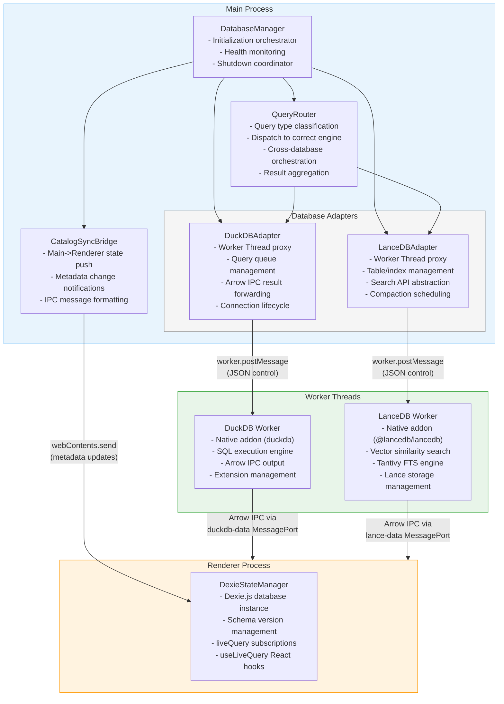
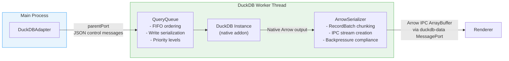
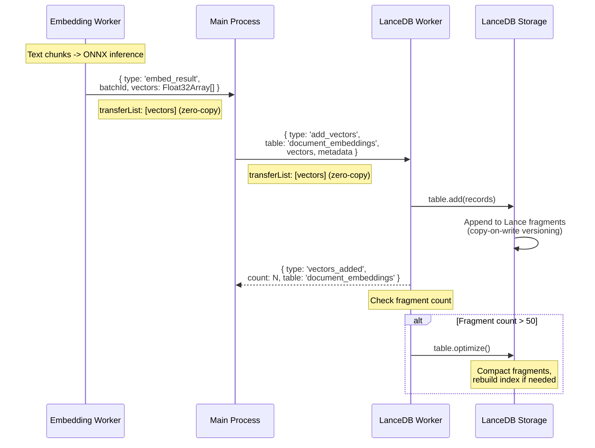
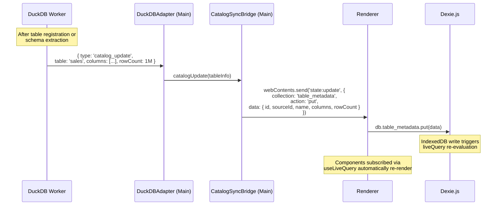
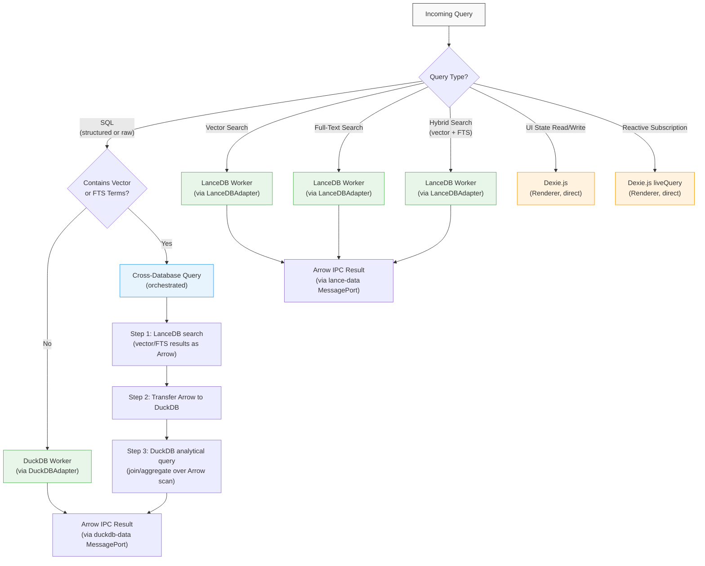
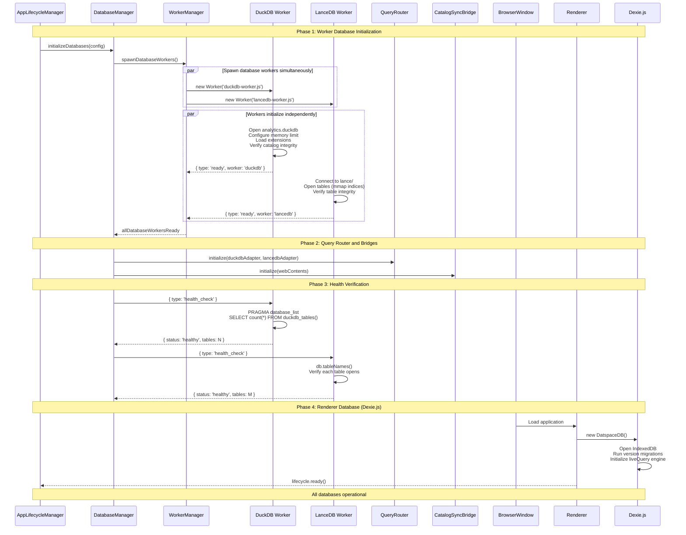
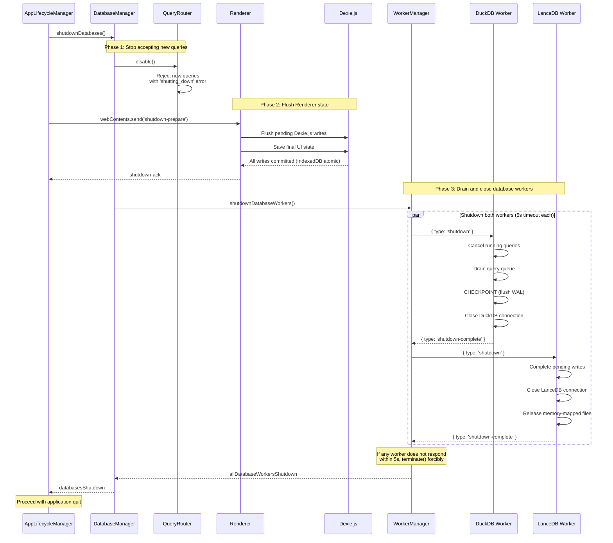

# datspace: Database Integration Layer

**Document:** 04-database-integration.md
**Version:** 1.0
**Date:** 2026-02-05
**Status:** Accepted
**Depends on:** [ADR-001](../decisions/adr-001-database-trio.md), [02-Electron Process Model](02-electron-process-model.md), [03-Arrow Data Plane](03-arrow-data-plane.md), [Constitution](../../decomposition/constitution.yaml)
**Feeds into:** 05-Vector Search & FTS, 06-Local Ingestion, 07-Remote Connectors, 09-AI Integration, Data Model Spec, IPC/API Spec

---

## 1. Database Manager Architecture

The Database Manager is the central coordination layer for all three embedded databases in datspace. It runs in the Main Process and provides a unified interface for initialization, health monitoring, query routing, and lifecycle management. Per ADR-001, the three databases are DuckDB (OLAP analytics), LanceDB (vector/FTS), and Dexie.js (reactive UI state). Dexie.js was chosen over RxDB after evaluating both options -- RxDB Premium requires a paid license and RxDB Community offers diminishing returns over Dexie.js's native `liveQuery()` capability (see ADR-001 for the full comparison).

### 1.1 Component Diagram



### 1.2 Component Responsibilities

| Component | Process | Responsibility |
|-----------|---------|---------------|
| **DatabaseManager** | Main | Orchestrates initialization order, monitors adapter health, coordinates shutdown sequence |
| **QueryRouter** | Main | Classifies query type, dispatches to correct adapter, handles cross-database queries |
| **DuckDBAdapter** | Main | Proxy for DuckDB Worker Thread; manages query queue, cancellation, and result forwarding |
| **LanceDBAdapter** | Main | Proxy for LanceDB Worker Thread; manages search requests, table operations, index lifecycle |
| **CatalogSyncBridge** | Main | Pushes metadata changes to Renderer for Dexie.js storage (e.g., after table registration, schema extraction) |
| **DexieStateManager** | Renderer | Manages the Dexie.js database instance, schema migrations, and reactive query subscriptions |

### 1.3 Separation of Concerns

The DatabaseManager does NOT hold database connections directly. It delegates all data operations to Worker Thread adapters:

- **DuckDBAdapter** communicates with the DuckDB Worker via `worker.postMessage()` (control plane). Query results flow directly from the DuckDB Worker to the Renderer via the `duckdb-data` MessagePort channel (data plane), bypassing the Main Process entirely for data transfer.
- **LanceDBAdapter** communicates with the LanceDB Worker via `worker.postMessage()` (control plane). Search results flow directly from the LanceDB Worker to the Renderer via the `lance-data` MessagePort channel.
- **DexieStateManager** runs entirely in the Renderer Process. The Main Process never reads from or writes to Dexie.js directly. When the Main Process needs to update reactive state (e.g., after a background metadata scan), it sends structured update messages via `webContents.send()` to the Renderer, which writes to Dexie.js.

This architecture ensures the Main Process event loop is never blocked by database operations, per the Process Model (doc 02, Section 2) requirement that the Main Process must not perform synchronous computation exceeding 10ms.

---

## 2. DuckDB Integration Design

DuckDB is the analytical SQL engine for datspace, handling all OLAP queries: aggregations, joins, window functions, columnar scans, and filtered projections. It runs as a native Node.js addon in a dedicated Worker Thread per ADR-001 and the Process Model (doc 02, Section 4.2).

### 2.1 Initialization

```typescript
// DuckDB Worker initialization (workers/duckdb-worker.js)
import { parentPort, workerData } from 'worker_threads';
import duckdb from 'duckdb';

interface DuckDBWorkerConfig {
  dbPath: string;          // e.g., ~/Library/Application Support/Datspace/analytics.duckdb
  memoryLimit: string;     // e.g., "8GB" (50% of system RAM)
  threads: number;         // os.cpus().length - 2
  extensions: string[];    // ['parquet', 'json', 'httpfs', 'icu']
  tempDirectory: string;   // e.g., ~/Library/Application Support/Datspace/tmp
}

const config = workerData as DuckDBWorkerConfig;

// Step 1: Open database file
const db = new duckdb.Database(config.dbPath, {
  access_mode: 'READ_WRITE',
  max_memory: config.memoryLimit,
  threads: config.threads.toString(),
  temp_directory: config.tempDirectory,
});

// Step 2: Create connection
const conn = db.connect();

// Step 3: Load extensions
for (const ext of config.extensions) {
  conn.run(`INSTALL '${ext}'; LOAD '${ext}';`);
}

// Step 4: Configure settings
conn.run(`SET enable_progress_bar = true`);
conn.run(`SET memory_limit = '${config.memoryLimit}'`);
conn.run(`SET temp_directory = '${config.tempDirectory}'`);

// Step 5: Signal ready
parentPort?.postMessage({ type: 'ready', worker: 'duckdb' });
```

**Database file location:** `app.getPath('userData')/analytics.duckdb` -- a single DuckDB file containing all registered analytical tables, views, and catalog information. This file lives alongside the LanceDB directory and Electron's IndexedDB storage in the unified user data directory.

**Configuration parameters:**

| Parameter | Default | Source | Effect |
|-----------|---------|--------|--------|
| `memory_limit` | 50% of system RAM | `ConfigManager` | DuckDB spills to disk when limit reached |
| `threads` | `os.cpus().length - 2` | `ConfigManager` | DuckDB internal thread pool size |
| `temp_directory` | `app.getPath('userData')/tmp` | `AppLifecycleManager` | Spill-to-disk location for large intermediate results |
| `access_mode` | `READ_WRITE` | Fixed | MVCC: multiple concurrent readers, single writer |

### 2.2 Worker Thread Hosting

DuckDB runs in Worker Thread #1 (per doc 02, Section 4.2). The Worker Thread owns the DuckDB database instance exclusively. No other thread or process accesses the DuckDB file.



**Query execution pipeline:**

1. **Receive:** QueryQueue receives `execute_query` message from DuckDBAdapter via `parentPort`
2. **Classify:** Determine if query is read-only (SELECT) or write (CREATE TABLE, INSERT)
3. **Queue:** Read queries execute concurrently (MVCC). Write queries are serialized through a single-writer lock
4. **Prepare:** DuckDB prepares the SQL statement with parameter bindings ($1, $2, ...)
5. **Execute:** DuckDB runs the query using its columnar vectorized execution engine
6. **Stream:** Results are emitted as Arrow IPC RecordBatch chunks (per doc 03, Section 4.1) with adaptive batch sizing targeting 2 MB per batch
7. **Transfer:** Each chunk is sent via the `duckdb-data` MessagePort with `[arrowBuffer]` in the transfer list (zero-copy)
8. **Backpressure:** The worker respects the window-based flow control protocol (doc 03, Section 4.2) -- pauses emission when the unacknowledged batch window is full

### 2.3 Extension Loading

DuckDB extensions are loaded at startup and provide critical capabilities:

| Extension | Size | Capability | Usage in datspace |
|-----------|------|-----------|-------------------|
| `parquet` | ~8 MB | Read/write Parquet files | Ingestion of Parquet data sources; export to Parquet |
| `json` | ~3 MB | Read/write JSON and NDJSON | Ingestion of JSON data sources |
| `httpfs` | ~5 MB | HTTP/HTTPS file system | Remote data access (S3, HTTP URLs) via DuckDB |
| `icu` | ~7 MB | Unicode collation and sorting | Correct sorting for international text data |

**Extension binary management:** Extensions are bundled with the Electron application in `resources/duckdb-extensions/`. At startup, the DuckDB Worker sets the extension directory:

```sql
SET extension_directory = '/path/to/app/resources/duckdb-extensions/';
```

Extensions must match the exact DuckDB version. The build system validates extension compatibility during packaging.

### 2.4 Catalog Management

DuckDB maintains a catalog of all registered tables and views. These represent the user's analytical data:

```typescript
interface DuckDBCatalogEntry {
  name: string;            // Table name in DuckDB
  schema: string;          // DuckDB schema (default: 'main')
  type: 'table' | 'view'; // Persistent table or view over external data
  sourceId: string;        // datspace source ID (links to Dexie.js metadata)
  columns: ColumnInfo[];   // Column names, types, nullable
  rowCount: number;        // Estimated row count
  sizeBytes: number;       // Estimated storage size
  createdAt: string;       // ISO timestamp
  lastAccessed: string;    // ISO timestamp
}
```

**Registration patterns:**

1. **Local file ingestion:** Compute Worker parses file, converts to Arrow, DuckDB Worker creates table from Arrow data via `CREATE TABLE ... AS SELECT * FROM arrow_scan(?)`
2. **Parquet files (direct):** DuckDB reads Parquet directly without conversion: `CREATE VIEW source_name AS SELECT * FROM read_parquet('path/to/file.parquet')`
3. **Remote data (via httpfs):** DuckDB reads directly from HTTP/S3 URLs: `CREATE VIEW remote_source AS SELECT * FROM read_parquet('https://...')`

After registration, the DuckDB Worker sends a catalog update message to the Main Process, which relays it to the Renderer for Dexie.js metadata storage.

### 2.5 Memory Configuration

DuckDB's memory management is critical for a desktop application that shares system resources:

```
Total System RAM: 16 GB (typical Mac)
DuckDB memory_limit: 8 GB (50%, user-configurable)
DuckDB temp_directory: ~/Library/Application Support/Datspace/tmp

Behavior:
- Queries < 8 GB intermediate results: fully in-memory, maximum speed
- Queries > 8 GB intermediate results: DuckDB automatically spills to temp_directory
- Spill-to-disk is transparent -- query results are identical, just slower
- temp_directory is cleaned on graceful shutdown
```

**V8 heap limit for the Worker Thread:** 512 MB (`resourceLimits.maxOldGenerationSizeMb`). This is separate from DuckDB's native memory. The V8 heap holds JavaScript objects (query queue, message handling), not DuckDB data. If the V8 heap is exhausted, the Worker Thread terminates and is auto-restarted by WorkerManager.

---

## 3. LanceDB Integration Design

LanceDB is the vector search and full-text search engine for datspace, supporting the AI/RAG pipeline. It stores document embeddings, provides k-nearest-neighbor (kNN) similarity search, BM25 full-text search, and hybrid search (vector + FTS combined). Per ADR-001, LanceDB runs as a native N-API addon.

### 3.1 Initialization

```typescript
// LanceDB Worker initialization (workers/lancedb-worker.js)
import { parentPort, workerData } from 'worker_threads';
import * as lancedb from '@lancedb/lancedb';

interface LanceDBWorkerConfig {
  dbPath: string;              // e.g., ~/Library/Application Support/Datspace/lance
  compactionThreshold: number; // Fragment count threshold (default: 50)
  retentionVersions: number;   // Keep last N versions (default: 10)
}

const config = workerData as LanceDBWorkerConfig;

// Step 1: Open LanceDB connection
// LanceDB uses a directory-based storage model -- each table is a subdirectory
const db = await lancedb.connect(config.dbPath);

// Step 2: Open existing tables (memory-map indices)
const tableNames = await db.tableNames();
const tables = new Map<string, lancedb.Table>();
for (const name of tableNames) {
  tables.set(name, await db.openTable(name));
}

// Step 3: Signal ready
parentPort?.postMessage({
  type: 'ready',
  worker: 'lancedb',
  tables: tableNames,
});
```

**Database directory structure:**

```
~/Library/Application Support/Datspace/lance/
  document_embeddings/          # Main embeddings table
    data/                       # Lance fragment files (columnar, Arrow-native)
    _versions/                  # Version manifest files
    _indices/                   # Vector index files (IVF_FLAT, IVF_PQ, etc.)
  column_embeddings/            # Column-level embeddings for schema search
    data/
    _versions/
    _indices/
  query_embeddings/             # Query history embeddings for suggestion
    data/
    _versions/
    _indices/
```

### 3.2 Table Management

LanceDB tables are created, opened, and dropped through the LanceDB Worker:

```typescript
// Table creation with schema
async function createTable(
  name: string,
  schema: lancedb.Schema,
  initialData?: Record<string, unknown>[]
): Promise<void> {
  const table = await db.createTable(name, initialData ?? [], {
    mode: 'create',  // Fail if table exists
    schema,
  });
  tables.set(name, table);
}

// Standard table schemas used by datspace:

// Document embeddings table
const documentEmbeddingsSchema = {
  fields: [
    { name: 'id', type: 'string' },
    { name: 'source_id', type: 'string' },
    { name: 'chunk_index', type: 'int32' },
    { name: 'text', type: 'string' },               // Original text chunk
    { name: 'vector', type: 'fixed_size_list(float32, 384)' },  // all-MiniLM-L6-v2
    { name: 'metadata', type: 'string' },            // JSON metadata
    { name: 'created_at', type: 'timestamp[us]' },
  ],
};
```

**Table operations:**

| Operation | Method | Worker Message Type |
|-----------|--------|-------------------|
| Create table | `db.createTable(name, data, options)` | `create_table` |
| Open existing table | `db.openTable(name)` | `open_table` |
| Drop table | `db.dropTable(name)` | `drop_table` |
| List tables | `db.tableNames()` | `list_tables` |
| Get table info | `table.countRows()`, `table.schema` | `get_table_info` |

### 3.3 Index Management

Vector indices are built and rebuilt based on collection size thresholds defined in ADR-001:

```typescript
async function manageIndex(
  tableName: string,
  action: 'build' | 'rebuild'
): Promise<void> {
  const table = tables.get(tableName);
  if (!table) throw new Error(`Table ${tableName} not found`);

  const rowCount = await table.countRows();

  if (rowCount < 5_000) {
    // No index needed -- brute force provides 100% recall with negligible latency
    return;
  }

  let indexConfig: lancedb.IndexConfig;

  if (rowCount <= 50_000) {
    // IVF_FLAT: Exact search within partitions, fast build
    indexConfig = {
      type: 'ivf_flat',
      num_partitions: Math.ceil(Math.sqrt(rowCount)),
    };
  } else {
    // IVF_PQ: Memory-efficient with high recall for large collections
    indexConfig = {
      type: 'ivf_pq',
      num_partitions: Math.ceil(Math.sqrt(rowCount)),
      num_sub_vectors: 16,  // 384 dimensions / 16 = 24 dims per sub-vector
    };
  }

  await table.createIndex('vector', indexConfig);
}
```

**Index rebuild triggers:**
- After bulk insertion (>1000 vectors)
- When query recall drops below threshold (detected via known-answer test queries)
- On manual user request via settings
- Index type upgrade when collection crosses size thresholds (5K, 50K)

### 3.4 Search API

The LanceDB Worker exposes three search modes, all returning results as Arrow IPC buffers:

#### Vector Similarity Search

```typescript
async function vectorSearch(
  tableName: string,
  queryVector: Float32Array,
  limit: number,
  filter?: string,
): Promise<ArrayBuffer> {
  const table = tables.get(tableName);

  let query = table.search(queryVector).limit(limit);

  if (filter) {
    query = query.where(filter);  // SQL-like predicate pushdown
  }

  const results = await query.toArrow();
  return results.serialize();  // Arrow IPC buffer
}
```

#### Full-Text Search

```typescript
async function ftsSearch(
  tableName: string,
  queryText: string,
  limit: number,
  filter?: string,
): Promise<ArrayBuffer> {
  const table = tables.get(tableName);

  let query = table
    .search(queryText, { queryType: 'fts' })
    .limit(limit);

  if (filter) {
    query = query.where(filter);
  }

  const results = await query.toArrow();
  return results.serialize();
}
```

#### Hybrid Search (Vector + FTS)

```typescript
async function hybridSearch(
  tableName: string,
  queryText: string,
  queryVector: Float32Array,
  limit: number,
  weights: { vector: number; fts: number },
): Promise<ArrayBuffer> {
  const table = tables.get(tableName);

  // Reciprocal Rank Fusion (RRF) combining vector and FTS scores
  const results = await table
    .search(queryVector)
    .where(undefined)
    .limit(limit * 2)  // Over-fetch for fusion
    .toArrow();

  const ftsResults = await table
    .search(queryText, { queryType: 'fts' })
    .limit(limit * 2)
    .toArrow();

  // RRF fusion: score = sum(1 / (k + rank_i)) across both result sets
  const fused = reciprocalRankFusion(results, ftsResults, limit, weights);
  return fused.serialize();
}
```

### 3.5 Embedding Storage Pipeline

Embeddings flow from the Embedding Worker to LanceDB via Main Process relay:



**Batch insertion modes (per ADR-001):**

| Mode | Batch Size | Use Case |
|------|-----------|----------|
| Bulk ingestion | 256-1024 vectors | Initial document import, file ingestion |
| Micro-batch | 16-64 vectors | Real-time RAG interactions, single document updates |

### 3.6 Lance DuckDB Extension Integration

Per ADR-001, the architecture works without the Lance DuckDB extension but is designed to adopt it when stable. The current cross-database pattern:

```
1. LanceDB performs vector/FTS search, returns Arrow results
2. Arrow results transferred to DuckDB Worker via Main Process relay
3. DuckDB imports Arrow results using arrow_scan()
4. DuckDB performs analytical operations (aggregations, joins, filters) on the combined data
```

```sql
-- Cross-database query example (current approach, without Lance extension):
-- Step 1: LanceDB returns vector search results as Arrow IPC
-- Step 2: DuckDB Worker receives Arrow buffer, registers as table
SELECT
  doc.source_id,
  doc.chunk_index,
  doc.text,
  doc._distance AS similarity_score,
  sources.name AS source_name,
  sources.type AS source_type
FROM arrow_scan(?) AS doc     -- ? = Arrow IPC buffer from LanceDB search
JOIN data_sources AS sources  -- DuckDB registered table
  ON doc.source_id = sources.id
WHERE doc._distance < 0.5
ORDER BY doc._distance ASC;
```

When the Lance DuckDB extension matures, the query simplifies:

```sql
-- Future approach (with Lance extension):
SELECT doc.*, sources.name, sources.type
FROM lance_scan('lance/document_embeddings',
     vector := ?, limit := 20) AS doc  -- Direct Lance access from DuckDB
JOIN data_sources AS sources ON doc.source_id = sources.id
ORDER BY doc._distance ASC;
```

---

## 4. Dexie.js Integration Design

Dexie.js is the reactive state layer for datspace, managing all UI state, metadata catalog, chat history, and user preferences. Per ADR-001, Dexie.js was chosen over RxDB (both Premium and Community editions) for its free license, native `liveQuery()` reactive queries, and zero-IPC operation in the Renderer Process.

### 4.1 Initialization

```typescript
// Renderer Process: DexieStateManager initialization
import Dexie from 'dexie';

class DatspaceDB extends Dexie {
  // Typed table declarations
  user_preferences!: Dexie.Table<UserPreference, string>;
  dashboards!: Dexie.Table<Dashboard, string>;
  data_sources!: Dexie.Table<DataSource, string>;
  table_metadata!: Dexie.Table<TableMetadata, string>;
  chat_conversations!: Dexie.Table<ChatConversation, string>;
  chat_messages!: Dexie.Table<ChatMessage, string>;
  query_history!: Dexie.Table<QueryHistory, string>;
  column_statistics!: Dexie.Table<ColumnStatistics, string>;
  open_tabs!: Dexie.Table<OpenTab, string>;

  constructor() {
    super('Datspace');

    this.version(1).stores({
      user_preferences: 'id',
      dashboards: 'id, name, createdAt, updatedAt',
      data_sources: 'id, name, type, createdAt',
      table_metadata: 'id, sourceId, name, [sourceId+name]',
      chat_conversations: 'id, createdAt, updatedAt',
      chat_messages: 'id, conversationId, timestamp, [conversationId+timestamp]',
      query_history: 'id, timestamp, *tags',
      column_statistics: 'id, tableId, [tableId+columnName]',
      open_tabs: 'id, type, order',
    });
  }
}

const db = new DatspaceDB();
```

**IndexedDB storage location:** Chromium stores IndexedDB data in LevelDB files within Electron's user data directory:
```
~/Library/Application Support/Datspace/IndexedDB/
```

### 4.2 Collection Schema Definitions

Each collection stores a specific type of application state. Only indexed properties are declared -- Dexie.js stores non-indexed properties as schemaless documents:

| Collection | Primary Key | Indexes | Estimated Max Size | Description |
|-----------|-------------|---------|-------------------|-------------|
| `user_preferences` | `id` | (none) | < 100 rows | App settings, theme, memory config |
| `dashboards` | `id` | `name`, `createdAt`, `updatedAt` | < 1,000 | Dashboard layouts and configurations |
| `data_sources` | `id` | `name`, `type`, `createdAt` | < 500 | Registered data source metadata |
| `table_metadata` | `id` | `sourceId`, `name`, `[sourceId+name]` | < 10,000 | DuckDB table schema information |
| `chat_conversations` | `id` | `createdAt`, `updatedAt` | < 1,000 | AI chat session metadata |
| `chat_messages` | `id` | `conversationId`, `timestamp`, `[conversationId+timestamp]` | < 50,000 | Individual chat messages |
| `query_history` | `id` | `timestamp`, `*tags` (multi-entry) | < 10,000 | SQL query history with tags |
| `column_statistics` | `id` | `tableId`, `[tableId+columnName]` | < 100,000 | Per-column statistical summaries |
| `open_tabs` | `id` | `type`, `order` | < 50 | Currently open UI tabs |

### 4.3 Reactive Query Setup

Dexie.js `liveQuery()` provides push-based reactive queries that automatically re-evaluate when underlying data changes. The `useLiveQuery` React hook integrates this directly into the component rendering cycle:

```typescript
import { useLiveQuery } from 'dexie-react-hooks';

// Example: Dashboard list component
function DashboardList() {
  const dashboards = useLiveQuery(
    () => db.dashboards
      .orderBy('updatedAt')
      .reverse()
      .limit(50)
      .toArray()
  );

  if (!dashboards) return <Loading />;
  return <DashboardGrid items={dashboards} />;
}

// Example: Chat messages for a conversation
function ChatMessages({ conversationId }: { conversationId: string }) {
  const messages = useLiveQuery(
    () => db.chat_messages
      .where('[conversationId+timestamp]')
      .between(
        [conversationId, Dexie.minKey],
        [conversationId, Dexie.maxKey]
      )
      .toArray(),
    [conversationId]  // Re-subscribe when conversationId changes
  );

  if (!messages) return <Loading />;
  return <MessageList messages={messages} />;
}

// Example: Data source catalog with live updates
function DataCatalog() {
  const sources = useLiveQuery(
    () => db.data_sources.orderBy('name').toArray()
  );

  const totalTables = useLiveQuery(
    () => db.table_metadata.count()
  );

  // Both queries automatically re-render when data changes
}
```

**How liveQuery works internally:**
1. Dexie.js tracks which IndexedDB object stores and index ranges each query function reads
2. When any write operation (put, add, delete, update) affects those tracked ranges, the query re-evaluates
3. Rapid successive writes are debounced before re-evaluation
4. Cross-tab/cross-worker change propagation is built-in via IndexedDB's native change events

### 4.4 Data Flow: Main Process to Dexie.js

When the Main Process produces metadata that needs to be stored reactively (e.g., after a background table scan, after data source registration), it pushes updates to the Renderer:



**CatalogSyncBridge message format:**

```typescript
interface StateUpdateMessage {
  collection: string;     // Dexie.js table name
  action: 'put' | 'add' | 'delete' | 'bulkPut' | 'bulkDelete';
  data: Record<string, unknown> | Record<string, unknown>[];
  key?: string;           // For delete operations
}
```

### 4.5 Migration Strategy

Dexie.js uses version-based schema migrations. When the application upgrades and the schema changes:

```typescript
const db = new Dexie('Datspace');

// Version 1: Initial schema
db.version(1).stores({
  user_preferences: 'id',
  dashboards: 'id, name, createdAt, updatedAt',
  data_sources: 'id, name, type, createdAt',
  table_metadata: 'id, sourceId, name, [sourceId+name]',
  chat_conversations: 'id, createdAt, updatedAt',
  chat_messages: 'id, conversationId, timestamp, [conversationId+timestamp]',
  query_history: 'id, timestamp, *tags',
  column_statistics: 'id, tableId, [tableId+columnName]',
  open_tabs: 'id, type, order',
});

// Version 2: Add scheduled_queries collection (future example)
db.version(2).stores({
  scheduled_queries: 'id, name, cron, lastRun',
}).upgrade(tx => {
  // Data migration runs inside an IndexedDB transaction
  // Existing collections are untouched unless explicitly modified
  return tx.table('user_preferences').toCollection().modify(pref => {
    pref.scheduleEnabled = false;  // Add default for new feature
  });
});
```

**Migration guarantees:**
- Migrations run within IndexedDB transactions -- atomic and crash-safe
- Adding new collections or indexes is non-destructive (existing data preserved)
- Only indexed properties need declaration -- adding non-indexed properties requires no migration
- Dexie handles version skipping: if a user jumps from v1 to v3, both upgrades run sequentially

---

## 5. Query Routing Logic

The Query Router is the central dispatcher that directs queries to the appropriate database engine based on query type. It runs in the Main Process as part of the DatabaseManager.

### 5.1 Query Router Decision Tree



### 5.2 Query Router Implementation

```typescript
class QueryRouter {
  constructor(
    private duckdbAdapter: DuckDBAdapter,
    private lancedbAdapter: LanceDBAdapter,
  ) {}

  async route(query: QueryDescriptor): Promise<{ queryId: string }> {
    const queryId = crypto.randomUUID();

    switch (query.type) {
      case 'sql':
      case 'structured':
        // Analytical query -> DuckDB
        return this.duckdbAdapter.execute(queryId, query);

      case 'vector_search':
        // Vector similarity search -> LanceDB
        return this.lancedbAdapter.vectorSearch(queryId, query);

      case 'fts_search':
        // Full-text search -> LanceDB
        return this.lancedbAdapter.ftsSearch(queryId, query);

      case 'hybrid_search':
        // Hybrid (vector + FTS) -> LanceDB
        return this.lancedbAdapter.hybridSearch(queryId, query);

      case 'cross_database':
        // Cross-database: LanceDB search -> DuckDB analytics
        return this.executeCrossDatabase(queryId, query);

      default:
        throw new Error(`Unknown query type: ${(query as any).type}`);
    }
  }

  private async executeCrossDatabase(
    queryId: string,
    query: CrossDatabaseQuery,
  ): Promise<{ queryId: string }> {
    // Step 1: Execute LanceDB search
    const searchResult = await this.lancedbAdapter.searchToArrow(query.search);

    // Step 2: Forward Arrow result to DuckDB for analytical processing
    return this.duckdbAdapter.executeWithArrowInput(
      queryId,
      query.sql,
      searchResult,  // Arrow IPC buffer from LanceDB
    );
  }
}
```

### 5.3 Query Routing Summary Table

| Query Type | Target Engine | Process Path | Result Format | Example |
|-----------|--------------|-------------|---------------|---------|
| Analytical SQL | DuckDB Worker | Main -> Worker -> MessagePort -> Renderer | Arrow IPC stream | `SELECT region, SUM(sales) FROM orders GROUP BY region` |
| Parameterized SQL | DuckDB Worker | Main -> Worker -> MessagePort -> Renderer | Arrow IPC stream | `SELECT * FROM orders WHERE year = $1` |
| Vector similarity | LanceDB Worker | Main -> Worker -> MessagePort -> Renderer | Arrow IPC | "Find 20 documents similar to this vector" |
| Full-text search | LanceDB Worker | Main -> Worker -> MessagePort -> Renderer | Arrow IPC | "Search for 'revenue analysis'" |
| Hybrid search (vector + FTS) | LanceDB Worker | Main -> Worker -> MessagePort -> Renderer | Arrow IPC | Combined vector + text with RRF scoring |
| Cross-database analytics | LanceDB -> DuckDB | Main orchestrates two Workers | Arrow IPC stream | "Aggregate embeddings per source with analytics" |
| UI state read | Dexie.js | Renderer direct (no IPC) | JavaScript objects | `db.dashboards.get(id)` |
| UI state write | Dexie.js | Renderer direct (no IPC) | void | `db.dashboards.put(dashboard)` |
| Reactive subscription | Dexie.js `liveQuery` | Renderer direct (no IPC) | Push updates to React | `useLiveQuery(() => db.dashboards.toArray())` |

**Key architectural insight:** UI state queries via Dexie.js never route through the Query Router or Main Process. They execute entirely within the Renderer, eliminating IPC latency for the most frequent query pattern. Only analytical, vector, and search queries flow through the Main Process Query Router.

---

## 6. Database Lifecycle

### 6.1 Startup Sequence

The database initialization follows a strict ordering to ensure dependencies are ready before consumers begin querying:



**Startup ordering rules:**
1. DuckDB and LanceDB Workers spawn in parallel (no dependency between them)
2. Query Router initializes after both Workers report ready
3. CatalogSyncBridge initializes after BrowserWindow exists (needs `webContents`)
4. Dexie.js initializes in the Renderer independently of Worker databases
5. Application becomes interactive when all three database systems report healthy

**Timing budget:**

| Phase | Target | Bottleneck |
|-------|--------|-----------|
| DuckDB Worker ready | ~300-500ms | Native addon load + database open + extension loading |
| LanceDB Worker ready | ~200-400ms | Native addon load + memory-mapping indices |
| Dexie.js ready | ~50-100ms | IndexedDB open (fast for existing databases) |
| Health verification | ~50ms | Lightweight queries |
| **Total database init** | **~400-600ms** | Parallel worker init dominates |

### 6.2 Runtime Operations

#### Connection Health Monitoring

```typescript
class DatabaseManager {
  private healthCheckInterval: NodeJS.Timeout;

  startHealthMonitoring(): void {
    // Every 60 seconds, verify all database connections
    this.healthCheckInterval = setInterval(async () => {
      const results = await Promise.allSettled([
        this.checkDuckDBHealth(),
        this.checkLanceDBHealth(),
      ]);

      for (const result of results) {
        if (result.status === 'rejected') {
          this.handleUnhealthyDatabase(result.reason);
        }
      }
    }, 60_000);
  }

  private async checkDuckDBHealth(): Promise<HealthStatus> {
    const response = await this.duckdbAdapter.sendWithTimeout(
      { type: 'health_check' },
      5_000  // 5 second timeout
    );

    if (!response || response.status !== 'healthy') {
      throw new Error('DuckDB health check failed');
    }

    return response;
  }

  private async checkLanceDBHealth(): Promise<HealthStatus> {
    const response = await this.lancedbAdapter.sendWithTimeout(
      { type: 'health_check' },
      5_000
    );

    if (!response || response.status !== 'healthy') {
      throw new Error('LanceDB health check failed');
    }

    return response;
  }

  private handleUnhealthyDatabase(error: Error): void {
    // Log the health check failure
    console.error('Database health check failed:', error);

    // Notify Renderer via CatalogSyncBridge
    this.catalogSyncBridge.sendHealthAlert({
      type: 'database_unhealthy',
      message: error.message,
      timestamp: new Date().toISOString(),
    });

    // WorkerManager will handle restart via its own heartbeat mechanism
  }
}
```

#### Query Queuing

The DuckDB Worker maintains an internal query queue to manage concurrent access:

```typescript
class DuckDBQueryQueue {
  private readQueue: QueryRequest[] = [];
  private writeQueue: QueryRequest[] = [];
  private activeReads = 0;
  private writeLocked = false;
  private maxConcurrentReads = 8;

  async enqueue(request: QueryRequest): Promise<void> {
    if (request.readOnly) {
      this.readQueue.push(request);
      this.processReads();
    } else {
      this.writeQueue.push(request);
      this.processWrites();
    }
  }

  private async processReads(): Promise<void> {
    while (
      this.readQueue.length > 0 &&
      this.activeReads < this.maxConcurrentReads &&
      !this.writeLocked
    ) {
      const request = this.readQueue.shift()!;
      this.activeReads++;
      this.executeQuery(request).finally(() => {
        this.activeReads--;
        this.processReads();
        this.processWrites();
      });
    }
  }

  private async processWrites(): Promise<void> {
    if (this.writeLocked || this.activeReads > 0 || this.writeQueue.length === 0) {
      return;
    }

    this.writeLocked = true;
    const request = this.writeQueue.shift()!;
    await this.executeQuery(request);
    this.writeLocked = false;
    this.processReads();
    this.processWrites();
  }
}
```

#### LanceDB Background Maintenance

Compaction and index management run during application idle periods:

```typescript
class LanceDBMaintenanceScheduler {
  private idleTimer: NodeJS.Timeout | null = null;
  private readonly idleThresholdMs = 30_000;  // 30 seconds of no queries

  onQueryCompleted(): void {
    // Reset idle timer after each query
    if (this.idleTimer) clearTimeout(this.idleTimer);

    this.idleTimer = setTimeout(() => {
      this.runMaintenance();
    }, this.idleThresholdMs);
  }

  private async runMaintenance(): Promise<void> {
    for (const [name, table] of tables) {
      // Check fragment count
      const stats = await table.stats();
      if (stats.num_fragments > compactionThreshold) {
        await table.optimize();
      }

      // Check if index needs rebuild based on new data
      const rowsSinceLastIndex = stats.num_rows - stats.num_indexed_rows;
      if (rowsSinceLastIndex > 1000) {
        await manageIndex(name, 'rebuild');
      }
    }
  }
}
```

### 6.3 Shutdown Sequence

Database shutdown follows the reverse of startup, ensuring data durability:



**Shutdown data integrity guarantees:**

| Database | Guarantee | Mechanism |
|----------|-----------|-----------|
| **DuckDB** | All committed data persisted | `CHECKPOINT` flushes WAL to disk before close |
| **DuckDB** | No partial writes | WAL provides transaction atomicity |
| **LanceDB** | All committed data persisted | Lance format uses copy-on-write versioning |
| **LanceDB** | No corruption from interrupted writes | Incomplete fragments are discarded on next open |
| **Dexie.js** | All committed data persisted | IndexedDB transactions are atomic (Chromium/LevelDB) |
| **Dexie.js** | No partial writes | IndexedDB provides transaction atomicity |

### 6.4 Crash Recovery

If the application crashes or is force-quit, the databases recover on next startup:

```typescript
async function recoverDatabases(): Promise<RecoveryReport> {
  const report: RecoveryReport = {
    duckdb: 'unknown',
    lancedb: 'unknown',
    dexie: 'unknown',
    actions: [],
  };

  // DuckDB: Automatic WAL recovery
  // On open, DuckDB replays the WAL and recovers to last consistent state
  try {
    await duckdbAdapter.sendWithTimeout({ type: 'health_check' }, 10_000);
    report.duckdb = 'recovered';

    // Verify catalog integrity
    const integrityResult = await duckdbAdapter.sendWithTimeout(
      { type: 'execute_query', sql: 'PRAGMA integrity_check' },
      30_000,
    );
    if (integrityResult.status !== 'ok') {
      report.actions.push('DuckDB integrity check failed - manual review needed');
      report.duckdb = 'degraded';
    }
  } catch (error) {
    report.duckdb = 'failed';
    report.actions.push(`DuckDB recovery failed: ${error.message}`);
  }

  // LanceDB: Version-based recovery
  // Lance format is append-only with versioning -- incomplete writes are simply
  // missing from the version manifest
  try {
    await lancedbAdapter.sendWithTimeout({ type: 'health_check' }, 10_000);
    report.lancedb = 'recovered';
  } catch (error) {
    report.lancedb = 'failed';
    report.actions.push(`LanceDB recovery failed: ${error.message}`);
  }

  // Dexie.js: IndexedDB automatic recovery
  // Chromium's IndexedDB (LevelDB backend) handles crash recovery automatically
  // through its own WAL/journal mechanism
  // Note: Dexie.js recovery happens in Renderer, reported via IPC
  report.dexie = 'automatic';

  return report;
}
```

---

## 7. Cross-Reference and Consistency

### 7.1 Constitution Alignment

| Principle | Requirement | How This Design Satisfies It |
|-----------|------------|------------------------------|
| #9 Arrow-First Data Flow | All inter-component data transfer uses Arrow | DuckDB and LanceDB return Arrow IPC. Query results flow as Arrow buffers via MessagePort. Dexie.js handles small UI state (not inter-component data transfer). |
| #10 Embedded-Only Databases | No external database servers | DuckDB: native addon in Worker Thread. LanceDB: N-API addon in Worker Thread. Dexie.js: IndexedDB in Renderer. All in-process. |
| #11 Stream and Scan | No bulk loading into JS memory | DuckDB streams chunked Arrow batches. LanceDB returns Arrow results. Dexie.js queries are bounded by collection size (small documents only). |
| #12 Process Isolation | Main owns database engines; Renderer owns visualization | DuckDB/LanceDB Workers owned by Main Process via WorkerManager. Dexie.js in Renderer is a documented Principle 12 deviation (see ADR-001). |
| #13 macOS-First | Technologies work on macOS + Electron | DuckDB, LanceDB, Dexie.js all verified on macOS + Electron. |
| #14 Single-User, Local-First | No multi-user, sync, or auth | Single DuckDB file, single LanceDB directory, single Dexie.js database. No sync or replication configured. |

### 7.2 ADR-001 Decision Implementation

| ADR-001 Decision | Implementation in This Document |
|-----------------|-------------------------------|
| DuckDB in Worker Thread (native addon) | Section 2: DuckDBAdapter + Worker Thread hosting |
| LanceDB in Worker Thread (N-API addon) | Section 3: LanceDBAdapter + Worker Thread hosting |
| Dexie.js in Renderer (IndexedDB) | Section 4: DexieStateManager in Renderer Process |
| Query Routing by query type | Section 5: QueryRouter decision tree and implementation |
| Lance DuckDB extension (defer, design for) | Section 3.6: Arrow scan fallback with future extension path |
| DuckDB memory limit (50% RAM) | Section 2.5: Memory configuration |
| LanceDB vector index tiers (5K/50K thresholds) | Section 3.3: Index management with dynamic tier selection |
| Dexie.js reactive queries (liveQuery) | Section 4.3: useLiveQuery React integration |
| Dexie.js schema migrations | Section 4.5: Version-based migration strategy |

### 7.3 Document 02 (Process Model) Integration

| Doc 02 Component | Database Integration |
|-----------------|---------------------|
| WorkerManager (Section 4.3) | Spawns and monitors DuckDB + LanceDB Workers |
| DuckDB Worker (Section 4.2) | Hosts DuckDB native addon, query execution |
| LanceDB Worker (Section 4.2) | Hosts LanceDB N-API addon, vector/FTS operations |
| MessagePortOrchestrator (Section 4.4) | Creates duckdb-data and lance-data channels |
| Startup sequence (Section 6.1) | Database workers init as part of Phase 2 |
| Shutdown sequence (Section 6.2) | Database workers drain and close in Phase 2 |
| Health monitoring (Section 4.3) | Heartbeat mechanism monitors database workers |

### 7.4 Document 03 (Arrow Data Plane) Integration

| Doc 03 Component | Database Integration |
|-----------------|---------------------|
| Arrow IPC Stream Format (Section 2.1) | DuckDB and LanceDB output Arrow IPC |
| Message Envelope Protocol (Section 2.2) | Query results use ArrowBatchMessage format |
| Backpressure (Section 4.2) | DuckDB Worker respects window-based flow control |
| Predicate Pushdown (Section 3) | QueryRouter compiles StructuredQueryDescriptor to SQL |
| Type Mapping (Section 5.2) | DuckDB types map through Arrow to JavaScript types |

---

*Document 04 of the datspace Architecture Series*
*Generated: 2026-02-05 | Plan: datspace-system-design-2026-02-04 | Task: design-database-integration*
