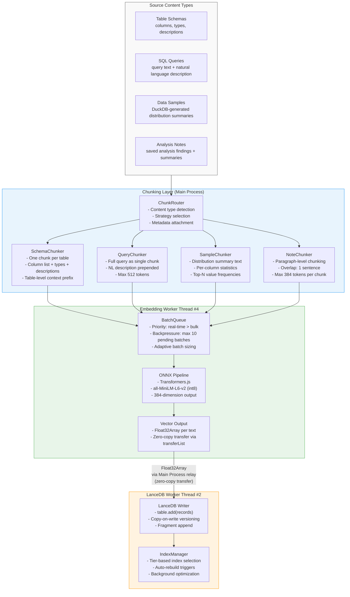
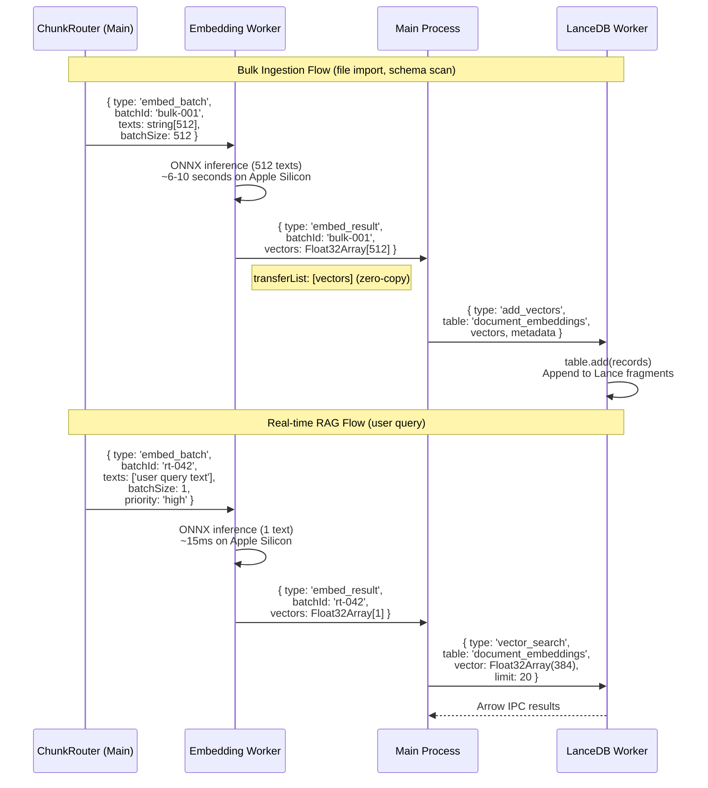
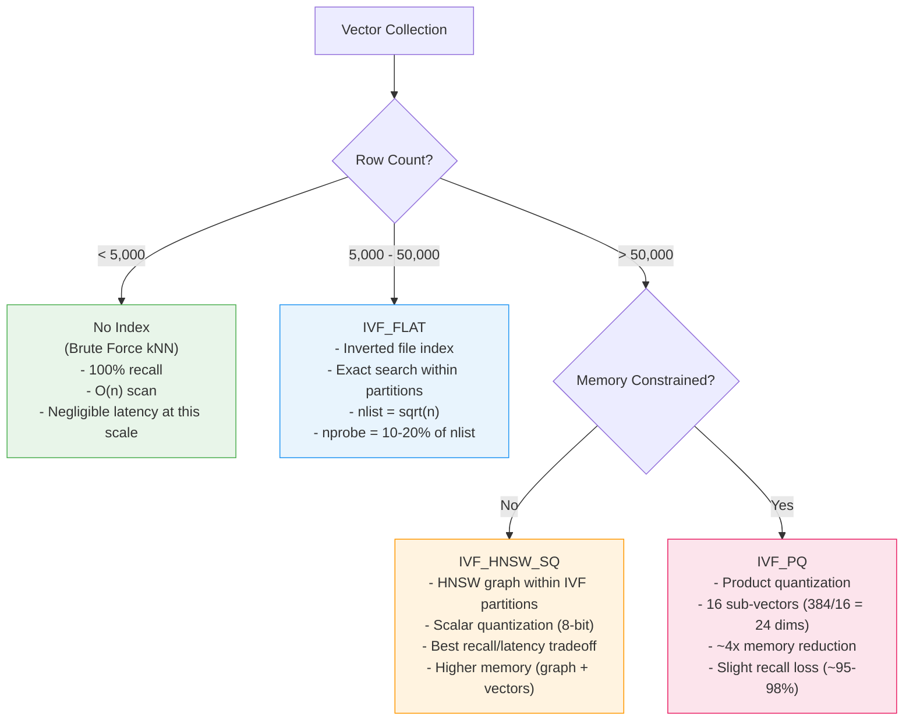
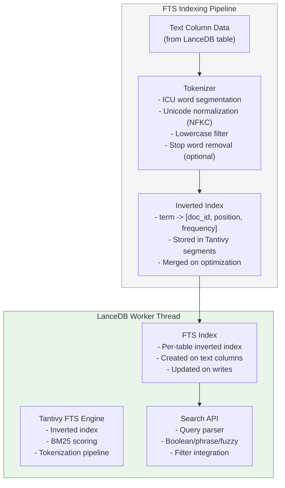
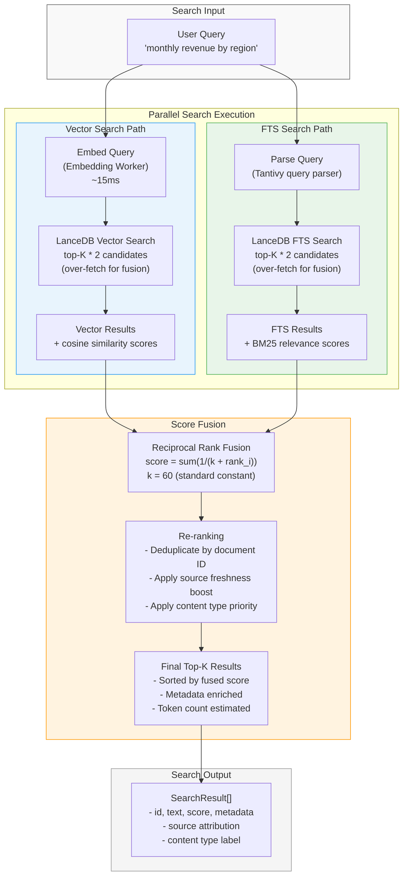
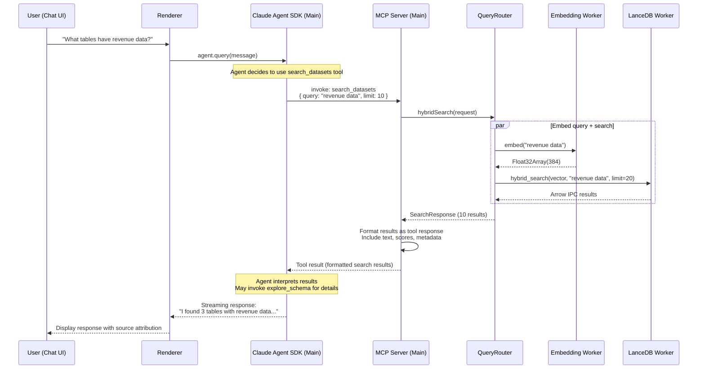

# duckspace: Vector Search and Full-Text Search

**Document:** 05-vector-search-fts.md
**Version:** 1.0
**Date:** 2026-02-05
**Status:** Accepted
**Depends on:** [ADR-001](../decisions/adr-001-database-trio.md), [ADR-004](../decisions/adr-004-ai-integration.md), [04-Database Integration](04-database-integration.md), [Constitution](../../decomposition/constitution.yaml)
**Feeds into:** 09-AI Integration, Data Model Spec, IPC/API Spec, Integration Architecture Overview

---

## 1. Embedding Pipeline Architecture

The embedding pipeline converts application content (SQL queries, table schemas, data samples, notes) into dense vector representations for semantic search. The pipeline runs entirely locally using Transformers.js with an ONNX model in a dedicated Worker Thread (Embedding Worker #4, per doc 02 Section 4.2).

### 1.1 Embedding Pipeline Flow



### 1.2 Chunking Strategies per Content Type

Each content type has a tailored chunking strategy optimized for semantic search quality at 384-dimensional embedding resolution.

| Content Type | Chunking Strategy | Chunk Size Target | Metadata Attached | Example |
|-------------|-------------------|-------------------|-------------------|---------|
| **Table schemas** | One chunk per table: `"Table: {name}. Columns: {col1} ({type1}), {col2} ({type2}), ..."` | 100-300 tokens | `source_id`, `table_name`, `content_type: 'schema'` | `"Table: orders. Columns: id (INTEGER), customer_id (INTEGER), amount (DECIMAL(10,2)), region (VARCHAR), created_at (TIMESTAMP)"` |
| **Column descriptions** | Per-column: `"Table {table}. Column {col} ({type}): {description}"` | 30-80 tokens | `source_id`, `table_name`, `column_name`, `content_type: 'column'` | `"Table orders. Column amount (DECIMAL): Total order value in USD including tax and shipping"` |
| **SQL queries** | Full query + NL description as single chunk | 100-512 tokens | `query_id`, `content_type: 'query'`, `executed_at` | `"Revenue by region last quarter. SELECT region, SUM(amount) FROM orders WHERE created_at >= '2025-10-01' GROUP BY region"` |
| **Analysis summaries** | Paragraph-level with 1-sentence overlap | 200-384 tokens | `analysis_id`, `content_type: 'analysis'`, `chunk_index` | `"Customer churn analysis shows 15% monthly churn rate concentrated in the SMB segment. Top factors: pricing sensitivity and feature gaps."` |
| **Data samples** | DuckDB-generated distribution summaries (not raw rows) | 150-300 tokens | `source_id`, `table_name`, `content_type: 'sample'` | `"Table orders distribution: amount ranges $5-$5000, median $127, 85% under $500. Region: 40% US, 25% EU, 20% APAC, 15% Other."` |

### 1.3 Embedding Model Configuration

Per ADR-004, the primary embedding model is `all-MiniLM-L6-v2` running locally:

```typescript
interface EmbeddingConfig {
  modelName: string;              // 'Xenova/all-MiniLM-L6-v2'
  dimensions: number;             // 384
  quantization: 'int8' | 'fp32'; // 'int8' for production (23 MB vs 90 MB)
  maxSequenceLength: number;      // 256 tokens (model maximum)
  batchSizeConfig: {
    bulk: number;                 // 256-1024 texts per batch (ingestion)
    realtime: number;             // 16-64 texts per batch (RAG queries)
  };
  normalization: boolean;         // true (L2 normalize for cosine similarity)
}

// Default configuration
const DEFAULT_EMBEDDING_CONFIG: EmbeddingConfig = {
  modelName: 'Xenova/all-MiniLM-L6-v2',
  dimensions: 384,
  quantization: 'int8',
  maxSequenceLength: 256,
  batchSizeConfig: { bulk: 512, realtime: 32 },
  normalization: true,
};
```

### 1.4 Batch vs Streaming Embedding Flow



### 1.5 Embedding Storage in LanceDB Tables

Embeddings are stored across three LanceDB tables, organized by content type for independent index tuning:

| Table Name | Content | Expected Size | Index Strategy |
|-----------|---------|---------------|---------------|
| `document_embeddings` | Schemas, analyses, notes | 5K-50K vectors | IVF_FLAT -> IVF_PQ as grows |
| `column_embeddings` | Column-level descriptions | 10K-100K vectors | IVF_FLAT -> IVF_PQ at 50K |
| `query_embeddings` | SQL queries + NL descriptions | 1K-10K vectors | Brute force -> IVF_FLAT at 5K |

```typescript
// LanceDB table schema for document_embeddings
const documentEmbeddingsSchema = {
  fields: [
    { name: 'id', type: 'string' },                               // UUID
    { name: 'source_id', type: 'string' },                        // Data source reference
    { name: 'content_type', type: 'string' },                     // 'schema' | 'column' | 'query' | 'analysis' | 'sample'
    { name: 'chunk_index', type: 'int32' },                       // Position within source
    { name: 'text', type: 'string' },                             // Original text chunk
    { name: 'vector', type: 'fixed_size_list(float32, 384)' },   // Embedding vector
    { name: 'metadata', type: 'string' },                         // JSON metadata blob
    { name: 'created_at', type: 'timestamp[us]' },                // Creation timestamp
    { name: 'updated_at', type: 'timestamp[us]' },                // Last update timestamp
  ],
};
```

---

## 2. Vector Index Design

Vector indices accelerate similarity search by reducing the search space from brute-force linear scan to approximate nearest neighbor (ANN) lookup. LanceDB implements its own indexing backed by the Lance columnar format.

### 2.1 Index Type Configuration

Per ADR-001, index type selection follows collection size thresholds:



### 2.2 Index Configuration Parameters

| Parameter | IVF_FLAT | IVF_PQ | IVF_HNSW_SQ | Description |
|-----------|----------|--------|-------------|-------------|
| `num_partitions` (nlist) | `ceil(sqrt(n))` | `ceil(sqrt(n))` | `ceil(sqrt(n))` | Number of inverted file partitions |
| `nprobe` | `ceil(nlist * 0.1)` | `ceil(nlist * 0.15)` | `ceil(nlist * 0.1)` | Partitions to probe at query time |
| `num_sub_vectors` | N/A | 16 | N/A | PQ sub-vector count (384/16 = 24 dims each) |
| `ef_search` | N/A | N/A | 64 | HNSW search beam width |
| `ef_construction` | N/A | N/A | 128 | HNSW construction beam width |
| `sq_bits` | N/A | N/A | 8 | Scalar quantization bits |

### 2.3 Index Build Triggers

```typescript
class VectorIndexManager {
  private indexState = new Map<string, IndexState>();

  // Triggers that initiate index build/rebuild
  readonly triggers = {
    // After bulk insertion exceeding threshold
    onBulkInsert: async (table: string, insertedCount: number) => {
      const state = this.indexState.get(table);
      if (!state) return;

      const totalRows = await this.getRowCount(table);

      // Tier upgrade check: cross a size threshold?
      if (this.shouldUpgradeIndex(state.indexType, totalRows)) {
        await this.rebuildIndex(table, totalRows);
        return;
      }

      // Freshness check: too many unindexed rows?
      const unindexedRatio = insertedCount / totalRows;
      if (unindexedRatio > 0.2) {  // >20% new data since last index
        await this.rebuildIndex(table, totalRows);
      }
    },

    // Scheduled: on application idle (30 seconds of no queries)
    onAppIdle: async () => {
      for (const [table, state] of this.indexState) {
        const stats = await this.getTableStats(table);
        if (stats.unindexedRows > 1000) {
          await this.rebuildIndex(table, stats.totalRows);
        }
      }
    },

    // Manual: user-initiated via settings
    onManualRequest: async (table: string) => {
      const totalRows = await this.getRowCount(table);
      await this.rebuildIndex(table, totalRows);
    },
  };

  private shouldUpgradeIndex(
    currentType: IndexType | null,
    rowCount: number
  ): boolean {
    if (rowCount < 5_000) return currentType !== null;   // Should have NO index
    if (rowCount <= 50_000) return currentType !== 'ivf_flat';
    return currentType !== 'ivf_pq' && currentType !== 'ivf_hnsw_sq';
  }
}
```

### 2.4 Index Rebuild Strategy for Growing Datasets

As datasets grow, the index must be rebuilt to maintain search quality. The rebuild strategy balances search accuracy against rebuild cost:

| Event | Action | Impact |
|-------|--------|--------|
| Collection crosses 5K threshold | Build first IVF_FLAT index | Search time drops from O(n) to O(sqrt(n)) |
| Collection crosses 50K threshold | Rebuild as IVF_PQ or IVF_HNSW_SQ | Memory reduction ~4x; slightly lower recall |
| >20% new data since last rebuild | Rebuild same index type with updated nlist | Maintains partition balance |
| >50 Lance fragments accumulated | `table.optimize()` compaction + index rebuild | Reduces I/O overhead from fragment proliferation |
| User switches embedding model | Full re-embedding + index rebuild | All vectors regenerated at new dimensionality |

**Rebuild is non-blocking:** Index rebuilds run in the LanceDB Worker Thread's background maintenance scheduler (doc 04, Section 6.2). During rebuild, queries continue using the previous index version. When the new index is complete, LanceDB atomically swaps to the new version. No query interruption occurs.

---

## 3. Full-Text Search Design

LanceDB integrates Tantivy (a Rust full-text search engine inspired by Lucene) for FTS capabilities. This provides BM25-scored text search complementary to vector similarity search.

### 3.1 Tantivy-Based FTS Architecture



### 3.2 Tokenization and Analysis Configuration

```typescript
interface FTSConfig {
  // Tokenization
  tokenizer: 'default' | 'whitespace' | 'raw';  // 'default' = Unicode word segmentation
  lowercase: boolean;                             // true: case-insensitive search
  stopWords: string[] | null;                     // null = use default English stop words
  stemmer: string | null;                         // null = no stemming (preserves exact terms)

  // Index configuration
  indexedColumns: string[];                       // Columns to include in FTS index
  positionsIndexed: boolean;                      // true: enables phrase search
  fieldBoosts: Record<string, number>;            // Per-field BM25 boost weights
}

// Default FTS configuration for document_embeddings table
const DEFAULT_FTS_CONFIG: FTSConfig = {
  tokenizer: 'default',
  lowercase: true,
  stopWords: null,             // English stop words
  stemmer: null,               // No stemming -- exact keyword matches for SQL/column names
  indexedColumns: ['text'],    // FTS on the text column
  positionsIndexed: true,      // Enable phrase search
  fieldBoosts: { text: 1.0 },
};
```

### 3.3 FTS Index Management

FTS indices are created alongside vector indices at table creation time:

```typescript
async function createTableWithFTS(
  db: LanceDBConnection,
  tableName: string,
  data: Record<string, unknown>[],
  ftsConfig: FTSConfig,
): Promise<LanceDBTable> {
  // Step 1: Create table with data
  const table = await db.createTable(tableName, data);

  // Step 2: Create FTS index on text columns
  for (const column of ftsConfig.indexedColumns) {
    await table.createIndex(column, {
      config: lancedb.Index.fts({
        with_position: ftsConfig.positionsIndexed,
        // Tantivy tokenizer configuration
        tokenizer_name: ftsConfig.tokenizer,
        lowercase: ftsConfig.lowercase,
      }),
    });
  }

  return table;
}
```

**FTS index lifecycle:**
- **Created at:** Table creation time, on all configured text columns
- **Updated on:** Every write operation (append, update) triggers incremental index update
- **Rebuilt on:** `table.optimize()` merges Tantivy segments for better read performance
- **Storage:** Tantivy index files stored alongside Lance data in the table's `_indices/` directory

### 3.4 Query Syntax Support

| Query Type | Syntax | Example | Description |
|-----------|--------|---------|-------------|
| **Simple term** | `word` | `revenue` | Match documents containing "revenue" |
| **Multi-term (OR)** | `word1 word2` | `revenue profit` | Match documents containing either term |
| **Phrase** | `"exact phrase"` | `"monthly revenue"` | Match exact phrase (requires positions indexed) |
| **Boolean AND** | `word1 AND word2` | `revenue AND quarterly` | Both terms must appear |
| **Boolean NOT** | `word1 NOT word2` | `revenue NOT forecast` | First term present, second absent |
| **Prefix** | `word*` | `rev*` | Match terms starting with prefix |
| **Fuzzy** | `word~N` | `revnue~1` | Levenshtein distance N (typo tolerance) |
| **Field-specific** | `field:term` | `text:revenue` | Search within specific field |
| **Boosted term** | `term^N` | `revenue^2.0` | Boost term importance in scoring |

---

## 4. Hybrid Search Architecture

Hybrid search combines vector similarity search (semantic understanding) with full-text search (exact keyword matching) to provide comprehensive retrieval. This is critical for analytics use cases where both semantic similarity ("find data about revenue") and exact identifier matching ("find the orders table") are needed.

### 4.1 Combined Vector + FTS Search Pipeline



### 4.2 Score Fusion Strategy: Reciprocal Rank Fusion (RRF)

RRF combines rankings from multiple search systems without requiring score normalization. It is robust to differences in score distributions between vector search (cosine similarity, range 0-1) and FTS (BM25, unbounded positive).

```typescript
interface RRFConfig {
  k: number;             // Fusion constant (default: 60, standard in literature)
  vectorWeight: number;  // Weight for vector search rank (default: 0.5)
  ftsWeight: number;     // Weight for FTS rank (default: 0.5)
  overFetchMultiplier: number;  // Over-fetch factor for each search (default: 2)
}

function reciprocalRankFusion(
  vectorResults: SearchResult[],
  ftsResults: SearchResult[],
  limit: number,
  config: RRFConfig = { k: 60, vectorWeight: 0.5, ftsWeight: 0.5, overFetchMultiplier: 2 },
): SearchResult[] {
  const scores = new Map<string, { score: number; result: SearchResult }>();

  // Score vector results by rank
  vectorResults.forEach((result, rank) => {
    const rrfScore = config.vectorWeight * (1 / (config.k + rank + 1));
    const existing = scores.get(result.id);
    if (existing) {
      existing.score += rrfScore;
    } else {
      scores.set(result.id, { score: rrfScore, result });
    }
  });

  // Score FTS results by rank
  ftsResults.forEach((result, rank) => {
    const rrfScore = config.ftsWeight * (1 / (config.k + rank + 1));
    const existing = scores.get(result.id);
    if (existing) {
      existing.score += rrfScore;
    } else {
      scores.set(result.id, { score: rrfScore, result });
    }
  });

  // Sort by fused score descending, return top-K
  return Array.from(scores.values())
    .sort((a, b) => b.score - a.score)
    .slice(0, limit)
    .map(entry => ({
      ...entry.result,
      fusedScore: entry.score,
    }));
}
```

### 4.3 Re-ranking Approach

After RRF fusion, a lightweight re-ranking pass applies domain-specific adjustments:

```typescript
interface RerankerConfig {
  freshnessDecayDays: number;     // Half-life for freshness boost (default: 30)
  contentTypePriority: Record<string, number>;  // Boost by content type
  sourceActiveBoost: number;      // Boost for active (non-stale) sources
}

const DEFAULT_RERANKER: RerankerConfig = {
  freshnessDecayDays: 30,
  contentTypePriority: {
    schema: 1.2,     // Schema matches are highly relevant for analytics queries
    column: 1.1,     // Column descriptions are useful for field selection
    query: 1.0,      // Past queries have baseline relevance
    analysis: 0.9,   // Analysis summaries have slightly lower priority
    sample: 0.8,     // Data samples are least relevant for most queries
  },
  sourceActiveBoost: 1.1,
};

function rerank(
  results: FusedSearchResult[],
  config: RerankerConfig,
): FusedSearchResult[] {
  const now = Date.now();

  return results.map(result => {
    let adjustedScore = result.fusedScore;

    // Content type priority boost
    const typePriority = config.contentTypePriority[result.contentType] ?? 1.0;
    adjustedScore *= typePriority;

    // Freshness decay (exponential)
    const ageMs = now - new Date(result.updatedAt).getTime();
    const ageDays = ageMs / (1000 * 60 * 60 * 24);
    const freshnessMultiplier = Math.pow(0.5, ageDays / config.freshnessDecayDays);
    adjustedScore *= (0.8 + 0.2 * freshnessMultiplier);  // 80% base + 20% freshness

    // Active source boost
    if (result.sourceStatus === 'active') {
      adjustedScore *= config.sourceActiveBoost;
    }

    return { ...result, adjustedScore };
  }).sort((a, b) => b.adjustedScore - a.adjustedScore);
}
```

### 4.4 Result Deduplication

Documents may appear in both vector and FTS result sets. Deduplication occurs during RRF fusion (the Map keyed by document ID naturally merges duplicates, summing their RRF scores). This means documents found by both search methods receive a higher fused score, which is the desired behavior -- dual-presence indicates high relevance.

---

## 5. Search API Design

The search API provides a unified interface for all search operations, exposed through the LanceDB Worker and accessible via the Main Process QueryRouter.

### 5.1 Search Request Format

```typescript
interface SearchRequest {
  requestId: string;              // UUID for request tracking
  table: string;                  // LanceDB table name
  mode: 'vector' | 'fts' | 'hybrid';  // Search mode

  // Query specification
  query: {
    text: string;                 // Natural language query text
    vector?: Float32Array;        // Pre-computed query vector (optional; computed if absent)
  };

  // Result configuration
  limit: number;                  // Max results to return (default: 20)
  offset?: number;                // Cursor offset for pagination (default: 0)

  // Filtering
  filter?: {
    contentTypes?: string[];      // Filter by content type
    sourceIds?: string[];         // Filter by source ID
    dateRange?: {
      from?: string;              // ISO timestamp
      to?: string;                // ISO timestamp
    };
    custom?: string;              // LanceDB SQL filter expression
  };

  // Hybrid search configuration (only for mode: 'hybrid')
  hybridConfig?: {
    vectorWeight: number;         // Weight for vector results (0-1, default: 0.5)
    ftsWeight: number;            // Weight for FTS results (0-1, default: 0.5)
    rrfK: number;                 // RRF constant (default: 60)
  };

  // Options
  options?: {
    includeVectors: boolean;      // Include embedding vectors in results (default: false)
    includeScores: boolean;       // Include similarity/relevance scores (default: true)
    estimateTokens: boolean;      // Estimate token count per result (default: true)
    timeout: number;              // Search timeout in ms (default: 5000)
  };
}
```

### 5.2 Search Response Format

```typescript
interface SearchResponse {
  requestId: string;              // Echo back request ID
  status: 'success' | 'error';
  mode: string;                   // Search mode used

  // Results
  results: SearchResult[];

  // Pagination
  pagination: {
    offset: number;
    limit: number;
    totalEstimate?: number;       // Estimated total matching documents
    hasMore: boolean;
  };

  // Performance
  performance: {
    searchDurationMs: number;
    embeddingDurationMs?: number; // Time to compute query embedding (if computed)
    resultCount: number;
  };
}

interface SearchResult {
  id: string;                     // Document ID
  text: string;                   // Original text chunk
  contentType: string;            // 'schema' | 'column' | 'query' | 'analysis' | 'sample'
  sourceId: string;               // Data source reference
  chunkIndex: number;             // Position within source

  // Scores
  score: number;                  // Final score (fused for hybrid, raw for single-mode)
  vectorScore?: number;           // Cosine similarity (vector mode)
  ftsScore?: number;              // BM25 score (FTS mode)

  // Metadata
  metadata: Record<string, unknown>;
  createdAt: string;              // ISO timestamp
  updatedAt: string;              // ISO timestamp

  // Token estimation
  estimatedTokens?: number;       // Approximate token count for context budgeting
}
```

### 5.3 Pagination and Cursor-Based Navigation

For large result sets, the search API supports cursor-based pagination:

```typescript
// First page
const page1 = await search({
  mode: 'hybrid',
  query: { text: 'revenue analysis' },
  limit: 20,
  offset: 0,
});
// page1.pagination.hasMore = true

// Next page
const page2 = await search({
  mode: 'hybrid',
  query: { text: 'revenue analysis' },
  limit: 20,
  offset: 20,
});
```

**Pagination implementation:** LanceDB supports `offset` via its query API. For vector search, the search retrieves `offset + limit` results and discards the first `offset`. For FTS, Tantivy supports native offset. For hybrid search, both branches over-fetch and fusion produces the paginated window.

**Limitation:** Deep pagination (offset > 1000) is discouraged because both vector and FTS over-fetch cost grows linearly with offset. For deep exploration, users should refine their query instead.

### 5.4 Search Result Caching Strategy

```typescript
class SearchCache {
  private cache = new Map<string, { response: SearchResponse; timestamp: number }>();
  private maxEntries = 100;
  private ttlMs = 60_000;  // 60-second cache TTL

  getCacheKey(request: SearchRequest): string {
    // Cache key includes query text, mode, filters, and pagination
    return JSON.stringify({
      table: request.table,
      mode: request.mode,
      text: request.query.text,
      filter: request.filter,
      limit: request.limit,
      offset: request.offset,
    });
  }

  get(request: SearchRequest): SearchResponse | null {
    const key = this.getCacheKey(request);
    const entry = this.cache.get(key);

    if (!entry) return null;
    if (Date.now() - entry.timestamp > this.ttlMs) {
      this.cache.delete(key);
      return null;
    }

    return entry.response;
  }

  set(request: SearchRequest, response: SearchResponse): void {
    const key = this.getCacheKey(request);

    // LRU eviction
    if (this.cache.size >= this.maxEntries) {
      const oldestKey = this.cache.keys().next().value;
      if (oldestKey) this.cache.delete(oldestKey);
    }

    this.cache.set(key, { response, timestamp: Date.now() });
  }

  // Invalidate cache when embeddings change
  invalidateForTable(tableName: string): void {
    for (const [key, _] of this.cache) {
      if (key.includes(`"table":"${tableName}"`)) {
        this.cache.delete(key);
      }
    }
  }
}
```

**Cache invalidation triggers:**
- New vectors added to a LanceDB table
- Index rebuild completed
- User-initiated cache clear
- TTL expiration (60 seconds default)

---

## 6. RAG Context Assembly

The RAG (Retrieval-Augmented Generation) context assembly pipeline converts search results into structured context for the Claude Agent SDK's conversation.

### 6.1 How Search Results Feed into AI Context



### 6.2 Context Window Budget Allocation

Per ADR-004, the Claude context window (200K tokens) is allocated as follows for RAG-enhanced queries:

| Allocation | Tokens | Source | Strategy |
|-----------|--------|--------|----------|
| System prompt + tool definitions | ~3,000 | Fixed | Always present |
| Cached schema context | ~10,000 | Injected at session start | Top-level schema overview of all registered tables |
| RAG search results | ~15,000 | Dynamic per query | Top-K search results, trimmed to budget |
| Tool execution results | ~10,000 | Dynamic per turn | SQL results, schema details, statistics |
| Conversation history | ~50,000 | Managed by Agent SDK | Automatic pruning of older turns |
| Response generation | ~8,000 | Reserved | Agent's response output |
| Safety buffer | ~104,000 | Unused | Headroom for complex multi-turn conversations |

### 6.3 Relevance Scoring and Cutoff Thresholds

Not all search results are worth including in the AI context. The context assembly pipeline applies cutoff thresholds to prevent low-relevance noise from diluting context quality:

```typescript
interface ContextAssemblyConfig {
  // Score thresholds (below these, results are excluded)
  minVectorScore: number;         // 0.3 (cosine similarity minimum)
  minFTSScore: number;            // 1.0 (BM25 minimum)
  minFusedScore: number;          // 0.005 (RRF fused score minimum)

  // Token budget
  maxContextTokens: number;       // 15,000 tokens for RAG results
  tokensPerResult: number;        // ~200 average tokens per search result

  // Result limits
  maxResults: number;             // 20 (hard cap regardless of scores)
  minResults: number;             // 3 (include at least 3 if available)
}

function assembleRAGContext(
  results: SearchResult[],
  config: ContextAssemblyConfig,
): RAGContext {
  let totalTokens = 0;
  const included: SearchResult[] = [];

  for (const result of results) {
    // Score cutoff (skip unless we haven't hit minResults)
    if (included.length >= config.minResults && result.score < config.minFusedScore) {
      break;
    }

    // Token budget check
    const resultTokens = result.estimatedTokens ?? config.tokensPerResult;
    if (totalTokens + resultTokens > config.maxContextTokens) {
      break;
    }

    // Max results check
    if (included.length >= config.maxResults) {
      break;
    }

    included.push(result);
    totalTokens += resultTokens;
  }

  return {
    results: included,
    totalTokens,
    truncated: included.length < results.length,
    metadata: {
      queryMode: results[0]?.fusedScore !== undefined ? 'hybrid' : 'single',
      resultCount: included.length,
      totalAvailable: results.length,
    },
  };
}
```

### 6.4 Source Attribution in AI Responses

Every piece of information retrieved via RAG includes source attribution metadata that the Claude Agent SDK can use to cite sources in its responses:

```typescript
interface RAGContextItem {
  text: string;                   // Retrieved text content
  attribution: {
    sourceId: string;             // Data source ID
    sourceName: string;           // Human-readable source name
    contentType: string;          // 'schema' | 'column' | 'query' | 'analysis' | 'sample'
    tableName?: string;           // Table name (if applicable)
    columnName?: string;          // Column name (if applicable)
    retrievalMethod: 'vector' | 'fts' | 'hybrid';
    score: number;                // Retrieval score
  };
}
```

The MCP tool responses include attribution data in a structured format that the Claude Agent SDK passes to the model. The model is instructed via the system prompt to cite sources when referencing retrieved information:

```
When referencing information from search results, cite the source:
- For schemas: "Based on the {table_name} table schema..."
- For past queries: "A similar analysis was run: {query_description}..."
- For analyses: "A previous analysis found that..."
```

---

## 7. Cross-Reference and Consistency

### 7.1 Constitution Alignment

| Principle | Requirement | How This Design Satisfies It |
|-----------|------------|------------------------------|
| #9 Arrow-First Data Flow | All inter-component data transfer uses Arrow | Search results returned as Arrow IPC from LanceDB Worker. Embedding vectors transferred as Float32Array (Arrow-compatible). |
| #10 Embedded-Only Databases | No external database servers | LanceDB runs in-process in Worker Thread. Tantivy FTS is embedded within LanceDB. No external search service. |
| #11 Stream and Scan | No bulk loading into JS memory | Search results are bounded by limit parameter. Embedding batches use backpressure. No full collection scans in JS. |
| #12 Process Isolation | Main owns database engines; Workers isolate computation | LanceDB Worker owns search operations. Embedding Worker isolates ONNX inference. Main Process relays control messages only. |
| #13 macOS-First | Technologies work on macOS + Electron | LanceDB N-API, Transformers.js ONNX, Tantivy -- all verified on macOS arm64 and x64. |
| #14 Single-User, Local-First | No network dependency for core features | Embedding model runs locally. Vector and FTS search are fully local. No external API calls for retrieval. |

### 7.2 ADR-001 Decision Implementation

| ADR-001 Decision | Implementation in This Document |
|-----------------|-------------------------------|
| LanceDB for vector + FTS | Section 2 (vector index), Section 3 (FTS), Section 4 (hybrid) |
| Vector index tiers (5K/50K thresholds) | Section 2.1: Index type decision tree |
| IVF_FLAT, IVF_PQ, IVF_HNSW_SQ | Section 2.2: Index configuration parameters |
| Tantivy-based FTS with BM25 | Section 3.1: Tantivy architecture |
| Reciprocal Rank Fusion for hybrid search | Section 4.2: RRF implementation |
| Embedding pipeline separate from LanceDB built-in | Section 1: External Embedding Worker pipeline |
| Batch insertion modes (256-1024, 16-64) | Section 1.4: Bulk vs streaming flow |

### 7.3 ADR-004 Decision Implementation

| ADR-004 Decision | Implementation in This Document |
|-----------------|-------------------------------|
| all-MiniLM-L6-v2 (384-dim, int8 ONNX) | Section 1.3: Embedding model configuration |
| Transformers.js in Worker Thread | Section 1.1: Embedding Worker #4 |
| Hybrid search (LanceDB vectors + FTS) | Section 4: Full hybrid search pipeline |
| Progressive context loading | Section 6.2: Context window budget allocation |
| RAG context assembly | Section 6: Complete RAG pipeline |

### 7.4 Document 04 (Database Integration) Integration

| Doc 04 Component | Vector/FTS Integration |
|-----------------|----------------------|
| LanceDBAdapter (Section 3) | Proxies search requests from QueryRouter to LanceDB Worker |
| LanceDB Worker (Section 3.2) | Hosts all vector search, FTS, and hybrid search operations |
| Index Management (Section 3.3) | Extended here with detailed tier configuration and rebuild triggers |
| Search API (Section 3.4) | Extended here with full request/response formats and caching |
| Embedding Storage Pipeline (Section 3.5) | Extended here with chunking strategies and content type handling |
| Query Router (Section 5) | Routes `vector_search`, `fts_search`, `hybrid_search` to LanceDB Worker |

---

*Document 05 of the duckspace Architecture Series*
*Generated: 2026-02-05 | Plan: duckspace-system-design-2026-02-04 | Task: design-vector-search-fts*
