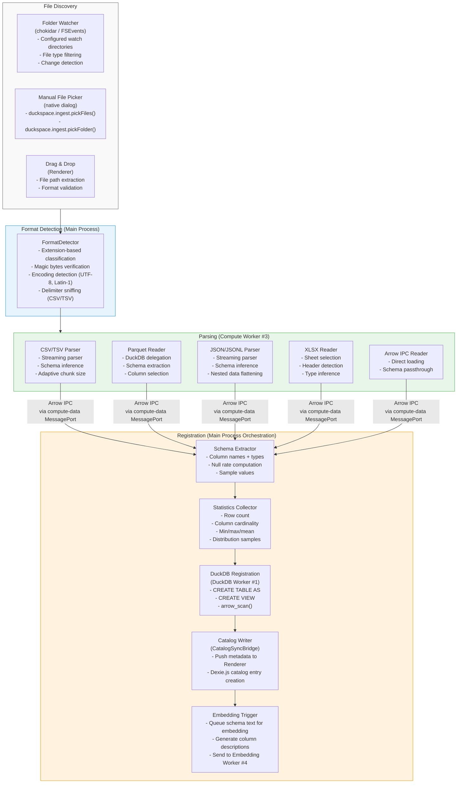
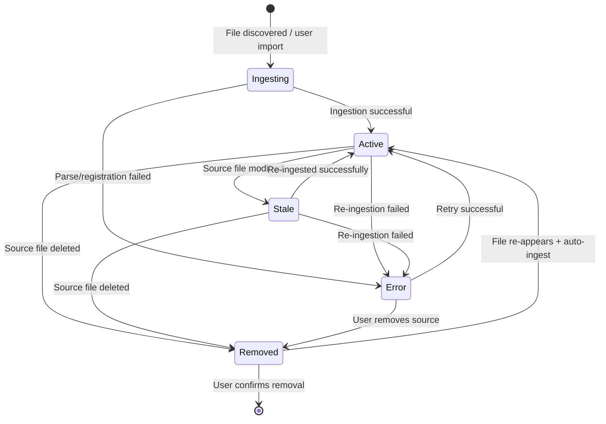
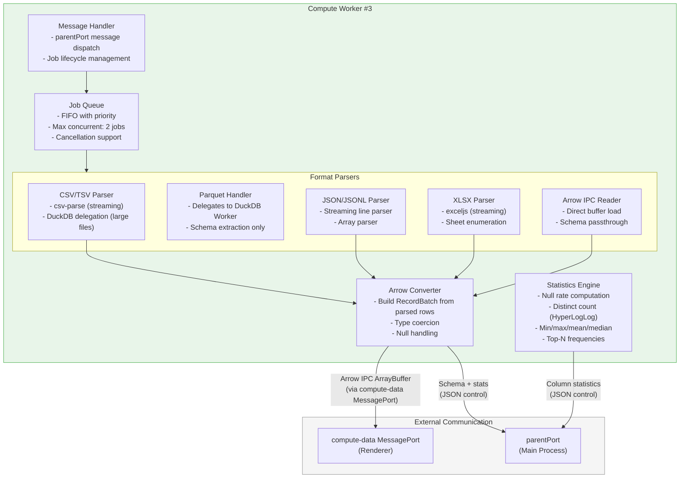

# duckspace: Local Data Ingestion Pipeline

**Document:** 06-local-ingestion.md
**Version:** 1.0
**Date:** 2026-02-05
**Status:** Accepted
**Depends on:** [02-Electron Process Model](02-electron-process-model.md), [03-Arrow Data Plane](03-arrow-data-plane.md), [04-Database Integration](04-database-integration.md), [Constitution](../../decomposition/constitution.yaml)
**Feeds into:** 07-Remote Connectors, Data Model Spec, IPC/API Spec, Integration Architecture Overview

---

## 1. Ingestion Pipeline Overview

The local data ingestion pipeline is responsible for discovering local files, detecting their format, parsing them into Apache Arrow tables, registering them in DuckDB for analytical queries, and generating metadata for the Dexie.js catalog and embeddings for AI search. The pipeline enforces Constitution Principle 9 (Arrow-first) by using Arrow IPC as the intermediate format for all data transfer between pipeline stages.

### 1.1 Pipeline Flow Diagram



### 1.2 Pipeline Data Flow

All data flows through the pipeline as Apache Arrow IPC buffers. The Compute Worker (#3, per doc 02 Section 4.2) performs all CPU-intensive parsing and converts every supported format into Arrow before any further processing occurs.

| Stage | Input | Output | Process |
|-------|-------|--------|---------|
| Discovery | File paths | `IngestJob` descriptors | Main Process |
| Format Detection | File path + first 8KB bytes | Format type + options | Main Process |
| Parsing | File bytes | Arrow IPC RecordBatch stream | Compute Worker #3 |
| Schema Extraction | Arrow RecordBatches | `SchemaInfo` object | Compute Worker #3 |
| Statistics | Arrow RecordBatches | `ColumnStatistics[]` | Compute Worker #3 |
| DuckDB Registration | Arrow IPC buffer | DuckDB table/view | DuckDB Worker #1 |
| Catalog Update | Metadata JSON | Dexie.js entry | Renderer (via CatalogSyncBridge) |
| Embedding | Schema text | Float32Array vectors | Embedding Worker #4 |

---

## 2. Folder Scanning and Watch System

The folder scan system monitors configured directories for new, modified, and deleted files, automatically triggering the ingestion pipeline for supported file types.

### 2.1 Configured Watch Directories

Watch directories are stored in Dexie.js (`user_preferences` collection) and managed through the Settings UI:

```typescript
interface WatchDirectoryConfig {
  id: string;                     // UUID
  path: string;                   // Absolute path to watched directory
  recursive: boolean;             // Watch subdirectories (default: true)
  autoIngest: boolean;            // Automatically ingest new files (default: true)
  fileTypes: string[];            // Allowed extensions (default: all supported)
  excludePatterns: string[];      // Glob patterns to exclude (e.g., '*.tmp', '.DS_Store')
  scanInterval?: number;          // Periodic rescan interval in ms (default: null = event-driven only)
  enabled: boolean;               // Can be disabled without removing
}

// Default supported file types
const SUPPORTED_EXTENSIONS = [
  '.csv', '.tsv', '.tab',        // Delimited text
  '.parquet', '.pq',             // Apache Parquet
  '.json', '.jsonl', '.ndjson',  // JSON and newline-delimited JSON
  '.xlsx', '.xls',               // Microsoft Excel
  '.arrow', '.ipc', '.feather',  // Apache Arrow IPC
];
```

### 2.2 File System Watcher Implementation

The folder scan system uses `chokidar` for cross-platform file watching, with macOS FSEvents as the native backend:

```typescript
import chokidar from 'chokidar';

class FolderWatchManager {
  private watchers = new Map<string, chokidar.FSWatcher>();
  private debounceTimers = new Map<string, NodeJS.Timeout>();
  private readonly debounceMs = 500;  // Debounce rapid file changes

  async addWatchDirectory(config: WatchDirectoryConfig): Promise<void> {
    const watcher = chokidar.watch(config.path, {
      persistent: true,
      ignoreInitial: false,          // Emit events for existing files on first scan
      depth: config.recursive ? undefined : 0,
      ignored: [
        ...config.excludePatterns,
        /(^|[\/\\])\../,             // Hidden files (dotfiles)
        /\.DS_Store$/,               // macOS metadata
        /~\$/,                       // Office lock files
      ],
      awaitWriteFinish: {
        stabilityThreshold: 2000,    // Wait 2s after last write before emitting
        pollInterval: 100,
      },
      usePolling: false,             // Use native FSEvents on macOS (efficient)
    });

    watcher
      .on('add', (filePath) => this.onFileAdded(config, filePath))
      .on('change', (filePath) => this.onFileChanged(config, filePath))
      .on('unlink', (filePath) => this.onFileRemoved(config, filePath))
      .on('error', (error) => this.onWatchError(config, error));

    this.watchers.set(config.id, watcher);
  }

  private onFileAdded(config: WatchDirectoryConfig, filePath: string): void {
    if (!this.isSupportedFile(filePath, config.fileTypes)) return;

    // Debounce to handle rapid multi-file drops
    this.debounce(filePath, () => {
      if (config.autoIngest) {
        this.startIngestion(filePath, 'auto');
      } else {
        this.notifyNewFile(filePath);
      }
    });
  }

  private onFileChanged(config: WatchDirectoryConfig, filePath: string): void {
    if (!this.isSupportedFile(filePath, config.fileTypes)) return;

    this.debounce(filePath, () => {
      this.markSourceStale(filePath);
      if (config.autoIngest) {
        this.startReingestion(filePath);
      }
    });
  }

  private onFileRemoved(config: WatchDirectoryConfig, filePath: string): void {
    this.markSourceRemoved(filePath);
  }

  private isSupportedFile(filePath: string, allowedTypes: string[]): boolean {
    const ext = path.extname(filePath).toLowerCase();
    const types = allowedTypes.length > 0 ? allowedTypes : SUPPORTED_EXTENSIONS;
    return types.includes(ext);
  }

  private debounce(key: string, fn: () => void): void {
    const existing = this.debounceTimers.get(key);
    if (existing) clearTimeout(existing);
    this.debounceTimers.set(key, setTimeout(() => {
      this.debounceTimers.delete(key);
      fn();
    }, this.debounceMs));
  }
}
```

### 2.3 Change Detection

| Change Type | Detection Method | Response |
|------------|-----------------|----------|
| **New file** | `chokidar` `add` event | Auto-ingest if enabled; else notify user |
| **Modified file** | `chokidar` `change` event (after write stabilization) | Mark source as `stale`; re-ingest if auto-ingest enabled |
| **Deleted file** | `chokidar` `unlink` event | Mark source as `removed` in catalog; drop DuckDB view/table on user confirmation |
| **Renamed file** | `unlink` + `add` pair (within debounce window) | Detect rename heuristic: same size + similar timestamp = update path in catalog |
| **Directory deleted** | `chokidar` `unlinkDir` event | Mark all contained sources as `removed` |

### 2.4 Scan Scheduling

| Scan Type | Trigger | Purpose |
|-----------|---------|---------|
| **Initial scan** | `chokidar` with `ignoreInitial: false` | Discover all existing files when watch starts |
| **Event-driven** | FSEvents (macOS native) | Real-time detection of file system changes |
| **Periodic rescan** | Optional `setInterval` (configurable per directory) | Catch events missed by watcher (e.g., network drives, edge cases) |
| **Manual scan** | User-initiated via Settings UI | Force rediscovery of all files in watched directories |

---

## 3. Supported File Format Parsers

Each parser runs in the Compute Worker (#3) and converts its input format into Arrow IPC RecordBatch streams. The Compute Worker delegates to DuckDB for formats that DuckDB handles natively (Parquet, JSON) to leverage DuckDB's optimized readers.

### 3.1 CSV/TSV Parser

```typescript
interface CSVParserConfig {
  delimiter?: string;             // Auto-detected if not specified
  header: boolean;                // true: first row is header (default: true)
  encoding?: string;              // Auto-detected (UTF-8, Latin-1)
  quoteChar?: string;             // Default: '"'
  escapeChar?: string;            // Default: '"' (RFC 4180)
  nullValues?: string[];          // Default: ['', 'NULL', 'null', 'NA', 'N/A', 'NaN']
  skipRows?: number;              // Skip N rows before header
  maxRows?: number;               // Limit rows read (for preview)
  sampleSize?: number;            // Rows to sample for schema inference (default: 10000)
}
```

**Parsing pipeline:**
1. **Encoding detection:** Read first 8KB, detect UTF-8 BOM or infer encoding via byte frequency analysis
2. **Delimiter detection:** If not specified, test `,`, `\t`, `|`, `;` against first 100 lines; select delimiter producing most consistent column count
3. **Schema inference:** Parse first `sampleSize` rows; for each column, attempt type detection in order: integer, float, boolean, date/timestamp, string. Track null ratio.
4. **Streaming parse:** Parse file in 64KB chunks; convert each chunk to Arrow RecordBatch; emit via compute-data MessagePort with backpressure

**DuckDB delegation (alternative path):** For large CSV files (>100 MB), the Compute Worker can delegate to DuckDB's `read_csv_auto()` for faster parsing:

```sql
-- DuckDB Worker executes:
CREATE TABLE {table_name} AS
SELECT * FROM read_csv_auto('{file_path}',
  header=true,
  auto_detect=true,
  sample_size=10000
);
```

### 3.2 Parquet Reader

Parquet files are read natively by DuckDB -- no conversion needed:

```typescript
interface ParquetReaderConfig {
  columns?: string[];             // Select specific columns (pushdown)
  rowGroupRange?: [number, number]; // Read specific row groups
}
```

**Parsing pipeline:**
1. **Direct DuckDB read:** `read_parquet('{file_path}')` -- DuckDB reads Parquet natively with column pruning, predicate pushdown, and row group selection
2. **Schema extraction:** `DESCRIBE SELECT * FROM read_parquet('{file_path}')` provides column names and types
3. **Registration:** `CREATE VIEW {table_name} AS SELECT * FROM read_parquet('{file_path}')` -- lazy view over the original file (no data copy)

Parquet files are the most efficient path: no parsing overhead, no intermediate copy, and DuckDB can push predicates directly into the Parquet reader.

### 3.3 JSON/JSONL Parser

```typescript
interface JSONParserConfig {
  format: 'json' | 'jsonl' | 'auto';  // Auto-detect single JSON vs newline-delimited
  flattenDepth?: number;               // Max nesting depth to flatten (default: 2)
  arrayPath?: string;                  // JSONPath to array of records (for nested JSON)
  maxRows?: number;                    // Limit rows read
}
```

**Parsing pipeline:**
1. **Format detection:** Read first 1KB; if first non-whitespace byte is `[`, treat as JSON array; if each line is valid JSON, treat as JSONL
2. **Streaming parse (JSONL):** Read line-by-line; parse each line as JSON object; flatten nested structures up to `flattenDepth`
3. **Array parse (JSON):** Use DuckDB's `read_json_auto()` for efficient array-of-objects parsing
4. **Schema inference:** Analyze first 10,000 records; detect types, handle mixed types (fall back to string), handle null/missing fields
5. **Nested data handling:** Flatten nested objects with dot notation (`address.city` -> `address_city`); arrays become JSON string columns

**DuckDB delegation:**
```sql
-- For JSON arrays and JSONL:
CREATE TABLE {table_name} AS
SELECT * FROM read_json_auto('{file_path}',
  format='auto',
  maximum_sample_size=10000
);
```

### 3.4 Excel (XLSX) Reader

```typescript
interface XLSXReaderConfig {
  sheet?: string | number;        // Sheet name or 0-based index (default: first sheet)
  headerRow?: number;             // Row containing headers (default: 1)
  dataRange?: string;             // Cell range, e.g., 'A1:G1000'
  skipEmptyRows?: boolean;        // Default: true
}
```

**Parsing pipeline:**
1. **Sheet enumeration:** List available sheets; use specified or first sheet
2. **Header detection:** Read specified header row; detect merged cells
3. **Type inference:** Sample column values; infer numeric, date, boolean, string types
4. **Streaming read:** Read in chunks of 10,000 rows; convert to Arrow RecordBatches
5. **Memory management:** Excel files can be large; the parser streams rows without loading the entire workbook

**Library:** `xlsx` (SheetJS Community Edition) or `exceljs` for streaming. The choice depends on performance benchmarks during implementation.

### 3.5 Arrow IPC Reader

Arrow IPC files are the simplest path -- direct loading with zero conversion:

```typescript
interface ArrowIPCReaderConfig {
  // No configuration needed -- Arrow IPC is the native format
}
```

**Parsing pipeline:**
1. **Direct read:** Load Arrow IPC file as `ArrayBuffer`
2. **Schema extraction:** Read Arrow schema from the IPC stream header
3. **Passthrough:** Forward the Arrow IPC buffer directly to DuckDB Worker for registration

This path involves zero format conversion -- the file is already in the target format.

### 3.6 Format-Specific Options and Configuration

| Format | Parse Speed | Schema Quality | DuckDB Delegation | Memory Efficiency |
|--------|-----------|----------------|-------------------|-------------------|
| **Parquet** | Fastest (native DuckDB) | Excellent (schema in file) | Always | Best (lazy view, no copy) |
| **Arrow IPC** | Fastest (zero conversion) | Excellent (schema in file) | Registration only | Best (no conversion) |
| **CSV/TSV** | Medium (streaming parse) | Inferred (may need hints) | Optional (large files) | Good (streaming chunks) |
| **JSONL** | Medium (line parse) | Inferred (may have mixed types) | Optional | Good (streaming) |
| **JSON array** | Slow (must parse full) | Inferred | Recommended | Fair (full parse in memory) |
| **XLSX** | Slowest (complex format) | Inferred | No (not supported by DuckDB) | Fair (sheet decompression) |

---

## 4. Auto-Registration Pipeline

After parsing produces Arrow RecordBatches, the auto-registration pipeline extracts metadata, creates DuckDB tables/views, writes catalog entries to Dexie.js, and triggers embedding generation.

### 4.1 Schema Inference

```typescript
interface SchemaInfo {
  columns: ColumnInfo[];
  rowCount: number;
  estimatedSizeBytes: number;
  sourceFormat: string;
}

interface ColumnInfo {
  name: string;                   // Column name
  type: string;                   // DuckDB type name (VARCHAR, INTEGER, etc.)
  arrowType: string;              // Arrow type (Utf8, Int32, etc.)
  nullable: boolean;              // Can contain nulls
  nullRate: number;               // Percentage of null values (0-1)
  sampleValues: unknown[];        // Up to 5 sample non-null values
}

async function inferSchema(
  arrowBatches: ArrowRecordBatch[],
  sampleSize: number = 10_000,
): Promise<SchemaInfo> {
  const schema = arrowBatches[0].schema;
  const columns: ColumnInfo[] = [];

  for (const field of schema.fields) {
    const column = arrowBatches[0].getChildAt(schema.fields.indexOf(field));
    if (!column) continue;

    // Count nulls across sample
    let nullCount = 0;
    let totalCount = 0;
    const sampleValues: unknown[] = [];

    for (const batch of arrowBatches) {
      const col = batch.getChildAt(schema.fields.indexOf(field));
      if (!col) continue;

      for (let i = 0; i < Math.min(col.length, sampleSize - totalCount); i++) {
        totalCount++;
        if (!col.isValid(i)) {
          nullCount++;
        } else if (sampleValues.length < 5) {
          sampleValues.push(col.get(i));
        }
      }
      if (totalCount >= sampleSize) break;
    }

    columns.push({
      name: field.name,
      type: arrowTypeToDuckDB(field.type),
      arrowType: field.type.toString(),
      nullable: nullCount > 0,
      nullRate: totalCount > 0 ? nullCount / totalCount : 0,
      sampleValues,
    });
  }

  return {
    columns,
    rowCount: arrowBatches.reduce((sum, b) => sum + b.numRows, 0),
    estimatedSizeBytes: arrowBatches.reduce((sum, b) =>
      sum + b.byteLength, 0),
    sourceFormat: 'arrow',  // Intermediate format is always Arrow
  };
}
```

### 4.2 Statistics Collection

```typescript
interface ColumnStatistics {
  columnName: string;
  type: string;
  rowCount: number;
  nullCount: number;
  nullRate: number;
  distinctCount: number;          // Exact for <100K rows; estimated for larger
  // Numeric columns
  min?: number | bigint;
  max?: number | bigint;
  mean?: number;
  median?: number;
  stddev?: number;
  // String columns
  minLength?: number;
  maxLength?: number;
  avgLength?: number;
  // Top-N most frequent values
  topValues?: { value: unknown; count: number }[];
}
```

Statistics are computed by DuckDB after table registration, leveraging DuckDB's columnar execution for efficient computation:

```sql
-- Statistics query executed by DuckDB Worker
SELECT
  count(*) as row_count,
  count(DISTINCT "{column}") as distinct_count,
  count(*) - count("{column}") as null_count,
  min("{column}") as min_val,
  max("{column}") as max_val,
  avg("{column}"::DOUBLE) as mean_val,
  median("{column}"::DOUBLE) as median_val,
  stddev("{column}"::DOUBLE) as stddev_val
FROM "{table_name}";

-- Top-N values for categorical columns
SELECT "{column}" as value, count(*) as freq
FROM "{table_name}"
WHERE "{column}" IS NOT NULL
GROUP BY "{column}"
ORDER BY freq DESC
LIMIT 10;
```

### 4.3 DuckDB Table/View Creation

The registration strategy depends on the source file format:

| Source Format | Registration Method | Rationale |
|--------------|-------------------|-----------|
| **Parquet** | `CREATE VIEW ... AS SELECT * FROM read_parquet(?)` | Lazy: no data copy; DuckDB reads directly from file |
| **Arrow IPC** | `CREATE TABLE ... AS SELECT * FROM arrow_scan(?)` | Import: Arrow data loaded into DuckDB storage |
| **CSV** (small, <100 MB) | `CREATE TABLE ... AS SELECT * FROM arrow_scan(?)` | Import: parsed Arrow data loaded into DuckDB |
| **CSV** (large, >100 MB) | `CREATE VIEW ... AS SELECT * FROM read_csv_auto(?)` | Lazy: DuckDB reads directly from file |
| **JSON/JSONL** | `CREATE TABLE ... AS SELECT * FROM arrow_scan(?)` | Import: parsed Arrow data loaded |
| **XLSX** | `CREATE TABLE ... AS SELECT * FROM arrow_scan(?)` | Import: parsed Arrow data loaded |

```typescript
async function registerInDuckDB(
  duckdbAdapter: DuckDBAdapter,
  sourceId: string,
  tableName: string,
  sourcePath: string,
  sourceFormat: string,
  arrowBuffer?: ArrayBuffer,
): Promise<void> {
  const safeTableName = sanitizeTableName(tableName);

  switch (sourceFormat) {
    case 'parquet':
      // Lazy view -- DuckDB reads Parquet directly
      await duckdbAdapter.execute(
        `CREATE OR REPLACE VIEW "${safeTableName}" AS SELECT * FROM read_parquet($1)`,
        [sourcePath],
      );
      break;

    case 'csv':
      const fileSizeMB = (await fs.stat(sourcePath)).size / (1024 * 1024);
      if (fileSizeMB > 100) {
        // Large CSV: lazy view via DuckDB's CSV reader
        await duckdbAdapter.execute(
          `CREATE OR REPLACE VIEW "${safeTableName}" AS SELECT * FROM read_csv_auto($1)`,
          [sourcePath],
        );
      } else {
        // Small CSV: import via Arrow
        await duckdbAdapter.executeWithArrowInput(
          `CREATE OR REPLACE TABLE "${safeTableName}" AS SELECT * FROM arrow_scan($1)`,
          arrowBuffer!,
        );
      }
      break;

    default:
      // All other formats: import via Arrow buffer
      await duckdbAdapter.executeWithArrowInput(
        `CREATE OR REPLACE TABLE "${safeTableName}" AS SELECT * FROM arrow_scan($1)`,
        arrowBuffer!,
      );
  }
}
```

### 4.4 Metadata Catalog Entry Creation (Dexie.js)

After DuckDB registration, the pipeline pushes metadata to the Renderer for Dexie.js catalog storage via the CatalogSyncBridge (doc 04, Section 4.4):

```typescript
interface DataSourceCatalogEntry {
  id: string;                     // UUID
  name: string;                   // Display name (derived from filename)
  type: 'local_file';            // Source type
  format: string;                 // 'csv' | 'parquet' | 'json' | 'xlsx' | 'arrow'
  path: string;                   // Absolute file path
  duckdbName: string;             // Table/view name in DuckDB
  registrationType: 'table' | 'view';  // DuckDB registration type
  schema: SchemaInfo;             // Column names, types, null rates
  statistics: ColumnStatistics[]; // Per-column statistics
  rowCount: number;
  sizeBytes: number;              // File size on disk
  status: 'active' | 'stale' | 'error' | 'removed';
  createdAt: string;              // ISO timestamp
  updatedAt: string;              // ISO timestamp
  lastScannedAt: string;          // Last time file was checked
  watchDirectoryId?: string;      // Which watch directory found this file
  tags: string[];                 // User-assigned tags
  errorMessage?: string;          // Error details if status is 'error'
}

// Push to Renderer via CatalogSyncBridge
catalogSyncBridge.send({
  collection: 'data_sources',
  action: 'put',
  data: catalogEntry,
});

// Also push table metadata
catalogSyncBridge.send({
  collection: 'table_metadata',
  action: 'put',
  data: {
    id: `${catalogEntry.id}_metadata`,
    sourceId: catalogEntry.id,
    name: catalogEntry.duckdbName,
    columns: catalogEntry.schema.columns,
    rowCount: catalogEntry.rowCount,
  },
});
```

### 4.5 Embedding Generation for Schema

After catalog creation, the pipeline triggers embedding generation for the new data source's schema. This enables AI-powered semantic search across all registered data:

```typescript
async function triggerSchemaEmbeddings(
  embeddingWorker: EmbeddingWorkerProxy,
  catalogEntry: DataSourceCatalogEntry,
): Promise<void> {
  const texts: string[] = [];

  // Table-level embedding
  const columnList = catalogEntry.schema.columns
    .map(c => `${c.name} (${c.type})`)
    .join(', ');
  texts.push(
    `Table: ${catalogEntry.duckdbName}. ` +
    `Format: ${catalogEntry.format}. ` +
    `Columns: ${columnList}. ` +
    `Rows: ${catalogEntry.rowCount}.`
  );

  // Column-level embeddings
  for (const col of catalogEntry.schema.columns) {
    const samples = col.sampleValues.slice(0, 3).join(', ');
    texts.push(
      `Table ${catalogEntry.duckdbName}. ` +
      `Column ${col.name} (${col.type}): ` +
      `${col.nullable ? 'nullable' : 'not null'}, ` +
      `null rate ${(col.nullRate * 100).toFixed(1)}%. ` +
      `Sample values: ${samples}`
    );
  }

  // Send to Embedding Worker for vectorization
  await embeddingWorker.embedBatch({
    batchId: `schema-${catalogEntry.id}`,
    texts,
    metadata: texts.map((_, i) => ({
      source_id: catalogEntry.id,
      content_type: i === 0 ? 'schema' : 'column',
      table_name: catalogEntry.duckdbName,
      column_name: i > 0 ? catalogEntry.schema.columns[i - 1].name : undefined,
    })),
  });
}
```

---

## 5. Metadata Catalog Design

The metadata catalog tracks all registered data sources, their schemas, statistics, and lifecycle state. It is stored in Dexie.js (`data_sources` and `table_metadata` collections) in the Renderer Process with reactive queries via `liveQuery()`.

### 5.1 Catalog Entry Schema

The primary Dexie.js collections for the metadata catalog are defined in doc 04, Section 4.2:

| Collection | Purpose | Key Fields | Reactive Queries |
|-----------|---------|------------|-----------------|
| `data_sources` | Source file metadata | `id, name, type, createdAt` | Data catalog browser, source status indicators |
| `table_metadata` | Per-table schema info | `id, sourceId, name, [sourceId+name]` | Schema explorer, column browser |
| `column_statistics` | Per-column statistics | `id, tableId, [tableId+columnName]` | Column detail panels, data quality indicators |

### 5.2 Dexie.js Reactive Queries for Catalog

```typescript
import { useLiveQuery } from 'dexie-react-hooks';

// Data Catalog Browser component
function DataCatalogBrowser() {
  // Reactive query: automatically updates when sources change
  const sources = useLiveQuery(
    () => db.data_sources
      .where('status')
      .anyOf('active', 'stale')
      .sortBy('name')
  );

  const totalTables = useLiveQuery(
    () => db.table_metadata.count()
  );

  // These queries re-evaluate whenever data_sources or table_metadata
  // collections are modified (via CatalogSyncBridge from Main Process)
}

// Schema Explorer component
function SchemaExplorer({ sourceId }: { sourceId: string }) {
  const tables = useLiveQuery(
    () => db.table_metadata
      .where('sourceId')
      .equals(sourceId)
      .toArray(),
    [sourceId]
  );

  const statistics = useLiveQuery(
    () => db.column_statistics
      .where('tableId')
      .equals(sourceId)
      .toArray(),
    [sourceId]
  );
}

// Source Status Dashboard
function SourceStatusDashboard() {
  const statusCounts = useLiveQuery(async () => {
    const active = await db.data_sources.where('status').equals('active').count();
    const stale = await db.data_sources.where('status').equals('stale').count();
    const error = await db.data_sources.where('status').equals('error').count();
    const removed = await db.data_sources.where('status').equals('removed').count();
    return { active, stale, error, removed };
  });
}
```

### 5.3 Source Status Tracking



| Status | Meaning | User Action |
|--------|---------|-------------|
| `active` | Source is registered and up-to-date | Query, explore, visualize |
| `stale` | Source file was modified since last ingestion | Re-ingest (auto or manual) |
| `error` | Ingestion or registration failed | View error, retry, or remove |
| `removed` | Source file was deleted from disk | Confirm removal (drops DuckDB table/view) |

### 5.4 Source Grouping and Tagging

Sources can be organized using tags stored in the `data_sources.tags` field (Dexie.js multi-entry index):

```typescript
// Tag-based queries
const financialSources = useLiveQuery(
  () => db.data_sources
    .where('tags')
    .equals('financial')
    .toArray()
);

// Add tag
await db.data_sources.update(sourceId, {
  tags: [...existingTags, 'financial'],
});

// Remove tag
await db.data_sources.update(sourceId, {
  tags: existingTags.filter(t => t !== 'financial'),
});
```

---

## 6. Ingestion Worker Design

The Compute Worker (#3, per doc 02 Section 4.2) handles all CPU-intensive parsing and data conversion for the ingestion pipeline. It runs in a dedicated Worker Thread with its own V8 isolate.

### 6.1 Worker Thread Architecture



### 6.2 Communication Protocol

```typescript
// === Requests (Main Process -> Compute Worker via parentPort) ===

interface IngestFileRequest {
  type: 'ingest_file';
  jobId: string;
  filePath: string;
  format: string;                 // Detected format
  options: FormatSpecificOptions;
  outputMode: 'import' | 'preview';  // Full import or preview (first N rows)
  previewRows?: number;           // Default: 1000 for preview mode
}

interface CancelJobRequest {
  type: 'cancel';
  jobId: string;
}

// === Responses (Compute Worker -> Main Process via parentPort) ===

interface IngestProgressResponse {
  type: 'ingest_progress';
  jobId: string;
  phase: 'detecting' | 'parsing' | 'converting' | 'extracting_schema' | 'computing_stats';
  rowsProcessed: number;
  totalRows?: number;             // Known for some formats (Parquet, Arrow IPC)
  bytesProcessed: number;
  totalBytes: number;
  elapsedMs: number;
}

interface IngestCompleteResponse {
  type: 'ingest_complete';
  jobId: string;
  schema: SchemaInfo;
  statistics: ColumnStatistics[];
  rowCount: number;
  durationMs: number;
}

interface IngestErrorResponse {
  type: 'ingest_error';
  jobId: string;
  error: string;
  code: 'PARSE_ERROR' | 'ENCODING_ERROR' | 'MEMORY_LIMIT' | 'CANCELLED' | 'UNSUPPORTED_FORMAT';
  rowsProcessed: number;         // Rows successfully parsed before error
}

// === Data Output (Compute Worker -> Renderer via compute-data MessagePort) ===
// Arrow IPC ArrayBuffer transferred via MessagePort transfer list
// Uses same ArrowBatchMessage envelope as DuckDB (doc 03, Section 2.2)
```

### 6.3 Error Handling

| Error Type | Detection | Response | Recovery |
|-----------|-----------|----------|----------|
| **Corrupt file** | Parser exception (invalid bytes, truncated records) | Report rows-before-error; mark job as partial | User can retry with different options or skip |
| **Encoding issues** | Invalid byte sequences for detected encoding | Attempt fallback encodings (UTF-8 -> Latin-1 -> Windows-1252) | User can specify encoding manually |
| **Memory limits** | V8 heap approaching `maxOldGenerationSizeMb` (512 MB) | Abort current job; report partial results | Reduce chunk size; delegate to DuckDB for large files |
| **Schema mismatch** | Type inference inconsistency across chunks | Fall back to VARCHAR for ambiguous columns | User can provide explicit schema hints |
| **File lock** | EACCES/EBUSY on file open | Report locked status; schedule retry after delay | Auto-retry 3 times with 2s backoff |

### 6.4 Progress Reporting

Progress is reported via the control plane (`parentPort`) to the Main Process, which relays to the Renderer via IPC events:

```typescript
// Progress reporting interval
const PROGRESS_INTERVAL_MS = 250;  // Report progress every 250ms

class IngestionProgressReporter {
  private lastReport = 0;
  private startTime = Date.now();

  report(jobId: string, state: ProgressState): void {
    const now = Date.now();
    if (now - this.lastReport < PROGRESS_INTERVAL_MS) return;

    parentPort?.postMessage({
      type: 'ingest_progress',
      jobId,
      phase: state.phase,
      rowsProcessed: state.rowsProcessed,
      totalRows: state.totalRows,
      bytesProcessed: state.bytesProcessed,
      totalBytes: state.totalBytes,
      elapsedMs: now - this.startTime,
    });

    this.lastReport = now;
  }
}
```

### 6.5 Cancellation Support

```typescript
class IngestionJob {
  private abortController = new AbortController();

  cancel(): void {
    this.abortController.abort();
  }

  async execute(): Promise<void> {
    const signal = this.abortController.signal;

    // Check for cancellation at each chunk boundary
    for await (const chunk of this.parser.stream()) {
      if (signal.aborted) {
        throw new Error('CANCELLED');
      }

      const arrowBatch = this.convertToArrow(chunk);
      await this.sendBatch(arrowBatch);
    }
  }
}
```

---

## 7. Error Handling and Recovery

### 7.1 Partial Ingestion

When ingesting multiple files (e.g., via folder scan), individual file failures should not block the entire batch:

```typescript
interface BatchIngestionResult {
  total: number;
  succeeded: IngestionSuccess[];
  failed: IngestionFailure[];
}

interface IngestionSuccess {
  filePath: string;
  sourceId: string;
  tableName: string;
  rowCount: number;
}

interface IngestionFailure {
  filePath: string;
  error: string;
  code: string;
  retryable: boolean;
}

async function ingestBatch(files: string[]): Promise<BatchIngestionResult> {
  const result: BatchIngestionResult = {
    total: files.length,
    succeeded: [],
    failed: [],
  };

  for (const filePath of files) {
    try {
      const success = await ingestSingleFile(filePath);
      result.succeeded.push(success);
    } catch (error) {
      result.failed.push({
        filePath,
        error: error.message,
        code: classifyError(error),
        retryable: isRetryableError(error),
      });
    }
  }

  return result;
}
```

### 7.2 Error Logging and User Notification

Ingestion errors are logged and surfaced to the user through multiple channels:

```typescript
// 1. Update catalog entry with error status
await catalogSyncBridge.send({
  collection: 'data_sources',
  action: 'put',
  data: {
    id: sourceId,
    status: 'error',
    errorMessage: error.message,
    updatedAt: new Date().toISOString(),
  },
});

// 2. Push notification to Renderer
mainWindow.webContents.send('notification', {
  type: 'error',
  title: 'Ingestion Failed',
  message: `Failed to import ${filename}: ${error.message}`,
  action: { label: 'Retry', command: `ingest:retry:${sourceId}` },
});

// 3. Log to application log
log.error('Ingestion failed', {
  filePath,
  error: error.message,
  code: error.code,
  stack: error.stack,
});
```

### 7.3 Retry Strategy for Transient Errors

```typescript
interface RetryConfig {
  maxAttempts: number;            // 3
  baseDelayMs: number;            // 2000
  maxDelayMs: number;             // 30000
  backoffMultiplier: number;      // 2 (exponential backoff)
  retryableCodes: string[];       // ['EBUSY', 'EACCES', 'EMFILE', 'ENFILE']
}

const DEFAULT_RETRY_CONFIG: RetryConfig = {
  maxAttempts: 3,
  baseDelayMs: 2000,
  maxDelayMs: 30000,
  backoffMultiplier: 2,
  retryableCodes: ['EBUSY', 'EACCES', 'EMFILE', 'ENFILE'],
};

async function ingestWithRetry(
  filePath: string,
  config: RetryConfig = DEFAULT_RETRY_CONFIG,
): Promise<IngestionSuccess> {
  let lastError: Error | null = null;

  for (let attempt = 1; attempt <= config.maxAttempts; attempt++) {
    try {
      return await ingestSingleFile(filePath);
    } catch (error) {
      lastError = error;

      // Check if error is retryable
      if (!config.retryableCodes.includes(error.code)) {
        throw error;  // Non-retryable error, fail immediately
      }

      if (attempt < config.maxAttempts) {
        const delay = Math.min(
          config.baseDelayMs * Math.pow(config.backoffMultiplier, attempt - 1),
          config.maxDelayMs,
        );
        await sleep(delay);
      }
    }
  }

  throw lastError;
}
```

### 7.4 File Lock Handling

On macOS, file locks can occur when files are being written by other applications or when the OS has pending operations:

| Lock Type | Detection | Resolution |
|-----------|-----------|-----------|
| **Advisory lock (flock)** | `EACCES` on open | Retry after delay; notify user if persistent |
| **Mandatory lock** | `EBUSY` on read | Same as advisory |
| **Office lock file** | `~$filename.xlsx` exists alongside target | Wait for lock file deletion; offer to read-only |
| **macOS quarantine** | `EPERM` with quarantine extended attribute | Prompt user to remove quarantine via Finder |
| **File descriptor limit** | `EMFILE` or `ENFILE` | Close unused file descriptors; reduce concurrent ingestion jobs |

---

## 8. Cross-Reference and Consistency

### 8.1 Constitution Alignment

| Principle | Requirement | How This Design Satisfies It |
|-----------|------------|------------------------------|
| #9 Arrow-First Data Flow | All inter-component data transfer uses Arrow | All parsers output Arrow IPC. DuckDB registration uses `arrow_scan()`. Data flows as Arrow IPC via MessagePort. |
| #10 Embedded-Only Databases | No external database servers | DuckDB runs in Worker Thread. File parsers run in Compute Worker. No external services. |
| #11 Stream and Scan | No bulk loading into JS memory | Streaming parsers process files in chunks. Arrow RecordBatches stream via backpressure. Large CSVs delegate to DuckDB's streaming reader. |
| #12 Process Isolation | Main owns database engines; Workers isolate computation | Parsing in Compute Worker #3. DuckDB registration in DuckDB Worker #1. Catalog in Renderer via Dexie.js. |
| #13 macOS-First | Technologies work on macOS + Electron | chokidar uses native FSEvents on macOS. All file parsers verified on macOS. Native file dialogs via Electron. |
| #14 Single-User, Local-First | No network dependency | All ingestion is local file processing. No cloud storage or remote APIs in the ingestion path. |

### 8.2 Document 02 (Process Model) Integration

| Doc 02 Component | Ingestion Integration |
|-----------------|----------------------|
| Compute Worker #3 (Section 4.2) | Performs all file parsing and Arrow conversion |
| DuckDB Worker #1 (Section 4.2) | Receives Arrow data for table registration |
| Embedding Worker #4 (Section 4.2) | Receives schema text for embedding generation |
| FileSystemManager (Section 2.1) | Provides file dialogs and folder watching infrastructure |
| Preload Bridge (Section 5) | Exposes `duckspace.ingest.*` API for Renderer |
| WorkerManager (Section 4.3) | Manages Compute Worker lifecycle and restart |

### 8.3 Document 03 (Arrow Data Plane) Integration

| Doc 03 Component | Ingestion Integration |
|-----------------|----------------------|
| Arrow IPC Stream Format (Section 2.1) | All parser output uses Arrow IPC stream format |
| Message Envelope Protocol (Section 2.2) | Ingestion data uses ArrowBatchMessage envelope via compute-data channel |
| compute-data MessagePort (Section 2.3) | Primary data channel for parsed file content |
| Backpressure (Section 4.2) | Compute Worker respects window-based flow control when streaming to Renderer |

### 8.4 Document 04 (Database Integration) Integration

| Doc 04 Component | Ingestion Integration |
|-----------------|----------------------|
| DuckDBAdapter (Section 2) | `executeWithArrowInput` for table creation from Arrow buffers |
| DuckDB Catalog Management (Section 2.4) | Registration patterns (CREATE TABLE AS, CREATE VIEW) |
| CatalogSyncBridge (Section 4.4) | Pushes metadata to Renderer for Dexie.js storage |
| Dexie.js Collections (Section 4.2) | `data_sources`, `table_metadata`, `column_statistics` entries |
| Query Router (Section 5) | After registration, queries route to DuckDB Worker for the new table |

---

*Document 06 of the duckspace Architecture Series*
*Generated: 2026-02-05 | Plan: duckspace-system-design-2026-02-04 | Task: design-local-ingestion*
