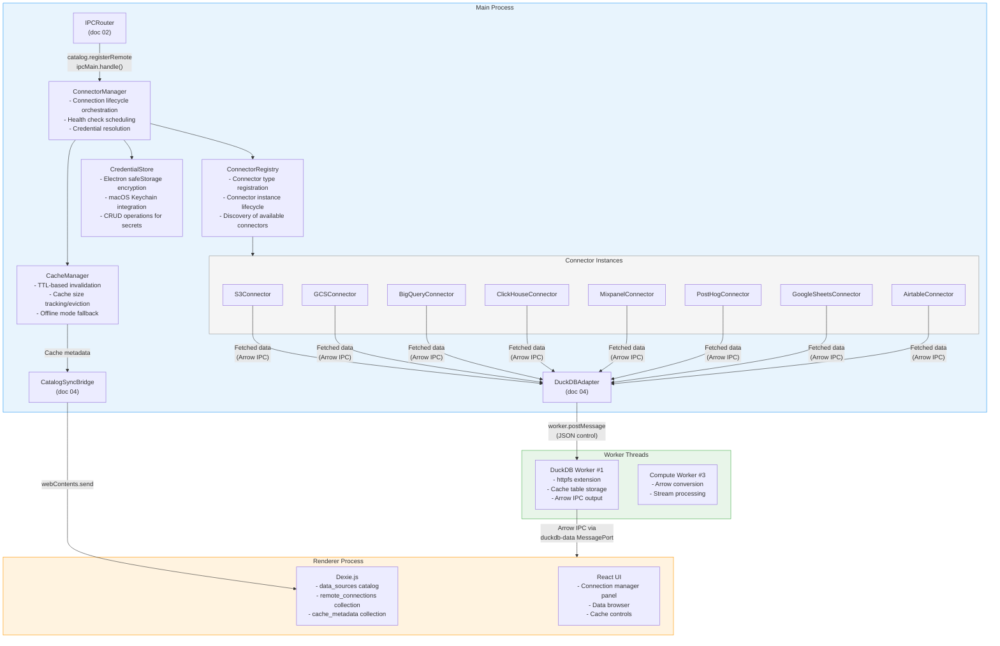
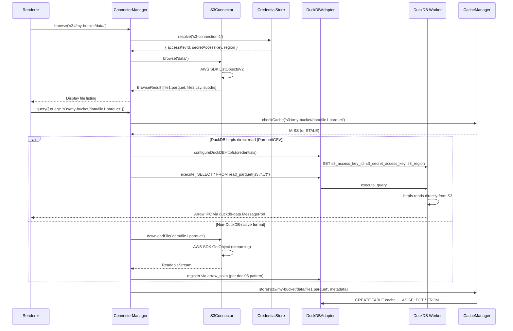
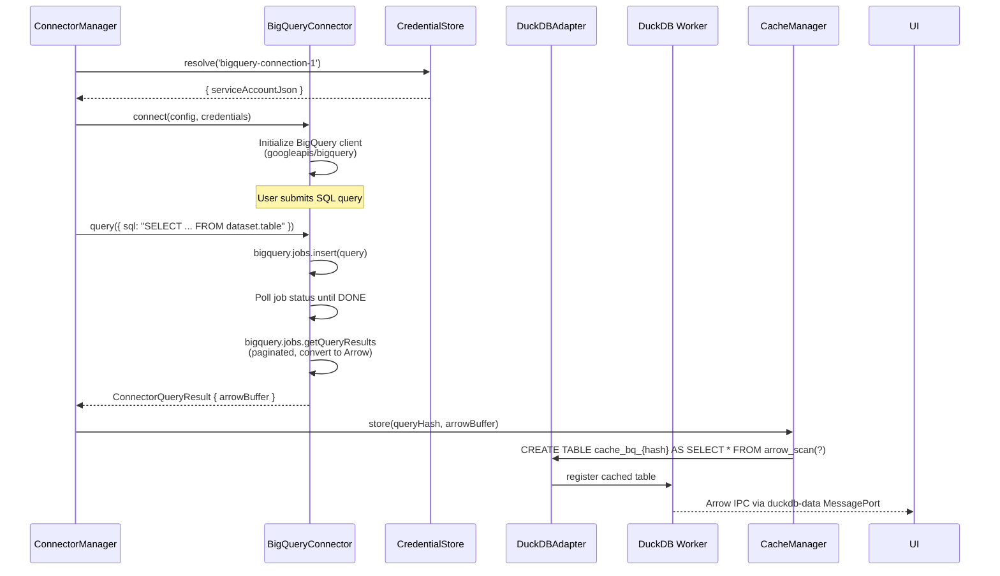
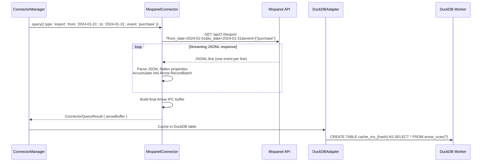
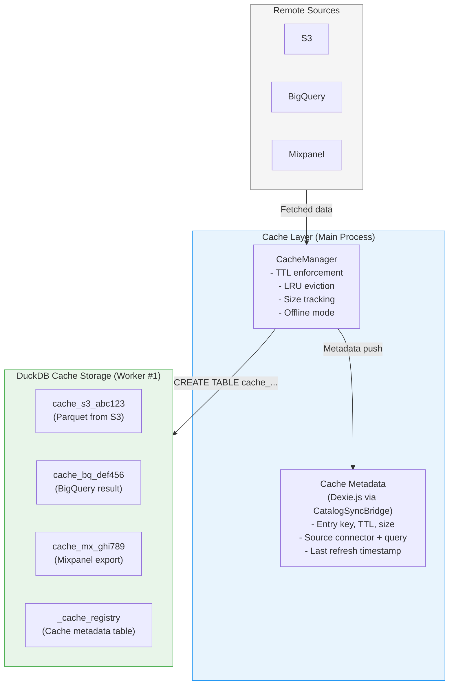
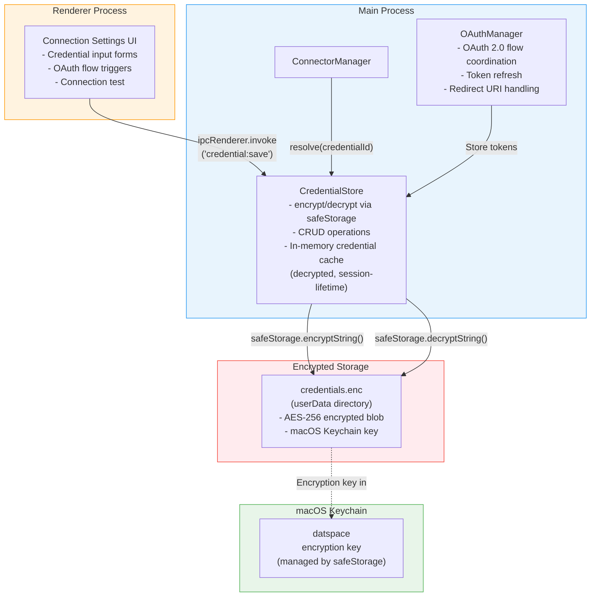
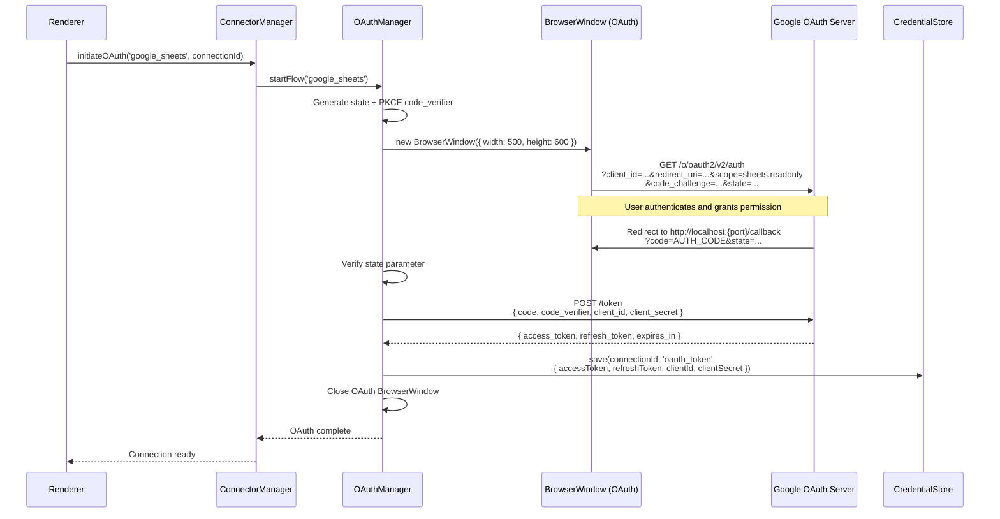
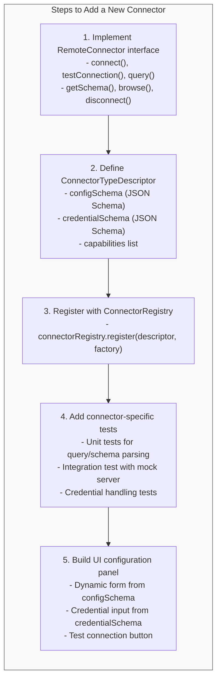

# datspace: Remote Data Source Connector Framework

**Document:** 07-remote-connectors.md
**Version:** 1.0
**Date:** 2026-02-05
**Status:** Accepted
**Depends on:** [02-Electron Process Model](02-electron-process-model.md), [04-Database Integration](04-database-integration.md), [06-Local Ingestion](06-local-ingestion.md), [Constitution](../../decomposition/constitution.yaml)
**Feeds into:** 09-AI Integration, Data Model Spec, IPC/API Spec, Integration Architecture Overview

---

## 1. Connector Framework Architecture

The Remote Data Source Connector Framework enables datspace to connect to cloud storage, hosted databases, and SaaS analytics platforms. All remote connectors run in the **Main Process** (per doc 02, Section 2), which is the networking boundary for the application. The Renderer Process never makes direct network requests (enforced by `webSecurity: true` and the Chromium sandbox). Remote data, once fetched, is cached in DuckDB tables (per doc 04, Section 2) and registered in the shared metadata catalog (per doc 06, Section 5) so that downstream analytical queries operate identically on local and remote sources.

### 1.1 Component Diagram



### 1.2 Component Responsibilities

| Component | Process | Responsibility |
|-----------|---------|---------------|
| **ConnectorRegistry** | Main | Registers connector types (classes), instantiates connectors from saved configurations, discovers available connector types for the UI |
| **ConnectorManager** | Main | Orchestrates connection lifecycle (connect, test, query, disconnect), schedules periodic health checks, resolves credentials before passing to connectors |
| **CredentialStore** | Main | Encrypts and stores API keys, OAuth tokens, and service account keys using Electron `safeStorage` backed by macOS Keychain |
| **CacheManager** | Main | Manages DuckDB cache tables, enforces TTL-based invalidation and LRU eviction, enables offline mode by serving stale cache when network is unavailable |
| **Connector Instances** | Main | Individual connector implementations for each supported data source type |

---

## 2. Connector Interface Design

All connectors implement a standard interface that provides a uniform contract for the ConnectorManager. This ensures that new connector types can be added without modifying framework code.

### 2.1 Base Connector Interface

```typescript
/**
 * Base interface for all remote data source connectors.
 * Implementations run in the Main Process.
 */
interface RemoteConnector {
  /** Unique connector type identifier (e.g., 's3', 'bigquery', 'mixpanel') */
  readonly type: string;

  /** Human-readable connector name */
  readonly displayName: string;

  /** Current connection state */
  readonly state: ConnectorState;

  /**
   * Establish connection to the remote data source.
   * Resolves when connection is ready for queries.
   * Throws ConnectorError on failure.
   */
  connect(config: ConnectorConfig, credentials: ResolvedCredentials): Promise<void>;

  /**
   * Test connectivity and authentication without establishing a persistent connection.
   * Used by the UI "Test Connection" button.
   * Returns a diagnostic result.
   */
  testConnection(config: ConnectorConfig, credentials: ResolvedCredentials): Promise<ConnectionTestResult>;

  /**
   * Execute a query against the remote data source.
   * Returns results as an Arrow IPC buffer (Constitution Principle 9).
   * Supports streaming for large result sets.
   */
  query(request: ConnectorQueryRequest): Promise<ConnectorQueryResult>;

  /**
   * Retrieve the schema of the remote data source.
   * Returns available tables/datasets, column names, and types.
   */
  getSchema(options?: SchemaOptions): Promise<RemoteSchema>;

  /**
   * Browse available resources (buckets, datasets, tables, sheets).
   * Used by the UI data browser.
   */
  browse(path?: string): Promise<BrowseResult>;

  /**
   * Gracefully disconnect from the remote data source.
   * Releases any held resources (HTTP connections, tokens).
   */
  disconnect(): Promise<void>;
}

type ConnectorState = 'disconnected' | 'connecting' | 'connected' | 'error' | 'rate_limited';

interface ConnectorConfig {
  /** Connector type (matches RemoteConnector.type) */
  type: string;
  /** User-assigned display name for this connection */
  name: string;
  /** Connector-specific configuration */
  settings: Record<string, unknown>;
}

interface ResolvedCredentials {
  /** Credential type */
  type: 'api_key' | 'oauth_token' | 'service_account' | 'access_key_pair';
  /** Decrypted credential data */
  data: Record<string, string>;
  /** Expiry timestamp (for OAuth tokens) */
  expiresAt?: string;
}
```

### 2.2 Query Request and Result Types

```typescript
interface ConnectorQueryRequest {
  /** Unique query identifier for tracking */
  queryId: string;
  /** Query in the connector's native language (SQL, API params, etc.) */
  query: string | Record<string, unknown>;
  /** Maximum rows to return (default: 100,000) */
  limit?: number;
  /** Pagination cursor for continued fetching */
  cursor?: string;
  /** Column selection (pushdown to remote if supported) */
  columns?: string[];
  /** Filter predicates (pushdown to remote if supported) */
  filters?: FilterPredicate[];
  /** Abort signal for cancellation */
  signal?: AbortSignal;
}

interface ConnectorQueryResult {
  /** Arrow IPC buffer containing the result data */
  arrowBuffer: ArrayBuffer;
  /** Number of rows in this result batch */
  rowCount: number;
  /** Total rows available (if known) */
  totalRows?: number;
  /** Pagination cursor for next page (null if complete) */
  nextCursor?: string;
  /** Whether this is the final page of results */
  complete: boolean;
  /** Schema of the returned data */
  schema: RemoteSchema;
}

interface ConnectionTestResult {
  success: boolean;
  latencyMs: number;
  message: string;
  serverVersion?: string;
  permissions?: string[];
}

interface RemoteSchema {
  /** Available resources (tables, datasets, buckets, sheets) */
  resources: RemoteResource[];
}

interface RemoteResource {
  name: string;
  type: 'table' | 'view' | 'bucket' | 'file' | 'sheet' | 'dataset' | 'collection';
  path: string;
  columns?: RemoteColumn[];
  rowCount?: number;
  sizeBytes?: number;
  lastModified?: string;
}

interface RemoteColumn {
  name: string;
  type: string;
  nullable: boolean;
  description?: string;
}
```

### 2.3 Error Handling Contract

All connectors use a structured error hierarchy for consistent error handling across connector types:

```typescript
class ConnectorError extends Error {
  constructor(
    message: string,
    public readonly code: ConnectorErrorCode,
    public readonly retryable: boolean,
    public readonly connector: string,
    public readonly cause?: Error,
  ) {
    super(message);
    this.name = 'ConnectorError';
  }
}

type ConnectorErrorCode =
  | 'AUTH_FAILED'           // Invalid credentials, expired token
  | 'AUTH_EXPIRED'          // Token expired, needs refresh
  | 'PERMISSION_DENIED'    // Valid auth but insufficient permissions
  | 'NOT_FOUND'            // Resource (table, bucket, sheet) not found
  | 'RATE_LIMITED'          // API rate limit exceeded
  | 'NETWORK_ERROR'        // DNS failure, timeout, connection refused
  | 'TIMEOUT'              // Query or connection timeout exceeded
  | 'QUERY_ERROR'          // Invalid query syntax or execution error
  | 'SCHEMA_ERROR'         // Schema mismatch or unsupported types
  | 'QUOTA_EXCEEDED'       // API quota or data transfer limit
  | 'SERVICE_UNAVAILABLE'  // Remote service is down
  | 'CANCELLED'            // Query cancelled by user
  | 'UNKNOWN';             // Unclassified error
```

### 2.4 Rate Limiting and Retry Logic

Every connector has built-in rate limiting and retry logic via a shared `RetryExecutor`:

```typescript
interface RetryConfig {
  maxAttempts: number;         // Default: 3
  baseDelayMs: number;         // Default: 1000
  maxDelayMs: number;          // Default: 30000
  backoffMultiplier: number;   // Default: 2 (exponential)
  retryableCodes: ConnectorErrorCode[];
}

class RetryExecutor {
  constructor(private config: RetryConfig) {}

  async execute<T>(fn: () => Promise<T>, signal?: AbortSignal): Promise<T> {
    let lastError: ConnectorError | null = null;

    for (let attempt = 1; attempt <= this.config.maxAttempts; attempt++) {
      if (signal?.aborted) {
        throw new ConnectorError('Cancelled', 'CANCELLED', false, 'retry');
      }

      try {
        return await fn();
      } catch (error) {
        lastError = error instanceof ConnectorError ? error : wrapError(error);

        if (!lastError.retryable || !this.config.retryableCodes.includes(lastError.code)) {
          throw lastError;
        }

        if (attempt < this.config.maxAttempts) {
          const delay = this.calculateDelay(attempt, lastError);
          await sleep(delay);
        }
      }
    }

    throw lastError!;
  }

  private calculateDelay(attempt: number, error: ConnectorError): number {
    let delay = this.config.baseDelayMs * Math.pow(this.config.backoffMultiplier, attempt - 1);

    // Respect Retry-After header for rate-limited requests
    if (error.code === 'RATE_LIMITED' && error.cause?.['retryAfterMs']) {
      delay = Math.max(delay, error.cause['retryAfterMs']);
    }

    return Math.min(delay, this.config.maxDelayMs) + Math.random() * 500; // Jitter
  }
}

const DEFAULT_RETRY_CONFIG: RetryConfig = {
  maxAttempts: 3,
  baseDelayMs: 1000,
  maxDelayMs: 30000,
  backoffMultiplier: 2,
  retryableCodes: ['RATE_LIMITED', 'NETWORK_ERROR', 'TIMEOUT', 'SERVICE_UNAVAILABLE'],
};
```

### 2.5 Connector Configuration Schema

Each connector type declares a JSON Schema for its configuration, enabling validation in the UI and at registration time:

```typescript
interface ConnectorTypeDescriptor {
  type: string;
  displayName: string;
  description: string;
  icon: string;                        // Icon identifier for UI
  category: 'cloud_storage' | 'database' | 'saas_analytics';
  configSchema: JSONSchema;            // JSON Schema for settings
  credentialType: 'api_key' | 'oauth_token' | 'service_account' | 'access_key_pair';
  credentialSchema: JSONSchema;        // JSON Schema for credential fields
  capabilities: ConnectorCapability[];
}

type ConnectorCapability =
  | 'browse'              // Can browse resources (buckets, tables)
  | 'query_sql'           // Supports SQL queries
  | 'query_api'           // Supports API-based queries
  | 'schema_discovery'    // Can enumerate tables and columns
  | 'predicate_pushdown'  // Supports server-side filtering
  | 'column_pushdown'     // Supports column selection on remote
  | 'streaming'           // Supports streaming large results
  | 'incremental_fetch';  // Supports cursor-based pagination
```

---

## 3. Cloud Storage Connectors

Cloud storage connectors provide access to object storage systems (S3, GCS) and network file shares. They integrate with DuckDB's `httpfs` extension (doc 04, Section 2.3) for direct file reading when possible.

### 3.1 S3 Connector

The S3 connector provides access to Amazon S3 buckets, S3-compatible stores (MinIO, Backblaze B2, Cloudflare R2), and files stored therein.



**S3 Configuration Schema:**

```typescript
interface S3ConnectorConfig {
  type: 's3';
  settings: {
    bucket: string;                 // S3 bucket name
    region: string;                 // AWS region (e.g., 'us-east-1')
    endpoint?: string;              // Custom endpoint for S3-compatible stores
    pathPrefix?: string;            // Restrict browsing to a prefix
    forcePathStyle?: boolean;       // For S3-compatible stores (MinIO, etc.)
  };
}

interface S3Credentials {
  type: 'access_key_pair';
  data: {
    accessKeyId: string;
    secretAccessKey: string;
    sessionToken?: string;          // For temporary credentials
  };
}
```

**DuckDB httpfs Integration:**

For Parquet, CSV, and JSON files on S3, the connector configures DuckDB's `httpfs` extension to read directly from S3 without downloading the full file:

```sql
-- Configure S3 credentials in DuckDB
SET s3_access_key_id = '...';
SET s3_secret_access_key = '...';
SET s3_region = 'us-east-1';
SET s3_endpoint = 'custom-endpoint.com';  -- Optional, for S3-compatible stores

-- Direct read from S3 (Parquet)
CREATE VIEW remote_sales AS
SELECT * FROM read_parquet('s3://my-bucket/data/sales-2024.parquet');

-- Direct read from S3 (CSV)
CREATE VIEW remote_events AS
SELECT * FROM read_csv_auto('s3://my-bucket/exports/events.csv');

-- Pattern matching for multiple files
CREATE VIEW all_logs AS
SELECT * FROM read_parquet('s3://my-bucket/logs/**/*.parquet');
```

**S3 Capabilities:** `browse`, `schema_discovery`, `column_pushdown` (Parquet), `streaming`

### 3.2 GCS Connector

The GCS (Google Cloud Storage) connector follows the same pattern as S3 using DuckDB's `httpfs` extension, which supports GCS through the `gcs://` URI scheme.

```typescript
interface GCSConnectorConfig {
  type: 'gcs';
  settings: {
    bucket: string;                  // GCS bucket name
    project?: string;                // GCP project ID
    pathPrefix?: string;             // Restrict browsing to prefix
  };
}

interface GCSCredentials {
  type: 'service_account';
  data: {
    serviceAccountJson: string;      // JSON service account key (stringified)
  };
}
```

**DuckDB httpfs GCS Integration:**

```sql
-- Configure GCS credentials in DuckDB
SET gcs_access_key_id = '...';       -- From service account HMAC key
SET gcs_secret = '...';

-- Direct read from GCS
CREATE VIEW gcs_data AS
SELECT * FROM read_parquet('gcs://my-bucket/analytics/report.parquet');
```

**GCS Capabilities:** `browse`, `schema_discovery`, `column_pushdown` (Parquet), `streaming`

### 3.3 Local Network Shares

For local network shares (NAS devices, shared drives), datspace treats them as local file paths that may be intermittently available:

```typescript
interface NetworkShareConfig {
  type: 'network_share';
  settings: {
    path: string;                    // UNC path (smb://server/share) or mount point (/Volumes/...)
    mountPoint?: string;             // macOS mount point if not auto-mounted
    autoReconnect: boolean;          // Attempt reconnection on failure
  };
}
```

On macOS, network shares mounted via Finder or `mount_smbfs` appear as local paths under `/Volumes/`. The connector verifies accessibility and delegates to the local ingestion pipeline (doc 06) for file reading, with the addition of network-aware timeout handling.

**Network Share Capabilities:** `browse`, `schema_discovery`

---

## 4. Database Connectors

Database connectors provide read-only access to hosted analytical databases. All database connectors stream results as Arrow IPC buffers into DuckDB cache tables.

### 4.1 BigQuery Connector

The BigQuery connector provides access to Google BigQuery datasets via the BigQuery REST/gRPC API with service account authentication.



**BigQuery Configuration:**

```typescript
interface BigQueryConnectorConfig {
  type: 'bigquery';
  settings: {
    projectId: string;              // GCP project ID
    defaultDataset?: string;        // Default dataset for unqualified table names
    location?: string;              // Query location (US, EU, etc.)
    maximumBytesBilled?: string;    // Safety limit on query cost
    timeoutMs?: number;             // Query timeout (default: 120000)
  };
}

interface BigQueryCredentials {
  type: 'service_account';
  data: {
    serviceAccountJson: string;     // Full JSON service account key
  };
}
```

**Schema Discovery:**

```typescript
// BigQueryConnector.getSchema() implementation
async getSchema(): Promise<RemoteSchema> {
  const datasets = await this.client.datasets.list({ projectId: this.projectId });

  const resources: RemoteResource[] = [];
  for (const dataset of datasets.data.datasets ?? []) {
    const tables = await this.client.tables.list({
      projectId: this.projectId,
      datasetId: dataset.datasetReference!.datasetId!,
    });

    for (const table of tables.data.tables ?? []) {
      const tableInfo = await this.client.tables.get({
        projectId: this.projectId,
        datasetId: dataset.datasetReference!.datasetId!,
        tableId: table.tableReference!.tableId!,
      });

      resources.push({
        name: table.tableReference!.tableId!,
        type: table.type === 'VIEW' ? 'view' : 'table',
        path: `${dataset.datasetReference!.datasetId}.${table.tableReference!.tableId}`,
        columns: tableInfo.data.schema?.fields?.map(f => ({
          name: f.name!,
          type: f.type!,
          nullable: f.mode !== 'REQUIRED',
          description: f.description,
        })),
        rowCount: parseInt(tableInfo.data.numRows ?? '0'),
        sizeBytes: parseInt(tableInfo.data.numBytes ?? '0'),
      });
    }
  }

  return { resources };
}
```

**BigQuery Capabilities:** `browse`, `query_sql`, `schema_discovery`, `predicate_pushdown`, `column_pushdown`

### 4.2 ClickHouse Connector

The ClickHouse connector connects via ClickHouse's HTTP interface, which supports JSON and Arrow output formats.

```typescript
interface ClickHouseConnectorConfig {
  type: 'clickhouse';
  settings: {
    host: string;                   // ClickHouse server hostname
    port?: number;                  // HTTP port (default: 8443 for HTTPS, 8123 for HTTP)
    database?: string;              // Default database
    useTls: boolean;                // Use HTTPS (default: true)
    timeoutMs?: number;             // Query timeout (default: 60000)
  };
}

interface ClickHouseCredentials {
  type: 'api_key';
  data: {
    username: string;
    password: string;
  };
}
```

**Arrow-Native Query Results:**

ClickHouse supports the Arrow output format natively, enabling zero-conversion data transfer:

```typescript
async query(request: ConnectorQueryRequest): Promise<ConnectorQueryResult> {
  const url = `${this.baseUrl}/?default_format=ArrowStream`;

  const response = await fetch(url, {
    method: 'POST',
    headers: {
      'X-ClickHouse-User': this.credentials.data.username,
      'X-ClickHouse-Key': this.credentials.data.password,
      'X-ClickHouse-Database': this.config.settings.database ?? 'default',
    },
    body: request.query as string,
    signal: request.signal,
  });

  if (!response.ok) {
    const errorText = await response.text();
    throw new ConnectorError(errorText, 'QUERY_ERROR', false, 'clickhouse');
  }

  // ClickHouse returns Arrow IPC stream directly
  const arrowBuffer = await response.arrayBuffer();

  return {
    arrowBuffer,
    rowCount: -1,  // Determined from Arrow schema
    complete: true,
    schema: this.extractSchemaFromArrow(arrowBuffer),
  };
}
```

**ClickHouse Capabilities:** `query_sql`, `schema_discovery`, `predicate_pushdown`, `column_pushdown`, `streaming`

### 4.3 PostgreSQL and MySQL Connectors

For PostgreSQL and MySQL, the connectors provide read-only query access. These are optional connectors for users who need to pull data from operational databases into datspace for analysis.

```typescript
interface PostgreSQLConnectorConfig {
  type: 'postgresql';
  settings: {
    host: string;
    port?: number;                  // Default: 5432
    database: string;
    schema?: string;                // Default: 'public'
    sslMode?: 'disable' | 'require' | 'verify-ca' | 'verify-full';
    readOnly: true;                 // Always read-only (enforced)
    statementTimeout?: number;      // Query timeout in ms (default: 60000)
  };
}

interface MySQLConnectorConfig {
  type: 'mysql';
  settings: {
    host: string;
    port?: number;                  // Default: 3306
    database: string;
    ssl?: boolean;                  // Default: true
    readOnly: true;                 // Always read-only (enforced)
    statementTimeout?: number;      // Default: 60000
  };
}
```

Both connectors enforce read-only access by:
1. Setting the connection to read-only mode at the driver level
2. Prepending `SET TRANSACTION READ ONLY;` before each query
3. Rejecting queries containing DDL/DML keywords (`INSERT`, `UPDATE`, `DELETE`, `DROP`, `ALTER`, `CREATE`, `TRUNCATE`) at the connector level before sending to the server

**PostgreSQL/MySQL Capabilities:** `query_sql`, `schema_discovery`, `predicate_pushdown`, `column_pushdown`

---

## 5. SaaS Analytics Connectors

SaaS analytics connectors provide access to third-party analytics and data platforms via their REST APIs. These connectors translate API responses into Arrow IPC buffers for seamless integration with the DuckDB query engine.

### 5.1 Mixpanel Connector

The Mixpanel connector accesses event data and analytics via the Mixpanel Export API and JQL interface.



**Mixpanel Configuration:**

```typescript
interface MixpanelConnectorConfig {
  type: 'mixpanel';
  settings: {
    projectId: string;              // Mixpanel project ID
    region?: 'US' | 'EU';          // Data residency (default: 'US')
    apiHost?: string;               // Custom API host (for EU: 'eu.mixpanel.com')
    exportBatchDays?: number;       // Days per export batch (default: 7, max: 31)
  };
}

interface MixpanelCredentials {
  type: 'api_key';
  data: {
    serviceAccountUsername: string;  // Service account username
    serviceAccountSecret: string;   // Service account secret
  };
}
```

**Query Types:**

| Query Type | API | Description |
|-----------|-----|------------|
| **Event export** | `/api/2.0/export` | Raw event data for date range, optionally filtered by event name |
| **JQL query** | `/api/2.0/jql` | JavaScript Query Language for complex aggregations |
| **Insights** | `/api/2.0/insights` | Pre-aggregated metrics (segmented events, funnels) |
| **Cohort export** | `/api/2.0/engage` | User profile/cohort data |

**Rate Limiting:** Mixpanel enforces rate limits per project. The connector uses a `TokenBucketRateLimiter` with:
- Export API: 60 requests per rolling 60 seconds
- JQL API: 60 requests per rolling 60 seconds
- Concurrent export connections: max 5

**Mixpanel Capabilities:** `query_api`, `schema_discovery`, `streaming`, `incremental_fetch`

### 5.2 PostHog Connector

The PostHog connector accesses event data, person profiles, and HogQL query results via the PostHog API.

```typescript
interface PostHogConnectorConfig {
  type: 'posthog';
  settings: {
    host: string;                    // PostHog instance URL (e.g., 'https://app.posthog.com' or self-hosted)
    projectId: string;               // PostHog project ID
  };
}

interface PostHogCredentials {
  type: 'api_key';
  data: {
    personalApiKey: string;          // PostHog personal API key
  };
}
```

**Query Types:**

| Query Type | Endpoint | Description |
|-----------|----------|------------|
| **Events** | `/api/projects/{id}/events` | Raw event data with filtering and pagination |
| **Persons** | `/api/projects/{id}/persons` | Person profiles with properties |
| **HogQL** | `/api/projects/{id}/query` | HogQL queries (PostHog's SQL dialect) |
| **Insights** | `/api/projects/{id}/insights` | Saved insights and trends |

**HogQL Query Example:**

```typescript
async queryHogQL(sql: string, signal?: AbortSignal): Promise<ConnectorQueryResult> {
  const response = await this.retryExecutor.execute(async () => {
    return fetch(`${this.host}/api/projects/${this.projectId}/query`, {
      method: 'POST',
      headers: {
        'Authorization': `Bearer ${this.credentials.data.personalApiKey}`,
        'Content-Type': 'application/json',
      },
      body: JSON.stringify({ query: { kind: 'HogQLQuery', query: sql } }),
      signal,
    });
  }, signal);

  const data = await response.json();
  const arrowBuffer = this.convertResultsToArrow(data.columns, data.results, data.types);

  return {
    arrowBuffer,
    rowCount: data.results.length,
    complete: !data.hasMore,
    nextCursor: data.next,
    schema: this.extractSchema(data.columns, data.types),
  };
}
```

**PostHog Capabilities:** `query_sql` (HogQL), `query_api`, `schema_discovery`, `incremental_fetch`

### 5.3 Google Sheets Connector

The Google Sheets connector reads spreadsheet data via the Google Sheets API v4, with OAuth 2.0 authentication for user-owned sheets.

```typescript
interface GoogleSheetsConnectorConfig {
  type: 'google_sheets';
  settings: {
    spreadsheetId: string;           // From the sheet URL
    defaultSheet?: string;           // Sheet name (default: first sheet)
    headerRow?: number;              // Row containing headers (default: 1)
    dataRange?: string;              // A1 notation range (e.g., 'A1:Z1000')
  };
}

interface GoogleSheetsCredentials {
  type: 'oauth_token';
  data: {
    accessToken: string;
    refreshToken: string;
    clientId: string;
    clientSecret: string;
    tokenUri: string;
  };
  expiresAt: string;                 // ISO timestamp
}
```

**Sheet Listing and Data Reading:**

```typescript
async getSchema(): Promise<RemoteSchema> {
  const spreadsheet = await this.sheetsApi.spreadsheets.get({
    spreadsheetId: this.config.settings.spreadsheetId,
  });

  const resources: RemoteResource[] = spreadsheet.data.sheets!.map(sheet => ({
    name: sheet.properties!.title!,
    type: 'sheet' as const,
    path: sheet.properties!.title!,
    rowCount: sheet.properties!.gridProperties?.rowCount,
  }));

  return { resources };
}

async query(request: ConnectorQueryRequest): Promise<ConnectorQueryResult> {
  const sheetName = (request.query as Record<string, unknown>).sheet as string
    ?? this.config.settings.defaultSheet
    ?? (await this.getFirstSheetName());

  const range = (request.query as Record<string, unknown>).range as string
    ?? this.config.settings.dataRange
    ?? `${sheetName}`;

  const response = await this.sheetsApi.spreadsheets.values.get({
    spreadsheetId: this.config.settings.spreadsheetId,
    range: `'${sheetName}'!${range}`,
    valueRenderOption: 'UNFORMATTED_VALUE',
    dateTimeRenderOption: 'FORMATTED_STRING',
  });

  const rows = response.data.values ?? [];
  const headers = rows[this.config.settings.headerRow! - 1] ?? rows[0];
  const dataRows = rows.slice(this.config.settings.headerRow ?? 1);

  // Convert to Arrow IPC
  const arrowBuffer = this.rowsToArrow(headers, dataRows);

  return {
    arrowBuffer,
    rowCount: dataRows.length,
    complete: true,
    schema: this.inferSchema(headers, dataRows),
  };
}
```

**Google Sheets Capabilities:** `browse` (list sheets), `query_api`, `schema_discovery`

### 5.4 Airtable Connector

The Airtable connector reads table data via the Airtable REST API with personal access token authentication.

```typescript
interface AirtableConnectorConfig {
  type: 'airtable';
  settings: {
    baseId: string;                  // Airtable base ID (e.g., 'appXXXXXXXXXXXXXX')
    tableIdOrName?: string;          // Default table
  };
}

interface AirtableCredentials {
  type: 'api_key';
  data: {
    personalAccessToken: string;     // Airtable personal access token
  };
}
```

**Pagination and Data Fetching:**

Airtable returns at most 100 records per request. The connector handles automatic pagination:

```typescript
async query(request: ConnectorQueryRequest): Promise<ConnectorQueryResult> {
  const tableId = (request.query as Record<string, unknown>).table as string
    ?? this.config.settings.tableIdOrName!;

  const allRecords: Record<string, unknown>[] = [];
  let offset: string | undefined = request.cursor as string | undefined;

  do {
    const params = new URLSearchParams();
    if (offset) params.set('offset', offset);
    if (request.limit) params.set('pageSize', Math.min(request.limit, 100).toString());
    if (request.filters?.length) {
      params.set('filterByFormula', this.buildAirtableFormula(request.filters));
    }

    const response = await this.retryExecutor.execute(async () => {
      return fetch(
        `https://api.airtable.com/v0/${this.config.settings.baseId}/${tableId}?${params}`,
        {
          headers: { 'Authorization': `Bearer ${this.credentials.data.personalAccessToken}` },
          signal: request.signal,
        },
      );
    }, request.signal);

    if (!response.ok) {
      throw new ConnectorError(
        `Airtable API error: ${response.status}`,
        response.status === 429 ? 'RATE_LIMITED' : 'QUERY_ERROR',
        response.status === 429,
        'airtable',
      );
    }

    const data = await response.json();
    allRecords.push(...data.records.map((r: any) => ({ id: r.id, ...r.fields })));
    offset = data.offset;

    // Respect rate limit: 5 requests per second
    if (offset) await sleep(210);  // ~4.7 req/s to stay under limit

  } while (offset && (!request.limit || allRecords.length < request.limit));

  const arrowBuffer = this.recordsToArrow(allRecords);

  return {
    arrowBuffer,
    rowCount: allRecords.length,
    complete: !offset,
    nextCursor: offset,
    schema: this.inferSchema(allRecords),
  };
}
```

**Airtable Rate Limiting:** 5 requests per second per base. The connector enforces this via a per-base token bucket limiter with built-in sleep between paginated requests.

**Airtable Capabilities:** `browse` (list tables/views), `query_api`, `schema_discovery`, `predicate_pushdown` (formulas), `incremental_fetch`

---

## 6. Local Caching Strategy

All remote data fetched by connectors is cached in DuckDB tables. This provides instant access for subsequent queries, offline mode support, and consistent query performance regardless of network conditions.

### 6.1 Cache Architecture



### 6.2 Cache-First Query Pattern

Every remote query follows a cache-first pattern:

```typescript
class CacheManager {
  private cacheEntries = new Map<string, CacheEntry>();

  async queryWithCache(
    connector: RemoteConnector,
    request: ConnectorQueryRequest,
    cacheConfig: CacheConfig,
  ): Promise<ConnectorQueryResult> {
    const cacheKey = this.computeCacheKey(connector.type, request);
    const entry = this.cacheEntries.get(cacheKey);

    // Check cache validity
    if (entry && this.isValid(entry, cacheConfig)) {
      // Cache HIT: query from DuckDB cache table
      return this.queryFromCache(entry);
    }

    // Check if offline mode
    if (!this.isNetworkAvailable()) {
      if (entry) {
        // Offline + stale cache: serve stale data with warning
        return this.queryFromCache(entry, { stale: true });
      }
      throw new ConnectorError(
        'Network unavailable and no cached data',
        'NETWORK_ERROR',
        true,
        connector.type,
      );
    }

    // Cache MISS or STALE: fetch from remote
    try {
      const result = await connector.query(request);
      await this.storeInCache(cacheKey, connector.type, request, result, cacheConfig);
      return result;
    } catch (error) {
      // Fetch failed: fall back to stale cache if available
      if (entry) {
        return this.queryFromCache(entry, { stale: true, error: error.message });
      }
      throw error;
    }
  }

  private isValid(entry: CacheEntry, config: CacheConfig): boolean {
    if (config.ttlMs === 0) return false;  // TTL=0 means always refresh
    const age = Date.now() - entry.cachedAt;
    return age < config.ttlMs;
  }

  private computeCacheKey(connectorType: string, request: ConnectorQueryRequest): string {
    const normalized = JSON.stringify({
      type: connectorType,
      query: request.query,
      columns: request.columns?.sort(),
      filters: request.filters,
    });
    return `cache_${connectorType}_${hashString(normalized).slice(0, 12)}`;
  }
}
```

### 6.3 Cache Storage in DuckDB

Cached data is stored as DuckDB tables for full analytical query capability:

```typescript
interface CacheEntry {
  key: string;                       // DuckDB table name (cache_<type>_<hash>)
  connectorType: string;             // Source connector type
  sourceQuery: string;               // Original query that produced this data
  rowCount: number;
  sizeBytes: number;                 // Estimated size in DuckDB storage
  cachedAt: number;                  // Unix timestamp when cached
  ttlMs: number;                     // Time-to-live in milliseconds
  lastAccessedAt: number;            // For LRU eviction
  status: 'fresh' | 'stale' | 'refreshing';
}

async function storeInCache(
  cacheKey: string,
  connectorType: string,
  request: ConnectorQueryRequest,
  result: ConnectorQueryResult,
  config: CacheConfig,
): Promise<void> {
  // Create or replace cache table in DuckDB
  await this.duckdbAdapter.executeWithArrowInput(
    `CREATE OR REPLACE TABLE "${cacheKey}" AS SELECT * FROM arrow_scan($1)`,
    result.arrowBuffer,
  );

  // Update cache metadata
  const entry: CacheEntry = {
    key: cacheKey,
    connectorType,
    sourceQuery: JSON.stringify(request.query),
    rowCount: result.rowCount,
    sizeBytes: result.arrowBuffer.byteLength,
    cachedAt: Date.now(),
    ttlMs: config.ttlMs,
    lastAccessedAt: Date.now(),
    status: 'fresh',
  };

  this.cacheEntries.set(cacheKey, entry);

  // Persist cache metadata to DuckDB registry table
  await this.duckdbAdapter.execute(
    `INSERT OR REPLACE INTO _cache_registry VALUES ($1, $2, $3, $4, $5, $6, $7, $8, $9)`,
    [entry.key, entry.connectorType, entry.sourceQuery, entry.rowCount,
     entry.sizeBytes, entry.cachedAt, entry.ttlMs, entry.lastAccessedAt, entry.status],
  );

  // Push metadata to Dexie.js for reactive UI
  this.catalogSyncBridge.send({
    collection: 'data_sources',
    action: 'put',
    data: {
      id: cacheKey,
      name: `${connectorType} cache: ${this.summarizeQuery(request.query)}`,
      type: 'remote_cache',
      duckdbName: cacheKey,
      registrationType: 'table',
      status: 'active',
      createdAt: new Date(entry.cachedAt).toISOString(),
      updatedAt: new Date(entry.cachedAt).toISOString(),
    },
  });
}
```

### 6.4 Cache Invalidation

| Strategy | Trigger | Behavior |
|----------|---------|----------|
| **TTL-based** | Cache age exceeds configured TTL | Mark entry as `stale`; refresh on next access |
| **Manual refresh** | User clicks "Refresh" in UI | Immediately re-fetch from remote, replace cache table |
| **Schedule-based** | Optional cron-like schedule per source | Background refresh at configured intervals |
| **Eviction (LRU)** | Total cache size exceeds configured maximum | Drop least-recently-accessed cache tables until under budget |

**Default TTL values by connector type:**

| Connector | Default TTL | Rationale |
|-----------|-------------|-----------|
| S3 / GCS | 1 hour | Object storage changes are infrequent |
| BigQuery | 4 hours | Analytical tables update on batch schedules |
| ClickHouse | 1 hour | Analytical database, moderate change rate |
| Mixpanel | 6 hours | Event data is append-only; historical exports are stable |
| PostHog | 6 hours | Same as Mixpanel |
| Google Sheets | 15 minutes | Sheets change frequently; short TTL for freshness |
| Airtable | 15 minutes | Collaborative tool; short TTL for freshness |

### 6.5 Cache Size Management and Eviction

```typescript
interface CacheConfig {
  ttlMs: number;                     // Time-to-live per entry
  maxTotalSizeBytes: number;         // Global cache budget (default: 2 GB)
  maxEntriesCount: number;           // Maximum number of cache entries (default: 100)
  evictionPolicy: 'lru' | 'ttl';    // Eviction strategy (default: 'lru')
}

const DEFAULT_CACHE_CONFIG: CacheConfig = {
  ttlMs: 3600_000,                   // 1 hour default
  maxTotalSizeBytes: 2 * 1024 ** 3,  // 2 GB
  maxEntriesCount: 100,
  evictionPolicy: 'lru',
};

class CacheEvictionManager {
  async enforceSize(currentEntries: CacheEntry[], config: CacheConfig): Promise<void> {
    const totalSize = currentEntries.reduce((sum, e) => sum + e.sizeBytes, 0);

    if (totalSize <= config.maxTotalSizeBytes && currentEntries.length <= config.maxEntriesCount) {
      return;  // Within budget
    }

    // Sort by eviction priority (LRU: least recently accessed first)
    const sorted = [...currentEntries].sort((a, b) => a.lastAccessedAt - b.lastAccessedAt);

    let freedSize = 0;
    const toEvict: CacheEntry[] = [];

    for (const entry of sorted) {
      if (
        totalSize - freedSize <= config.maxTotalSizeBytes &&
        currentEntries.length - toEvict.length <= config.maxEntriesCount
      ) {
        break;
      }
      toEvict.push(entry);
      freedSize += entry.sizeBytes;
    }

    // Drop evicted cache tables from DuckDB
    for (const entry of toEvict) {
      await this.duckdbAdapter.execute(`DROP TABLE IF EXISTS "${entry.key}"`);
      this.cacheEntries.delete(entry.key);

      // Update Dexie.js catalog
      this.catalogSyncBridge.send({
        collection: 'data_sources',
        action: 'delete',
        key: entry.key,
      });
    }
  }
}
```

### 6.6 Offline Mode

When the network is unavailable, the CacheManager operates in offline mode:

```typescript
class CacheManager {
  private networkAvailable = true;

  constructor() {
    // Monitor network connectivity
    this.startNetworkMonitoring();
  }

  private startNetworkMonitoring(): void {
    // Periodic connectivity check (every 30 seconds)
    setInterval(async () => {
      try {
        const response = await fetch('https://dns.google/resolve?name=example.com', {
          method: 'HEAD',
          signal: AbortSignal.timeout(5000),
        });
        this.networkAvailable = response.ok;
      } catch {
        this.networkAvailable = false;
      }
    }, 30_000);
  }

  isNetworkAvailable(): boolean {
    return this.networkAvailable;
  }
}
```

**Offline behavior by operation:**

| Operation | Online | Offline (cache exists) | Offline (no cache) |
|-----------|--------|----------------------|-------------------|
| Query | Fetch fresh or use valid cache | Serve stale cache with warning | Error: no data available |
| Browse | Live listing from remote | Return last-known listing from metadata | Error: cannot browse |
| Test connection | Live test | Fails with network error | Fails with network error |
| Schema discovery | Live schema fetch | Return cached schema from metadata | Error: no schema available |

---

## 7. Credential Management

Secure credential storage is critical for remote connectors. datspace stores no credentials in plaintext. All secrets are encrypted using Electron's `safeStorage` API, which delegates to the macOS Keychain.

### 7.1 Secure Storage Architecture



### 7.2 CredentialStore Implementation

```typescript
import { safeStorage } from 'electron';
import * as fs from 'fs/promises';
import * as path from 'path';

interface StoredCredential {
  id: string;                        // UUID
  connectorType: string;             // 's3', 'bigquery', etc.
  connectionName: string;            // User-assigned connection name
  credentialType: 'api_key' | 'oauth_token' | 'service_account' | 'access_key_pair';
  encryptedData: string;             // Base64-encoded encrypted blob
  createdAt: string;                 // ISO timestamp
  updatedAt: string;                 // ISO timestamp
  expiresAt?: string;                // For OAuth tokens
}

class CredentialStore {
  private credentialsPath: string;
  private credentials: Map<string, StoredCredential> = new Map();
  private decryptedCache: Map<string, ResolvedCredentials> = new Map();

  constructor(userDataPath: string) {
    this.credentialsPath = path.join(userDataPath, 'credentials.enc');
  }

  async initialize(): Promise<void> {
    if (!safeStorage.isEncryptionAvailable()) {
      throw new Error('Electron safeStorage not available -- cannot store credentials securely');
    }

    try {
      const raw = await fs.readFile(this.credentialsPath, 'utf-8');
      const parsed = JSON.parse(raw) as StoredCredential[];
      for (const cred of parsed) {
        this.credentials.set(cred.id, cred);
      }
    } catch {
      // No credentials file yet -- first run
    }
  }

  async save(
    id: string,
    connectorType: string,
    connectionName: string,
    credentialType: StoredCredential['credentialType'],
    data: Record<string, string>,
    expiresAt?: string,
  ): Promise<void> {
    const plaintext = JSON.stringify(data);
    const encrypted = safeStorage.encryptString(plaintext);
    const encryptedBase64 = encrypted.toString('base64');

    const credential: StoredCredential = {
      id,
      connectorType,
      connectionName,
      credentialType,
      encryptedData: encryptedBase64,
      createdAt: new Date().toISOString(),
      updatedAt: new Date().toISOString(),
      expiresAt,
    };

    this.credentials.set(id, credential);
    this.decryptedCache.delete(id);  // Invalidate decrypted cache

    await this.persist();
  }

  async resolve(id: string): Promise<ResolvedCredentials> {
    // Check in-memory cache first
    const cached = this.decryptedCache.get(id);
    if (cached && (!cached.expiresAt || new Date(cached.expiresAt) > new Date())) {
      return cached;
    }

    const stored = this.credentials.get(id);
    if (!stored) {
      throw new Error(`Credential not found: ${id}`);
    }

    const encryptedBuffer = Buffer.from(stored.encryptedData, 'base64');
    const decrypted = safeStorage.decryptString(encryptedBuffer);
    const data = JSON.parse(decrypted) as Record<string, string>;

    const resolved: ResolvedCredentials = {
      type: stored.credentialType,
      data,
      expiresAt: stored.expiresAt,
    };

    this.decryptedCache.set(id, resolved);
    return resolved;
  }

  async delete(id: string): Promise<void> {
    this.credentials.delete(id);
    this.decryptedCache.delete(id);
    await this.persist();
  }

  async list(): Promise<Array<Omit<StoredCredential, 'encryptedData'>>> {
    return Array.from(this.credentials.values()).map(({ encryptedData, ...rest }) => rest);
  }

  private async persist(): Promise<void> {
    const data = JSON.stringify(Array.from(this.credentials.values()), null, 2);
    await fs.writeFile(this.credentialsPath, data, 'utf-8');
  }
}
```

### 7.3 OAuth 2.0 Flow Handling

For connectors requiring OAuth (Google Sheets), the OAuthManager handles the authorization code flow:



**Token Refresh:**

```typescript
class OAuthManager {
  async refreshTokenIfNeeded(credentialId: string): Promise<ResolvedCredentials> {
    const credentials = await this.credentialStore.resolve(credentialId);

    if (credentials.expiresAt && new Date(credentials.expiresAt) <= new Date(Date.now() + 300_000)) {
      // Token expires within 5 minutes -- refresh
      const newTokens = await this.refreshToken(credentials);

      await this.credentialStore.save(
        credentialId,
        'google_sheets',
        credentials.data.connectionName ?? '',
        'oauth_token',
        {
          accessToken: newTokens.access_token,
          refreshToken: credentials.data.refreshToken,  // Refresh token persists
          clientId: credentials.data.clientId,
          clientSecret: credentials.data.clientSecret,
          tokenUri: credentials.data.tokenUri ?? 'https://oauth2.googleapis.com/token',
        },
        new Date(Date.now() + newTokens.expires_in * 1000).toISOString(),
      );

      return this.credentialStore.resolve(credentialId);
    }

    return credentials;
  }

  private async refreshToken(
    credentials: ResolvedCredentials,
  ): Promise<{ access_token: string; expires_in: number }> {
    const response = await fetch(credentials.data.tokenUri ?? 'https://oauth2.googleapis.com/token', {
      method: 'POST',
      headers: { 'Content-Type': 'application/x-www-form-urlencoded' },
      body: new URLSearchParams({
        grant_type: 'refresh_token',
        refresh_token: credentials.data.refreshToken,
        client_id: credentials.data.clientId,
        client_secret: credentials.data.clientSecret,
      }),
    });

    if (!response.ok) {
      throw new ConnectorError('Token refresh failed', 'AUTH_EXPIRED', false, 'oauth');
    }

    return response.json();
  }
}
```

### 7.4 Security Guarantees

| Property | Guarantee | Mechanism |
|----------|-----------|-----------|
| **No plaintext storage** | Credentials encrypted at rest | Electron `safeStorage.encryptString()` uses OS-level encryption |
| **macOS Keychain integration** | Encryption key stored in Keychain | `safeStorage` automatically manages Keychain entries |
| **Memory safety** | Decrypted credentials cached only in Main Process memory | `decryptedCache` cleared on app shutdown; never sent to Renderer |
| **Credential isolation** | Renderer never sees raw credentials | IPC handlers accept credential IDs, not credential data |
| **Token rotation** | OAuth tokens refreshed before expiry | `OAuthManager.refreshTokenIfNeeded()` called before each query |
| **Secure deletion** | Credentials removed from all storage layers | `delete()` removes from Map, cache, and persisted file |

---

## 8. Connector Plugin Architecture

The connector framework is designed for extensibility. New connector types can be added by implementing the `RemoteConnector` interface and registering with the `ConnectorRegistry`.

### 8.1 Adding a New Connector



### 8.2 ConnectorRegistry Implementation

```typescript
type ConnectorFactory = (config: ConnectorConfig, credentials: ResolvedCredentials) => RemoteConnector;

class ConnectorRegistry {
  private descriptors = new Map<string, ConnectorTypeDescriptor>();
  private factories = new Map<string, ConnectorFactory>();

  /**
   * Register a new connector type.
   * Called at application startup for built-in connectors.
   */
  register(descriptor: ConnectorTypeDescriptor, factory: ConnectorFactory): void {
    if (this.descriptors.has(descriptor.type)) {
      throw new Error(`Connector type already registered: ${descriptor.type}`);
    }

    // Validate config and credential schemas
    this.validateJsonSchema(descriptor.configSchema, `${descriptor.type}.configSchema`);
    this.validateJsonSchema(descriptor.credentialSchema, `${descriptor.type}.credentialSchema`);

    this.descriptors.set(descriptor.type, descriptor);
    this.factories.set(descriptor.type, factory);
  }

  /**
   * List all registered connector types.
   * Used by the UI to show available connection options.
   */
  listTypes(): ConnectorTypeDescriptor[] {
    return Array.from(this.descriptors.values());
  }

  /**
   * Get descriptor for a specific connector type.
   */
  getDescriptor(type: string): ConnectorTypeDescriptor | undefined {
    return this.descriptors.get(type);
  }

  /**
   * Create a connector instance from configuration.
   */
  create(config: ConnectorConfig, credentials: ResolvedCredentials): RemoteConnector {
    const factory = this.factories.get(config.type);
    if (!factory) {
      throw new Error(`Unknown connector type: ${config.type}`);
    }

    // Validate configuration against schema
    const descriptor = this.descriptors.get(config.type)!;
    this.validateConfig(config.settings, descriptor.configSchema);

    return factory(config, credentials);
  }

  private validateConfig(settings: Record<string, unknown>, schema: JSONSchema): void {
    // Use Ajv or similar JSON Schema validator
    const errors = validateJsonSchema(settings, schema);
    if (errors.length > 0) {
      throw new ConnectorError(
        `Invalid connector configuration: ${errors.join('; ')}`,
        'SCHEMA_ERROR',
        false,
        'registry',
      );
    }
  }
}
```

### 8.3 Built-In Connector Registration

```typescript
// Application startup: register all built-in connectors
function registerBuiltInConnectors(registry: ConnectorRegistry): void {
  // Cloud Storage
  registry.register(S3_DESCRIPTOR, (config, creds) => new S3Connector(config, creds));
  registry.register(GCS_DESCRIPTOR, (config, creds) => new GCSConnector(config, creds));
  registry.register(NETWORK_SHARE_DESCRIPTOR, (config, creds) => new NetworkShareConnector(config, creds));

  // Databases
  registry.register(BIGQUERY_DESCRIPTOR, (config, creds) => new BigQueryConnector(config, creds));
  registry.register(CLICKHOUSE_DESCRIPTOR, (config, creds) => new ClickHouseConnector(config, creds));
  registry.register(POSTGRESQL_DESCRIPTOR, (config, creds) => new PostgreSQLConnector(config, creds));
  registry.register(MYSQL_DESCRIPTOR, (config, creds) => new MySQLConnector(config, creds));

  // SaaS Analytics
  registry.register(MIXPANEL_DESCRIPTOR, (config, creds) => new MixpanelConnector(config, creds));
  registry.register(POSTHOG_DESCRIPTOR, (config, creds) => new PostHogConnector(config, creds));
  registry.register(GOOGLE_SHEETS_DESCRIPTOR, (config, creds) => new GoogleSheetsConnector(config, creds));
  registry.register(AIRTABLE_DESCRIPTOR, (config, creds) => new AirtableConnector(config, creds));
}
```

### 8.4 Connector Testing Requirements

Every connector (built-in or future addition) must satisfy these testing requirements:

| Test Category | Requirement | Verification |
|--------------|-------------|-------------|
| **Interface compliance** | Implements all `RemoteConnector` methods | TypeScript compiler enforces interface |
| **Configuration validation** | `configSchema` and `credentialSchema` are valid JSON Schemas | Schema validator checks at registration |
| **Connection test** | `testConnection()` returns success/failure with diagnostics | Unit test with mock server |
| **Query execution** | `query()` returns valid Arrow IPC buffers | Deserialize Arrow, verify schema and row count |
| **Schema discovery** | `getSchema()` returns accurate resource listing | Compare against known test dataset |
| **Error handling** | All `ConnectorErrorCode` values are used correctly | Test each error path with appropriate mock |
| **Rate limiting** | Retry logic respects Retry-After headers | Mock rate-limited responses, verify backoff |
| **Cancellation** | AbortSignal cancels in-flight requests | Abort mid-query, verify cleanup |
| **Credential handling** | No credentials logged or exposed in errors | Audit error messages and log output |

### 8.5 Connector Configuration Validation

Configuration schemas are validated both at save time (UI) and at connect time (framework):

```typescript
// Example: S3 connector configuration schema
const S3_CONFIG_SCHEMA: JSONSchema = {
  type: 'object',
  required: ['bucket', 'region'],
  properties: {
    bucket: {
      type: 'string',
      minLength: 3,
      maxLength: 63,
      pattern: '^[a-z0-9][a-z0-9.-]*[a-z0-9]$',
      description: 'S3 bucket name',
    },
    region: {
      type: 'string',
      enum: ['us-east-1', 'us-west-2', 'eu-west-1', 'eu-central-1', 'ap-southeast-1', 'ap-northeast-1'],
      description: 'AWS region',
    },
    endpoint: {
      type: 'string',
      format: 'uri',
      description: 'Custom endpoint for S3-compatible stores',
    },
    pathPrefix: {
      type: 'string',
      description: 'Restrict browsing to this key prefix',
    },
    forcePathStyle: {
      type: 'boolean',
      default: false,
      description: 'Use path-style addressing (for MinIO, etc.)',
    },
  },
  additionalProperties: false,
};
```

---

## 9. Preload Bridge Extensions

The remote connector framework extends the Preload Bridge API (doc 02, Section 5) with remote-specific operations:

```typescript
// Extensions to DatspaceAPI (doc 02, Section 5.1)
interface DatspaceAPI {
  // ... existing API ...

  // === Remote Connector Operations ===
  remote: {
    /** List available connector types. */
    listConnectorTypes(): Promise<ConnectorTypeDescriptor[]>;
    /** Save a remote connection configuration. */
    saveConnection(config: ConnectorConfig, credentialData: Record<string, string>): Promise<string>;
    /** Test a remote connection before saving. */
    testConnection(config: ConnectorConfig, credentialData: Record<string, string>): Promise<ConnectionTestResult>;
    /** Browse remote resources (buckets, tables, sheets). */
    browse(connectionId: string, path?: string): Promise<BrowseResult>;
    /** Execute a query against a remote source. Results via duckdb-data MessagePort (from cache). */
    query(connectionId: string, query: string | Record<string, unknown>): Promise<{ queryId: string }>;
    /** Get schema of a remote source. */
    getSchema(connectionId: string): Promise<RemoteSchema>;
    /** Manually refresh cached data for a connection. */
    refreshCache(connectionId: string): Promise<void>;
    /** Delete a saved connection and its credentials. */
    deleteConnection(connectionId: string): Promise<void>;
    /** List saved connections. */
    listConnections(): Promise<SavedConnection[]>;
    /** Initiate OAuth flow for a connection. */
    initiateOAuth(connectorType: string, connectionId: string): Promise<void>;
  };

  // === Cache Operations ===
  cache: {
    /** Get cache statistics. */
    getStats(): Promise<CacheStats>;
    /** Clear all cached data. */
    clearAll(): Promise<void>;
    /** Clear cache for a specific connection. */
    clearForConnection(connectionId: string): Promise<void>;
    /** Get cache entries. */
    listEntries(): Promise<CacheEntry[]>;
  };
}
```

---

## 10. Cross-Reference and Consistency

### 10.1 Constitution Alignment

| Principle | Requirement | How This Design Satisfies It |
|-----------|------------|------------------------------|
| #9 Arrow-First Data Flow | All inter-component data transfer uses Arrow | All connectors return Arrow IPC buffers. Cache storage uses DuckDB tables queryable via Arrow. ClickHouse returns Arrow natively. Other connectors convert API responses to Arrow before caching. |
| #10 Embedded-Only Databases | No external database servers | Cache storage uses the existing DuckDB Worker Thread (doc 04). No new database processes. Remote databases are read-only data sources, not local servers. |
| #11 Stream and Scan | No bulk loading into JS memory | Connectors stream results via pagination. Large result sets are cached in DuckDB and queried via streaming Arrow batches. API responses are converted to Arrow in chunks. |
| #12 Process Isolation | Main Process owns networking; Renderer owns visualization | All network requests originate from Main Process connectors. Renderer never makes direct network calls (sandboxed, `webSecurity: true`). Cached data reaches Renderer via duckdb-data MessagePort. |
| #13 macOS-First | Technologies work on macOS + Electron | `safeStorage` uses macOS Keychain. OAuth flow uses Electron BrowserWindow. All HTTP clients are Node.js native (fetch/undici). |
| #14 Single-User, Local-First | Remote connectors degrade gracefully offline | Cache-first query pattern serves stale data when network unavailable. No multi-user authentication -- all credentials belong to the single local user. |

### 10.2 Document 02 (Process Model) Integration

| Doc 02 Component | Remote Connector Integration |
|-----------------|------------------------------|
| Main Process as control plane (Section 2) | ConnectorManager, CredentialStore, CacheManager all run in Main Process |
| IPCRouter (Section 2.1) | Handles `remote:*` and `cache:*` IPC channels for Renderer requests |
| webSecurity: true (Section 3.2) | Enforces that all network requests go through Main Process connectors |
| Preload Bridge API (Section 5) | Extended with `remote` and `cache` namespaces |
| Shutdown sequence (Section 6.2) | ConnectorManager disconnects all active connectors during shutdown |

### 10.3 Document 04 (Database Integration) Integration

| Doc 04 Component | Remote Connector Integration |
|-----------------|------------------------------|
| DuckDBAdapter (Section 2) | Executes cache table creation (`CREATE TABLE cache_...`) and httpfs configuration |
| DuckDB httpfs extension (Section 2.3) | S3 and GCS connectors configure httpfs for direct remote file reads |
| CatalogSyncBridge (Section 4.4) | Pushes remote source metadata and cache metadata to Dexie.js |
| Dexie.js collections (Section 4.2) | `data_sources` collection stores remote source entries with `type: 'remote_cache'` |
| QueryRouter (Section 5) | After caching, remote data is queryable via standard DuckDB SQL routing |

### 10.4 Document 06 (Local Ingestion) Integration

| Doc 06 Component | Remote Connector Integration |
|-----------------|------------------------------|
| Metadata catalog (Section 5) | Remote sources extend the shared `data_sources` catalog with remote-specific fields |
| DataSourceCatalogEntry (Section 4.4) | Remote sources use `type: 'remote_cache'` alongside local `type: 'local_file'` |
| Source status tracking (Section 5.3) | Remote sources add `stale` status for expired cache TTL |
| Embedding generation (Section 4.5) | Remote source schemas trigger the same embedding pipeline as local sources |
| Statistics collection (Section 4.2) | Cached remote data generates column statistics via the same DuckDB pipeline |

---

*Document 07 of the datspace Architecture Series*
*Generated: 2026-02-05 | Plan: datspace-system-design-2026-02-04 | Task: design-remote-connectors*
