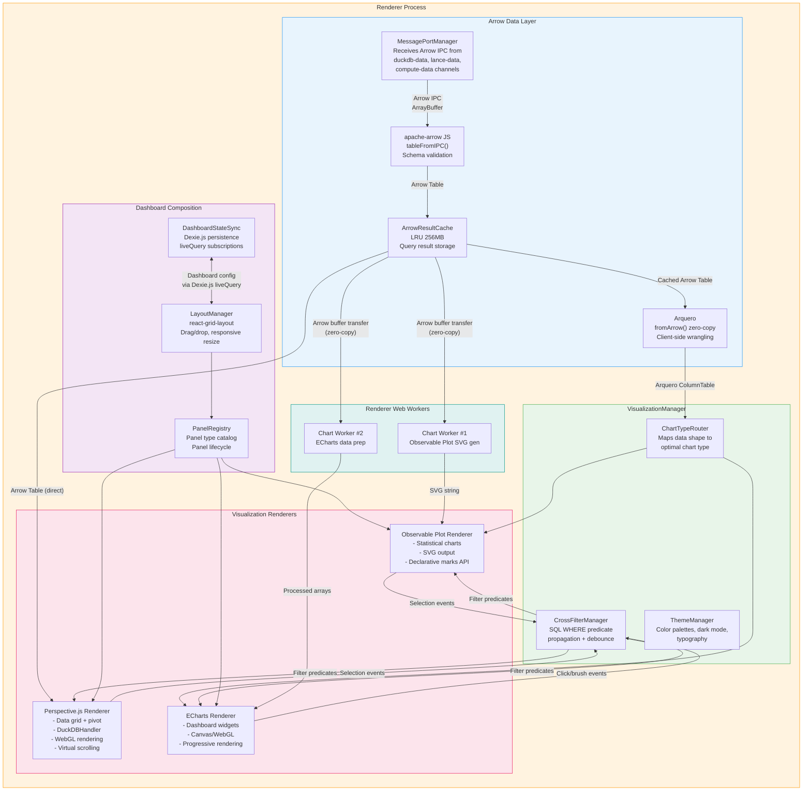
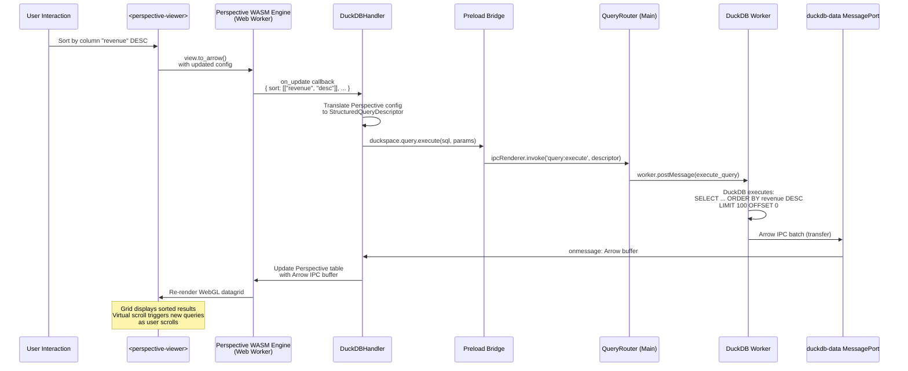
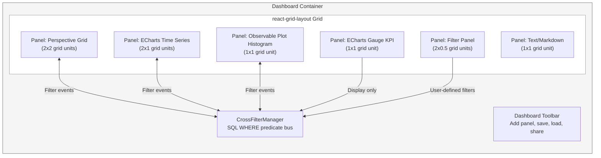
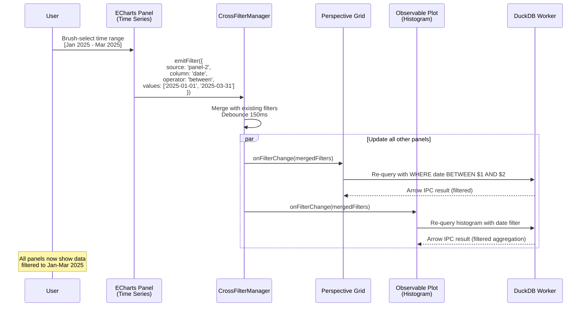
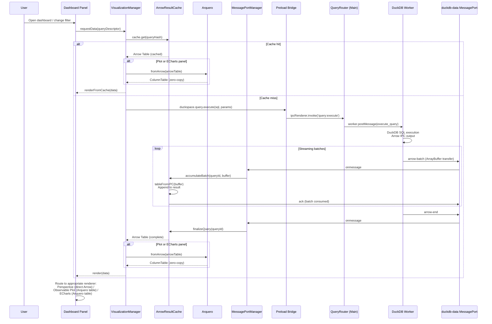

# duckspace: Visualization Engine Architecture

**Document:** 08-visualization-engine.md
**Version:** 1.1
**Date:** 2026-02-05
**Status:** Accepted
**Depends on:** [ADR-003](../decisions/adr-003-visualization-stack.md), [02-Electron Process Model](02-electron-process-model.md), [03-Arrow Data Plane](03-arrow-data-plane.md), [Constitution](../../decomposition/constitution.yaml)
**Feeds into:** 10-Publishing Engine, IPC/API Spec, Integration Architecture Overview

---

## 1. Visualization Engine Overview

The Visualization Engine is the Renderer-side system responsible for transforming Apache Arrow data into interactive visual representations. It orchestrates three specialized visualization libraries (Perspective.js, Observable Plot, ECharts) behind a unified management layer, handles dashboard composition, and coordinates cross-filter interactions.

### 1.1 Component Architecture



### 1.2 Data Flow Summary

| Path | Source | Consumer | Format | Copy? |
|------|--------|----------|--------|-------|
| Query results | DuckDB Worker via duckdb-data MessagePort | ArrowResultCache | Arrow IPC ArrayBuffer | Zero-copy transfer |
| Search results | LanceDB Worker via lance-data MessagePort | ArrowResultCache | Arrow IPC ArrayBuffer | Zero-copy transfer |
| Ingestion preview | Compute Worker via compute-data MessagePort | ArrowResultCache | Arrow IPC ArrayBuffer | Zero-copy transfer |
| Cache -> Perspective | ArrowResultCache | Perspective.js WASM | Arrow Table reference | No copy (shared ref) |
| Cache -> Plot | ArrowResultCache -> Arquero | Observable Plot | Arrow -> Arquero fromArrow (zero-copy) -> native driver | No copy (zero-copy Arrow load + Plot iterates Arquero table) |
| Cache -> ECharts | ArrowResultCache -> Arquero | ECharts | Arrow -> Arquero fromArrow -> dt.objects() or dt.column().data | Conditional (objects = 1 copy; TypedArray = 0 copy) |

---

## 2. Perspective.js Integration Design

### 2.1 DuckDBHandler Architecture

Perspective.js operates in two modes: (1) loading data into its internal WASM table, or (2) connecting to an external data source via a Handler. duckspace uses mode (2) exclusively via a custom `DuckDBHandler` that bridges Perspective's query interface to DuckDB running in the Main Process Worker Thread.

The DuckDBHandler translates Perspective's internal query operations (filter, sort, aggregate, group-by, pagination) into DuckDB SQL queries, executes them via the duckdb-data MessagePort, and returns Arrow IPC results that Perspective renders directly from WASM memory.



#### DuckDBHandler Implementation

```typescript
class DuckDBHandler {
  private tableName: string;
  private schema: ArrowSchema | null = null;
  private port: MessagePort;           // duckdb-data MessagePort
  private pendingQueries = new Map<string, {
    resolve: (buffer: ArrayBuffer) => void;
    reject: (error: Error) => void;
  }>();

  constructor(tableName: string, port: MessagePort) {
    this.tableName = tableName;
    this.port = port;
    this.port.onmessage = this.handleMessage.bind(this);
  }

  /**
   * Called by Perspective when the view configuration changes
   * (sort, filter, group-by, aggregate, scroll position)
   */
  async getData(config: PerspectiveViewConfig): Promise<ArrayBuffer> {
    const queryId = crypto.randomUUID();

    // Translate Perspective config to DuckDB SQL
    const sql = this.buildSQL(config);
    const params = this.extractParams(config);

    // Submit query via control plane
    await window.duckspace.query.execute(sql, params);

    // Wait for Arrow IPC result via data channel
    return new Promise((resolve, reject) => {
      this.pendingQueries.set(queryId, { resolve, reject });
      // Timeout after 30 seconds
      setTimeout(() => {
        if (this.pendingQueries.has(queryId)) {
          this.pendingQueries.delete(queryId);
          reject(new Error('DuckDBHandler query timeout'));
        }
      }, 30_000);
    });
  }

  private buildSQL(config: PerspectiveViewConfig): string {
    const parts: string[] = [];

    // SELECT clause
    if (config.columns && config.columns.length > 0) {
      if (config.group_by && config.group_by.length > 0) {
        // Aggregated query
        const groupCols = config.group_by.map(c => `"${c}"`).join(', ');
        const aggCols = config.columns.map(c =>
          config.aggregates?.[c]
            ? `${config.aggregates[c]}("${c}") as "${c}"`
            : `"${c}"`
        );
        parts.push(`SELECT ${groupCols}, ${aggCols.join(', ')}`);
      } else {
        parts.push(`SELECT ${config.columns.map(c => `"${c}"`).join(', ')}`);
      }
    } else {
      parts.push('SELECT *');
    }

    // FROM clause
    parts.push(`FROM "${this.tableName}"`);

    // WHERE clause (from Perspective filters)
    if (config.filter && config.filter.length > 0) {
      const conditions = config.filter.map(([col, op, val]) =>
        this.translateFilter(col, op, val)
      );
      parts.push(`WHERE ${conditions.join(' AND ')}`);
    }

    // GROUP BY clause
    if (config.group_by && config.group_by.length > 0) {
      parts.push(`GROUP BY ${config.group_by.map(c => `"${c}"`).join(', ')}`);
    }

    // ORDER BY clause
    if (config.sort && config.sort.length > 0) {
      const sortClauses = config.sort.map(([col, dir]) =>
        `"${col}" ${dir === 'asc' ? 'ASC' : 'DESC'}`
      );
      parts.push(`ORDER BY ${sortClauses.join(', ')}`);
    }

    // LIMIT/OFFSET for virtual scrolling
    const limit = config.viewport?.height ?? 100;
    const offset = config.viewport?.top ?? 0;
    parts.push(`LIMIT ${limit} OFFSET ${offset}`);

    return parts.join(' ');
  }

  private handleMessage(event: MessageEvent): void {
    const msg = event.data;
    if (msg.type === 'arrow-batch') {
      const query = this.pendingQueries.get(msg.queryId);
      if (query) {
        // For DuckDBHandler, we collect a single batch per scroll position
        this.pendingQueries.delete(msg.queryId);
        query.resolve(event.data.buffer ?? event.ports?.[0]);
      }
    } else if (msg.type === 'arrow-error') {
      const query = this.pendingQueries.get(msg.queryId);
      if (query) {
        this.pendingQueries.delete(msg.queryId);
        query.reject(new Error(msg.message));
      }
    }
  }
}
```

### 2.2 Custom Element Lifecycle

Perspective.js renders via the `<perspective-viewer>` custom element. duckspace wraps this in a React component that manages the element lifecycle:

```typescript
interface PerspectiveViewerProps {
  tableName: string;
  initialConfig?: PerspectiveViewConfig;
  onFilterChange?: (filters: FilterExpression[]) => void;
  onSelectionChange?: (selection: RowSelection) => void;
  className?: string;
}

function PerspectiveViewer({
  tableName,
  initialConfig,
  onFilterChange,
  onSelectionChange,
  className,
}: PerspectiveViewerProps) {
  const containerRef = useRef<HTMLDivElement>(null);
  const viewerRef = useRef<HTMLPerspectiveViewerElement | null>(null);
  const handlerRef = useRef<DuckDBHandler | null>(null);

  useEffect(() => {
    if (!containerRef.current) return;

    // Create perspective-viewer element
    const viewer = document.createElement('perspective-viewer');
    viewer.setAttribute('theme', 'Pro Dark');
    containerRef.current.appendChild(viewer);
    viewerRef.current = viewer;

    // Create DuckDBHandler connected to duckdb-data MessagePort
    const port = messagePortManager.getPort('duckdb-data');
    handlerRef.current = new DuckDBHandler(tableName, port);

    // Load table through handler
    const table = perspective.worker().table(handlerRef.current);
    viewer.load(table);

    // Apply initial configuration
    if (initialConfig) {
      viewer.restore(initialConfig);
    }

    // Subscribe to view config changes for cross-filter
    viewer.addEventListener('perspective-config-update', (event: CustomEvent) => {
      const config = event.detail;
      if (config.filter && onFilterChange) {
        onFilterChange(translatePerspectiveFilters(config.filter));
      }
    });

    // Subscribe to row selection for cross-filter
    viewer.addEventListener('perspective-select', (event: CustomEvent) => {
      if (onSelectionChange) {
        onSelectionChange(event.detail);
      }
    });

    return () => {
      // Cleanup
      viewer.delete();
      if (containerRef.current?.contains(viewer)) {
        containerRef.current.removeChild(viewer);
      }
      viewerRef.current = null;
      handlerRef.current = null;
    };
  }, [tableName]);

  return <div ref={containerRef} className={className} />;
}
```

### 2.3 View Types and Configuration

Perspective supports multiple view types, each with specific configuration:

| View Type | Perspective Plugin | Best For | GPU | Notes |
|-----------|-------------------|----------|-----|-------|
| Data Grid | `@finos/perspective-viewer-datagrid` | Raw data exploration, column sorting | WebGL | Default view; virtual scrolling enabled |
| Pivot Table | `@finos/perspective-viewer-datagrid` + group_by | Cross-tabulation, hierarchical drilldown | WebGL | group_by + split_by generate pivot |
| Bar Chart | `@finos/perspective-viewer-d3fc` | Category comparison | Canvas | D3FC-based chart plugin |
| Line Chart | `@finos/perspective-viewer-d3fc` | Time series trends | Canvas | Supports multi-series |
| Scatter Plot | `@finos/perspective-viewer-d3fc` | Correlation analysis | Canvas | Color dimension for grouping |
| Area Chart | `@finos/perspective-viewer-d3fc` | Stacked composition | Canvas | Supports stacked/stream |
| Heatmap | `@finos/perspective-viewer-d3fc` | Density visualization | Canvas | Group-by X + Split-by Y |
| Treemap | `@finos/perspective-viewer-d3fc` | Hierarchical proportion | Canvas | Nested group_by |

### 2.4 Virtual Scrolling with Query Pushdown

For datasets with millions of rows, Perspective renders only the visible viewport (~50-100 rows). As the user scrolls, the DuckDBHandler fires new queries with updated `LIMIT`/`OFFSET`:

```
User scrolls to row 50,000:
  DuckDBHandler.getData({ viewport: { top: 50000, height: 100 } })
  -> SELECT * FROM sales ORDER BY date DESC LIMIT 100 OFFSET 50000
  -> Arrow IPC result (100 rows, ~10 KB)
  -> Perspective renders 100 rows in WebGL grid
```

**Scroll debouncing:** Scroll events are debounced at 16ms (one frame at 60fps) to prevent excessive query volume during fast scrolling. A pending query is cancelled (`{ type: 'cancel', queryId }`) when a new scroll position arrives before the previous query completes.

### 2.5 Theme and Styling

Perspective.js supports themes via CSS custom properties:

```css
perspective-viewer {
  /* duckspace dark theme */
  --plugin--background: #1e1e2e;
  --plugin--font-family: 'Inter', -apple-system, system-ui, sans-serif;
  --plugin--font-size: 12px;

  /* Grid colors */
  --d3fc-series: #89b4fa;
  --d3fc-gradient--high: #f38ba8;
  --d3fc-gradient--low: #a6e3a1;

  /* Active row highlight */
  --active--color: #cdd6f4;
  --active--background: #45475a;
}
```

### 2.6 Export Capabilities

Perspective supports data export from the current view:

| Format | Method | Use Case |
|--------|--------|----------|
| CSV | `view.to_csv()` | Spreadsheet import, data sharing |
| JSON | `view.to_json()` | API integration, programmatic access |
| Arrow | `view.to_arrow()` | Cross-tool data transfer (preserves types) |
| PNG | `viewer.save()` | Report embedding, screenshot |

Export operations are routed through the Main Process `FileSystemManager` for file system access (Renderer is sandboxed).

---

## 3. Observable Plot Integration

### 3.1 Design Role

Observable Plot handles **statistical and explanatory visualizations** -- charts that communicate patterns, distributions, and relationships in pre-aggregated data. It operates on small Arrow result sets (< 10K rows) that have already been aggregated by DuckDB.

### 3.2 Arrow Data Consumption via Arquero

Observable Plot accepts data through Arquero's `fromArrow()` for zero-copy Arrow table loading. The data path from Arrow to Plot:

```typescript
import { fromArrow } from 'arquero';
import type { ColumnTable } from 'arquero';
import type { Table as ArrowTable } from 'apache-arrow';

/**
 * Load an Arrow Table (pre-aggregated, < 10K rows) into Arquero
 * for Observable Plot consumption. fromArrow() is zero-copy for
 * most numeric data types.
 */
function prepareForPlot(arrowTable: ArrowTable): ColumnTable {
  return fromArrow(arrowTable); // zero-copy for most data types
}
```

Observable Plot marks accept Arquero tables directly via the iterator protocol -- no `toArray()` or `objects()` conversion is needed. Plot detects array-like objects and iterates rows on demand:

```typescript
import * as Plot from '@observablehq/plot';

const dt = fromArrow(arrowTable);

// Plot iterates the Arquero table directly -- no intermediate copy
const chart = Plot.plot({
  marks: [
    Plot.dot(dt, { x: 'col1', y: 'col2', fill: 'category' }),
  ],
});
```

**Performance note:** `fromArrow()` is zero-copy for numeric types (Int32, Float64, etc.) -- the underlying Arrow buffers are shared directly. Dictionary columns with null entries or spanning multiple record batches may be unpacked for query performance, but this is rare for pre-aggregated subsets.

### 3.3 Arquero Data Wrangling Layer

Arquero provides lightweight client-side data transformations on pre-aggregated subsets that have already been reduced by DuckDB to < 10K rows. This avoids round-tripping back to DuckDB for simple post-query adjustments.

#### Purpose

Visualization-specific data shaping that is too trivial to warrant a DuckDB query but too complex for inline JavaScript:
- Threshold filtering on cached data
- Computed columns (percentages, rates of change)
- Secondary grouping for chart legends
- Field restructuring (pivot/fold) for visualization-specific layouts

#### API Surface and Examples

```typescript
import { fromArrow, op } from 'arquero';
import type { ColumnTable } from 'arquero';

// Load from Arrow (zero-copy where possible)
const dt: ColumnTable = fromArrow(arrowTable);

// Filter: threshold filtering on cached data
const filtered = dt.filter((d: any) => d.value > 100);

// Derive: computed columns (percentages, rates of change)
const withPct = dt.derive({
  pct: (d: any) => d.value / d.total,
  rateOfChange: (d: any) => (d.current - d.previous) / d.previous,
});

// Groupby + rollup: secondary grouping for chart legends
const summary = dt
  .groupby('category')
  .rollup({ total: (d: any) => op.sum(d.value), count: op.count() });

// Pivot: reshape for chart legend series
const pivoted = dt.pivot('category', 'value');

// Join: combine two cached result sets
const joined = dt.join(otherTable, ['key']);
```

#### When NOT to Use Arquero

Heavy aggregation (GROUP BY over millions of rows, window functions, time_bucket) stays in DuckDB. Arquero is for lightweight client-side tweaks on already-small data (< 10K rows). The rule of thumb: if the operation would benefit from DuckDB's columnar OLAP engine, it should be a SQL query, not an Arquero transformation.

#### Memory Characteristics

`fromArrow()` wraps Arrow buffers without copying -- the Arquero ColumnTable shares the same underlying memory as the Arrow Table in ArrowResultCache. Subsequent operations (filter, derive, rollup) create new columns only for derived or filtered results; unmodified columns continue to reference the original Arrow buffers.

#### Bundle Size

Arquero adds ~150KB as an ES module (includes Flechette, its internal Arrow engine). This replaces ~75 lines of custom `arrowToPlotData()`, `arrowToColumnArrays()`, and `arrowToEChartsDataset()` adapter code.

### 3.4 Chart Type Catalog

| Chart Type | Observable Plot Marks | When to Use | Typical Data Size |
|-----------|----------------------|------------|-------------------|
| Histogram | `Plot.rectY(data, Plot.binX({y: "count"}, {x: "column"}))` | Distribution of a single numeric column | 100-10K rows |
| Scatter Plot | `Plot.dot(data, {x: "col1", y: "col2"})` | Correlation between two numeric columns | 100-10K rows |
| Line Chart | `Plot.line(data, {x: "date", y: "value"})` | Time series trend | 50-5K rows |
| Area Chart | `Plot.areaY(data, {x: "date", y: "value"})` | Cumulative quantity over time | 50-5K rows |
| Box Plot | `Plot.boxY(data, {x: "category", y: "value"})` | Distribution comparison across categories | 100-10K rows |
| Bar Chart | `Plot.barY(data, {x: "category", y: "value"})` | Category comparison | 5-200 rows (aggregated) |
| Density Plot | `Plot.density(data, {x: "col1", y: "col2"})` | 2D density estimation | 500-10K rows |
| Regression | `Plot.linearRegressionY(data, {x: "x", y: "y"})` | Trend line with confidence interval | 100-10K rows |
| Small Multiples | `Plot.plot({ facet: {data, x: "category"}, marks: [...] })` | Compare patterns across categories | 100-5K rows per facet |
| Heatmap | `Plot.cell(data, {x: "col1", y: "col2", fill: "value"})` | Matrix visualization | 100-1K rows |

### 3.5 React Integration

```typescript
import { fromArrow } from 'arquero';
import type { ColumnTable } from 'arquero';

interface ObservablePlotProps {
  queryId: string;
  chartConfig: PlotChartConfig;
  width?: number;
  height?: number;
  className?: string;
  onSelection?: (selection: DataSelection) => void;
}

function ObservablePlotChart({
  queryId,
  chartConfig,
  width = 600,
  height = 400,
  className,
  onSelection,
}: ObservablePlotProps) {
  const containerRef = useRef<HTMLDivElement>(null);
  const arrowCache = useArrowResultCache();

  useEffect(() => {
    const arrowTable = arrowCache.get(queryId);
    if (!arrowTable || !containerRef.current) return;

    // Load Arrow data into Arquero (zero-copy) with optional wrangling
    const dt: ColumnTable = fromArrow(arrowTable);

    // Example: apply client-side wrangling if config specifies filters/derivations
    const data = chartConfig.clientFilter
      ? dt.filter(chartConfig.clientFilter).derive(chartConfig.clientDerive ?? {})
      : dt;

    // Build Plot specification from config
    // Plot iterates the Arquero ColumnTable directly via iterator protocol
    const plot = Plot.plot({
      width,
      height,
      style: {
        background: 'transparent',
        color: 'var(--text-primary)',
        fontFamily: 'Inter, system-ui, sans-serif',
      },
      marks: buildMarks(chartConfig, data),
      x: chartConfig.xAxis,
      y: chartConfig.yAxis,
      color: chartConfig.colorScale,
    });

    // Clear previous chart and append new one
    containerRef.current.replaceChildren(plot);

    // Attach selection handler (Observable Plot emits input events)
    if (onSelection) {
      plot.addEventListener('input', () => {
        const selection = plot.value;
        if (selection) {
          onSelection(selection);
        }
      });
    }

    return () => {
      containerRef.current?.replaceChildren();
    };
  }, [queryId, chartConfig, width, height]);

  return <div ref={containerRef} className={className} />;
}

function buildMarks(config: PlotChartConfig, data: ColumnTable): Plot.Markish[] {
  switch (config.chartType) {
    case 'histogram':
      return [
        Plot.rectY(data, Plot.binX({ y: 'count' }, { x: config.xColumn, fill: config.color })),
        Plot.ruleY([0]),
      ];
    case 'scatter':
      return [
        Plot.dot(data, { x: config.xColumn, y: config.yColumn, fill: config.colorColumn, r: 3 }),
      ];
    case 'line':
      return [
        Plot.line(data, { x: config.xColumn, y: config.yColumn, stroke: config.colorColumn }),
        Plot.ruleY([0]),
      ];
    case 'boxplot':
      return [
        Plot.boxY(data, { x: config.xColumn, y: config.yColumn, fill: config.color }),
      ];
    case 'bar':
      return [
        Plot.barY(data, { x: config.xColumn, y: config.yColumn, fill: config.color }),
        Plot.ruleY([0]),
      ];
    default:
      return [Plot.dot(data, { x: config.xColumn, y: config.yColumn })];
  }
}
```

### 3.6 Responsive Sizing and Re-rendering

Observable Plot charts are re-rendered when their container resizes:

```typescript
function useResizeObserver(ref: RefObject<HTMLElement>) {
  const [dimensions, setDimensions] = useState({ width: 0, height: 0 });

  useEffect(() => {
    if (!ref.current) return;
    const observer = new ResizeObserver(
      debounce((entries: ResizeObserverEntry[]) => {
        const { width, height } = entries[0].contentRect;
        setDimensions({ width: Math.floor(width), height: Math.floor(height) });
      }, 150)  // 150ms debounce prevents excessive re-renders during resize drag
    );
    observer.observe(ref.current);
    return () => observer.disconnect();
  }, [ref]);

  return dimensions;
}
```

### 3.7 Interactive Features

| Feature | Implementation | Cross-Filter Integration |
|---------|---------------|-------------------------|
| Tooltips | `Plot.tip(data, {x, y})` mark | Display only (no filter emission) |
| Brush selection | `Plot.brush` interaction | Emits `{ column, range: [min, max] }` to CrossFilterManager |
| Click selection | DOM click handler on SVG elements | Emits `{ column, value }` to CrossFilterManager |
| Zoom | CSS `transform: scale()` on SVG container | No filter emission (visual only) |

---

## 4. ECharts Integration

### 4.1 Design Role

ECharts powers **interactive dashboard components** -- charts that require progressive rendering, built-in downsampling, and rich interactivity (zooming, brushing, linked charts). It handles time series, KPI gauges, geographic maps, relationship diagrams, and other dashboard-oriented visualization types.

### 4.2 Arrow Data Consumption via Arquero

ECharts accepts data via its `dataset.source` property. Arquero provides two primary output paths for ECharts consumption:

```typescript
import { fromArrow } from 'arquero';
import type { ColumnTable } from 'arquero';

/**
 * Load Arrow Table into Arquero and prepare for ECharts.
 * Input must be pre-aggregated (< 10K rows for interactive charts,
 * up to 100K for charts with downsampling enabled).
 */
function prepareForECharts(arrowTable: ArrowTable): ColumnTable {
  return fromArrow(arrowTable);
}

// Usage: Array of objects for ECharts dataset.source
const dt = fromArrow(arrowTable);

// For ECharts dataset (array of objects):
const dataset = { source: dt.objects() };

// For large numeric series (TypedArray passthrough, zero-copy):
const xData = dt.column('timestamp').data; // Float64Array, no copy
const yData = dt.column('value').data;     // Float64Array, no copy
```

#### TypedArray Passthrough for Large Series

For time series and scatter plots with large numeric data, Arquero's `dt.column().data` returns the underlying TypedArray directly from the Arrow buffer -- zero copies involved. This is critical for ECharts series that can handle millions of points:

```typescript
const dt = fromArrow(arrowTable);

// Zero-copy: TypedArray references the Arrow buffer directly
const option: EChartsOption = {
  xAxis: { type: 'time', data: dt.column('timestamp').data },
  yAxis: { type: 'value' },
  series: [{
    type: 'line',
    sampling: 'lttb',
    data: dt.column('value').data,   // Float64Array, zero-copy
    symbol: 'none',
  }],
};
```

For non-numeric or mixed-type datasets, use `dt.objects()` which creates one copy as an array of plain objects -- the standard ECharts dataset format.

```typescript
/**
 * For time series with many points, use downsampled transfer:
 * DuckDB performs time-bucket aggregation before Arrow transfer.
 */
function buildTimeSeriesQuery(
  table: string,
  timeColumn: string,
  valueColumn: string,
  bucketWidth: string,  // e.g., '1 hour', '1 day', '1 week'
): string {
  return `
    SELECT time_bucket(INTERVAL '${bucketWidth}', "${timeColumn}") as bucket,
           AVG("${valueColumn}") as avg_value,
           MIN("${valueColumn}") as min_value,
           MAX("${valueColumn}") as max_value,
           COUNT(*) as count
    FROM "${table}"
    GROUP BY bucket
    ORDER BY bucket
  `;
}
```

### 4.3 Chart Type Catalog

| Chart Type | ECharts Series Type | When to Use | Data Size | Features |
|-----------|-------------------|------------|-----------|----------|
| Time Series | `line` | Temporal trends | 100-100K pts | Zoom, brush, LTTB downsampling |
| Bar Chart | `bar` | Category comparison (interactive) | 5-500 bars | Click selection, drill-down |
| Gauge | `gauge` | KPI display | 1 value | Animated needle, threshold colors |
| Heatmap | `heatmap` | Time x Category matrix | 100-10K cells | Calendar heatmap variant |
| Tree | `tree` | Hierarchical structure | 10-1K nodes | Expand/collapse, radial layout |
| Treemap | `treemap` | Hierarchical proportion | 10-1K nodes | Drill-down, breadcrumb |
| Sankey | `sankey` | Flow/relationship | 10-500 links | Interactive highlight |
| Funnel | `funnel` | Conversion stages | 3-20 stages | Sort ascending/descending |
| Scatter (WebGL) | `scatterGL` (echarts-gl) | Large point clouds | 10K-1M pts | WebGL rendering via Metal on macOS |
| Line (WebGL) | `linesGL` (echarts-gl) | Large time series | 100K-1M pts | WebGL rendering, smooth |
| Radar | `radar` | Multi-dimension comparison | 3-12 dimensions | Overlay multiple series |
| Pie/Donut | `pie` | Proportion (few categories) | 2-12 slices | Interactive labels |

### 4.4 Large Dataset Handling

#### LTTB Downsampling

For time series with > 10K points, ECharts' built-in `sampling: 'lttb'` reduces rendered points while preserving visual shape:

```typescript
const timeSeriesOption: EChartsOption = {
  xAxis: { type: 'time' },
  yAxis: { type: 'value' },
  series: [{
    type: 'line',
    sampling: 'lttb',              // Largest-Triangle-Three-Buckets
    data: arrowToEChartsTimeSeries(table),
    smooth: false,
    symbol: 'none',                // Hide point markers for performance
  }],
  dataZoom: [{
    type: 'inside',                // Mouse wheel zoom
    xAxisIndex: 0,
  }, {
    type: 'slider',                // Slider below chart
    xAxisIndex: 0,
  }],
};
```

#### Progressive Rendering

For datasets exceeding 100K points, ECharts renders incrementally:

```typescript
const largeScatterOption: EChartsOption = {
  series: [{
    type: 'scatterGL',            // WebGL renderer (echarts-gl)
    progressive: 10000,            // Render 10K points per frame
    progressiveThreshold: 50000,   // Enable progressive above 50K points
    data: arrowToEChartsScatter(table),
    itemStyle: {
      opacity: 0.3,               // Transparency for dense plots
    },
  }],
};
```

### 4.5 React Integration

```typescript
interface EChartsChartProps {
  queryId: string;
  chartConfig: EChartsChartConfig;
  className?: string;
  onBrushSelection?: (selection: BrushSelection) => void;
  onClick?: (params: EChartsClickParams) => void;
}

function EChartsChart({
  queryId,
  chartConfig,
  className,
  onBrushSelection,
  onClick,
}: EChartsChartProps) {
  const containerRef = useRef<HTMLDivElement>(null);
  const chartRef = useRef<EChartsInstance | null>(null);
  const arrowCache = useArrowResultCache();
  const { width, height } = useResizeObserver(containerRef);

  // Initialize ECharts instance
  useEffect(() => {
    if (!containerRef.current) return;

    const chart = echarts.init(containerRef.current, 'dark', {
      renderer: chartConfig.useWebGL ? 'canvas' : 'canvas',  // Canvas for both (WebGL via echarts-gl series types)
      useDirtyRect: true,  // Incremental rendering optimization
    });
    chartRef.current = chart;

    // Event handlers for cross-filter
    if (onClick) {
      chart.on('click', onClick);
    }
    if (onBrushSelection) {
      chart.on('brushSelected', (params: any) => {
        onBrushSelection(translateEChartsBrush(params));
      });
    }

    return () => {
      chart.dispose();
      chartRef.current = null;
    };
  }, []);

  // Update chart when data or config changes
  useEffect(() => {
    const chart = chartRef.current;
    const arrowTable = arrowCache.get(queryId);
    if (!chart || !arrowTable) return;

    const dt = fromArrow(arrowTable);
    const option = buildEChartsOption(chartConfig, dt);
    chart.setOption(option, { notMerge: true });
  }, [queryId, chartConfig]);

  // Resize chart when container changes
  useEffect(() => {
    if (chartRef.current && width > 0 && height > 0) {
      chartRef.current.resize({ width, height });
    }
  }, [width, height]);

  return <div ref={containerRef} className={className} style={{ width: '100%', height: '100%' }} />;
}
```

### 4.6 Interactive Features

| Feature | ECharts Configuration | Cross-Filter Integration |
|---------|----------------------|-------------------------|
| Zooming | `dataZoom: [{ type: 'inside' }, { type: 'slider' }]` | Zoom range emitted to CrossFilterManager as time range filter |
| Brushing | `brush: { toolbox: ['rect', 'polygon', 'lineX', 'lineY'] }` | Brush selection emitted as multi-column filter predicate |
| Click | `chart.on('click', handler)` | Clicked category/value emitted as exact-match filter |
| Linked charts | `connect: 'group1'` | ECharts built-in linking for tooltip sync + zoom sync |
| Drill-down | `chart.on('click', handler)` + option update | Emits new query descriptor with drill-down filter |
| Tooltip | `tooltip: { trigger: 'axis', axisPointer: { type: 'cross' } }` | Display only (no filter emission) |

### 4.7 Tree-Shakeable Imports

Only used chart types are bundled to minimize ECharts' footprint:

```typescript
// echarts-setup.ts - Import only what we need
import * as echarts from 'echarts/core';

// Renderers
import { CanvasRenderer } from 'echarts/renderers';

// Chart types (import only used ones)
import { LineChart, BarChart, ScatterChart, PieChart,
         GaugeChart, HeatmapChart, TreeChart, TreemapChart,
         SankeyChart, FunnelChart, RadarChart } from 'echarts/charts';

// Components
import { GridComponent, TooltipComponent, LegendComponent,
         DataZoomComponent, BrushComponent, ToolboxComponent,
         TitleComponent, DatasetComponent } from 'echarts/components';

// Register
echarts.use([
  CanvasRenderer,
  LineChart, BarChart, ScatterChart, PieChart,
  GaugeChart, HeatmapChart, TreeChart, TreemapChart,
  SankeyChart, FunnelChart, RadarChart,
  GridComponent, TooltipComponent, LegendComponent,
  DataZoomComponent, BrushComponent, ToolboxComponent,
  TitleComponent, DatasetComponent,
]);

export default echarts;

// Separately, for WebGL charts (lazy-loaded):
// import 'echarts-gl';
```

---

## 5. Dashboard Composition Architecture

### 5.1 Layout System

duckspace dashboards use `react-grid-layout` for a CSS Grid-based, drag-and-drop layout system:



#### Layout Configuration

```typescript
interface DashboardLayout {
  id: string;
  name: string;
  gridCols: number;           // Default: 12 (12-column grid)
  rowHeight: number;          // Default: 80 pixels
  panels: PanelConfig[];
  createdAt: string;
  updatedAt: string;
}

interface PanelConfig {
  id: string;
  panelType: PanelType;
  layout: {
    x: number;                // Grid column position (0-based)
    y: number;                // Grid row position
    w: number;                // Width in grid units
    h: number;                // Height in grid units
    minW?: number;            // Minimum width
    minH?: number;            // Minimum height
  };
  config: PerspectiveConfig | ObservablePlotConfig | EChartsConfig | FilterConfig | TextConfig;
  dataSource: {
    queryDescriptor: StructuredQueryDescriptor | ParameterizedSQLDescriptor;
    refreshInterval?: number;  // Auto-refresh in ms (0 = manual only)
  };
}

type PanelType =
  | 'perspective-grid'
  | 'perspective-pivot'
  | 'perspective-chart'
  | 'observable-plot'
  | 'echarts'
  | 'filter'
  | 'text'
  | 'kpi';
```

### 5.2 Panel Types

| Panel Type | Renderer | Data Source | Interactive | Cross-Filter |
|-----------|----------|-----------|-------------|-------------|
| `perspective-grid` | Perspective.js | DuckDBHandler (virtual scroll) | Sort, filter, resize columns | Emits row selection |
| `perspective-pivot` | Perspective.js | DuckDBHandler (aggregated) | Expand/collapse, drill-down | Emits group selection |
| `perspective-chart` | Perspective.js D3FC | DuckDBHandler (aggregated) | Click, hover | Emits data point selection |
| `observable-plot` | Observable Plot | Pre-aggregated Arrow (< 10K) | Brush, click | Emits brush range or click value |
| `echarts` | ECharts | Pre-aggregated Arrow (< 100K) | Zoom, brush, click, drill-down | Emits selection/range |
| `filter` | Custom React | N/A (emits filters) | Dropdowns, sliders, date pickers | Emits filter predicates |
| `text` | Markdown renderer | N/A | Edit mode | None |
| `kpi` | ECharts gauge + custom | Single-value query | None | None |

### 5.3 Cross-Filter Coordination

The CrossFilterManager is the central coordination point for inter-panel filter propagation. When a user interacts with any panel (e.g., clicking a bar in an ECharts chart, brushing a range in an Observable Plot scatter), the resulting filter is propagated to all other panels.

**Client-side cross-filtering with Arquero:** For small cached datasets below `CROSS_FILTER_CLIENT_THRESHOLD`, cross-filtering can be performed entirely client-side using Arquero `filter()`, avoiding a DuckDB round-trip:

```typescript
// Client-side filtering on cached Arquero table (no DuckDB round-trip)
const filtered = cachedTable.filter(`d.${column} === '${value}'`);
```

This is particularly effective for panels operating on pre-aggregated subsets (< 10K rows) that are already loaded in the ArrowResultCache and wrapped in Arquero tables.



#### CrossFilterManager Implementation

```typescript
class CrossFilterManager {
  private filters = new Map<string, FilterExpression>();  // key: "sourcePanel:column"
  private subscribers = new Map<string, (filters: FilterExpression[]) => void>();
  private debounceTimer: ReturnType<typeof setTimeout> | null = null;
  private debounceMs = 150;

  /** Panel emits a filter */
  emitFilter(source: string, filter: FilterExpression | null): void {
    const key = `${source}:${filter?.column ?? 'clear'}`;

    if (filter) {
      this.filters.set(key, filter);
    } else {
      // Clear all filters from this source
      for (const k of this.filters.keys()) {
        if (k.startsWith(`${source}:`)) {
          this.filters.delete(k);
        }
      }
    }

    this.debouncedNotify(source);
  }

  /** Subscribe a panel to filter updates */
  subscribe(panelId: string, callback: (filters: FilterExpression[]) => void): () => void {
    this.subscribers.set(panelId, callback);
    return () => this.subscribers.delete(panelId);
  }

  private debouncedNotify(excludeSource: string): void {
    if (this.debounceTimer) clearTimeout(this.debounceTimer);

    this.debounceTimer = setTimeout(() => {
      const mergedFilters = Array.from(this.filters.values());

      // Notify all subscribers EXCEPT the source panel (avoid feedback loop)
      for (const [panelId, callback] of this.subscribers) {
        if (panelId !== excludeSource) {
          callback(mergedFilters);
        }
      }
    }, this.debounceMs);
  }

  /** Get current merged filters as SQL WHERE clause predicates */
  getMergedFiltersSQL(): { where: string; params: unknown[] } {
    const conditions: string[] = [];
    const params: unknown[] = [];
    let paramIndex = 1;

    for (const filter of this.filters.values()) {
      switch (filter.operator) {
        case 'eq':
          conditions.push(`"${filter.column}" = $${paramIndex++}`);
          params.push(filter.value);
          break;
        case 'between':
          conditions.push(`"${filter.column}" BETWEEN $${paramIndex++} AND $${paramIndex++}`);
          params.push(filter.values![0], filter.values![1]);
          break;
        case 'in':
          const placeholders = filter.values!.map(() => `$${paramIndex++}`).join(', ');
          conditions.push(`"${filter.column}" IN (${placeholders})`);
          params.push(...filter.values!);
          break;
        // ... other operators
      }
    }

    return {
      where: conditions.length > 0 ? conditions.join(' AND ') : '1=1',
      params,
    };
  }
}
```

### 5.4 Dashboard State Persistence

Dashboard configurations are persisted in Dexie.js (IndexedDB) in the Renderer process. The `liveQuery` API provides reactive updates when dashboards are modified:

```typescript
// Dexie.js schema for dashboards
const db = new Dexie('Duckspace');
db.version(1).stores({
  dashboards: 'id, name, updatedAt',
  panels: 'id, dashboardId, panelType',
});

// Save dashboard layout
async function saveDashboard(dashboard: DashboardLayout): Promise<void> {
  await db.transaction('rw', [db.dashboards, db.panels], async () => {
    await db.dashboards.put({
      id: dashboard.id,
      name: dashboard.name,
      gridCols: dashboard.gridCols,
      rowHeight: dashboard.rowHeight,
      createdAt: dashboard.createdAt,
      updatedAt: new Date().toISOString(),
    });

    // Delete existing panels and re-insert
    await db.panels.where('dashboardId').equals(dashboard.id).delete();
    await db.panels.bulkPut(
      dashboard.panels.map(p => ({ ...p, dashboardId: dashboard.id }))
    );
  });
}

// Reactive dashboard loading
function useDashboard(dashboardId: string): DashboardLayout | undefined {
  return useLiveQuery(async () => {
    const dashboard = await db.dashboards.get(dashboardId);
    if (!dashboard) return undefined;

    const panels = await db.panels
      .where('dashboardId')
      .equals(dashboardId)
      .toArray();

    return { ...dashboard, panels };
  }, [dashboardId]);
}
```

### 5.5 Responsive Resizing

All visualization panels handle responsive resize via `ResizeObserver`:

```typescript
function DashboardPanel({ panel }: { panel: PanelConfig }) {
  const containerRef = useRef<HTMLDivElement>(null);
  const { width, height } = useResizeObserver(containerRef);

  const renderPanel = () => {
    switch (panel.panelType) {
      case 'perspective-grid':
      case 'perspective-pivot':
      case 'perspective-chart':
        // Perspective handles its own resize via custom element
        return <PerspectiveViewer tableName={panel.dataSource.table} />;

      case 'observable-plot':
        // Observable Plot needs explicit width/height
        return (
          <ObservablePlotChart
            queryId={panel.id}
            chartConfig={panel.config}
            width={width}
            height={height}
          />
        );

      case 'echarts':
        // ECharts needs explicit resize call
        return (
          <EChartsChart
            queryId={panel.id}
            chartConfig={panel.config}
          />
        );

      default:
        return null;
    }
  };

  return (
    <div ref={containerRef} className="dashboard-panel">
      <PanelHeader title={panel.config.title} panelId={panel.id} />
      <div className="panel-content">
        {renderPanel()}
      </div>
    </div>
  );
}
```

---

## 6. Arrow Data Flow to Visualization

### 6.1 Complete Data Flow Sequence

This sequence diagram shows the full data path from user interaction to rendered visualization, encompassing the Arrow data plane (doc 03), the Preload Bridge (doc 02), and the visualization engine.



### 6.2 Incremental Updates (Live Data)

For panels with `refreshInterval` configured, the VisualizationManager periodically re-executes the query and updates the visualization with new data:

```typescript
class IncrementalUpdater {
  private timers = new Map<string, ReturnType<typeof setInterval>>();

  startAutoRefresh(panelId: string, queryDescriptor: QueryDescriptor, intervalMs: number): void {
    if (intervalMs <= 0) return;

    const timer = setInterval(async () => {
      try {
        // Execute query (same as initial load)
        const queryId = await window.duckspace.query.execute(
          queryDescriptor.sql,
          queryDescriptor.params
        );

        // Result arrives via MessagePort -> ArrowResultCache
        // VisualizationManager detects new data and re-renders panel
      } catch (err) {
        console.warn(`Auto-refresh failed for panel ${panelId}:`, err);
        // Don't stop timer -- transient errors are expected
      }
    }, intervalMs);

    this.timers.set(panelId, timer);
  }

  stopAutoRefresh(panelId: string): void {
    const timer = this.timers.get(panelId);
    if (timer) {
      clearInterval(timer);
      this.timers.delete(panelId);
    }
  }

  stopAll(): void {
    for (const timer of this.timers.values()) {
      clearInterval(timer);
    }
    this.timers.clear();
  }
}
```

### 6.3 Streaming Data to Visualization Components

For very large query results, visualization components can begin rendering before all batches arrive:

| Component | Streaming Behavior |
|-----------|-------------------|
| **Perspective.js** | Each Arrow batch is appended to the Perspective table via `table.update(batch)`. The grid re-renders incrementally as new rows arrive. Virtual scrolling makes this seamless. |
| **Observable Plot** | Waits for all batches. Loads into Arquero via `fromArrow()`. Plot iterates Arquero table directly. |
| **ECharts** | For time series: loads into Arquero via `fromArrow()`. TypedArray passthrough for numeric columns via `dt.column().data`. For non-numeric: `dt.objects()` conversion. For streaming time series: each batch appends points and triggers chart update. |

---

## 7. Performance Optimization

### 7.1 GPU Acceleration

| Component | GPU Technology | Backend on macOS | Activation |
|-----------|---------------|-----------------|-----------|
| Perspective.js datagrid | WebGL 2.0 | Metal (via ANGLE) | Always active for datagrid plugin |
| Perspective.js WASM | CPU (V8 WASM) | N/A | WASM runs in Web Worker, not GPU |
| ECharts standard | Canvas 2D | CPU-composited | Default renderer |
| ECharts GL | WebGL 2.0 | Metal (via ANGLE) | `scatterGL`, `linesGL` series types |
| Observable Plot | SVG | CPU-composited | Default; Canvas mode for density plots |

**WebGL context limits:** Chromium allows up to 16 WebGL contexts per process. duckspace constrains usage:
- 1 context for Perspective.js datagrid
- 1-2 contexts for ECharts GL charts
- Remaining available for future extensions

If context limit is approached, ECharts panels fall back to Canvas 2D rendering.

### 7.2 Lazy Rendering

Only visible dashboard panels are rendered. Panels outside the viewport (scrolled out of view) are unmounted:

```typescript
function LazyPanel({ panel, isVisible }: { panel: PanelConfig; isVisible: boolean }) {
  const [hasBeenVisible, setHasBeenVisible] = useState(false);

  useEffect(() => {
    if (isVisible && !hasBeenVisible) {
      setHasBeenVisible(true);
    }
  }, [isVisible]);

  if (!hasBeenVisible) {
    // Never rendered yet -- show placeholder
    return <div className="panel-placeholder" />;
  }

  if (!isVisible) {
    // Was rendered but now off-screen -- keep DOM but skip updates
    return <div className="panel-suspended" style={{ visibility: 'hidden' }} />;
  }

  return <DashboardPanel panel={panel} />;
}
```

**Intersection Observer integration:**
```typescript
function usePanelVisibility(panelRef: RefObject<HTMLElement>): boolean {
  const [isVisible, setIsVisible] = useState(false);

  useEffect(() => {
    if (!panelRef.current) return;
    const observer = new IntersectionObserver(
      ([entry]) => setIsVisible(entry.isIntersecting),
      { threshold: 0.1 }  // Visible if at least 10% in viewport
    );
    observer.observe(panelRef.current);
    return () => observer.disconnect();
  }, [panelRef]);

  return isVisible;
}
```

### 7.3 Data Windowing

For panels showing tabular data (Perspective grids), only the visible data window is requested from DuckDB:

| Viewport State | Query Strategy |
|---------------|---------------|
| Initial load | `LIMIT 100 OFFSET 0` (first screen of rows) |
| Scroll down | `LIMIT 100 OFFSET {scrollTop / rowHeight}` |
| Fast scroll (> 500px/frame) | Cancel pending query, debounce 100ms, then query new position |
| Column resize | No re-query (client-side reflow) |
| Column sort | New query with `ORDER BY` (server-side) |
| Filter change | New query with `WHERE` (server-side, cancel previous) |

### 7.4 Debounced Re-rendering

All resize and filter change events are debounced to prevent excessive re-rendering:

| Event | Debounce Duration | Rationale |
|-------|------------------|-----------|
| Window resize | 150ms | CSS layout settles after resize drag |
| Panel resize (drag) | 150ms | Same as window resize |
| Cross-filter propagation | 150ms | User may make multiple quick selections |
| Scroll (virtual) | 16ms (1 frame) | Smooth scrolling requires near-instant response |
| Zoom (ECharts) | 100ms | Wheel zoom generates many events |
| Brush selection | 200ms | User may adjust brush edges |

### 7.5 Memory Budget for Visualization

| Component | Memory Budget | Enforcement |
|-----------|--------------|-------------|
| ArrowResultCache | 256 MB | LRU eviction (doc 03, Section 7.3) |
| Perspective WASM | 256 MB | WASM linear memory limit; exceeding triggers DuckDB-side aggregation |
| ECharts instances (all) | ~100 MB | Max 8 simultaneous ECharts instances; excess panels use lazy rendering |
| Observable Plot SVG DOM | ~50 MB | SVG node count monitoring; degrade to Canvas for > 10K elements |
| Arquero tables | ~50 MB | Shared buffers with ArrowResultCache (zero-copy fromArrow uses same underlying Arrow buffers) |
| Web Workers (chart prep) | 2 x 128 MB | `resourceLimits.maxOldGenerationSizeMb` per Worker |
| **Total Renderer viz budget** | ~950 MB | Within Chromium's typical 1-2 GB per-process limit |

---

## 8. Cross-Reference and Consistency

### 8.1 Constitution Alignment

| Principle | Requirement | How the Visualization Engine Satisfies It |
|-----------|------------|------------------------------------------|
| #9 Arrow-First Data Flow | All inter-component transfer uses Arrow | Arrow IPC via MessagePort for all data. Arquero's `fromArrow()` maintains zero-copy Arrow buffer sharing for Observable Plot and ECharts consumption. |
| #11 Stream and Scan | Never bulk-load full datasets into JS memory | Perspective uses DuckDBHandler with virtual scrolling (only visible rows loaded). Observable Plot and ECharts receive pre-aggregated subsets (< 10K rows). ArrowResultCache has LRU eviction. |
| #12 Process Isolation | Renderer owns visualization | All visualization components run in the Renderer process. DuckDB runs in Main Process Worker Thread. Data flows via MessagePort. |
| #13 macOS-First | Technologies work on macOS + Electron | WebGL maps to Metal via ANGLE. All three libraries verified on macOS Electron. |

### 8.2 ADR-003 Decision Implementation

| ADR-003 Decision | Implementation in This Document |
|-----------------|-------------------------------|
| Three-library stack (Perspective + Plot + ECharts) | Sections 2, 3, 4: Each library has dedicated integration design |
| DuckDBHandler pattern for Perspective | Section 2.1: Full DuckDBHandler implementation with query translation |
| Virtual scrolling with query pushdown | Section 2.4: LIMIT/OFFSET queries on scroll, debounced |
| Observable Plot for statistical charts | Section 3: SVG-based, pre-aggregated data, < 10K rows |
| Observable Plot with Arquero data wrangling | Section 3.2, 3.3: Arquero fromArrow() zero-copy load, Plot native iteration, client-side transformations |
| ECharts with LTTB downsampling | Section 4.4: Built-in `sampling: 'lttb'` for time series |
| ECharts progressive rendering | Section 4.4: `progressive: 10000` for > 50K point datasets |
| Tree-shakeable ECharts imports | Section 4.7: Import only used chart types |
| CSS Grid + react-grid-layout | Section 5.1: Dashboard layout system |
| Cross-filter via Filter Manager | Section 5.3: CrossFilterManager with SQL predicate propagation |
| Arrow-native data flow | Section 6: End-to-end Arrow from MessagePort to visualization |

### 8.3 Document 02 (Process Model) Integration

| Doc 02 Component | Visualization Engine Integration |
|-----------------|--------------------------------|
| Renderer Process Architecture (Section 3) | All visualization components listed in Section 3.1 module listing |
| MessagePortManager (Section 3.1) | Receives Arrow data from 3 data channels, routes to ArrowResultCache |
| Preload Bridge (Section 5) | `duckspace.query.execute()` initiates queries; results via MessagePort |
| Context Isolation (Section 3.2) | Visualization runs in sandboxed Renderer; no direct DB access |
| Renderer Web Workers (Section 3.1) | Chart prep workers for Observable Plot SVG and ECharts data processing |

### 8.4 Document 03 (Arrow Data Plane) Integration

| Doc 03 Component | Visualization Engine Integration |
|-----------------|--------------------------------|
| Arrow IPC Protocol (Section 2) | Visualization receives data via arrow-batch messages on MessagePort |
| Predicate Pushdown (Section 3) | DuckDBHandler translates Perspective queries to StructuredQueryDescriptor |
| Backpressure (Section 4.2) | Consumer (Renderer) sends ACK for each processed batch |
| ArrowResultCache (Section 7.3) | Visualization reads from cache; cache manages memory lifecycle |
| Memory Ownership (Section 7) | Arrow buffers transferred to Renderer; released on panel unmount |
| Schema Management (Section 5) | Type mapping used for chart axis configuration and formatting |

---

*Document 08 of the duckspace Architecture Series*
*Generated: 2026-02-05 | Plan: duckspace-system-design-2026-02-04 | Task: design-visualization-engine*

---
**R4 Revision (2026-02-05):** Integrated Arquero as Renderer-side data wrangling layer per goal.md requirement. Replaces manual `arrowToPlotData()` and `arrowToEChartsDataset()` with Arquero `fromArrow()` (zero-copy) and native Plot/ECharts consumption patterns. Added TypedArray passthrough for ECharts large series.
