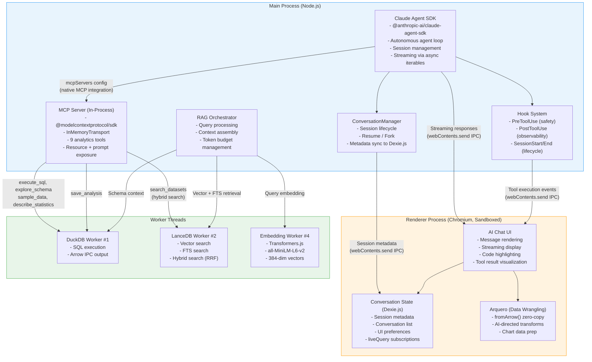
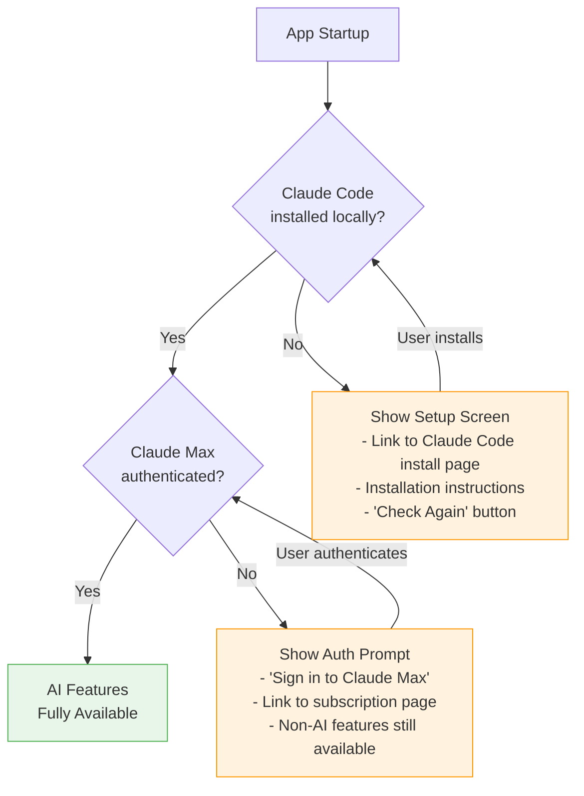
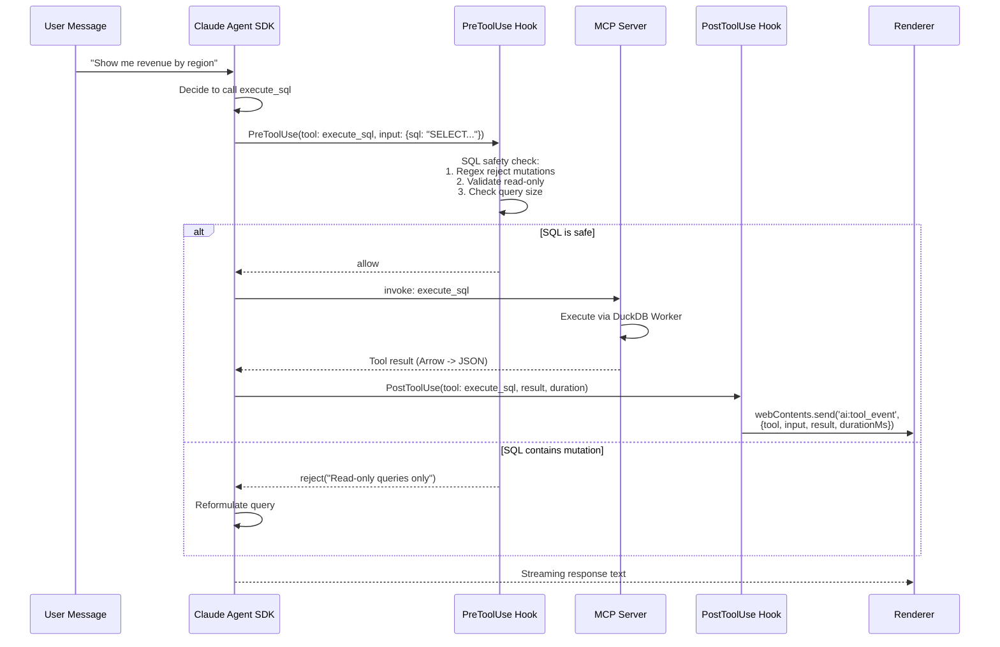
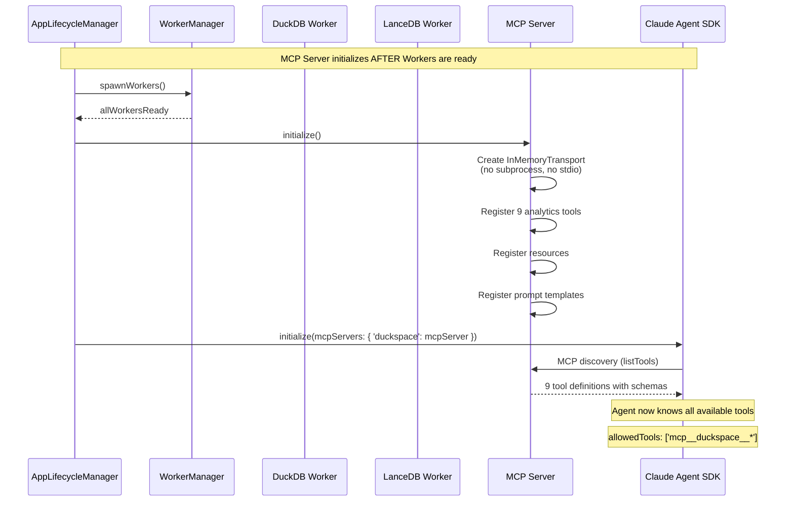
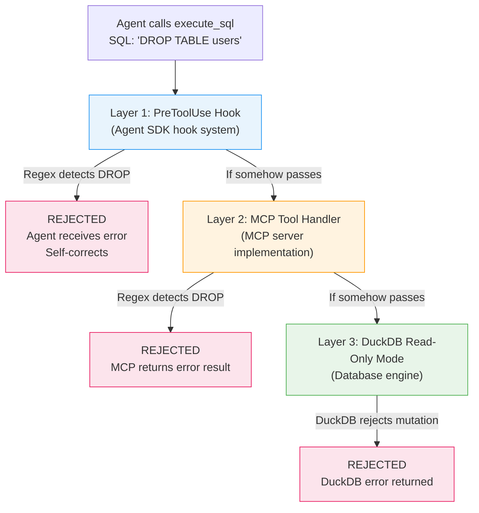
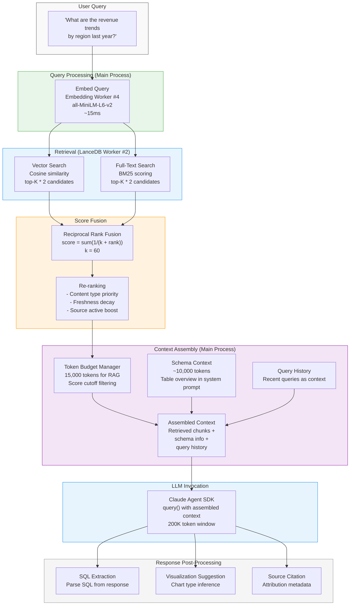
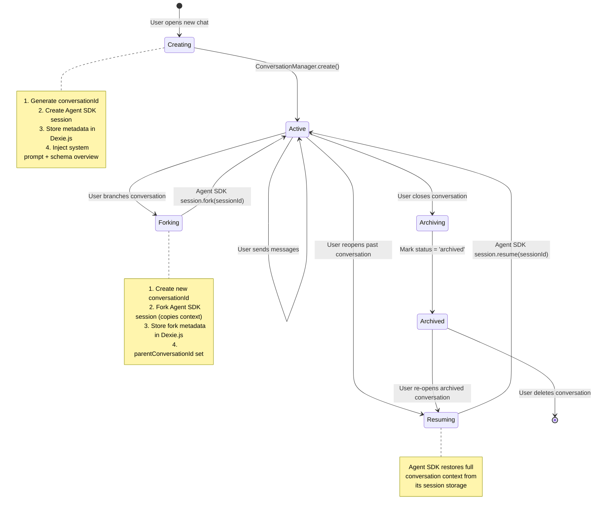
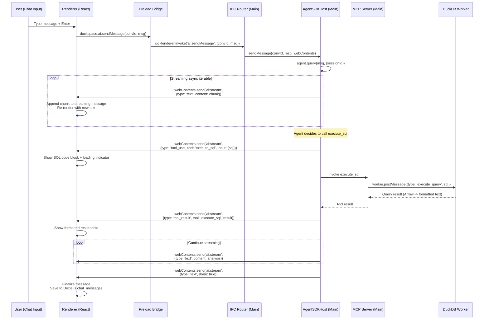
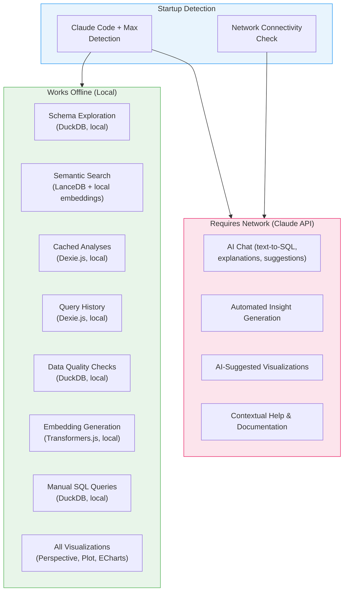

# duckspace: AI Integration Architecture

**Document:** 09-ai-integration.md
**Version:** 1.0
**Date:** 2026-02-05
**Status:** Accepted
**Depends on:** [ADR-004](../decisions/adr-004-ai-integration.md) (Revision 3), [02-Electron Process Model](02-electron-process-model.md), [04-Database Integration](04-database-integration.md), [05-Vector Search & FTS](05-vector-search-fts.md), [Constitution](../../decomposition/constitution.yaml)
**Feeds into:** IPC/API Spec, Data Model Spec, UI Component Spec, Integration Architecture Overview

---

## 1. AI Integration Overview

The AI integration layer provides natural language data analytics capabilities to duckspace through a Claude Agent SDK-powered conversational interface. The architecture connects the Claude Agent SDK (conversation engine), an in-process MCP server (tool framework), a RAG pipeline (context grounding), and a conversational UI (user interaction) into a cohesive system that runs within Electron's process model.

### 1.1 Component Diagram



### 1.2 Component Summary

| Component | Process | Responsibility |
|-----------|---------|---------------|
| **Claude Agent SDK** | Main | Conversation engine with autonomous agent loop, streaming responses, session management |
| **MCP Server** | Main (in-process) | Tool framework exposing 9 analytics tools via `InMemoryTransport` |
| **ConversationManager** | Main | Session lifecycle (create, resume, fork, archive), metadata sync to Dexie.js |
| **Hook System** | Main | Safety enforcement (PreToolUse), observability (PostToolUse), lifecycle (SessionStart/End) |
| **RAG Orchestrator** | Main | Query embedding, hybrid retrieval, context assembly, token budget management |
| **AI Chat UI** | Renderer | Message rendering, streaming display, code highlighting, inline tool result visualization |
| **Conversation State** | Renderer (Dexie.js) | Session metadata storage with `liveQuery()` reactive subscriptions |
| **Arquero** | Renderer | Data wrangling for AI-generated visualizations via `fromArrow()` zero-copy loading |
| **DuckDB Worker** | Worker Thread #1 | SQL execution for `execute_sql`, `explore_schema`, `sample_data`, `describe_statistics` tools |
| **LanceDB Worker** | Worker Thread #2 | Vector, FTS, and hybrid search for `search_datasets` and RAG retrieval |
| **Embedding Worker** | Worker Thread #4 | Local embedding generation for RAG queries via Transformers.js (all-MiniLM-L6-v2) |

---

## 2. Claude Agent SDK Integration

The Claude Agent SDK (`@anthropic-ai/claude-agent-sdk`) is the conversation engine for duckspace. It runs in the Electron Main Process and manages all LLM interactions through its autonomous agent loop. Per [ADR-004 (Revision 3)](../decisions/adr-004-ai-integration.md), the Agent SDK was chosen over the Anthropic Client SDK for zero-configuration authentication, native MCP integration, and elimination of cost tracking.

### 2.1 SDK Initialization and Configuration

```typescript
// Main Process: AgentSDKHost initialization
import { ClaudeAgent } from '@anthropic-ai/claude-agent-sdk';

interface AgentSDKConfig {
  // MCP server connections
  mcpServers: {
    'duckspace': {
      transport: 'in-memory';
      server: MCPServerInstance;  // In-process MCP server reference
    };
  };

  // Tool restriction: ONLY duckspace MCP tools
  allowedTools: ['mcp__duckspace__*'];

  // Agent behavior limits
  maxTurns: 25;            // Maximum tool-use iterations per query

  // System prompt
  systemPrompt: string;    // Data analytics system prompt (see Section 2.3)

  // Hook registrations
  hooks: {
    preToolUse: PreToolUseHook[];
    postToolUse: PostToolUseHook[];
    sessionStart: SessionStartHook[];
    sessionEnd: SessionEndHook[];
    stop: StopHook[];
  };
}

class AgentSDKHost {
  private agent: ClaudeAgent | null = null;
  private config: AgentSDKConfig;

  async initialize(mcpServer: MCPServerInstance): Promise<void> {
    this.config = {
      mcpServers: {
        'duckspace': {
          transport: 'in-memory',
          server: mcpServer,
        },
      },
      allowedTools: ['mcp__duckspace__*'],
      maxTurns: 25,
      systemPrompt: buildSystemPrompt(),
      hooks: {
        preToolUse: [sqlSafetyHook],
        postToolUse: [observabilityHook],
        sessionStart: [sessionLifecycleHook],
        sessionEnd: [sessionLifecycleHook],
        stop: [stopReasonLogger],
      },
    };

    this.agent = new ClaudeAgent(this.config);
  }
}
```

### 2.2 Authentication

The Claude Agent SDK authenticates via the user's locally installed Claude Code instance and Claude Max subscription. **No API key management or secure key storage is needed.** This is a fundamental architectural advantage over the Anthropic Client SDK:

- **No BYOK API key:** Users do not obtain, configure, or rotate API keys
- **No `safeStorage` integration:** No Electron `safeStorage.encryptString()` calls for key storage
- **No onboarding wizard:** No first-run API key entry screen
- **No per-token billing:** Claude Max is subscription-based; no token usage tracking, cost estimates, spending limits, or budget alerts in the UI

**Startup detection flow:**



```typescript
// Main Process: Claude Code detection at startup
async function detectClaudeCodeInstallation(): Promise<ClaudeCodeStatus> {
  try {
    // Check if Claude Code CLI is available
    const { stdout } = await execAsync('claude --version');
    const version = parseVersion(stdout.trim());

    // Check authentication status
    const { stdout: authStatus } = await execAsync('claude auth status');
    const isAuthenticated = authStatus.includes('authenticated');

    return {
      installed: true,
      version,
      authenticated: isAuthenticated,
      subscriptionType: isAuthenticated ? 'max' : 'none',
    };
  } catch {
    return {
      installed: false,
      version: null,
      authenticated: false,
      subscriptionType: 'none',
    };
  }
}
```

### 2.3 Conversation Management

The Agent SDK manages multi-turn conversations with system prompts, tool usage context, and history management:

**System prompt structure:**

```typescript
function buildSystemPrompt(): string {
  return `You are a data analytics assistant for duckspace, a desktop application for exploring and analyzing local datasets.

## Your Capabilities
You can execute SQL queries, explore table schemas, generate visualizations, search across datasets, and assess data quality using the tools available to you.

## Guidelines
- Always explore the schema before writing SQL queries
- Use sample_data to understand data distributions before analysis
- Cite source tables and columns when explaining results
- Suggest follow-up analyses when appropriate
- When generating visualizations, consider the data shape and user intent
- For large result sets, use LIMIT clauses and aggregations

## Data Context
The user has the following registered data sources:
{schemaOverview}

## Source Attribution
When referencing information from search results, cite the source:
- For schemas: "Based on the {table_name} table schema..."
- For past queries: "A similar analysis was run: {query_description}..."
- For analyses: "A previous analysis found that..."`;
}
```

**Session management:**

```typescript
interface ConversationSession {
  sessionId: string;           // Agent SDK session identifier
  conversationId: string;      // duckspace internal ID (stored in Dexie.js)
  createdAt: string;           // ISO timestamp
  updatedAt: string;           // ISO timestamp
  label: string;               // User-assigned or auto-generated label
  parentSessionId?: string;    // For forked conversations
  turnCount: number;           // Number of user-assistant exchanges
  status: 'active' | 'archived';
}
```

The Agent SDK manages actual conversation state, context window utilization, and history pruning internally. duckspace stores only lightweight session metadata in Dexie.js for the conversation list UI.

### 2.4 Streaming Response Handling

The Agent SDK provides streaming responses via async iterables from `query()`. These are forwarded to the Renderer Process over Electron IPC for real-time chat display:

```typescript
class AgentSDKHost {
  async sendMessage(
    conversationId: string,
    message: string,
    webContents: Electron.WebContents,
  ): Promise<void> {
    const session = this.sessionManager.getSession(conversationId);

    // query() returns an async iterable of streaming events
    const stream = this.agent.query(message, {
      sessionId: session.sessionId,
    });

    for await (const event of stream) {
      switch (event.type) {
        case 'text':
          // Forward text chunks to Renderer for real-time display
          webContents.send('ai:stream', {
            conversationId,
            type: 'text',
            content: event.content,
            done: false,
          });
          break;

        case 'tool_use':
          // Forward tool invocation start to Renderer
          webContents.send('ai:stream', {
            conversationId,
            type: 'tool_use',
            toolName: event.tool,
            toolInput: event.input,
          });
          break;

        case 'tool_result':
          // Forward tool result to Renderer for inline display
          webContents.send('ai:stream', {
            conversationId,
            type: 'tool_result',
            toolName: event.tool,
            result: event.result,
          });
          break;

        case 'done':
          webContents.send('ai:stream', {
            conversationId,
            type: 'text',
            content: '',
            done: true,
          });
          break;

        case 'error':
          webContents.send('ai:stream', {
            conversationId,
            type: 'error',
            error: event.error,
          });
          break;
      }
    }

    // Update session metadata
    session.turnCount++;
    session.updatedAt = new Date().toISOString();
    this.syncSessionMetadata(session, webContents);
  }
}
```

### 2.5 Error Handling

| Error Type | Detection | Response | User Experience |
|-----------|-----------|----------|----------------|
| **Network failure** | Agent SDK stream error | Catch error, preserve partial response | "Connection lost. Your partial response is preserved. Retry?" |
| **Rate limit** | Agent SDK error with rate limit code | Back off, queue retry with exponential delay | "Claude is busy. Retrying in {N} seconds..." |
| **Context overflow** | Agent SDK error (context too long) | Fork conversation with summary, start fresh context | "This conversation is very long. Starting a new thread with a summary." |
| **Tool execution error** | MCP tool returns error result | Agent SDK receives error, self-corrects or reports | Agent explains the error and suggests alternatives |
| **Claude Code not running** | Connection failure during query | Detect and prompt user | "Claude Code is not running. Please start Claude Code and try again." |
| **Auth expired** | Authentication error from Agent SDK | Prompt re-authentication | "Your Claude Max session has expired. Please sign in again." |
| **maxTurns reached** | Agent SDK stop reason: max_turns | Return partial result with explanation | "I've reached the maximum number of steps. Here's what I found so far..." |

```typescript
async function handleAgentError(
  error: AgentError,
  conversationId: string,
  webContents: Electron.WebContents,
): Promise<void> {
  if (error.type === 'network') {
    webContents.send('ai:stream', {
      conversationId,
      type: 'error',
      error: {
        code: 'NETWORK_ERROR',
        message: 'Connection to Claude lost. Check your internet connection.',
        retryable: true,
      },
    });
  } else if (error.type === 'rate_limit') {
    const retryAfterMs = error.retryAfter ?? 5000;
    setTimeout(() => {
      // Auto-retry after backoff
      this.retryLastMessage(conversationId, webContents);
    }, retryAfterMs);
  } else if (error.type === 'context_overflow') {
    // Fork conversation with context summary
    const forkedSession = await this.forkConversation(conversationId);
    webContents.send('ai:conversation_forked', {
      originalId: conversationId,
      forkedId: forkedSession.conversationId,
      reason: 'context_overflow',
    });
  }
}
```

### 2.6 Process Hosting

The Claude Agent SDK runs in the **Main Process**, consistent with the process model defined in [doc 02, Section 2.1](02-electron-process-model.md):

- **AgentSDKHost** initializes at startup order 6 (after Workers are ready)
- Tools execute via MCP, which dispatches to Worker Threads for database operations
- Streaming responses forward to the Renderer via `webContents.send()` IPC
- No data-plane operations in the Main Process -- tool results flow through Workers

### 2.7 allowedTools Configuration

The `allowedTools` parameter restricts the agent to only duckspace's MCP tools, cleanly disabling all built-in Agent SDK tools (Read, Write, Edit, Bash, Glob, Grep, WebSearch):

```typescript
allowedTools: ['mcp__duckspace__*']
```

This glob pattern matches all tools registered on the `duckspace` MCP server (e.g., `mcp__duckspace__execute_sql`, `mcp__duckspace__explore_schema`). The agent cannot access the filesystem, run shell commands, or perform web searches -- it can only interact with duckspace's analytics tools.

### 2.8 Hook System

The hook system provides four interception points for safety, observability, and lifecycle management:



**Hook implementations:**

```typescript
// PreToolUse: SQL safety enforcement (defense-in-depth layer 1)
const sqlSafetyHook: PreToolUseHook = {
  name: 'sql-safety',
  async handler(event) {
    if (event.tool === 'mcp__duckspace__execute_sql') {
      const sql = event.input.sql as string;
      const mutationPattern = /\b(INSERT|UPDATE|DELETE|DROP|ALTER|CREATE|TRUNCATE|MERGE|REPLACE)\b/i;
      if (mutationPattern.test(sql)) {
        return { action: 'reject', reason: 'Read-only queries only. Mutation statements are not allowed.' };
      }
    }
    return { action: 'allow' };
  },
};

// PostToolUse: Forward tool events to Renderer for UI display
const observabilityHook: PostToolUseHook = {
  name: 'observability',
  async handler(event, webContents) {
    webContents.send('ai:tool_event', {
      tool: event.tool,
      input: event.input,
      resultSummary: summarizeToolResult(event.result),
      durationMs: event.durationMs,
      timestamp: new Date().toISOString(),
    });
  },
};

// SessionStart/End: Lifecycle management
const sessionLifecycleHook = {
  name: 'session-lifecycle',
  async onStart(session) {
    // Sync session creation to Dexie.js via IPC
    webContents.send('state:update', {
      collection: 'chat_conversations',
      action: 'put',
      data: {
        id: session.conversationId,
        sessionId: session.sessionId,
        createdAt: new Date().toISOString(),
        updatedAt: new Date().toISOString(),
        status: 'active',
      },
    });
  },
  async onEnd(session) {
    webContents.send('state:update', {
      collection: 'chat_conversations',
      action: 'put',
      data: {
        id: session.conversationId,
        updatedAt: new Date().toISOString(),
        status: 'archived',
      },
    });
  },
};
```

---

## 3. MCP Server Design

The MCP server provides the tool framework that enables the Claude Agent SDK to interact with duckspace's databases, search indices, and analytics capabilities. Per [ADR-004 (Revision 3)](../decisions/adr-004-ai-integration.md), the MCP server uses `@modelcontextprotocol/sdk` with `InMemoryTransport` for zero-overhead in-process communication.

### 3.1 MCP Server Lifecycle in Electron



**Lifecycle guarantees:**
- MCP server starts after DuckDB and LanceDB Workers report ready (startup order 6, per [doc 02, Section 2.1](02-electron-process-model.md))
- Tool handlers delegate to Worker Threads via `worker.postMessage()` -- no blocking operations in the Main Process
- On shutdown, the MCP server closes after the Agent SDK session ends but before Workers terminate

### 3.2 Tool Definitions

The MCP server registers 9 analytics tools that the Claude Agent SDK discovers and invokes autonomously:

#### execute_sql

Execute read-only SQL queries against DuckDB with timeout and row limits.

```typescript
{
  name: 'execute_sql',
  description: 'Execute a read-only SQL query against the analytics database. Returns results as formatted text. Use for aggregations, filtering, joins, and analytical queries.',
  inputSchema: {
    type: 'object',
    properties: {
      sql: {
        type: 'string',
        description: 'SQL query to execute. Must be read-only (SELECT, WITH, EXPLAIN). Mutation statements (INSERT, UPDATE, DELETE, DROP, ALTER, CREATE, TRUNCATE) are rejected.',
      },
      limit: {
        type: 'number',
        description: 'Maximum rows to return. Default: 100. Maximum: 1000.',
        default: 100,
      },
      format: {
        type: 'string',
        enum: ['table', 'csv', 'json'],
        description: 'Output format. Default: table (aligned text table).',
        default: 'table',
      },
    },
    required: ['sql'],
  },
}
```

#### explore_schema

Retrieve table schemas, column types, and metadata.

```typescript
{
  name: 'explore_schema',
  description: 'Explore the schema of a data source. Returns table names, column names, data types, and nullable flags. Use this before writing SQL to understand available tables and columns.',
  inputSchema: {
    type: 'object',
    properties: {
      table: {
        type: 'string',
        description: 'Table name to describe. If omitted, lists all available tables.',
      },
      includeStats: {
        type: 'boolean',
        description: 'Include row count and storage size. Default: false.',
        default: false,
      },
    },
  },
}
```

#### sample_data

Retrieve representative rows from a table.

```typescript
{
  name: 'sample_data',
  description: 'Get a representative sample of rows from a table. Useful for understanding data formats, value distributions, and common patterns before writing queries.',
  inputSchema: {
    type: 'object',
    properties: {
      table: {
        type: 'string',
        description: 'Table name to sample from.',
      },
      rows: {
        type: 'number',
        description: 'Number of rows to return. Default: 10. Maximum: 50.',
        default: 10,
      },
      method: {
        type: 'string',
        enum: ['first', 'random', 'diverse'],
        description: 'Sampling method. first: first N rows. random: random sample. diverse: stratified sample showing value variety.',
        default: 'diverse',
      },
    },
    required: ['table'],
  },
}
```

#### describe_statistics

Compute column-level statistics.

```typescript
{
  name: 'describe_statistics',
  description: 'Compute descriptive statistics for columns in a table: min, max, mean, median, standard deviation, null count, distinct count, and value distribution.',
  inputSchema: {
    type: 'object',
    properties: {
      table: {
        type: 'string',
        description: 'Table name.',
      },
      columns: {
        type: 'array',
        items: { type: 'string' },
        description: 'Column names to analyze. If omitted, analyzes all columns.',
      },
    },
    required: ['table'],
  },
}
```

#### suggest_visualization

Recommend chart type based on data shape and query intent.

```typescript
{
  name: 'suggest_visualization',
  description: 'Analyze query results and suggest the most appropriate visualization type. Returns chart type, axis mappings, and configuration rationale.',
  inputSchema: {
    type: 'object',
    properties: {
      sql: {
        type: 'string',
        description: 'The SQL query that produced the data.',
      },
      intent: {
        type: 'string',
        description: 'User intent or question that motivated the analysis.',
      },
      resultShape: {
        type: 'object',
        properties: {
          columns: {
            type: 'array',
            items: {
              type: 'object',
              properties: {
                name: { type: 'string' },
                type: { type: 'string' },
              },
            },
          },
          rowCount: { type: 'number' },
        },
      },
    },
    required: ['sql', 'resultShape'],
  },
}
```

#### create_visualization

Generate a chart specification (Vega-Lite or ECharts).

```typescript
{
  name: 'create_visualization',
  description: 'Generate a chart specification from query results. Returns a Vega-Lite or ECharts JSON specification that the UI renders inline.',
  inputSchema: {
    type: 'object',
    properties: {
      chartType: {
        type: 'string',
        enum: ['bar', 'line', 'scatter', 'area', 'pie', 'heatmap', 'histogram', 'boxplot', 'table'],
        description: 'Chart type to generate.',
      },
      sql: {
        type: 'string',
        description: 'SQL query to execute and visualize.',
      },
      config: {
        type: 'object',
        description: 'Chart configuration: axis labels, title, color scheme, dimensions.',
        properties: {
          title: { type: 'string' },
          xAxis: { type: 'string' },
          yAxis: { type: 'string' },
          colorBy: { type: 'string' },
          width: { type: 'number' },
          height: { type: 'number' },
        },
      },
      format: {
        type: 'string',
        enum: ['vega-lite', 'echarts'],
        description: 'Specification format. Default: vega-lite.',
        default: 'vega-lite',
      },
    },
    required: ['chartType', 'sql'],
  },
}
```

#### search_datasets

Semantic search across datasets via LanceDB hybrid search.

```typescript
{
  name: 'search_datasets',
  description: 'Search across all datasets using natural language. Uses hybrid search (semantic + keyword) to find relevant tables, columns, past queries, and analysis summaries. Use this to discover what data is available.',
  inputSchema: {
    type: 'object',
    properties: {
      query: {
        type: 'string',
        description: 'Natural language search query.',
      },
      limit: {
        type: 'number',
        description: 'Maximum results. Default: 10.',
        default: 10,
      },
      contentTypes: {
        type: 'array',
        items: {
          type: 'string',
          enum: ['schema', 'column', 'query', 'analysis', 'sample'],
        },
        description: 'Filter results by content type.',
      },
    },
    required: ['query'],
  },
}
```

#### assess_data_quality

Check for data quality issues.

```typescript
{
  name: 'assess_data_quality',
  description: 'Assess data quality for a table. Checks for null values, duplicates, outliers, type inconsistencies, and format issues. Returns a quality score and detailed findings.',
  inputSchema: {
    type: 'object',
    properties: {
      table: {
        type: 'string',
        description: 'Table name to assess.',
      },
      checks: {
        type: 'array',
        items: {
          type: 'string',
          enum: ['nulls', 'duplicates', 'outliers', 'types', 'formats', 'all'],
        },
        description: 'Quality checks to run. Default: ["all"].',
        default: ['all'],
      },
      columns: {
        type: 'array',
        items: { type: 'string' },
        description: 'Columns to assess. If omitted, assesses all columns.',
      },
    },
    required: ['table'],
  },
}
```

#### save_analysis

Persist a query and visualization as a saved analysis.

```typescript
{
  name: 'save_analysis',
  description: 'Save the current analysis (SQL query, results, visualization, and findings) as a named analysis for future reference. Saved analyses are searchable via search_datasets.',
  inputSchema: {
    type: 'object',
    properties: {
      name: {
        type: 'string',
        description: 'Name for the saved analysis.',
      },
      description: {
        type: 'string',
        description: 'Summary of findings and methodology.',
      },
      sql: {
        type: 'string',
        description: 'The SQL query used.',
      },
      visualization: {
        type: 'object',
        description: 'Chart specification (if any).',
      },
      tags: {
        type: 'array',
        items: { type: 'string' },
        description: 'Tags for categorization.',
      },
    },
    required: ['name', 'description', 'sql'],
  },
}
```

### 3.3 Tool Summary Table

| Tool | Purpose | Backend | Response Type |
|------|---------|---------|---------------|
| `execute_sql` | Run read-only SQL | DuckDB Worker | Formatted query results (table/CSV/JSON) |
| `explore_schema` | List tables and columns | DuckDB Worker | Schema description text |
| `sample_data` | Representative rows | DuckDB Worker | Formatted sample rows |
| `describe_statistics` | Column statistics | DuckDB Worker | Statistical summary text |
| `suggest_visualization` | Recommend chart type | Local logic | Chart recommendation with rationale |
| `create_visualization` | Generate chart spec | DuckDB Worker + local | Vega-Lite or ECharts JSON |
| `search_datasets` | Semantic data discovery | LanceDB Worker + Embedding Worker | Search results with scores |
| `assess_data_quality` | Quality assessment | DuckDB Worker | Quality report with scores |
| `save_analysis` | Persist analysis | DuckDB Worker + LanceDB Worker | Confirmation with analysis ID |

### 3.4 MCP Resources

The MCP server exposes read-only resources that the model can reference for context:

```typescript
// Resource exposure
server.setRequestHandler('resources/list', async () => ({
  resources: [
    {
      uri: 'datacodex://catalog/sources',
      name: 'Data Source Catalog',
      description: 'List of all registered data sources with metadata',
      mimeType: 'application/json',
    },
    {
      uri: 'datacodex://catalog/tables',
      name: 'Table Catalog',
      description: 'All registered tables with column schemas',
      mimeType: 'application/json',
    },
    {
      uri: 'datacodex://analyses/saved',
      name: 'Saved Analyses',
      description: 'Previously saved analyses with queries and findings',
      mimeType: 'application/json',
    },
  ],
}));
```

### 3.5 MCP Prompt Templates

Reusable prompt templates for common analytics workflows:

```typescript
server.setRequestHandler('prompts/list', async () => ({
  prompts: [
    {
      name: 'comprehensive_analysis',
      description: 'Perform a comprehensive analysis of a dataset: schema exploration, quality assessment, key statistics, and visualization recommendations.',
      arguments: [
        { name: 'table', description: 'Table name to analyze', required: true },
      ],
    },
    {
      name: 'data_exploration',
      description: 'Guided data exploration: understand the structure, distributions, and relationships in a dataset.',
      arguments: [
        { name: 'table', description: 'Table name to explore', required: true },
      ],
    },
    {
      name: 'sql_generation',
      description: 'Generate SQL from a natural language question about the data.',
      arguments: [
        { name: 'question', description: 'Natural language question', required: true },
        { name: 'tables', description: 'Comma-separated table names to query', required: false },
      ],
    },
  ],
}));
```

### 3.6 SQL Safety (Defense-in-Depth)

SQL safety is enforced through three independent layers, per [ADR-004 (Revision 3)](../decisions/adr-004-ai-integration.md). A mutation query must bypass all three to execute:



| Layer | Location | Mechanism | Blocked Statements |
|-------|----------|-----------|-------------------|
| **1. PreToolUse Hook** | Agent SDK hook | Regex pattern match before tool invocation | INSERT, UPDATE, DELETE, DROP, ALTER, CREATE, TRUNCATE, MERGE, REPLACE |
| **2. MCP Tool Handler** | MCP server `execute_sql` handler | Regex validation in tool implementation | Same set + ATTACH, DETACH, COPY, EXPORT |
| **3. DuckDB Read-Only** | DuckDB Worker Thread | `access_mode: 'READ_ONLY'` for AI queries | All mutation operations at engine level |

**Additional protections:**
- **Query timeout:** 30 seconds, enforced by the DuckDB Worker Thread via `AbortSignal`
- **Row limit:** Maximum 1,000 rows returned to the agent context
- **maxTurns:** Agent loop limited to 25 iterations per user message

```typescript
// Layer 2: MCP tool handler validation
async function handleExecuteSQL(input: { sql: string; limit?: number; format?: string }) {
  const { sql, limit = 100, format = 'table' } = input;

  // Regex check (defense-in-depth layer 2)
  const mutationPattern = /\b(INSERT|UPDATE|DELETE|DROP|ALTER|CREATE|TRUNCATE|MERGE|REPLACE|ATTACH|DETACH|COPY\s+TO|EXPORT)\b/i;
  if (mutationPattern.test(sql)) {
    return {
      content: [{ type: 'text', text: 'Error: Only read-only SQL queries (SELECT, WITH, EXPLAIN) are allowed.' }],
      isError: true,
    };
  }

  // Enforce row limit
  const effectiveLimit = Math.min(limit, 1000);
  const limitedSql = ensureLimit(sql, effectiveLimit);

  // Execute via DuckDB Worker with 30s timeout
  const result = await duckdbAdapter.executeWithTimeout(limitedSql, 30_000);

  return {
    content: [{ type: 'text', text: formatResult(result, format) }],
  };
}
```

---

## 4. RAG Pipeline Design

The RAG (Retrieval-Augmented Generation) pipeline grounds Claude's responses in the user's actual data context by retrieving relevant schemas, past queries, and analysis summaries before generating responses.

### 4.1 RAG Pipeline Flow



### 4.2 Query Processing

When a user sends a message, the RAG pipeline processes the query before it reaches the Claude Agent SDK:

```typescript
class RAGOrchestrator {
  async processQuery(
    userMessage: string,
    conversationId: string,
  ): Promise<RAGContext> {
    // Step 1: Embed the user query
    const queryVector = await this.embeddingWorker.embedSingle(userMessage);

    // Step 2: Hybrid search in LanceDB
    const searchResults = await this.lancedbAdapter.hybridSearch({
      table: 'document_embeddings',
      queryText: userMessage,
      queryVector,
      limit: 20,
      weights: { vector: 0.5, fts: 0.5 },
    });

    // Step 3: Assemble context within token budget
    const ragContext = assembleRAGContext(searchResults, {
      maxContextTokens: 15_000,
      minResults: 3,
      maxResults: 20,
      minFusedScore: 0.005,
      tokensPerResult: 200,
    });

    return ragContext;
  }
}
```

### 4.3 Retrieval Strategy

The retrieval layer uses hybrid search combining vector similarity (semantic) and full-text search (keyword), as detailed in [doc 05, Section 4](05-vector-search-fts.md):

1. **Vector search** via LanceDB: The user query embedding (384-dim Float32Array from Embedding Worker) is compared against stored embeddings using IVF-PQ approximate nearest neighbor search
2. **Full-text search** via LanceDB/Tantivy: Keyword matching for exact terms, table names, column names using BM25 scoring
3. **Reciprocal Rank Fusion (RRF)** merges results from both sources with k=60, deduplicates by document ID, and fits within the context token budget

### 4.4 Context Window Budget Management

The Claude context window (200K tokens) is allocated as follows, per [ADR-004 (Revision 3)](../decisions/adr-004-ai-integration.md):

| Allocation | Tokens | Type | Strategy |
|-----------|--------|------|----------|
| System prompt + tool definitions | ~3,000 | Fixed | Always present, includes analytics guidelines |
| Cached schema context | ~10,000 | Semi-static | Top-level schema overview of all registered tables, refreshed on schema changes |
| RAG search results | ~15,000 | Dynamic per query | Top-K search results after score cutoff and token budget filtering |
| Tool execution results | ~10,000 | Dynamic per turn | SQL results, schema details, statistics from MCP tool calls |
| Conversation history | ~50,000 | Managed by Agent SDK | Automatic pruning of older turns by Agent SDK |
| Response generation | ~8,000 | Reserved | Agent's response output |
| Safety buffer | ~104,000 | Unused | Headroom for complex multi-turn conversations |

```typescript
interface ContextBudget {
  systemPrompt: number;      // ~3,000 (fixed)
  schemaOverview: number;    // ~10,000 (semi-static)
  ragResults: number;        // ~15,000 (dynamic)
  toolResults: number;       // ~10,000 (dynamic)
  conversationHistory: number; // ~50,000 (managed by Agent SDK)
  responseReserve: number;   // ~8,000 (fixed)
  total: 200_000;
}
```

### 4.5 Progressive Context Loading

Rather than saturating the context window upfront, the RAG pipeline uses progressive loading:

1. **System prompt** includes a schema overview (table names, row counts, column summaries) -- enough for the agent to know what data exists
2. **On demand:** The agent requests detailed schemas, statistics, and samples via MCP tools (`explore_schema`, `describe_statistics`, `sample_data`) as needed
3. **RAG retrieval** provides relevant past queries, analysis summaries, and column descriptions when they match the user's question

This strategy avoids wasting context budget on irrelevant schema details while ensuring the agent has enough context to make informed tool choices.

### 4.6 Response Post-Processing

After the Agent SDK generates a response, post-processing extracts structured elements:

```typescript
interface PostProcessedResponse {
  text: string;                    // Natural language response
  sqlQueries: ExtractedSQL[];      // SQL queries mentioned in response
  visualizations: ChartSpec[];     // Chart specifications for inline rendering
  sourceAttributions: Attribution[]; // Sources cited by the agent
  followUpSuggestions: string[];   // Suggested follow-up questions
}

function postProcessResponse(response: string): PostProcessedResponse {
  return {
    text: response,
    sqlQueries: extractSQLBlocks(response),
    visualizations: extractChartSpecs(response),
    sourceAttributions: extractAttributions(response),
    followUpSuggestions: extractSuggestions(response),
  };
}
```

---

## 5. Conversational Interface Architecture

The conversational interface connects the Claude Agent SDK (Main Process) to the AI Chat UI (Renderer Process) through Electron IPC, with session metadata stored in Dexie.js.

### 5.1 Chat Message Model

```typescript
// Message types in the conversation
type MessageRole = 'user' | 'assistant' | 'system' | 'tool_use' | 'tool_result';

interface ChatMessage {
  id: string;                      // UUID
  conversationId: string;          // Parent conversation ID
  role: MessageRole;               // Message type
  content: string;                 // Text content (or JSON for tool messages)
  timestamp: string;               // ISO timestamp

  // Tool-specific fields
  toolName?: string;               // MCP tool name (for tool_use and tool_result)
  toolInput?: Record<string, unknown>;  // Tool input parameters (for tool_use)
  toolResultType?: 'success' | 'error'; // Tool execution result type

  // Rendering hints
  metadata?: {
    sqlQueries?: ExtractedSQL[];   // SQL blocks for syntax highlighting
    chartSpec?: ChartSpec;         // Chart specification for inline rendering
    isStreaming?: boolean;         // Currently streaming (partial content)
    tokenCount?: number;           // Estimated token count
  };
}
```

### 5.2 Conversation History Storage

Conversation session metadata is stored in **Dexie.js** (not RxDB) in the Renderer Process. The actual conversation state (message history, context window) is managed internally by the Claude Agent SDK's session management:

```typescript
// Dexie.js schema (from doc 04, Section 4.1)
// chat_conversations: 'id, createdAt, updatedAt'
// chat_messages: 'id, conversationId, timestamp, [conversationId+timestamp]'

interface ChatConversation {
  id: string;                      // duckspace conversation ID
  sessionId: string;               // Agent SDK session ID (for resume/fork)
  label: string;                   // User-assigned or auto-generated label
  createdAt: string;               // ISO timestamp
  updatedAt: string;               // ISO timestamp
  status: 'active' | 'archived';
  turnCount: number;               // Number of user-assistant exchanges
  parentConversationId?: string;   // For forked conversations
  summary?: string;                // Auto-generated conversation summary
}
```

**Division of responsibility:**

| Aspect | Managed By | Storage |
|--------|-----------|---------|
| Conversation list and metadata | duckspace (ConversationManager) | Dexie.js `chat_conversations` collection |
| Recent messages for UI display | duckspace (Renderer) | Dexie.js `chat_messages` collection |
| Full conversation context | Claude Agent SDK | Agent SDK session storage (internal) |
| Context window management | Claude Agent SDK | Automatic pruning (internal) |
| Session resume/fork tokens | Claude Agent SDK | Session ID references |

### 5.3 Conversation Lifecycle



```typescript
class ConversationManager {
  // Create a new conversation
  async create(label?: string): Promise<ConversationSession> {
    const conversationId = crypto.randomUUID();
    const session = await this.agent.createSession();

    const conversation: ConversationSession = {
      sessionId: session.id,
      conversationId,
      createdAt: new Date().toISOString(),
      updatedAt: new Date().toISOString(),
      label: label ?? 'New conversation',
      turnCount: 0,
      status: 'active',
    };

    // Sync to Dexie.js
    this.syncSessionMetadata(conversation);
    return conversation;
  }

  // Resume an existing conversation
  async resume(conversationId: string): Promise<ConversationSession> {
    const metadata = await this.getMetadata(conversationId);
    await this.agent.resumeSession(metadata.sessionId);
    return metadata;
  }

  // Fork a conversation for exploratory analysis
  async fork(conversationId: string): Promise<ConversationSession> {
    const original = await this.getMetadata(conversationId);
    const forkedSession = await this.agent.forkSession(original.sessionId);

    const forked: ConversationSession = {
      sessionId: forkedSession.id,
      conversationId: crypto.randomUUID(),
      createdAt: new Date().toISOString(),
      updatedAt: new Date().toISOString(),
      label: `${original.label} (fork)`,
      parentSessionId: original.sessionId,
      turnCount: original.turnCount,
      status: 'active',
    };

    this.syncSessionMetadata(forked);
    return forked;
  }

  // Archive a conversation
  async archive(conversationId: string): Promise<void> {
    const metadata = await this.getMetadata(conversationId);
    metadata.status = 'archived';
    metadata.updatedAt = new Date().toISOString();
    this.syncSessionMetadata(metadata);
  }
}
```

### 5.4 UI State and Rendering

The AI Chat UI in the Renderer Process handles message rendering, streaming display, and inline tool result visualization:

**Message rendering pipeline:**

```typescript
// Renderer Process: Chat message rendering
interface MessageRenderState {
  messages: ChatMessage[];          // All messages in current conversation
  streamingMessage: Partial<ChatMessage> | null;  // Currently streaming response
  pendingToolCalls: ToolCallState[];  // Active tool executions
  isWaitingForResponse: boolean;
}

// Message types and their rendering
const MESSAGE_RENDERERS: Record<MessageRole, React.FC<ChatMessage>> = {
  user: UserMessageBubble,         // Plain text with markdown support
  assistant: AssistantMessageBubble, // Markdown + syntax highlighting + charts
  system: SystemMessageBanner,      // Subtle system notification
  tool_use: ToolCallCard,           // Collapsible card showing tool name + input
  tool_result: ToolResultCard,      // Expandable card showing results + visualizations
};
```

**Streaming display:**

```typescript
// Renderer: Subscribe to AI streaming events
useEffect(() => {
  const unsubscribe = window.duckspace.on.aiStream((event) => {
    switch (event.type) {
      case 'text':
        if (event.done) {
          // Finalize streaming message
          finalizeMessage(event.conversationId);
        } else {
          // Append text chunk to streaming message
          appendToStreamingMessage(event.conversationId, event.content);
        }
        break;

      case 'tool_use':
        // Show tool call card (collapsible, shows SQL query)
        addToolCallCard(event.conversationId, event.toolName, event.toolInput);
        break;

      case 'tool_result':
        // Show tool result (expandable, shows formatted results)
        addToolResultCard(event.conversationId, event.toolName, event.result);
        break;

      case 'error':
        showErrorMessage(event.conversationId, event.error);
        break;
    }
  });

  return unsubscribe;
}, []);
```

**Tool execution display:**

When the agent invokes MCP tools, the UI renders them inline:

| Tool | Display |
|------|---------|
| `execute_sql` | SQL query in syntax-highlighted code block, results in formatted table |
| `explore_schema` | Collapsible schema tree with column types |
| `sample_data` | Compact data table with first N rows |
| `describe_statistics` | Statistical summary with inline sparklines |
| `suggest_visualization` | Chart type recommendation with rationale |
| `create_visualization` | Rendered chart (Observable Plot, ECharts) inline in chat |
| `search_datasets` | Search results with relevance scores and source attribution |
| `assess_data_quality` | Quality scorecard with pass/fail indicators |
| `save_analysis` | Confirmation badge with link to saved analysis |

### 5.5 IPC Pattern: Agent SDK Streaming to Renderer

The streaming IPC pattern ensures low-latency display of Agent SDK responses:



---

## 6. ACP Assessment

### 6.1 Agent Client Protocol (ACP) -- Not Applicable

The Agent Client Protocol (ACP), created by Zed and JetBrains in January 2026, has been evaluated and determined **not applicable** to duckspace, per [ADR-004 (Revision 3)](../decisions/adr-004-ai-integration.md).

### 6.2 What ACP Is

ACP is an open protocol analogous to LSP (Language Server Protocol) but for AI agents. It defines how **code editors** (Zed, JetBrains IDEs, VS Code) communicate with **AI coding agents** (Claude Code, Gemini CLI, Copilot). ACP specifies:

- How editors create conversations with agents
- How editors stream responses from agents
- How editors approve/deny tool requests from agents
- How editors provide file context (open files, cursor position, selection) to agents

### 6.3 Why ACP Is Irrelevant to duckspace

| ACP Concept | duckspace Reality |
|-------------|-------------------|
| **Client role (editor)** | duckspace is a desktop analytics app, not a code editor |
| **Server role (coding agent)** | duckspace hosts a data analytics agent, not a coding agent |
| **Context model (files, cursor, selection)** | duckspace's context is schemas, tables, and queries -- not source code files |
| **Agent Registry** | Users would not invoke "duckspace" from their code editor for analytics |
| **Tool approval UX** | duckspace's tool approval is handled by PreToolUse hooks, not an editor toolbar |

**Prior ADR confusion:** The original ADR-004 (revision 1) incorrectly identified ACP as an "Agent Communication Protocol" for multi-agent orchestration (confusion with a separate IBM project at `github.com/i-am-bee/acp`). The actual ACP (`agentclientprotocol.com`) is strictly an editor-to-agent protocol. Revision 2 corrected the identity but retained the incorrect SDK recommendation. Revision 3 corrects both.

### 6.4 Alternative Extensibility: MCP Server Exposure

If external AI agents (the user's Claude Code in their terminal, Copilot, Gemini CLI) want to access duckspace's analytics tools, the correct approach is **exposing duckspace's MCP server** for external connections -- not implementing ACP:

- ACP-compatible editors already connect to MCP servers for tool access
- duckspace's 9 analytics tools are registered as standard MCP tools
- External agents connect to duckspace's MCP server via subprocess or network transport
- This is planned for Phase 6 (Extensions) per ADR-004's implementation phasing

No ACP compliance features, server implementation, or client implementation should be designed or built for duckspace.

---

## 7. Offline Behavior

duckspace follows the Constitution's Principle 14 (Single-User, Local-First) for AI features, with graceful degradation when network connectivity is unavailable.

### 7.1 Online vs Offline Feature Matrix



### 7.2 Feature Availability by Connectivity State

| Feature | Online | Offline | Notes |
|---------|--------|---------|-------|
| AI Chat (conversational analytics) | Available | Unavailable | Requires Claude API via Agent SDK |
| Text-to-SQL generation | Available | Unavailable | Requires LLM |
| AI-generated insights | Available | Unavailable | Requires LLM |
| Schema exploration via MCP tools | Available | Available | DuckDB runs locally |
| Semantic search (vector) | Available | Available | LanceDB + local embeddings |
| Full-text search | Available | Available | Tantivy runs locally in LanceDB |
| Hybrid search | Available | Available | Both search backends are local |
| Embedding generation | Available | Available | Transformers.js + all-MiniLM-L6-v2 runs locally |
| Manual SQL queries | Available | Available | DuckDB runs locally |
| Cached/saved analyses | Available | Available | Stored in Dexie.js + DuckDB |
| Data quality assessment | Available | Available | DuckDB queries, no LLM needed |
| Visualizations | Available | Available | Chart libraries run in Renderer |
| Conversation history browsing | Available | Available | Stored in Dexie.js |

### 7.3 Claude Code + Claude Max Detection at Startup

```typescript
// Main Process: AI availability check at startup
interface AIAvailabilityStatus {
  claudeCodeInstalled: boolean;
  claudeMaxAuthenticated: boolean;
  networkAvailable: boolean;
  aiChatAvailable: boolean;        // All three above must be true
  localAIAvailable: boolean;       // Embeddings + search (always true after init)
}

async function checkAIAvailability(): Promise<AIAvailabilityStatus> {
  const claudeStatus = await detectClaudeCodeInstallation();
  const networkAvailable = await checkNetworkConnectivity();

  return {
    claudeCodeInstalled: claudeStatus.installed,
    claudeMaxAuthenticated: claudeStatus.authenticated,
    networkAvailable,
    aiChatAvailable: claudeStatus.installed && claudeStatus.authenticated && networkAvailable,
    localAIAvailable: true,  // Embedding model + search are always local
  };
}
```

### 7.4 UX for Online vs Offline AI Status

```typescript
// Renderer: AI status indicator component
interface AIStatusIndicator {
  status: 'online' | 'offline' | 'degraded' | 'setup-required';
  message: string;
  actions: StatusAction[];
}

function getAIStatusIndicator(availability: AIAvailabilityStatus): AIStatusIndicator {
  if (availability.aiChatAvailable) {
    return {
      status: 'online',
      message: 'AI assistant available',
      actions: [],
    };
  }

  if (!availability.claudeCodeInstalled) {
    return {
      status: 'setup-required',
      message: 'Install Claude Code to enable AI features',
      actions: [{ label: 'Install Guide', action: 'open-install-guide' }],
    };
  }

  if (!availability.claudeMaxAuthenticated) {
    return {
      status: 'setup-required',
      message: 'Sign in to Claude Max to enable AI chat',
      actions: [{ label: 'Sign In', action: 'open-auth-prompt' }],
    };
  }

  if (!availability.networkAvailable) {
    return {
      status: 'degraded',
      message: 'Offline mode: Search and schema exploration available. AI chat requires internet.',
      actions: [{ label: 'Retry Connection', action: 'retry-network' }],
    };
  }

  return {
    status: 'offline',
    message: 'AI features unavailable',
    actions: [{ label: 'Troubleshoot', action: 'open-troubleshoot' }],
  };
}
```

The AI status indicator is displayed in the chat panel header and the application status bar, providing clear visibility into whether conversational AI features are available.

---

## 8. Cross-Reference and Consistency

### 8.1 Constitution Alignment

| Principle | Requirement | How This Design Satisfies It |
|-----------|------------|------------------------------|
| #5 Decision Traceability | Every design choice documents alternatives and rationale | ADR-004 (Revision 3) documents SDK comparison, ACP assessment, embedding model selection |
| #9 Arrow-First Data Flow | Inter-component data uses Arrow | MCP tool results from DuckDB/LanceDB Workers arrive as Arrow IPC, converted to text only at the LLM context boundary |
| #10 Embedded-Only Databases | No external database servers | DuckDB, LanceDB, Dexie.js all in-process. MCP server uses InMemoryTransport (no subprocess) |
| #11 Stream and Scan | No bulk loading into JS memory | Agent SDK streams responses. MCP tools use LIMIT clauses. RAG retrieves bounded result sets |
| #12 Process Isolation | Main owns database engines; Renderer owns visualization | Agent SDK + MCP in Main Process. Chat UI in Renderer. DB operations in Worker Threads |
| #13 macOS-First | Technologies work on macOS + Electron | Agent SDK, MCP SDK, Transformers.js all verified on macOS + Electron |
| #14 Single-User, Local-First | Offline-capable for local features | Local embeddings, local search, local schema exploration. LLM features degrade gracefully offline |

### 8.2 ADR-004 (Revision 3) Decision Implementation

| ADR-004 Decision | Implementation in This Document |
|-----------------|-------------------------------|
| Claude Agent SDK as conversation engine | Section 2: Full SDK integration design |
| Auth via Claude Code + Claude Max | Section 2.2: Authentication flow, startup detection |
| No cost tracking | Section 2.2: Explicitly no per-token billing, no usage tracking UI |
| MCP Server (in-process, InMemoryTransport) | Section 3: Complete MCP server design with 9 tools |
| allowedTools: MCP-only | Section 2.7: Glob pattern restricting to duckspace tools |
| Hook system (Pre/PostToolUse, Session) | Section 2.8: Hook implementations for safety and observability |
| SQL safety defense-in-depth (3 layers) | Section 3.6: PreToolUse -> MCP handler -> DuckDB read-only |
| ACP: Not applicable | Section 6: Full ACP assessment and rejection rationale |
| RAG pipeline: LanceDB + DuckDB hybrid search | Section 4: Complete RAG pipeline design |
| Progressive context loading | Section 4.5: Schema overview + on-demand detail via MCP tools |
| Session management (resume, fork) | Section 5.3: Conversation lifecycle with Agent SDK sessions |
| Context window budget (200K tokens) | Section 4.4: Token allocation table |
| Offline degradation | Section 7: Feature matrix, detection, UX status indicator |

### 8.3 Document 02 (Process Model) Integration

| Doc 02 Component | AI Integration |
|-----------------|----------------|
| AgentSDKHost (Section 2.1, startup order 6) | Hosts Claude Agent SDK + MCP Server in Main Process |
| Embedding Worker #4 (Section 4.2) | Generates query embeddings for RAG pipeline |
| DuckDB Worker #1 (Section 4.2) | Executes SQL for execute_sql, explore_schema, sample_data, describe_statistics tools |
| LanceDB Worker #2 (Section 4.2) | Provides vector/FTS/hybrid search for search_datasets tool and RAG retrieval |
| Preload Bridge ai.* API (Section 5.1) | sendMessage, createConversation, cancelResponse, listConversations |
| AI streaming IPC (Section 5.2) | webContents.send('ai:stream') for real-time chat display |
| Shutdown sequence (Section 6.2) | Agent SDK sessions closed before Worker shutdown |

### 8.4 Document 04 (Database Integration) Integration

| Doc 04 Component | AI Integration |
|-----------------|----------------|
| QueryRouter (Section 5) | Routes MCP tool SQL queries to DuckDB Worker |
| DuckDBAdapter (Section 2) | Proxies execute_sql, explore_schema, sample_data, describe_statistics tool calls |
| LanceDBAdapter (Section 3) | Proxies search_datasets hybrid search requests |
| Dexie.js chat_conversations (Section 4.1) | Stores conversation session metadata |
| Dexie.js chat_messages (Section 4.1) | Stores recent chat messages for UI display |
| CatalogSyncBridge (Section 4.4) | Pushes session metadata updates to Renderer Dexie.js |

### 8.5 Document 05 (Vector Search & FTS) Integration

| Doc 05 Component | AI Integration |
|-----------------|----------------|
| Embedding Pipeline (Section 1) | RAG query embedding via Embedding Worker |
| Hybrid Search (Section 4) | RAG retrieval combining vector + FTS with RRF fusion |
| RAG Context Assembly (Section 6) | Context window budget management, score cutoff filtering |
| Search Cache (Section 5.4) | Caches repeated RAG queries for low-latency responses |
| Source Attribution (Section 6.4) | Attribution metadata in MCP tool responses for agent citations |

---

*Document 09 of the duckspace Architecture Series*
*Generated: 2026-02-05 | Plan: duckspace-system-design-2026-02-04 | Task: design-ai-integration*
