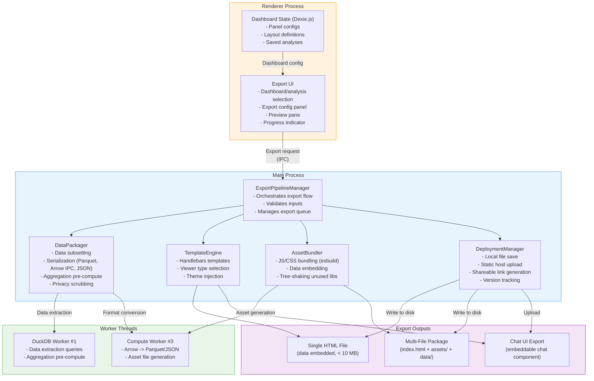
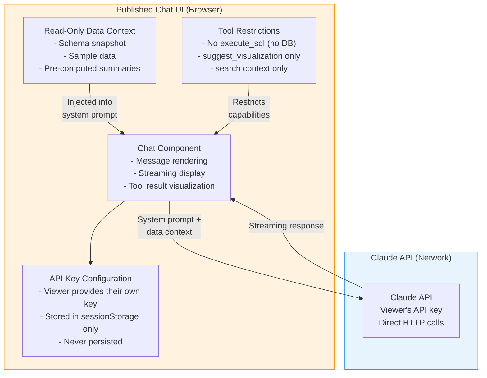
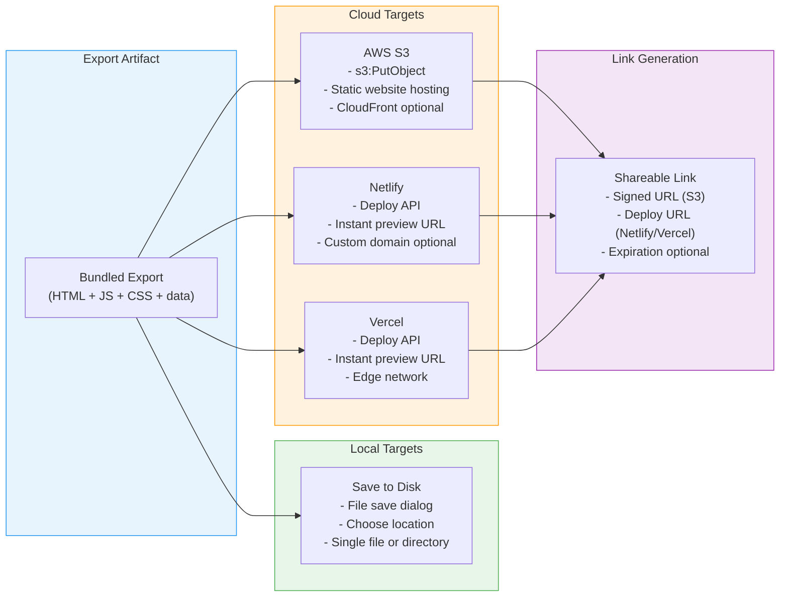

# duckspace: Publishing Engine Architecture

**Document:** 10-publishing-engine.md
**Version:** 1.0
**Date:** 2026-02-05
**Status:** Accepted
**Depends on:** [01-System Overview](01-system-overview.md), [08-Visualization Engine](08-visualization-engine.md), [09-AI Integration](09-ai-integration.md), [Constitution](../../decomposition/constitution.yaml)
**Feeds into:** Integration Architecture Overview, Cross-Reference Validation

---

## 1. Publishing Engine Overview

The Publishing Engine is the Phase 6 system responsible for exporting duckspace dashboards, analyses, and AI chat sessions into standalone artifacts that can be shared, hosted, or embedded outside the application. It transforms in-app interactive analytics into portable web applications, static viewers, and deployable packages.

### 1.1 Design Goals

| Goal | Description |
|------|-------------|
| **Self-contained exports** | Exported artifacts work without duckspace installed -- standalone HTML files, static site packages, or deployable bundles |
| **Data snapshot isolation** | Exported data is a frozen point-in-time copy; no live connection back to the user's local databases |
| **Privacy by default** | No credentials, API keys, connection strings, or sensitive metadata leak into exports |
| **Progressive fidelity** | Export options range from lightweight (single HTML file with embedded data) to full-featured (multi-file package with interactive charts) |
| **Template-driven** | All exports are generated from customizable templates, enabling branding and theming |

### 1.2 Component Diagram



### 1.3 Component Summary

| Component | Process | Responsibility |
|-----------|---------|---------------|
| **Export UI** | Renderer | Dashboard/analysis selection, export configuration, preview, progress display |
| **ExportPipelineManager** | Main | Orchestrates the full export flow: data extraction, template rendering, asset bundling, output generation |
| **TemplateEngine** | Main | Renders Handlebars templates for each viewer type, injects theme/branding, generates HTML |
| **AssetBundler** | Main | Bundles required JS/CSS/data assets via esbuild, tree-shakes unused chart libraries |
| **DataPackager** | Main | Extracts, subsets, aggregates, and serializes data for export; enforces privacy scrubbing |
| **DeploymentManager** | Main | Handles output targets: local file save, static hosting upload, shareable link generation, versioning |
| **DuckDB Worker** | Worker Thread #1 | Executes data extraction queries and pre-compute aggregations for export |
| **Compute Worker** | Worker Thread #3 | Converts Arrow data to export formats (Parquet, JSON), generates bundled asset files |

---

## 2. Export Pipeline Design

### 2.1 Export Pipeline Flow

The export pipeline transforms a dashboard or saved analysis into a portable artifact through five sequential stages: selection, data snapshot, template selection, asset bundling, and output generation.

```mermaid
flowchart TB
    subgraph Stage1["Stage 1: Selection"]
        S1A["User selects dashboard<br/>or saved analysis"]
        S1B["Resolve all panels:<br/>queries, configs, layouts"]
        S1C["Validate: all data<br/>sources available"]
    end

    subgraph Stage2["Stage 2: Data Snapshot"]
        S2A["Execute panel queries<br/>via DuckDB Worker"]
        S2B["Apply data subsetting<br/>(user-selected columns/rows)"]
        S2C["Pre-compute aggregations<br/>(reduce export size)"]
        S2D["Privacy scrub:<br/>strip credentials,<br/>connection strings,<br/>sensitive metadata"]
    end

    subgraph Stage3["Stage 3: Template Selection"]
        S3A["User selects viewer type:<br/>single HTML, multi-file,<br/>chart-only, chat UI"]
        S3B["Determine required libraries:<br/>Perspective? Plot? ECharts?"]
        S3C["Load template +<br/>apply theme/branding"]
    end

    subgraph Stage4["Stage 4: Asset Bundling"]
        S4A["Bundle required JS<br/>(esbuild tree-shake)"]
        S4B["Bundle CSS<br/>(theme + component styles)"]
        S4C["Serialize data:<br/>embed inline or<br/>write external files"]
        S4D["Generate configuration<br/>JSON for viewer"]
    end

    subgraph Stage5["Stage 5: Output Generation"]
        S5A["Assemble final artifact:<br/>HTML + JS + CSS + data"]
        S5B["Write to output target:<br/>local file / upload / link"]
        S5C["Record export metadata<br/>in Dexie.js"]
    end

    Stage1 --> Stage2
    Stage2 --> Stage3
    Stage3 --> Stage4
    Stage4 --> Stage5

    style Stage1 fill:#e8f4fd,stroke:#2196F3
    style Stage2 fill:#e8f5e9,stroke:#4CAF50
    style Stage3 fill:#fff3e0,stroke:#FF9800
    style Stage4 fill:#f3e5f5,stroke:#9C27B0
    style Stage5 fill:#fce4ec,stroke:#E91E63
```



### 2.2 ExportPipelineManager Implementation

```typescript
interface ExportRequest {
  sourceType: 'dashboard' | 'analysis' | 'chat';
  sourceId: string;                    // Dashboard ID or analysis ID
  viewerType: ViewerType;              // Export template type
  dataOptions: DataExportOptions;      // Subsetting, aggregation, format
  themeOptions: ThemeOptions;          // Branding, colors, custom CSS
  deployTarget: DeployTarget;          // Local, S3, Netlify, etc.
}

type ViewerType =
  | 'single-html'           // Everything in one HTML file
  | 'multi-file'            // index.html + assets/ + data/
  | 'perspective-viewer'    // Perspective.js embedded viewer
  | 'chart-only'            // Observable Plot or ECharts export
  | 'chat-ui';              // Embeddable chat component

interface DataExportOptions {
  format: 'parquet' | 'arrow-ipc' | 'json';
  subsetting: {
    columns?: string[];      // Specific columns to include (null = all)
    rowFilter?: string;      // SQL WHERE clause for row filtering
    rowLimit?: number;       // Maximum rows to export
  };
  preAggregate: boolean;     // Pre-compute summary tables to reduce size
  aggregationQueries?: string[];  // SQL queries for pre-computed summaries
}

class ExportPipelineManager {
  async export(request: ExportRequest): Promise<ExportResult> {
    const exportId = crypto.randomUUID();

    // Stage 1: Selection -- resolve source content
    this.emitProgress(exportId, 'resolving', 0);
    const source = await this.resolveSource(request);

    // Stage 2: Data Snapshot -- extract and package data
    this.emitProgress(exportId, 'extracting-data', 20);
    const dataSnapshot = await this.dataPackager.snapshot(source, request.dataOptions);

    // Stage 3: Template Selection -- prepare template context
    this.emitProgress(exportId, 'preparing-template', 50);
    const templateContext = await this.templateEngine.prepare(
      request.viewerType,
      source,
      dataSnapshot,
      request.themeOptions,
    );

    // Stage 4: Asset Bundling -- bundle JS, CSS, data
    this.emitProgress(exportId, 'bundling', 70);
    const bundle = await this.assetBundler.bundle(templateContext, dataSnapshot);

    // Stage 5: Output Generation -- write to target
    this.emitProgress(exportId, 'deploying', 90);
    const result = await this.deploymentManager.deploy(bundle, request.deployTarget);

    // Record export metadata
    this.emitProgress(exportId, 'complete', 100);
    await this.recordExportMetadata(exportId, request, result);

    return result;
  }

  private emitProgress(exportId: string, stage: string, percent: number): void {
    this.webContents.send('export:progress', { exportId, stage, percent });
  }
}
```

### 2.3 Source Resolution

The pipeline resolves all content from a dashboard or analysis before beginning data extraction:

```typescript
interface ResolvedSource {
  type: 'dashboard' | 'analysis' | 'chat';
  panels: ResolvedPanel[];             // All panels with their configs
  layout: DashboardLayout | null;      // Grid layout (for dashboards)
  queries: Map<string, string>;        // Panel ID -> SQL query
  chatHistory?: ChatMessage[];         // For chat exports
  metadata: {
    title: string;
    description?: string;
    createdAt: string;
    sourceVersion: string;             // Export format version
  };
}

interface ResolvedPanel {
  id: string;
  panelType: PanelType;               // perspective-grid, observable-plot, echarts, etc.
  config: PanelConfig;                 // Full panel configuration
  queryDescriptor: QueryDescriptor;    // SQL query for this panel's data
  requiredLibraries: LibraryDependency[];  // Which viz libraries this panel needs
}
```

---

## 3. Interactive Viewer Templates

The Publishing Engine provides five viewer templates, each targeting a different balance of file size, interactivity, and complexity.

### 3.1 Template Overview

| Template | Output | Data Location | Interactivity | Size Range | Best For |
|----------|--------|--------------|---------------|------------|----------|
| **Single HTML** | One `.html` file | Embedded (base64 or inline JSON) | Basic (tooltips, hover) | 100 KB -- 10 MB | Quick sharing via email/Slack |
| **Multi-File Package** | `index.html` + `assets/` + `data/` | External files in `data/` directory | Full (zoom, filter, brush) | 500 KB -- 100 MB | Static site hosting |
| **Perspective Viewer** | Multi-file with Perspective.js WASM | External Parquet or Arrow IPC | Full grid (sort, filter, pivot, virtual scroll) | 5 MB -- 100 MB | Data exploration sharing |
| **Chart-Only** | Single HTML or SVG/PNG | Embedded | Static or basic tooltips | 10 KB -- 5 MB | Report embedding, presentations |
| **Chat UI** | Multi-file with chat component | Embedded read-only context | Conversational (requires API key) | 2 MB -- 20 MB | Published interactive analytics |

### 3.2 Single HTML Viewer

The simplest export: a self-contained HTML file with all data, JavaScript, and CSS inlined. Suitable for datasets under 10 MB when rendered.

**Architecture:**

```
single-export.html
  <head>
    <style> /* Inlined CSS: theme + chart library styles */ </style>
  </head>
  <body>
    <div id="app">
      <!-- Dashboard layout with panel containers -->
    </div>
    <script>
      // Inlined: tree-shaken Observable Plot or ECharts
      // Inlined: Arquero (if client-side wrangling needed)
      // Data: JSON or base64-encoded Arrow IPC in a <script> tag
      // Config: Panel configurations + layout
    </script>
  </body>
```

**Data embedding strategy:**

| Data Size | Strategy | Format |
|-----------|----------|--------|
| < 500 KB | Inline JSON in `<script>` tag | `const DATA = [...]` |
| 500 KB -- 5 MB | Base64-encoded Arrow IPC in `<script>` tag | `const ARROW_B64 = "..."` decoded at runtime |
| 5 MB -- 10 MB | Base64-encoded Parquet, decoded via bundled decoder | Larger but compressed (~3x reduction) |
| > 10 MB | Not supported for single HTML; auto-upgrade to multi-file | -- |

**Size limits:**

```typescript
const SINGLE_HTML_LIMITS = {
  maxTotalSize: 10 * 1024 * 1024,       // 10 MB total file size
  maxDataSize: 8 * 1024 * 1024,         // 8 MB for data payload
  maxPanels: 8,                          // Max panels in single HTML
  warnSize: 5 * 1024 * 1024,            // Warn user above 5 MB
};
```

### 3.3 Multi-File Package

A deployable directory structure for static hosting. Supports full interactivity with external data files.

**Directory structure:**

```
export-package/
  index.html                  # Main viewer page
  assets/
    viewer.js                 # Bundled viewer runtime (esbuild output)
    viewer.css                # Bundled styles
    echarts.min.js            # Tree-shaken ECharts (only if needed)
    plot.min.js               # Observable Plot (only if needed)
    arquero.min.js            # Arquero (only if needed)
  data/
    panel-1.parquet           # Data for panel 1
    panel-2.parquet           # Data for panel 2
    summary.json              # Pre-computed summaries
  config/
    dashboard.json            # Layout + panel configurations
    theme.json                # Theme/branding settings
```

**Loading sequence:**

```typescript
// viewer.js (bundled runtime)
async function initViewer() {
  // 1. Load configuration
  const config = await fetch('config/dashboard.json').then(r => r.json());
  const theme = await fetch('config/theme.json').then(r => r.json());

  // 2. Apply theme
  applyTheme(theme);

  // 3. Load data for each panel
  for (const panel of config.panels) {
    const dataUrl = `data/${panel.dataFile}`;
    const response = await fetch(dataUrl);
    const buffer = await response.arrayBuffer();

    // Decode based on format
    const table = panel.dataFormat === 'parquet'
      ? await decodeParquet(buffer)
      : tableFromIPC(buffer);

    // 4. Render panel with appropriate library
    renderPanel(panel, table, theme);
  }

  // 5. Initialize cross-filter (if multi-panel)
  if (config.panels.length > 1) {
    initCrossFilter(config.panels);
  }
}
```

### 3.4 Perspective.js Embedded Viewer

A specialized multi-file export that includes the full Perspective.js WASM runtime for interactive data grid exploration.

**Key differences from generic multi-file:**

- Includes Perspective.js WASM module (~10 MB)
- Data loaded directly into Perspective's internal table (not DuckDBHandler -- no DuckDB in export)
- Supports virtual scrolling for large datasets
- Full pivot, sort, filter, and group-by capabilities
- Exports the user's Perspective view configuration (column widths, sort order, filters)

```typescript
// Perspective viewer export initialization
async function initPerspectiveViewer() {
  const config = await fetch('config/viewer.json').then(r => r.json());

  // Load Arrow IPC data into Perspective table
  const dataBuffer = await fetch(`data/${config.dataFile}`).then(r => r.arrayBuffer());
  const worker = perspective.worker();
  const table = await worker.table(dataBuffer);

  // Create viewer element
  const viewer = document.querySelector('perspective-viewer');
  await viewer.load(table);

  // Restore user's view configuration (sort, filters, group-by, etc.)
  await viewer.restore(config.viewConfig);
}
```

### 3.5 Chart-Only Viewer

Exports individual charts as standalone HTML, SVG, or PNG for embedding in reports, presentations, or documentation.

**Output formats:**

| Format | Library Source | Use Case | Size |
|--------|--------------|----------|------|
| HTML + SVG | Observable Plot | Embeddable, scalable chart | 20 KB -- 500 KB |
| HTML + Canvas | ECharts | Interactive chart with tooltips | 200 KB -- 2 MB |
| SVG file | Observable Plot `.outerHTML` | Vector graphic for print/PDF | 5 KB -- 200 KB |
| PNG file | ECharts `getDataURL()` or Canvas capture | Raster image for slides | 50 KB -- 2 MB |

```typescript
async function exportChartOnly(panel: ResolvedPanel, data: ArrowTable, format: 'html' | 'svg' | 'png'): Promise<Uint8Array> {
  if (panel.panelType === 'observable-plot') {
    const dt = fromArrow(data);
    const plot = Plot.plot({
      marks: buildMarks(panel.config, dt),
      width: panel.config.exportWidth ?? 800,
      height: panel.config.exportHeight ?? 600,
      style: { background: 'white' },
    });

    if (format === 'svg') {
      return new TextEncoder().encode(plot.outerHTML);
    } else if (format === 'html') {
      return new TextEncoder().encode(wrapInHTML(plot.outerHTML, panel.config));
    }
  }

  if (panel.panelType === 'echarts') {
    // ECharts renders to Canvas; capture as image or wrap in HTML
    if (format === 'png') {
      const chart = echarts.init(offscreenCanvas);
      chart.setOption(buildEChartsOption(panel.config, fromArrow(data)));
      return chart.getDataURL({ type: 'png', pixelRatio: 2 });
    } else if (format === 'html') {
      return new TextEncoder().encode(
        wrapEChartsInHTML(panel.config, data, panel.config.themeOptions)
      );
    }
  }
}
```

### 3.6 Data Size Considerations

| Viewer Type | Max Recommended Data | Handling for Larger Data |
|-------------|---------------------|------------------------|
| Single HTML (inline JSON) | 500 KB | Pre-aggregate or subset |
| Single HTML (base64 Arrow) | 5 MB (10 MB compressed) | Auto-upgrade to multi-file |
| Multi-File (Parquet) | 100 MB | Parquet compression (~3-5x) |
| Perspective Viewer | 500 MB | Parquet + virtual scroll (Perspective loads incrementally) |
| Chart-Only | 1 MB (aggregated) | Always pre-aggregated |
| Chat UI | 5 MB (embedded context) | Truncated context snapshot |

---

## 4. Data Packaging

The DataPackager is responsible for extracting, transforming, and serializing data for export while enforcing size limits and privacy guarantees.

### 4.1 Data Extraction

```typescript
class DataPackager {
  async snapshot(
    source: ResolvedSource,
    options: DataExportOptions,
  ): Promise<DataSnapshot> {
    const panelData = new Map<string, SerializedData>();

    for (const panel of source.panels) {
      // Build extraction query with subsetting
      const sql = this.buildExtractionQuery(panel.queryDescriptor, options.subsetting);

      // Execute via DuckDB Worker
      const arrowBuffer = await this.duckdbAdapter.executeForExport(sql);
      const arrowTable = tableFromIPC(arrowBuffer);

      // Apply privacy scrubbing
      const scrubbed = this.privacyScrub(arrowTable, panel);

      // Serialize to target format
      const serialized = await this.serialize(scrubbed, options.format);
      panelData.set(panel.id, serialized);
    }

    // Pre-compute aggregations if requested
    let summaries: Map<string, SerializedData> | undefined;
    if (options.preAggregate && options.aggregationQueries) {
      summaries = await this.computeSummaries(options.aggregationQueries, options.format);
    }

    return { panelData, summaries, totalSize: this.calculateTotalSize(panelData, summaries) };
  }
}
```

### 4.2 Data Serialization Formats

| Format | When to Use | Compression | Browser Decoding | Size Ratio |
|--------|------------|-------------|-----------------|------------|
| **Parquet** | Multi-file exports, large datasets | Snappy or Zstd (built-in) | Requires parquet-wasm decoder (~2 MB) | 0.2x -- 0.4x vs raw |
| **Arrow IPC** | Perspective viewer exports, fast loading | Optional LZ4 | Native via `apache-arrow` JS (~500 KB) | 0.5x -- 0.8x vs raw |
| **JSON** | Small datasets, single HTML, maximum compatibility | None (but gzip at HTTP level) | Native `JSON.parse()` | 1.0x -- 2.0x vs raw |

```typescript
async function serialize(table: ArrowTable, format: DataExportFormat): Promise<SerializedData> {
  switch (format) {
    case 'parquet': {
      // Use Compute Worker for Parquet serialization
      const parquetBytes = await computeWorker.arrowToParquet(table, {
        compression: 'snappy',
        rowGroupSize: 65536,
      });
      return { bytes: parquetBytes, format: 'parquet', mimeType: 'application/octet-stream' };
    }

    case 'arrow-ipc': {
      const ipcBytes = tableToIPC(table, 'stream');
      return { bytes: ipcBytes, format: 'arrow-ipc', mimeType: 'application/vnd.apache.arrow.stream' };
    }

    case 'json': {
      // Convert via Arquero for clean JSON output
      const dt = fromArrow(table);
      const json = JSON.stringify(dt.objects());
      return { bytes: new TextEncoder().encode(json), format: 'json', mimeType: 'application/json' };
    }
  }
}
```

### 4.3 Data Subsetting

Users control what data is included in exports through column selection, row filtering, and row limits:

```typescript
function buildExtractionQuery(
  descriptor: QueryDescriptor,
  subsetting: DataExportOptions['subsetting'],
): string {
  const parts: string[] = [];

  // Column selection
  if (subsetting.columns && subsetting.columns.length > 0) {
    parts.push(`SELECT ${subsetting.columns.map(c => `"${c}"`).join(', ')}`);
  } else {
    parts.push('SELECT *');
  }

  // Source (from original query or table)
  parts.push(`FROM (${descriptor.sql}) AS source`);

  // Row filter
  if (subsetting.rowFilter) {
    parts.push(`WHERE ${subsetting.rowFilter}`);
  }

  // Row limit
  if (subsetting.rowLimit) {
    parts.push(`LIMIT ${subsetting.rowLimit}`);
  }

  return parts.join(' ');
}
```

### 4.4 Pre-Computed Aggregation

For large datasets, the DataPackager can pre-compute summary tables that replace raw data in exports. This dramatically reduces export size while preserving the analytical value of the visualization.

```typescript
// Example: Dashboard with a time series panel showing daily revenue
// Raw data: 1M rows, 200 MB
// Pre-aggregated: 365 rows (daily buckets), 50 KB

const aggregationQueries = [
  `SELECT DATE_TRUNC('day', timestamp) as day,
          SUM(revenue) as total_revenue,
          COUNT(*) as transaction_count,
          AVG(revenue) as avg_revenue
   FROM sales
   GROUP BY day
   ORDER BY day`,
];
```

### 4.5 Privacy Scrubbing

Every export passes through privacy scrubbing to prevent credential and sensitive data leakage:

```typescript
class PrivacyScrubber {
  // Fields that are NEVER included in exports
  private readonly blockedPatterns = [
    /password/i, /secret/i, /api_key/i, /token/i,
    /credential/i, /auth/i, /private_key/i,
    /ssn/i, /social_security/i,
    /credit_card/i, /card_number/i,
  ];

  scrub(table: ArrowTable, panelConfig: PanelConfig): ArrowTable {
    const schema = table.schema;
    const blockedColumns: string[] = [];

    for (const field of schema.fields) {
      if (this.blockedPatterns.some(p => p.test(field.name))) {
        blockedColumns.push(field.name);
      }
    }

    if (blockedColumns.length > 0) {
      // Log warning and exclude blocked columns
      console.warn(`Privacy scrub: excluded columns: ${blockedColumns.join(', ')}`);
      const allowedColumns = schema.fields
        .filter(f => !blockedColumns.includes(f.name))
        .map(f => f.name);
      return table.select(allowedColumns);
    }

    return table;
  }

  // Scrub metadata from export config
  scrubMetadata(config: ExportConfig): ExportConfig {
    const scrubbed = structuredClone(config);

    // Remove connection strings
    delete scrubbed.dataSource?.connectionString;
    delete scrubbed.dataSource?.credentials;

    // Remove file system paths
    delete scrubbed.dataSource?.localPath;

    // Remove user-specific identifiers
    delete scrubbed.metadata?.userId;
    delete scrubbed.metadata?.machineName;

    return scrubbed;
  }
}
```

---

## 5. Hosted Chat UI Export

The Chat UI export produces an embeddable conversational analytics component that allows viewers of a published analysis to ask follow-up questions about the data. This is the most complex export type because it requires a live LLM connection from the viewer's environment.

### 5.1 Architecture



### 5.2 Key Design Constraints

| Constraint | Rationale |
|-----------|-----------|
| **Viewer provides their own API key** | The publisher's Claude Max subscription cannot be shared. Viewers must have their own Anthropic API key. |
| **API key in sessionStorage only** | The viewer's key is never written to localStorage, IndexedDB, or cookies. It exists only for the current tab session. |
| **Read-only data context** | The published chat has a frozen data snapshot (schema + samples + summaries) injected into the system prompt. No live database queries. |
| **No MCP tools in published mode** | Published chat uses direct Anthropic API calls (not Agent SDK + MCP). The data context is pre-baked, not tool-discovered. |
| **No execute_sql** | There is no DuckDB in the published artifact. The chat can reference pre-computed data but cannot run new queries. |

### 5.3 Published Chat System Prompt

The published chat receives a system prompt that includes the frozen data context:

```typescript
function buildPublishedChatSystemPrompt(context: PublishedChatContext): string {
  return `You are a data analytics assistant for a published duckspace analysis.

## Available Data Context

The following data has been pre-analyzed. You can reference it in your responses but cannot run new queries.

### Schema
${context.schemaSnapshot}

### Summary Statistics
${context.summaryStatistics}

### Sample Data
${context.sampleData}

### Analysis Findings
${context.analysisFindings}

## Guidelines
- Answer questions about the data using the pre-computed context above
- Be transparent that you cannot run new queries or access raw data
- Suggest what additional analyses the user could run in duckspace
- Do not fabricate data points not present in the context
- If asked about data not in the context, explain that this is a published snapshot`;
}
```

### 5.4 API Key Configuration UI

```typescript
interface ChatAPIKeyConfig {
  // No persistent storage -- sessionStorage only
  setAPIKey(key: string): void;
  getAPIKey(): string | null;
  clearAPIKey(): void;
  isConfigured(): boolean;
}

// Implementation in the published chat component
const chatAPIKeyConfig: ChatAPIKeyConfig = {
  setAPIKey(key: string) {
    // sessionStorage only -- cleared when tab closes
    sessionStorage.setItem('dc-chat-api-key', key);
  },
  getAPIKey() {
    return sessionStorage.getItem('dc-chat-api-key');
  },
  clearAPIKey() {
    sessionStorage.removeItem('dc-chat-api-key');
  },
  isConfigured() {
    return sessionStorage.getItem('dc-chat-api-key') !== null;
  },
};
```

### 5.5 Published Chat vs In-App Chat

| Capability | In-App Chat (doc 09) | Published Chat |
|-----------|---------------------|----------------|
| LLM Provider | Claude Agent SDK (via Claude Max) | Direct Anthropic API (viewer's key) |
| Authentication | Claude Code + Claude Max (automatic) | Viewer enters API key manually |
| MCP Tools | 9 analytics tools (execute_sql, etc.) | None (pre-baked context only) |
| Data Access | Live DuckDB queries | Frozen schema + sample + summary snapshot |
| Session Management | Agent SDK session resume/fork | Stateless (new context per page load) |
| Cost | Publisher's Claude Max subscription | Viewer's Anthropic API usage |
| Offline | Degraded (local search only) | Fully unavailable |

---

## 6. Deployment Target Design

The DeploymentManager handles writing export artifacts to their final destinations, from local disk to cloud hosting platforms.

### 6.1 Deployment Targets



### 6.2 Local File Export

The primary export target. Uses Electron's `dialog.showSaveDialog` (for single files) or `dialog.showOpenDialog` with directory selection (for multi-file packages):

```typescript
async function deployLocal(bundle: ExportBundle): Promise<LocalDeployResult> {
  if (bundle.type === 'single-file') {
    const { filePath } = await dialog.showSaveDialog({
      title: 'Save Export',
      defaultPath: `${bundle.metadata.title}.html`,
      filters: [{ name: 'HTML', extensions: ['html'] }],
    });

    if (!filePath) throw new ExportCancelledError();
    await fs.writeFile(filePath, bundle.content);

    return { type: 'local', path: filePath };
  } else {
    // Multi-file: select output directory
    const { filePaths } = await dialog.showOpenDialog({
      title: 'Select Export Directory',
      properties: ['openDirectory', 'createDirectory'],
    });

    if (!filePaths || filePaths.length === 0) throw new ExportCancelledError();
    const outputDir = path.join(filePaths[0], bundle.metadata.slug);

    // Write all files
    await fs.mkdir(outputDir, { recursive: true });
    for (const [relativePath, content] of bundle.files) {
      const fullPath = path.join(outputDir, relativePath);
      await fs.mkdir(path.dirname(fullPath), { recursive: true });
      await fs.writeFile(fullPath, content);
    }

    return { type: 'local', path: outputDir };
  }
}
```

### 6.3 Static Hosting Upload

Cloud uploads use platform-specific APIs. Credentials for upload targets are stored in Electron's `safeStorage`:

```typescript
interface CloudDeployConfig {
  platform: 'aws-s3' | 'netlify' | 'vercel';
  credentials: EncryptedCredentials;   // Stored via Electron safeStorage
  settings: PlatformSettings;
}

// AWS S3 deployment
async function deployToS3(bundle: ExportBundle, config: S3Config): Promise<S3DeployResult> {
  const s3 = new S3Client({
    region: config.region,
    credentials: await decryptCredentials(config.credentials),
  });

  for (const [relativePath, content] of bundle.files) {
    await s3.send(new PutObjectCommand({
      Bucket: config.bucket,
      Key: `${config.prefix}/${bundle.metadata.slug}/${relativePath}`,
      Body: content,
      ContentType: getMimeType(relativePath),
      CacheControl: 'public, max-age=31536000, immutable',
    }));
  }

  const url = config.customDomain
    ? `https://${config.customDomain}/${bundle.metadata.slug}/`
    : `https://${config.bucket}.s3.${config.region}.amazonaws.com/${config.prefix}/${bundle.metadata.slug}/`;

  return { type: 's3', url, bucket: config.bucket };
}

// Netlify deployment
async function deployToNetlify(bundle: ExportBundle, config: NetlifyConfig): Promise<NetlifyDeployResult> {
  const netlify = new NetlifyAPI(await decryptCredentials(config.credentials));

  // Create a zip of all files
  const zipBuffer = await createZipFromBundle(bundle);

  const deploy = await netlify.createSiteDeploy(config.siteId, {
    body: zipBuffer,
    title: bundle.metadata.title,
  });

  return { type: 'netlify', url: deploy.ssl_url, deployId: deploy.id };
}
```

### 6.4 Shareable Link Generation

Each cloud deployment produces a shareable URL:

| Platform | URL Format | Expiration |
|----------|-----------|------------|
| AWS S3 (presigned) | `https://bucket.s3.region.amazonaws.com/path?X-Amz-...` | Configurable (1h -- 7d) |
| AWS S3 (static hosting) | `https://bucket.s3-website.region.amazonaws.com/path/` | Permanent (until deleted) |
| Netlify | `https://deploy-id--site.netlify.app/` | Permanent (until deleted) |
| Vercel | `https://project-hash.vercel.app/` | Permanent (until deleted) |

### 6.5 Version Management

Exports are versioned to support iterative publishing of the same analysis:

```typescript
interface ExportVersion {
  exportId: string;               // Unique export instance
  sourceId: string;               // Dashboard or analysis ID
  version: number;                // Auto-incrementing version number
  createdAt: string;              // ISO timestamp
  deployTarget: DeployTarget;     // Where this version was deployed
  url?: string;                   // Shareable URL (if cloud-deployed)
  metadata: {
    title: string;
    description?: string;
    dataRowCount: number;
    totalSizeBytes: number;
    viewerType: ViewerType;
  };
}

// Dexie.js schema for export versions
// export_versions: 'exportId, sourceId, version, createdAt, [sourceId+version]'

async function getExportHistory(sourceId: string): Promise<ExportVersion[]> {
  return db.export_versions
    .where('sourceId')
    .equals(sourceId)
    .reverse()
    .sortBy('version');
}
```

---

## 7. Template Customization

### 7.1 Theme Configuration

All viewer templates support customizable theming through a `ThemeOptions` interface:

```typescript
interface ThemeOptions {
  // Color scheme
  colorScheme: 'light' | 'dark' | 'auto';
  primaryColor: string;               // Hex color for accents
  backgroundColor: string;            // Hex color for background
  textColor: string;                  // Hex color for text
  chartColorPalette: string[];        // Array of hex colors for data series

  // Typography
  fontFamily: string;                 // CSS font-family value
  fontSize: {
    base: number;                     // Base font size in px
    heading: number;                  // Heading font size in px
    caption: number;                  // Caption/label font size in px
  };

  // Branding
  branding: {
    logoUrl?: string;                 // URL or data: URI for logo image
    logoPosition: 'top-left' | 'top-right' | 'bottom-left' | 'bottom-right';
    headerText?: string;              // Custom header text
    footerText?: string;              // Custom footer text (supports basic HTML)
  };

  // Custom CSS
  customCSS?: string;                 // Raw CSS injected into <style> tag
}
```

### 7.2 Default Themes

| Theme | Background | Text | Primary | Chart Palette |
|-------|-----------|------|---------|--------------|
| **Light** | `#ffffff` | `#1e1e2e` | `#2196F3` | Blue, Teal, Amber, Rose, Violet, Green |
| **Dark** | `#1e1e2e` | `#cdd6f4` | `#89b4fa` | Catppuccin Mocha palette (matches duckspace app) |
| **Print** | `#ffffff` | `#000000` | `#333333` | Grayscale-safe palette for printing |

### 7.3 Template Engine

The TemplateEngine uses Handlebars templates with helpers for theme injection:

```typescript
class TemplateEngine {
  private templates: Map<ViewerType, HandlebarsTemplateDelegate>;

  async prepare(
    viewerType: ViewerType,
    source: ResolvedSource,
    dataSnapshot: DataSnapshot,
    themeOptions: ThemeOptions,
  ): Promise<TemplateContext> {
    const template = this.templates.get(viewerType);
    if (!template) throw new Error(`Unknown viewer type: ${viewerType}`);

    // Build CSS from theme options
    const themeCSS = this.buildThemeCSS(themeOptions);

    // Determine required JavaScript libraries
    const requiredLibs = this.resolveLibraries(source.panels);

    return {
      template,
      variables: {
        title: source.metadata.title,
        description: source.metadata.description,
        generatedAt: new Date().toISOString(),
        themeCSS,
        customCSS: themeOptions.customCSS ?? '',
        branding: themeOptions.branding,
        panels: source.panels.map(p => ({
          id: p.id,
          type: p.panelType,
          config: JSON.stringify(p.config),
          dataRef: `data/${p.id}.${dataSnapshot.panelData.get(p.id)?.format}`,
        })),
        layout: source.layout ? JSON.stringify(source.layout) : null,
        requiredLibs,
      },
    };
  }

  private buildThemeCSS(theme: ThemeOptions): string {
    return `
      :root {
        --dc-bg: ${theme.backgroundColor};
        --dc-text: ${theme.textColor};
        --dc-primary: ${theme.primaryColor};
        --dc-font-family: ${theme.fontFamily};
        --dc-font-size-base: ${theme.fontSize.base}px;
        --dc-font-size-heading: ${theme.fontSize.heading}px;
        --dc-font-size-caption: ${theme.fontSize.caption}px;
        ${theme.chartColorPalette.map((c, i) => `--dc-chart-${i + 1}: ${c};`).join('\n        ')}
      }

      body {
        background-color: var(--dc-bg);
        color: var(--dc-text);
        font-family: var(--dc-font-family);
        font-size: var(--dc-font-size-base);
        margin: 0;
        padding: 0;
      }

      .dc-header {
        padding: 16px 24px;
        border-bottom: 1px solid color-mix(in srgb, var(--dc-text) 15%, transparent);
      }

      .dc-footer {
        padding: 12px 24px;
        font-size: var(--dc-font-size-caption);
        opacity: 0.7;
        border-top: 1px solid color-mix(in srgb, var(--dc-text) 15%, transparent);
      }
    `;
  }
}
```

### 7.4 Header and Footer Customization

```html
<!-- Template: header section -->
{{#if branding.headerText}}
<header class="dc-header">
  {{#if branding.logoUrl}}
  
  {{/if}}
  <h1 class="dc-title">{{branding.headerText}}</h1>
  <p class="dc-subtitle">{{title}}</p>
</header>
{{/if}}

<!-- Template: footer section -->
{{#if branding.footerText}}
<footer class="dc-footer">
  <div class="dc-footer-content">{{{branding.footerText}}}</div>
  <div class="dc-footer-meta">
    Generated {{generatedAt}} with duckspace
  </div>
</footer>
{{/if}}
```

### 7.5 Custom CSS Injection

Users can inject arbitrary CSS to further customize the exported viewer. The custom CSS is inserted after all template styles, giving it highest specificity:

```typescript
function injectCustomCSS(html: string, customCSS: string): string {
  // Sanitize: strip any <script> tags or event handlers from CSS
  const sanitized = customCSS
    .replace(/<script[^>]*>[\s\S]*?<\/script>/gi, '')
    .replace(/expression\s*\(/gi, '')
    .replace(/javascript\s*:/gi, '')
    .replace(/@import\s/gi, '/* @import blocked */ ');

  return html.replace(
    '</head>',
    `<style id="dc-custom-css">\n${sanitized}\n</style>\n</head>`
  );
}
```

---

## 8. Asset Bundling

### 8.1 Library Tree-Shaking

The AssetBundler uses esbuild to produce minimal JavaScript bundles that include only the chart libraries needed by the exported panels:

```typescript
interface BundleManifest {
  // Which libraries to include based on panel types
  includeLibraries: {
    perspectiveJs: boolean;      // perspective-viewer + WASM (~10 MB)
    observablePlot: boolean;     // Observable Plot (~150 KB)
    echarts: boolean;            // ECharts tree-shaken (~500 KB)
    echartsGL: boolean;          // echarts-gl (~300 KB, only if WebGL charts)
    arquero: boolean;            // Arquero (~150 KB, for Plot/ECharts data prep)
    arrowJs: boolean;            // apache-arrow JS (~500 KB, for Arrow IPC decoding)
    parquetDecoder: boolean;     // parquet-wasm (~2 MB, only if Parquet data files)
  };
}

function resolveLibraryDependencies(panels: ResolvedPanel[]): BundleManifest {
  const manifest: BundleManifest = {
    includeLibraries: {
      perspectiveJs: false,
      observablePlot: false,
      echarts: false,
      echartsGL: false,
      arquero: false,
      arrowJs: false,
      parquetDecoder: false,
    },
  };

  for (const panel of panels) {
    switch (panel.panelType) {
      case 'perspective-grid':
      case 'perspective-pivot':
      case 'perspective-chart':
        manifest.includeLibraries.perspectiveJs = true;
        manifest.includeLibraries.arrowJs = true;
        break;

      case 'observable-plot':
        manifest.includeLibraries.observablePlot = true;
        manifest.includeLibraries.arquero = true;
        manifest.includeLibraries.arrowJs = true;
        break;

      case 'echarts':
        manifest.includeLibraries.echarts = true;
        manifest.includeLibraries.arquero = true;
        manifest.includeLibraries.arrowJs = true;
        if (panel.config.useWebGL) {
          manifest.includeLibraries.echartsGL = true;
        }
        break;
    }
  }

  return manifest;
}
```

### 8.2 Bundle Size Budget (Exports)

| Component | Size | Included When |
|-----------|------|--------------|
| Viewer runtime (layout, theme, cross-filter) | ~50 KB | Always |
| Observable Plot | ~150 KB | Panel uses Plot |
| Arquero | ~150 KB | Panel uses Plot or ECharts |
| apache-arrow JS | ~500 KB | Arrow IPC data format |
| ECharts (tree-shaken) | ~500 KB | Panel uses ECharts |
| echarts-gl | ~300 KB | WebGL chart types |
| Perspective.js (WASM + JS) | ~10 MB | Perspective viewer |
| parquet-wasm | ~2 MB | Parquet data files |

**Typical bundle sizes:**

| Export Type | Typical Bundle | + Data |
|-------------|---------------|--------|
| Chart-only (Plot) | ~750 KB | + data size |
| Chart-only (ECharts) | ~1 MB | + data size |
| Multi-panel dashboard (Plot + ECharts) | ~1.5 MB | + data size |
| Perspective viewer | ~11 MB | + data size |
| Chat UI | ~2 MB | + context data |

### 8.3 esbuild Configuration

```typescript
import * as esbuild from 'esbuild';

async function bundleViewerRuntime(manifest: BundleManifest): Promise<Uint8Array> {
  const entryPoints: string[] = ['src/export/viewer-runtime.ts'];

  // Conditionally include chart library entry points
  if (manifest.includeLibraries.observablePlot) {
    entryPoints.push('src/export/plugins/observable-plot.ts');
  }
  if (manifest.includeLibraries.echarts) {
    entryPoints.push('src/export/plugins/echarts.ts');
  }
  if (manifest.includeLibraries.perspectiveJs) {
    entryPoints.push('src/export/plugins/perspective.ts');
  }

  const result = await esbuild.build({
    entryPoints,
    bundle: true,
    minify: true,
    format: 'esm',
    target: ['chrome100'],       // Modern browsers only
    write: false,                // Output to memory
    treeShaking: true,
    define: {
      'process.env.NODE_ENV': '"production"',
    },
  });

  return result.outputFiles[0].contents;
}
```

---

## 9. Cross-Reference and Consistency

### 9.1 Constitution Alignment

| Principle | Requirement | How the Publishing Engine Satisfies It |
|-----------|------------|---------------------------------------|
| #5 Decision Traceability | Document alternatives and rationale | Viewer type selection criteria documented in Section 3.1; deployment target options in Section 6 |
| #6 Implementation Feasibility | Real technologies with verified capabilities | esbuild for bundling, Handlebars for templates, Parquet/Arrow for data -- all production-proven |
| #7 Cross-Document Consistency | Components map across documents | Export uses visualization components from doc 08, chat from doc 09, data from DuckDB Workers (doc 04) |
| #8 Decomposability | Structured for incremental delivery | Five-stage pipeline (Section 2.1) enables independent implementation of each stage |
| #9 Arrow-First Data Flow | Inter-component data uses Arrow | Data extraction via DuckDB Worker produces Arrow IPC; serialization to Parquet/JSON is at the export boundary only |
| #11 Stream and Scan | No bulk loading into JS memory | Data extraction uses DuckDB queries with LIMIT; pre-aggregation reduces export volume |
| #12 Process Isolation | Export orchestration in Main Process | ExportPipelineManager in Main; data queries in DuckDB Worker; format conversion in Compute Worker |
| #13 macOS-First | Technologies work on macOS + Electron | esbuild, Handlebars, dialog APIs all macOS-compatible |
| #14 Single-User, Local-First | Local export as primary target | Local file save is the default deployment target; cloud targets are optional |

### 9.2 Document 08 (Visualization Engine) Integration

| Doc 08 Component | Publishing Engine Integration |
|-----------------|------------------------------|
| PanelType definitions (Section 5.2) | Export resolves panels by type to determine required libraries and viewer template |
| Observable Plot React component (Section 3.5) | Chart-only export generates static Observable Plot output using same config format |
| ECharts React component (Section 4.5) | Chart-only export generates static ECharts output using same config format |
| Perspective DuckDBHandler (Section 2.1) | Perspective viewer export replaces DuckDBHandler with local data table (no live DB in export) |
| Arquero data wrangling (Section 3.3) | Export viewer runtime includes Arquero for client-side data loading via `fromArrow()` |
| DashboardLayout (Section 5.1) | Multi-file export preserves the react-grid-layout configuration for panel positioning |
| CrossFilterManager (Section 5.3) | Multi-panel exports include a lightweight cross-filter implementation in the viewer runtime |
| ThemeManager (Section 1.1) | Export theme configuration maps to the same CSS custom properties used in-app |
| ArrowResultCache (Section 1.2) | Data extraction for export bypasses the cache -- queries DuckDB directly for freshness |

### 9.3 Document 09 (AI Integration) Integration

| Doc 09 Component | Publishing Engine Integration |
|-----------------|------------------------------|
| Claude Agent SDK (Section 2) | Published chat does NOT use Agent SDK; uses direct Anthropic API with viewer's key |
| MCP Server (Section 3) | Published chat has NO MCP tools; data context is pre-baked into system prompt |
| SQL Safety (Section 3.6) | Published chat cannot execute SQL at all (no database in export) |
| Conversation Session (Section 2.3) | Published chat is stateless; no session resume/fork capability |
| RAG Pipeline (Section 4) | Published chat includes a pre-computed RAG context snapshot, not a live pipeline |
| Offline Behavior (Section 7) | Published chat requires network (viewer's API key + Claude API) |

### 9.4 Document 01 (System Overview) Integration

| Doc 01 Component | Publishing Engine Integration |
|-----------------|------------------------------|
| Phase 6 Roadmap (Section 4) | Publishing Engine implements Phase 6: export pipeline, embedded viewers, static HTML generation, hosted chat UI export |
| Phase 6 Dependencies (P4 + P5) | Requires visualization (doc 08) and AI integration (doc 09) to be complete |
| Compute Worker #3 (Section 2) | Used for Arrow-to-Parquet conversion and asset file generation during export |
| Technology Stack (Section 3) | Export bundles include subset of the same libraries: Observable Plot, ECharts, Arquero, Perspective.js |

### 9.5 Roadmap Phase Mapping

| Phase 6 Deliverable (from doc 01) | Section in This Document |
|----------------------------------|-------------------------|
| Export pipeline | Section 2: Full five-stage pipeline design |
| Embedded viewers | Section 3: Five viewer template types |
| Static HTML generation | Section 3.2 (single HTML), Section 3.3 (multi-file) |
| Hosted chat UI export | Section 5: Published chat architecture |
| Shareable analysis snapshots | Section 6.4 (shareable links), Section 6.5 (versioning) |

---

*Document 10 of the duckspace Architecture Series*
*Generated: 2026-02-05 | Plan: duckspace-system-design-2026-02-04 | Task: design-publishing-engine*
